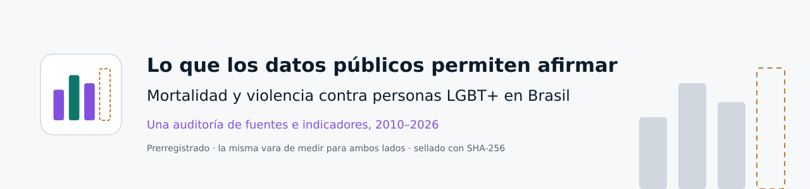
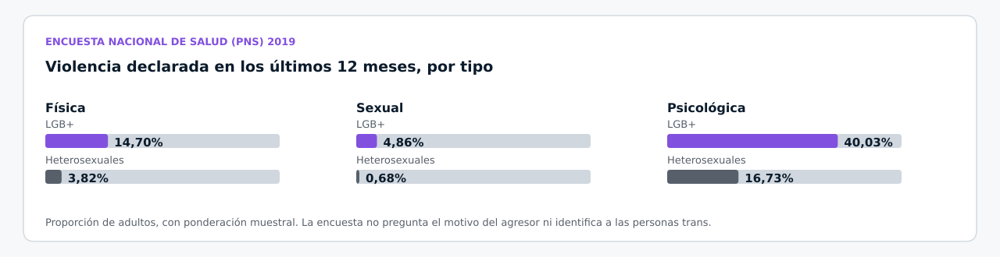

<div align="center">

<picture>
  <source media="(prefers-color-scheme: dark)" srcset="assets/brand/banner-es-dark.svg">
  
</picture>

<h3>La misma vara de medir para los dos lados del debate: qué miden los datos públicos brasileños sobre la violencia contra personas LGBT+, y qué no pueden medir.</h3>

[](https://doi.org/10.5281/zenodo.23873858)
[](LICENSE)
[](LICENSES/CC-BY-4.0.txt)
[](pyproject.toml)
[](tests/)
[](https://github.com/ulissesflores/lgbt-indicador-violencia/actions/workflows/verify.yml)
[](output/hash-chain.md)
[](REPRODUCIBILITY.md#pre-registrations)
[](https://colab.research.google.com/github/ulissesflores/lgbt-indicador-violencia/blob/main/colab/replication.ipynb)

[English](README.md) · [Português (Brasil)](README.pt-BR.md) · **Español** · [Italiano](README.it.md) · [עברית](README.he.md)

</div>

<picture>
  <source media="(prefers-color-scheme: dark)" srcset="assets/brand/findings-es-dark.svg">
  
</picture>

<picture>
  <source media="(prefers-color-scheme: dark)" srcset="assets/demo/verify-dark.gif">
  
</picture>
<p align="center"><sub>Reproducción de la verificación sellada, sin red: el sello y, después, las pruebas que fijan cada número publicado. Guion en <a href="https://github.com/charmbracelet/vhs">vhs</a> en <a href="assets/demo/">assets/demo/</a>; regrabada después del sello final. La grabación del terminal está en inglés.</sub></p>

> [!IMPORTANT]
> **Hallazgo.** En la Encuesta Nacional de Salud de 2019, el 14,70% de los adultos lesbianas, gais, bisexuales u otros no
> heterosexuales (LGB+) declaró violencia física en el año anterior, frente al 3,82% de los adultos heterosexuales; la
> razón ajustada es 2,82 (intervalo del 95%, 2,16 a 3,68). Los registros de defunción brasileños no recogen ni la
> orientación sexual ni la identidad de género, por lo que no existe una tasa nacional de mortalidad LGBT+. De 160 casos
> muestreados de la lista del Grupo Gay da Bahia de 2019, 50 se confirmaron por la fuente citada (48 por noticias): la
> lista no es ni una tasa ni un total, y los casos no verificados no son casos inventados. Tras 67 cambios de partido del
> gobernador, la tasa de homicidios del estado, en relación con la nacional, varió −0,7% (mediana), frente a +4,6% sin
> cambio; solo en los 21 cambios sin otro cambio cercano la caída es marcada (−10,2%, frente a +6,7%). La comparación
> es exploratoria y muestra coincidencia, no un efecto del gobierno.

## El artículo

*Mortalidad y violencia contra personas LGBT+ en Brasil: lo que los datos públicos permiten afirmar.* La edición en
español saldrá con DOI propio; hasta entonces, el artículo está en inglés y en portugués:

| Edición | Archivo |
|---|---|
| Inglés | [`docs/paper/paper-final-en.pdf`](docs/paper/paper-final-en.pdf) |
| Portugués (Brasil), original | [`docs/paper/paper-final.pdf`](docs/paper/paper-final.pdf) |

Las ediciones en español y en italiano de la v1.2.0 no forman parte de esta versión: traen dos lecturas corregidas en
[`docs/corrections.md`](docs/corrections.md) y volverán, cada una con su propio DOI. Cada edición tiene su propio DOI y
figuras con etiquetas en su idioma; el código de las figuras en `figures/` conserva las etiquetas en portugués del
estudio.

## Qué aporta este trabajo

1. **Una misma vara de medir para los dos lados del debate.** Veinticinco afirmaciones que circulan en el debate
   brasileño, de uno y otro lado, se contrastan con las mismas fuentes públicas y con un vocabulario de veredictos fijo,
   en el que "no verificable" es una respuesta y "falso" nunca se usa para una afirmación sobre motivación o
   mortalidad. Ocho componentes del análisis fueron prerregistrados, cada uno con su marca de tiempo y su SHA-256.
2. **Un reanálisis de la única encuesta que mide la brecha.** Los microdatos de la Encuesta Nacional de Salud de 2019,
   bajo el diseño muestral complejo: los adultos LGB+ declaran violencia física 3,84 veces más que los heterosexuales
   sin ajuste y 2,82 veces después de ajustar, y la brecha se mantiene con ajustes separados por estado civil, cónyuge
   en el hogar y modo de entrevista.
3. **Una auditoría por muestra aleatoria del recuento más citado.** 160 casos sorteados de la lista del Grupo Gay da
   Bahia de 2019, cada uno contrastado con la fuente que la propia lista cita. Cincuenta se confirman; la lista no es
   ni una tasa ni un total, y los casos no verificados no son casos inventados.
4. **Cada número publicado, convertido en prueba.** Las pruebas fijan cada número del artículo al archivo que lo
   produjo, y un único hash de cadena SHA-256 sella código, pruebas, datos y resultados derivados. Los microdatos
   oficiales no se redistribuyen; los scripts los descargan y comprueban cada archivo contra el SHA-256 esperado.

## De un vistazo

| | |
|---|---|
| Qué es | El paquete de estudio del artículo: datos derivados, código, prerregistros, pruebas y el artículo en dos ediciones |
| Período | 2010–2026 |
| Fuentes | Encuesta Nacional de Salud de 2019 (PNS), registros de defunción (SIM), notificaciones de salud (Sinan), denuncias policiales (Anuario del FBSP), la línea Disque 100, la lista del Grupo Gay da Bahia, datos electorales (TSE) |
| Prerregistrado | 8 componentes (Tabla B2 del artículo) y el análisis del Disque 100, cada uno con su marca de tiempo y SHA-256, en [`preregistrations/`](preregistrations/) y junto al análisis que fija ([lista](REPRODUCIBILITY.md#pre-registrations)); el reanálisis de la PNS y el sorteo de los 160 casos de la lista no se prerregistraron |
| Comprobar el sello | Solo la biblioteca estándar de Python; segundos |
| Recalcular | Python 3.12+ y [`requirements.txt`](requirements.txt); minutos |
| No distribuido | Nombres de víctimas, PDF y textos de noticias de terceros, microdatos oficiales en bruto (privacidad o licencia) |

## Cómo verificarlo

```bash
python3 -m pip install -r requirements.txt
python3 -I make_provenance.py --verify     # SHA-256 of every distributed file and the chain hash
python3 -I run_all.py --rapido             # integrity, tests and seal (seconds)
python3 -I run_all.py                      # also recomputes the derived results in a separate copy (minutes)
shasum -a 256 -c docs/paper/SHA256SUMS.txt # the paper PDF
```

Salida esperada de los dos primeros comandos (los scripts imprimen en el portugués del estudio):

```text
provenance verified: <chain hash> (<n> arquivos)
...
testes: <n>/<n> passaram (2 pulados)
provenance verified: <chain hash> (<n> arquivos)
```

El hash de la cadena de esta versión está en [`output/hash-chain.md`](output/hash-chain.md). Qué puede y qué no puede
volver a ejecutarse, y por qué, está en [`REPRODUCIBILITY.md`](REPRODUCIBILITY.md).

Sin instalar nada: [`colab/replication.ipynb`](colab/replication.ipynb) ([abrir en
Colab](https://colab.research.google.com/github/ulissesflores/lgbt-indicador-violencia/blob/main/colab/replication.ipynb))
clona este repositorio, verifica el sello, ejecuta `run_all.py` y muestra cada número que imprime el artículo junto al
valor del archivo que lo contiene; opcionalmente descarga del IBGE los microdatos de la PNS 2019 y vuelve a ejecutar
los cinco scripts que los leen.

## Resultados

Ocho de las veinticinco afirmaciones contrastadas en el artículo (Tabla 2 de la edición en inglés), condensadas de su texto.
Los cuatro números principales están dibujados en las tarjetas de la parte superior de esta página.

<picture>
  <source media="(prefers-color-scheme: dark)" srcset="assets/brand/results-es-dark.svg">
  
</picture>

| Afirmación en el debate | Qué muestran los datos | Qué no muestran |
|---|---|---|
| Los adultos LGB+ declaran más violencia física que los adultos heterosexuales | 14,70% frente a 3,82% en 12 meses, razón ajustada 2,82 | El tipo de agresor ni el motivo |
| También declaran más violencia sexual y psicológica | Sexual 4,86% frente a 0,68%; psicológica 40,03% frente a 16,73% | El motivo; las personas trans no se identifican |
| Las denuncias policiales de homofobia y transfobia se dispararon, luego la violencia se disparó | Las denuncias pasaron de 783 (2022) a 3.481 (2025), y la misma serie es compatible con una violencia estable, en aumento o en descenso | Que la violencia se mantuvo estable |
| Las personas LGBT+ mueren más en Brasil | El certificado de defunción no registra ni la orientación sexual ni la identidad de género, por lo que no existe una tasa nacional | Que mueran en la misma proporción |
| Las personas LGB+ mueren más fuera de Brasil | En Inglaterra y Gales, quienes se declararon LGB+ en el Censo tuvieron una mortalidad por todas las causas 31% mayor (razón 1,31) | No es homicidio, y no se aplica a Brasil |
| Las cifras del Grupo Gay da Bahia son inventadas | En 50 de los 160 casos sorteados de 2019, la fuente citada respaldaba una muerte violenta y una víctima LGBT+ | Que la lista sea completa |
| Un gobierno de derecha (o de izquierda) cambia los niveles de homicidio | El panel no halló una asociación detectable entre el partido del gobernador y el homicidio general (de −12,3% a +12,4%); en los 21 cambios de partido sin otro cambio cercano, la tasa del estado en relación con la de Brasil cayó (−10,2%, frente a +6,7%), en un análisis exploratorio | Que el gobierno sea irrelevante |
| Brasil es el país que más personas LGBT+ mata | La búsqueda solo halló comparaciones de muertes notificadas de personas trans, sin cobertura común entre países; en el Parlamento, 1 de 49 intervenciones que usan esta frase cita una fuente primaria | Que Brasil mate poco |

Dónde está cada resultado en el repositorio, archivo por archivo:
[`docs/reproducibility-and-result-locations.md`](docs/reproducibility-and-result-locations.md).

## Qué se afirma y qué no

| Se afirma | No se afirma |
|---|---|
| Los adultos LGB+ declaran más violencia física, sexual y psicológica que los adultos heterosexuales (2019) | Que esta brecha mida discriminación o estilo de vida: los datos no separan una cosa de la otra |
| Ningún registro público permite una tasa nacional de mortalidad LGBT+ | Que las personas LGBT+ sean o no asesinadas con más frecuencia que otras |
| Las denuncias policiales, las denuncias a la línea telefónica y las notificaciones miden el registro | Que la violencia contra personas LGBT+ haya subido o bajado bajo cualquier gobierno |
| La tasa de homicidios del estado, en relación con la nacional, cayó tras los 21 cambios de partido del gobernador sin otro cambio cercano (−10,2%, frente a +6,7%); comparación exploratoria | Que esa caída sea efecto del gobierno |
| 50 de los 160 casos muestreados de la lista de 2019 (31,3%) son verificables a partir de la fuente que la propia lista cita | Que la lista sea completa, o que sea inventada |

## Integridad

[`output/hash-chain.md`](output/hash-chain.md) contiene un único hash de cadena SHA-256 sobre todos los archivos
distribuidos: código, pruebas, datos, prerregistros y resultados derivados. Para comprobar que nada cambió desde el
sello:

```bash
python3 -I make_provenance.py --verify
```

Basta con la biblioteca estándar. Dos carpetas quedan fuera del sello por diseño: `docs/paper/`, comprobada por su
propio [`SHA256SUMS.txt`](docs/paper/SHA256SUMS.txt), y `assets/demo/`, cuya grabación muestra el hash de la cadena y se
hace después del sello.

## Qué hay en este repositorio

| Carpeta o archivo | Contenido |
|---|---|
| `data/` | Datos derivados y el código que los produce: reanálisis de la encuesta (`pns/`), tasas de mortalidad (`sim/`), notificaciones de violencia (`sinan/`), denuncias policiales (`anuario/`), la línea telefónica Disque 100 (`disque100/`), el panel de gobernadores (`painel/`, `presidencia/`, `exposicao/`) |
| `analysis/` | Los demás análisis en los que se apoya el artículo: auditoría de la lista del Grupo Gay da Bahia (`ggb-audit/`, `ggb-series/`, `counterpoint/`), potencia y costo de la encuesta (`survey-cost/`), simulación de identificabilidad (`simulation/`), discurso público (`discourse/`), pruebas de robustez (`robustness/`), puntuaciones de ideología (`ideology/`), literatura (`literature/`, `full-text/`) |
| `figures/` | Código y datos de cada figura (`make_figures.py`, `fontes/` con los valores representados) y las figuras del artículo (`article/`) |
| `preregistrations/` | Prerregistros con sus marcas de tiempo y SHA-256, tal como se citan en el artículo |
| `sources/` | Copias de fuentes públicas usadas por los scripts (`public/`), los registros de fuentes (`ledgers/`) y los cuartiles de revistas |
| `manifest/` | Manifiesto de fuentes (URL, fecha de acceso y, cuando se guardó un archivo, SHA-256), inventario público y las sumas de verificación del sello |
| `docs/` | Reproducibilidad y ubicación de cada resultado (`reproducibility-and-result-locations.md`), uso de modelos de lenguaje (`language-model-use.md`) y correcciones (`corrections.md`), en inglés y en portugués (`.pt-BR.md`); el artículo (`paper/`) |
| `assets/` | El arte de este README, dibujado por código a partir de los datos sellados (`brand/make_brand.py`), la marca del laboratorio y la grabación de terminal con sus guiones vhs (`demo/`) |
| `tests/` | Pruebas que vinculan cada número publicado con el archivo que lo produjo |
| `scripts/` | Descarga de los microdatos oficiales (con el SHA-256 esperado), el ejecutor de la reproducción y las auditorías |
| `colab/` | El cuaderno de replicación: todas las comprobaciones anteriores, desde el repositorio, en Google Colab, sin instalar nada |
| `run_all.py`, `make_provenance.py`, `output/` | Verificación de integridad, recálculo y la cadena SHA-256 |

El manifiesto de fuentes (`manifest/MANIFESTO-FONTES.csv`) y el inventario público (`manifest/INVENTARIO-PUBLICO.md`)
cuentan 1022 identificadores de 20 registros; el repositorio contiene 182 scripts. El código, los comentarios y las
columnas de datos conservan el portugués original del estudio.

## Autor

<picture>
  <source media="(prefers-color-scheme: dark)" srcset="assets/brand/lab-lockup-dark.png">
  
</picture>

**Carlos Ulisses Flores** — CTO e investigador jefe, Codex Hash Research Laboratory; estudiante de maestría en
Inteligencia Artificial, American Global Tech University.

[](https://orcid.org/0000-0002-6034-7765)
[](https://ulissesflores.com)
[](https://lattes.cnpq.br/6905246706890561)

Cómo se usaron los modelos de lenguaje, y dónde no se usaron, está en
[`docs/language-model-use.md`](docs/language-model-use.md).

## Cita

Cite el DOI de abajo para referirse al estudio; siempre resuelve a la versión más reciente. Cada versión y cada
edición del artículo tiene además su propio DOI en Zenodo.

```bibtex
@dataset{flores_lgbt_indicador_violencia,
  author    = {Flores, Carlos Ulisses},
  title     = {Mortality and violence against LGBT+ people in Brazil: what public data allow us to claim --- an audit of sources and indicators, 2010--2026},
  year      = {2026},
  publisher = {Zenodo},
  doi       = {10.5281/zenodo.23873858},
  url       = {https://doi.org/10.5281/zenodo.23873858}
}
```

El botón "Cite this repository" de GitHub lee [`CITATION.cff`](CITATION.cff).

## Licencia

Código: Apache-2.0 ([`LICENSE`](LICENSE), [`LICENSES/Apache-2.0.txt`](LICENSES/Apache-2.0.txt)). Datos derivados, texto y
figuras: CC BY 4.0 ([`LICENSES/CC-BY-4.0.txt`](LICENSES/CC-BY-4.0.txt)). La marca del Codex Hash Research Laboratory
(`assets/brand/lab-lockup-*.png`) no está cubierta por ninguna de las dos licencias. Los microdatos oficiales de IBGE,
DATASUS y TSE conservan sus propios términos y no se redistribuyen. Véase [`NOTICE`](NOTICE).

## Referencias ancla

Las obras frente a las cuales se construyó este paquete: el problema del indicador que pone a prueba, las fuentes
oficiales que audita y los conteos de la sociedad civil que lee. La lista completa está en el artículo.

- Campbell, D. T. (1979). Assessing the impact of planned social change. *Evaluation and Program Planning*, 2(1), 67–90. Reprinted in *Journal of MultiDisciplinary Evaluation*, 7(15), 3–43, 2011. https://doi.org/10.56645/jmde.v7i15.297
- Grupo Gay da Bahia. (2020). *Mortes violentas de LGBT+ no Brasil, 2019: Relatório do Grupo Gay da Bahia*. https://grupogaydabahia.com.br/wp-content/uploads/bsk-pdf-manager/2024/02/relatorio-2019.pdf
- Instituto Brasileiro de Geografia e Estatística. (2022). *Pesquisa Nacional de Saúde 2019: Orientação sexual autoidentificada da população adulta*. https://biblioteca.ibge.gov.br/visualizacao/livros/liv101934.pdf
- Instituto de Pesquisa Econômica Aplicada & Fórum Brasileiro de Segurança Pública. (2025). *Atlas da Violência 2025*. https://repositorio.ipea.gov.br/handle/11058/17165
- Fórum Brasileiro de Segurança Pública. (2025). *Anuário Brasileiro de Segurança Pública 2025*. https://forumseguranca.org.br/wp-content/uploads/2025/07/anuario-2025.pdf
- Benevides, B. G. (2026). *Dossiê: Assassinatos e violências contra travestis e transexuais brasileiras em 2025*. Associação Nacional de Travestis e Transexuais. https://antrabrasil.org/wp-content/uploads/2026/01/dossie-antra-2026.pdf
