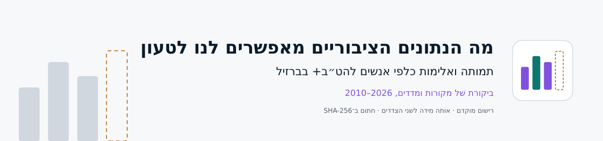
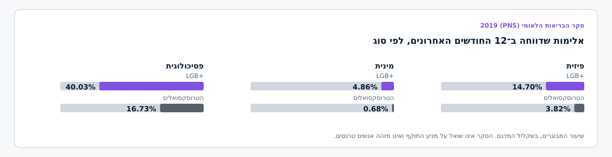

<div align="center">

<picture>
  <source media="(prefers-color-scheme: dark)" srcset="assets/brand/banner-he-dark.svg">
  
</picture>

<h3>אותה מידה לשני צדי הוויכוח: מה הנתונים הציבוריים בברזיל מודדים על אלימות כלפי אנשים להט״ב+, ומה הם אינם יכולים למדוד.</h3>

[](https://doi.org/10.5281/zenodo.23873858)
[](LICENSE)
[](LICENSES/CC-BY-4.0.txt)
[](pyproject.toml)
[](tests/)
[](https://github.com/ulissesflores/lgbt-indicador-violencia/actions/workflows/verify.yml)
[](output/hash-chain.md)
[](REPRODUCIBILITY.md#pre-registrations)
[](https://colab.research.google.com/github/ulissesflores/lgbt-indicador-violencia/blob/main/colab/replication.ipynb)

[English](README.md) · [Português (Brasil)](README.pt-BR.md) · [Español](README.es.md) · [Italiano](README.it.md) · **עברית**

</div>

<div dir="rtl">

<picture>
  <source media="(prefers-color-scheme: dark)" srcset="assets/brand/findings-he-dark.svg">
  
</picture>

<picture>
  <source media="(prefers-color-scheme: dark)" srcset="assets/demo/verify-dark.gif">
  
</picture>
<p align="center"><sub>הפעלה חוזרת של הבדיקה החתומה, ללא רשת: החותם, ואחריו הבדיקות שקושרות כל מספר שפורסם. תסריט ב־<a href="https://github.com/charmbracelet/vhs">vhs</a> ב־<a href="assets/demo/">assets/demo/</a>; מוקלט מחדש אחרי החותם הסופי. הקלטת המסוף באנגלית.</sub></p>

</div>

> [!IMPORTANT]
> **ממצא.** בסקר הבריאות הלאומי של 2019 דיווחו 14.70% מהמבוגרים הלסביות, ההומואים, הביסקסואלים או בעלי נטייה לא־הטרוסקסואלית
> אחרת (LGB+‎) על אלימות פיזית בשנה הקודמת, לעומת 3.82% מהמבוגרים ההטרוסקסואלים; היחס המתוקנן הוא 2.82 (רווח של 95%,
> 2.16 עד 3.68). רישומי הפטירה בברזיל אינם כוללים לא נטייה מינית ולא זהות מגדרית, ולכן אין שיעור תמותה לאומי של אנשים
> להט״ב+. מתוך 160 מקרים שנדגמו מרשימת Grupo Gay da Bahia לשנת 2019, 50 אומתו על ידי המקור המצוטט (48 מהם בדיווחים
> חדשותיים): הרשימה אינה שיעור ואינה סך כולל, ומקרים שלא אומתו אינם מקרים מומצאים. לאחר 67 החלפות של מפלגת המושל,
> שיעור הרצח במדינה, ביחס לשיעור הארצי, השתנה ב־‎−0.7%‎ (חציון), לעומת ‎+4.6%‎ ללא החלפה; רק ב־21 ההחלפות שאין
> בקרבתן החלפה אחרת הירידה ניכרת (‎−10.2%‎, לעומת ‎+6.7%‎). ההשוואה היא גישושית ומראה צירוף מקרים, לא השפעה של
> הממשלה.

<div dir="rtl">

## המאמר

קוראי עברית יכולים להיעזר במהדורה האנגלית:

| מהדורה | קובץ |
|---|---|
| אנגלית | [`docs/paper/paper-final-en.pdf`](docs/paper/paper-final-en.pdf) |
| פורטוגזית (ברזיל), מקור | [`docs/paper/paper-final.pdf`](docs/paper/paper-final.pdf) |

לכל מהדורה DOI משלה, והתוויות באיורים שלה כתובות בשפתה; קוד האיורים ב־`figures/` שומר על התוויות בפורטוגזית של
המחקר. המהדורות בספרדית ובאיטלקית של גרסה v1.2.0 אינן חלק מגרסה זו: הן כוללות שתי קריאות שתוקנו
ב־[`docs/corrections.md`](docs/corrections.md); הן ישובו, כל אחת עם DOI משלה.

## מה העבודה הזו תורמת

1. **מידה אחת לשני צדי הוויכוח.** עשרים וחמש טענות שמסתובבות בוויכוח הברזילאי, משני הצדדים, נבדקות מול אותם מקורות
   ציבוריים בעזרת אוצר מילים קבוע של פסקי דין, שבו "לא ניתן לבדיקה" הוא תשובה ואילו "שקר" אינו משמש לעולם לטענה על
   מניע או על תמותה. שמונה רכיבים של הניתוח נרשמו מראש, כל אחד עם חותמת הזמן שלו וערך ה־SHA-256 שלו.
2. **ניתוח חוזר של הסקר היחיד שמודד את הפער.** המיקרו־נתונים של סקר הבריאות הלאומי של 2019, בתכנון הדגימה המורכב:
   מבוגרים LGB+‎ מדווחים על אלימות פיזית פי 3.84 ממבוגרים הטרוסקסואלים ללא תיקון ופי 2.82 לאחר התיקון, והפער נשמר
   בתיקונים נפרדים לפי מצב משפחתי, בן או בת זוג במשק הבית ואופן הראיון.
3. **ביקורת של הספירה המצוטטת ביותר באמצעות מדגם אקראי.** 160 מקרים שנדגמו מרשימת Grupo Gay da Bahia לשנת 2019,
   כל אחד נבדק מול המקור שהרשימה עצמה מצטטת. חמישים אומתו; הרשימה אינה שיעור ואינה סך כולל, ומקרים שלא אומתו אינם
   מקרים מומצאים.
4. **כל מספר שפורסם הופך לבדיקה.** הבדיקות קושרות כל מספר במאמר לקובץ שהפיק אותו, וערך גיבוב יחיד של שרשרת SHA-256
   חותם קוד, בדיקות, נתונים ותוצאות נגזרות. המיקרו־נתונים הרשמיים אינם מופצים מחדש; הסקריפטים מורידים אותם ובודקים
   כל קובץ מול ערך ה־SHA-256 הצפוי.

## במבט אחד

| | |
|---|---|
| מה זה | חבילת המחקר של המאמר: נתונים נגזרים, קוד, רישומים מוקדמים, בדיקות והמאמר בשתי מהדורות |
| תקופה | 2010–2026 |
| מקורות | סקר הבריאות הלאומי של 2019 (PNS), רישומי פטירה (SIM), דיווחי בריאות (Sinan), תלונות במשטרה (Anuário של FBSP), קו הפניות Disque 100, רשימת Grupo Gay da Bahia, נתוני בחירות (TSE) |
| נרשם מראש | 8 רכיבים (טבלה B2 במאמר) והניתוח של Disque 100, כל אחד עם חותמת הזמן שלו וערך ה־SHA-256 שלו, ב־[`preregistrations/`](preregistrations/) ולצד הניתוח שהוא מקבע ([רשימה](REPRODUCIBILITY.md#pre-registrations)); הניתוח החוזר של ה־PNS והגרלת 160 המקרים מהרשימה לא נרשמו מראש |
| בדיקת החותם | ספריית הסטנדרט של Python בלבד; שניות |
| חישוב מחדש | Python 3.12+ ו־[`requirements.txt`](requirements.txt); דקות |
| לא מופץ | שמות של קורבנות, קובצי PDF וטקסטים חדשותיים של צדדים שלישיים, מיקרו־נתונים רשמיים גולמיים (פרטיות או רישיון) |

## איך לבדוק

<div dir="ltr">

```bash
python3 -m pip install -r requirements.txt
python3 -I make_provenance.py --verify     # SHA-256 of every distributed file and the chain hash
python3 -I run_all.py --rapido             # integrity, tests and seal (seconds)
python3 -I run_all.py                      # also recomputes the derived results in a separate copy (minutes)
shasum -a 256 -c docs/paper/SHA256SUMS.txt # the paper PDF
```

</div>

הפלט הצפוי של שתי הפקודות הראשונות (הסקריפטים מדפיסים בפורטוגזית של המחקר):

<div dir="ltr">

```text
provenance verified: <chain hash> (<n> arquivos)
...
testes: <n>/<n> passaram (2 pulados)
provenance verified: <chain hash> (<n> arquivos)
```

</div>

ערך הגיבוב של השרשרת בגרסה זו נמצא ב־[`output/hash-chain.md`](output/hash-chain.md). מה ניתן ומה לא ניתן להריץ מחדש,
ומדוע, מפורט ב־[`REPRODUCIBILITY.md`](REPRODUCIBILITY.md).

ללא התקנה: [`colab/replication.ipynb`](colab/replication.ipynb) ([פתיחה ב־Colab](https://colab.research.google.com/github/ulissesflores/lgbt-indicador-violencia/blob/main/colab/replication.ipynb)) משכפל את המאגר, מאמת את החותם, מריץ את `run_all.py` ומציג כל מספר שהמאמר מדפיס לצד הערך בקובץ שמחזיק אותו; אפשר גם להוריד מה־IBGE את נתוני המיקרו של PNS 2019 ולהריץ מחדש את חמשת הסקריפטים שקוראים אותם.

## תוצאות

שמונה מתוך עשרים וחמש הטענות שנבדקו במאמר (טבלה 2 במהדורה האנגלית), בתמצית מתוך ניסוחו. ארבעת המספרים המרכזיים מצוירים בכרטיסים
בראש הדף הזה.

<picture>
  <source media="(prefers-color-scheme: dark)" srcset="assets/brand/results-he-dark.svg">
  
</picture>

| הטענה בוויכוח | מה הנתונים מראים | מה הם אינם מראים |
|---|---|---|
| מבוגרים LGB+‎ מדווחים על יותר אלימות פיזית ממבוגרים הטרוסקסואלים | 14.70% לעומת 3.82% ב־12 חודשים, יחס מתוקן 2.82 | את סוג התוקף או את המניע |
| הם מדווחים גם על יותר אלימות מינית ופסיכולוגית | מינית 4.86% לעומת 0.68%; פסיכולוגית 40.03% לעומת 16.73% | את המניע; אנשים טרנסים אינם מזוהים |
| התלונות במשטרה על הומופוביה וטרנספוביה זינקו, ולכן האלימות זינקה | התלונות עלו מ־783 (2022) ל־3,481 (2025), ואותה סדרה מתיישבת עם אלימות יציבה, עולה או יורדת | שהאלימות נשארה יציבה |
| אנשים להט״ב+ מתים יותר בברזיל | תעודת הפטירה אינה רושמת לא נטייה מינית ולא זהות מגדרית, ולכן אין שיעור לאומי | שהם מתים באותו יחס |
| אנשים LGB+‎ מתים יותר מחוץ לברזיל | באנגליה ובוויילס, מי שהצהירו במפקד על עצמם כ־LGB+‎ היו בעלי תמותה כללית גבוהה ב־31% (יחס 1.31) | זה אינו רצח, ואינו חל על ברזיל |
| המספרים של Grupo Gay da Bahia מומצאים | ב־50 מתוך 160 המקרים שנדגמו אקראית מ־2019, המקור המצוטט תמך במוות אלים ובקורבן להט״ב+ | שהרשימה שלמה |
| ממשלת ימין (או שמאל) משנה את רמות הרצח | הפאנל לא מצא קשר שניתן לזיהוי בין מפלגת המושל לבין הרצח הכללי (מ־‎−12.3%‎ עד ‎+12.4%‎); ב־21 ההחלפות של מפלגה שאין בקרבתן החלפה אחרת, שיעור המדינה ביחס לשיעור ברזיל ירד (‎−10.2%‎, לעומת ‎+6.7%‎), בניתוח גישושי | שהממשלה חסרת חשיבות |
| ברזיל היא המדינה שהורגת הכי הרבה אנשים להט״ב+ | החיפוש מצא רק השוואות של מקרי מוות מדווחים של אנשים טרנסים, ללא כיסוי משותף בין מדינות; בפרלמנט, 1 מתוך 49 נאומים שמשתמשים בביטוי הזה מצטט מקור ראשוני | שברזיל הורגת מעט |

היכן נמצאת כל תוצאה במאגר, קובץ אחר קובץ:
[`docs/reproducibility-and-result-locations.md`](docs/reproducibility-and-result-locations.md).

## מה נטען ומה אינו נטען

| נטען | לא נטען |
|---|---|
| מבוגרים LGB+‎ מדווחים על יותר אלימות פיזית, מינית ופסיכולוגית ממבוגרים הטרוסקסואלים (2019) | שהפער הזה מודד אפליה או אורח חיים: הנתונים אינם מפרידים בין השניים |
| אף רישום ציבורי אינו מאפשר שיעור תמותה לאומי של אנשים להט״ב+ | שאנשים להט״ב+ נהרגים, או אינם נהרגים, לעתים קרובות יותר מאחרים |
| תלונות במשטרה, פניות לקו הפניות ודיווחים מודדים רישום | שהאלימות נגד אנשים להט״ב+ עלתה או ירדה תחת ממשלה כלשהי |
| שיעור הרצח במדינה, ביחס לשיעור הארצי, ירד לאחר 21 ההחלפות של מפלגת המושל שאין בקרבתן החלפה אחרת (‎−10.2%‎, לעומת ‎+6.7%‎); השוואה גישושית | שהירידה הזו היא השפעה של הממשלה |
| 50 מתוך 160 המקרים שנדגמו מרשימת 2019 (31.3%) ניתנים לאימות מהמקור שהרשימה עצמה מצטטת | שהרשימה שלמה, או שהיא מומצאת |

## שלמות

[`output/hash-chain.md`](output/hash-chain.md) מחזיק ערך גיבוב יחיד של שרשרת SHA-256 על כל הקבצים המופצים: קוד, בדיקות,
נתונים, רישומים מוקדמים ותוצאות נגזרות. כדי לוודא שדבר לא השתנה מאז החתימה:

<div dir="ltr">

```bash
python3 -I make_provenance.py --verify
```

</div>

די בספריית הסטנדרט. שתי תיקיות נשארות מחוץ לחותם בכוונה: `docs/paper/`, שנבדקת על ידי
[`SHA256SUMS.txt`](docs/paper/SHA256SUMS.txt) משלה, ו־`assets/demo/`, שההקלטה בה מציגה את ערך הגיבוב של השרשרת ונעשית
אחרי החותם.

## מה יש במאגר הזה

| תיקייה או קובץ | תוכן |
|---|---|
| `data/` | נתונים נגזרים והקוד שמפיק אותם: ניתוח חוזר של הסקר (`pns/`), שיעורי תמותה (`sim/`), דיווחים על אלימות (`sinan/`), תלונות במשטרה (`anuario/`), קו הפניות Disque 100 (`disque100/`), פאנל המושלים (`painel/`, `presidencia/`, `exposicao/`) |
| `analysis/` | שאר הניתוחים שהמאמר נשען עליהם: ביקורת על רשימת Grupo Gay da Bahia (`ggb-audit/`, `ggb-series/`, `counterpoint/`), עוצמה סטטיסטית ועלות של הסקר (`survey-cost/`), סימולציה של יכולת הזיהוי (`simulation/`), שיח ציבורי (`discourse/`), בדיקות חוסן (`robustness/`), ציוני אידאולוגיה (`ideology/`), ספרות (`literature/`, `full-text/`) |
| `figures/` | קוד ונתונים לכל איור (`make_figures.py`, `fontes/` עם הערכים המוצגים) והאיורים של המאמר (`article/`) |
| `preregistrations/` | רישומים מוקדמים עם חותמות הזמן וערכי ה־SHA-256 שלהם, כפי שהם מצוטטים במאמר |
| `sources/` | עותקים של מקורות ציבוריים שהסקריפטים משתמשים בהם (`public/`), פנקסי המקורות (`ledgers/`) ורבעוני כתבי העת |
| `manifest/` | מניפסט המקורות (URL, תאריך גישה, וכאשר נשמר קובץ, SHA-256), המלאי הציבורי וסכומי הביקורת של החותם |
| `docs/` | שחזוריות ומיקום כל תוצאה (`reproducibility-and-result-locations.md`), שימוש במודלי שפה (`language-model-use.md`) ותיקונים (`corrections.md`), באנגלית ובפורטוגזית (`.pt-BR.md`); המאמר (`paper/`) |
| `assets/` | האמנות של ה־README הזה, מצוירת בקוד מהנתונים החתומים (`brand/make_brand.py`), סימן המעבדה, והקלטת המסוף עם תסריטי ה־vhs שלה (`demo/`) |
| `tests/` | בדיקות שקושרות כל מספר שפורסם לקובץ שהפיק אותו |
| `scripts/` | הורדת המיקרו־נתונים הרשמיים (עם ערך ה־SHA-256 הצפוי), מריץ השחזור והביקורות |
| `colab/` | מחברת השחזור: כל הבדיקות שלמעלה, מתוך המאגר, ב־Google Colab וללא התקנה |
| `run_all.py`, `make_provenance.py`, `output/` | בדיקת שלמות, חישוב מחדש ושרשרת ה־SHA-256 |

מניפסט המקורות (`manifest/MANIFESTO-FONTES.csv`) והמלאי הציבורי (`manifest/INVENTARIO-PUBLICO.md`) מונים 1022 מזהים
מתוך 20 פנקסים; המאגר מכיל 182 סקריפטים. הקוד, ההערות ועמודות הנתונים שומרים על הפורטוגזית המקורית של המחקר.

## מחבר

<picture>
  <source media="(prefers-color-scheme: dark)" srcset="assets/brand/lab-lockup-dark.png">
  
</picture>

**Carlos Ulisses Flores** — CTO וחוקר ראשי, Codex Hash Research Laboratory; סטודנט לתואר שני בבינה מלאכותית, American Global Tech University.

[](https://orcid.org/0000-0002-6034-7765)
[](https://ulissesflores.com)
[](https://lattes.cnpq.br/6905246706890561)

כיצד נעשה שימוש במודלי שפה, והיכן לא נעשה בהם שימוש, מפורט ב־[`docs/language-model-use.md`](docs/language-model-use.md).

## ציטוט

יש לצטט את ה־DOI שלהלן כדי להפנות למחקר; הוא מפנה תמיד לגרסה העדכנית ביותר. לכל גרסה ולכל מהדורה של המאמר יש גם DOI
משלה ב־Zenodo.

<div dir="ltr">

```bibtex
@dataset{flores_lgbt_indicador_violencia,
  author    = {Flores, Carlos Ulisses},
  title     = {Mortality and violence against LGBT+ people in Brazil: what public data allow us to claim --- an audit of sources and indicators, 2010--2026},
  year      = {2026},
  publisher = {Zenodo},
  doi       = {10.5281/zenodo.23873858},
  url       = {https://doi.org/10.5281/zenodo.23873858}
}
```

</div>

הכפתור "Cite this repository" של GitHub קורא את [`CITATION.cff`](CITATION.cff).

## רישיון

קוד: Apache-2.0 ([`LICENSE`](LICENSE), [`LICENSES/Apache-2.0.txt`](LICENSES/Apache-2.0.txt)). נתונים נגזרים, טקסט
ואיורים: CC BY 4.0 ([`LICENSES/CC-BY-4.0.txt`](LICENSES/CC-BY-4.0.txt)). סימן Codex Hash Research Laboratory
(`assets/brand/lab-lockup-*.png`) אינו מכוסה באף אחד משני הרישיונות. המיקרו־נתונים הרשמיים של IBGE, DATASUS ו־TSE
כפופים לתנאים שלהם ואינם מופצים מחדש. ראו [`NOTICE`](NOTICE).

## מקורות עוגן

היצירות שמולן נבנתה החבילה הזאת: בעיית המדד שהיא בודקת, המקורות הרשמיים שהיא מבקרת וספירות החברה
האזרחית שהיא קוראת. הרשימה המלאה נמצאת במאמר.

- Campbell, D. T. (1979). Assessing the impact of planned social change. *Evaluation and Program Planning*, 2(1), 67–90. Reprinted in *Journal of MultiDisciplinary Evaluation*, 7(15), 3–43, 2011. https://doi.org/10.56645/jmde.v7i15.297
- Grupo Gay da Bahia. (2020). *Mortes violentas de LGBT+ no Brasil, 2019: Relatório do Grupo Gay da Bahia*. https://grupogaydabahia.com.br/wp-content/uploads/bsk-pdf-manager/2024/02/relatorio-2019.pdf
- Instituto Brasileiro de Geografia e Estatística. (2022). *Pesquisa Nacional de Saúde 2019: Orientação sexual autoidentificada da população adulta*. https://biblioteca.ibge.gov.br/visualizacao/livros/liv101934.pdf
- Instituto de Pesquisa Econômica Aplicada & Fórum Brasileiro de Segurança Pública. (2025). *Atlas da Violência 2025*. https://repositorio.ipea.gov.br/handle/11058/17165
- Fórum Brasileiro de Segurança Pública. (2025). *Anuário Brasileiro de Segurança Pública 2025*. https://forumseguranca.org.br/wp-content/uploads/2025/07/anuario-2025.pdf
- Benevides, B. G. (2026). *Dossiê: Assassinatos e violências contra travestis e transexuais brasileiras em 2025*. Associação Nacional de Travestis e Transexuais. https://antrabrasil.org/wp-content/uploads/2026/01/dossie-antra-2026.pdf

</div>
