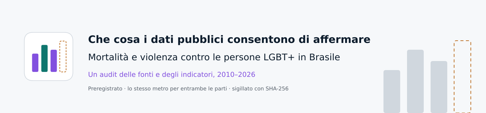
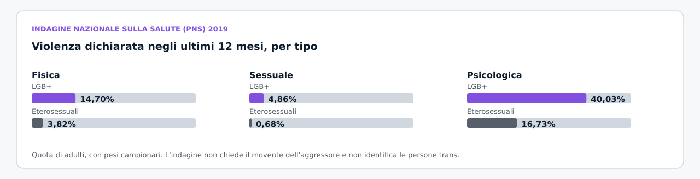

<div align="center">

<picture>
  <source media="(prefers-color-scheme: dark)" srcset="assets/brand/banner-it-dark.svg">
  
</picture>

<h3>Lo stesso metro per i due lati del dibattito: che cosa misurano i dati pubblici brasiliani sulla violenza contro le persone LGBT+, e che cosa non riescono a misurare.</h3>

[](https://doi.org/10.5281/zenodo.23873858)
[](LICENSE)
[](LICENSES/CC-BY-4.0.txt)
[](pyproject.toml)
[](tests/)
[](https://github.com/ulissesflores/lgbt-indicador-violencia/actions/workflows/verify.yml)
[](output/hash-chain.md)
[](REPRODUCIBILITY.md#pre-registrations)
[](https://colab.research.google.com/github/ulissesflores/lgbt-indicador-violencia/blob/main/colab/replication.ipynb)

[English](README.md) · [Português (Brasil)](README.pt-BR.md) · [Español](README.es.md) · **Italiano** · [עברית](README.he.md)

</div>

<picture>
  <source media="(prefers-color-scheme: dark)" srcset="assets/brand/findings-it-dark.svg">
  
</picture>

<picture>
  <source media="(prefers-color-scheme: dark)" srcset="assets/demo/verify-dark.gif">
  
</picture>
<p align="center"><sub>Riproduzione della verifica sigillata, senza rete: il sigillo e, poi, i test che vincolano ogni numero pubblicato. Script in <a href="https://github.com/charmbracelet/vhs">vhs</a> in <a href="assets/demo/">assets/demo/</a>; registrata di nuovo dopo il sigillo finale. La registrazione del terminale è in inglese.</sub></p>

> [!IMPORTANT]
> **Risultato.** Nell'Indagine nazionale sulla salute del 2019, il 14,70% degli adulti lesbiche, gay, bisessuali o di altro orientamento
> non eterosessuale (LGB+) ha dichiarato violenza fisica nell'anno precedente, contro il 3,82% degli adulti
> eterosessuali; il rapporto aggiustato è 2,82 (intervallo al 95%, da 2,16 a 3,68). I registri di morte brasiliani non
> riportano né l'orientamento sessuale né l'identità di genere, quindi non esiste un tasso nazionale di mortalità LGBT+.
> Dei 160 casi campionati dalla lista del Grupo Gay da Bahia per il 2019, 50 sono stati confermati dalla fonte citata (48
> da notizie): la lista non è né un tasso né un totale, e i casi non verificati non sono casi inventati. Dopo 67 cambi di
> partito del governatore, il tasso di omicidi dello stato, in rapporto a quello nazionale, è variato del −0,7% (mediana),
> contro il +4,6% senza cambio; solo nei 21 cambi senza un altro cambio vicino il calo è marcato (−10,2%, contro +6,7%).
> Il confronto è esplorativo e mostra una coincidenza, non un effetto del governo.

## L'articolo

*Mortalità e violenza contro le persone LGBT+ in Brasile: che cosa i dati pubblici permettono di affermare.* L'edizione
italiana uscirà con un DOI proprio; fino ad allora, l'articolo è in inglese e in portoghese:

| Edizione | File |
|---|---|
| Inglese | [`docs/paper/paper-final-en.pdf`](docs/paper/paper-final-en.pdf) |
| Portoghese (Brasile), originale | [`docs/paper/paper-final.pdf`](docs/paper/paper-final.pdf) |

Le edizioni spagnola e italiana della v1.2.0 non fanno parte di questa versione: riportano due letture corrette in
[`docs/corrections.md`](docs/corrections.md) e torneranno ciascuna con un proprio DOI. Ogni edizione ha un proprio DOI e
figure con etichette nella propria lingua; il codice delle figure in `figures/` mantiene le etichette in portoghese
dello studio.

## Che cosa apporta questo lavoro

1. **Un solo metro per i due lati del dibattito.** Venticinque affermazioni che circolano nel dibattito brasiliano, da
   una parte e dall'altra, sono verificate sulle stesse fonti pubbliche con un vocabolario di verdetti fisso, in cui
   "non verificabile" è una risposta e "falso" non viene mai usato per un'affermazione sulla motivazione o sulla
   mortalità. Otto componenti dell'analisi sono state preregistrate, ciascuna con la propria marca temporale e il
   proprio SHA-256.
2. **Una rianalisi dell'unica indagine che misura il divario.** I microdati dell'Indagine nazionale sulla salute del
   2019, con il disegno campionario complesso: gli adulti LGB+ dichiarano violenza fisica 3,84 volte più degli adulti
   eterosessuali senza aggiustamento e 2,82 volte dopo l'aggiustamento, e il divario resta con aggiustamenti separati
   per stato civile, coniuge in famiglia e modalità di intervista.
3. **Un audit con campione casuale del conteggio più citato.** 160 casi estratti dalla lista del Grupo Gay da Bahia per
   il 2019, ciascuno verificato sulla fonte che la lista stessa cita. Cinquanta sono confermati; la lista non è né un
   tasso né un totale, e i casi non verificati non sono casi inventati.
4. **Ogni numero pubblicato diventa un test.** I test vincolano ogni numero dell'articolo al file che lo ha prodotto, e
   un unico hash di catena SHA-256 sigilla codice, test, dati e risultati derivati. I microdati ufficiali non vengono
   ridistribuiti; gli script li scaricano e controllano ogni file rispetto allo SHA-256 atteso.

## In sintesi

| | |
|---|---|
| Che cos'è | Il pacchetto di studio dell'articolo: dati derivati, codice, preregistrazioni, test e l'articolo in due edizioni |
| Periodo | 2010–2026 |
| Fonti | Indagine nazionale sulla salute del 2019 (PNS), registri di morte (SIM), notifiche sanitarie (Sinan), denunce alla polizia (Annuario del FBSP), la linea Disque 100, la lista del Grupo Gay da Bahia, dati elettorali (TSE) |
| Preregistrato | 8 componenti (Tabella B2 dell'articolo) e l'analisi del Disque 100, ciascuno con la propria marca temporale e il proprio SHA-256, in [`preregistrations/`](preregistrations/) e accanto all'analisi che fissa ([elenco](REPRODUCIBILITY.md#pre-registrations)); la rianalisi della PNS e l'estrazione dei 160 casi della lista non sono state preregistrate |
| Verificare il sigillo | Solo la libreria standard di Python; secondi |
| Ricalcolare | Python 3.12+ e [`requirements.txt`](requirements.txt); minuti |
| Non distribuito | Nomi delle vittime, PDF e testi di notizie di terzi, microdati ufficiali grezzi (privacy o licenza) |

## Come verificarlo

```bash
python3 -m pip install -r requirements.txt
python3 -I make_provenance.py --verify     # SHA-256 of every distributed file and the chain hash
python3 -I run_all.py --rapido             # integrity, tests and seal (seconds)
python3 -I run_all.py                      # also recomputes the derived results in a separate copy (minutes)
shasum -a 256 -c docs/paper/SHA256SUMS.txt # the paper PDF
```

Output atteso dei primi due comandi (gli script stampano nel portoghese dello studio):

```text
provenance verified: <chain hash> (<n> arquivos)
...
testes: <n>/<n> passaram (2 pulados)
provenance verified: <chain hash> (<n> arquivos)
```

L'hash della catena di questa versione si trova in [`output/hash-chain.md`](output/hash-chain.md). Che cosa può e che
cosa non può essere rieseguito, e perché, è indicato in [`REPRODUCIBILITY.md`](REPRODUCIBILITY.md).

Senza installare nulla: [`colab/replication.ipynb`](colab/replication.ipynb) ([apri in
Colab](https://colab.research.google.com/github/ulissesflores/lgbt-indicador-violencia/blob/main/colab/replication.ipynb))
clona questo repository, verifica il sigillo, esegue `run_all.py` e mostra ogni numero stampato nell'articolo accanto
al valore del file che lo contiene; facoltativamente scarica dall'IBGE i microdati della PNS 2019 e riesegue i cinque
script che li leggono.

## Risultati

Otto delle venticinque affermazioni verificate nell'articolo (Tabella 2 dell'edizione in inglese), condensate dal suo testo. I
quattro numeri principali sono disegnati nelle schede in cima a questa pagina.

<picture>
  <source media="(prefers-color-scheme: dark)" srcset="assets/brand/results-it-dark.svg">
  
</picture>

| Affermazione nel dibattito | Che cosa mostrano i dati | Che cosa non mostrano |
|---|---|---|
| Gli adulti LGB+ dichiarano più violenza fisica degli adulti eterosessuali | 14,70% contro 3,82% in 12 mesi, rapporto aggiustato 2,82 | Il tipo di aggressore o il movente |
| Dichiarano anche più violenza sessuale e psicologica | Sessuale 4,86% contro 0,68%; psicologica 40,03% contro 16,73% | Il movente; le persone trans non sono identificate |
| Le denunce alla polizia di omofobia e transfobia sono esplose, quindi la violenza è esplosa | Le denunce sono passate da 783 (2022) a 3.481 (2025), e la stessa serie è compatibile con una violenza stabile, in aumento o in calo | Che la violenza sia rimasta stabile |
| Le persone LGBT+ muoiono di più in Brasile | Il certificato di morte non registra né l'orientamento sessuale né l'identità di genere, quindi non esiste un tasso nazionale | Che muoiano nella stessa proporzione |
| Le persone LGB+ muoiono di più fuori dal Brasile | In Inghilterra e Galles, chi si è dichiarato LGB+ nel Censimento ha avuto una mortalità per tutte le cause superiore del 31% (rapporto 1,31) | Non è omicidio, e non vale per il Brasile |
| Le cifre del Grupo Gay da Bahia sono inventate | In 50 dei 160 casi campionati a caso del 2019, la fonte citata sosteneva una morte violenta e una vittima LGBT+ | Che la lista sia completa |
| Un governo di destra (o di sinistra) cambia i livelli di omicidio | Il panel non ha trovato un'associazione rilevabile tra il partito del governatore e l'omicidio complessivo (da −12,3% a +12,4%); nei 21 cambi di partito senza un altro cambio vicino, il tasso dello stato in rapporto a quello del Brasile è diminuito (−10,2%, contro +6,7%), in un'analisi esplorativa | Che il governo sia irrilevante |
| Il Brasile è il paese che uccide più persone LGBT+ | La ricerca ha trovato solo confronti di morti segnalate di persone trans, senza una copertura comune tra i paesi; in Parlamento, 1 intervento su 49 che usano questa frase cita una fonte primaria | Che il Brasile uccida poco |

Dove si trova ciascun risultato nel repository, file per file:
[`docs/reproducibility-and-result-locations.md`](docs/reproducibility-and-result-locations.md).

## Che cosa si afferma e che cosa no

| Si afferma | Non si afferma |
|---|---|
| Gli adulti LGB+ dichiarano più violenza fisica, sessuale e psicologica degli adulti eterosessuali (2019) | Che questo divario misuri discriminazione o stile di vita: i dati non distinguono le due cose |
| Nessun registro pubblico consente un tasso nazionale di mortalità LGBT+ | Che le persone LGBT+ vengano o non vengano uccise più spesso di altre |
| Denunce alla polizia, segnalazioni alla linea telefonica e notifiche misurano la registrazione | Che la violenza contro le persone LGBT+ sia aumentata o diminuita sotto un qualsiasi governo |
| Il tasso di omicidi dello stato, in rapporto a quello nazionale, è diminuito dopo i 21 cambi di partito del governatore senza un altro cambio vicino (−10,2%, contro +6,7%); confronto esplorativo | Che questo calo sia un effetto del governo |
| 50 dei 160 casi campionati dalla lista del 2019 (31,3%) sono verificabili dalla fonte che la lista stessa cita | Che la lista sia completa, o che sia inventata |

## Integrità

[`output/hash-chain.md`](output/hash-chain.md) contiene un unico hash di catena SHA-256 su tutti i file distribuiti:
codice, test, dati, preregistrazioni e risultati derivati. Per verificare che nulla sia cambiato dal sigillo:

```bash
python3 -I make_provenance.py --verify
```

Basta la libreria standard. Due cartelle restano fuori dal sigillo per costruzione: `docs/paper/`, verificata dal
proprio [`SHA256SUMS.txt`](docs/paper/SHA256SUMS.txt), e `assets/demo/`, la cui registrazione mostra l'hash della
catena ed è fatta dopo il sigillo.

## Che cosa contiene questo repository

| Cartella o file | Contenuto |
|---|---|
| `data/` | Dati derivati e il codice che li produce: rianalisi dell'indagine (`pns/`), tassi di mortalità (`sim/`), notifiche di violenza (`sinan/`), denunce alla polizia (`anuario/`), la linea telefonica Disque 100 (`disque100/`), il panel dei governatori (`painel/`, `presidencia/`, `exposicao/`) |
| `analysis/` | Le altre analisi su cui si basa l'articolo: audit della lista del Grupo Gay da Bahia (`ggb-audit/`, `ggb-series/`, `counterpoint/`), potenza e costo dell'indagine (`survey-cost/`), simulazione di identificabilità (`simulation/`), discorso pubblico (`discourse/`), verifiche di robustezza (`robustness/`), punteggi di ideologia (`ideology/`), letteratura (`literature/`, `full-text/`) |
| `figures/` | Codice e dati di ogni figura (`make_figures.py`, `fontes/` con i valori rappresentati) e le figure dell'articolo (`article/`) |
| `preregistrations/` | Preregistrazioni con le relative marche temporali e SHA-256, come citate nell'articolo |
| `sources/` | Copie delle fonti pubbliche usate dagli script (`public/`), i registri delle fonti (`ledgers/`) e i quartili delle riviste |
| `manifest/` | Manifesto delle fonti (URL, data di accesso e, quando un file è stato salvato, SHA-256), inventario pubblico e i checksum del sigillo |
| `docs/` | Riproducibilità e posizione di ciascun risultato (`reproducibility-and-result-locations.md`), uso di modelli linguistici (`language-model-use.md`) e correzioni (`corrections.md`), in inglese e in portoghese (`.pt-BR.md`); l'articolo (`paper/`) |
| `assets/` | L'arte di questo README, disegnata da codice a partire dai dati sigillati (`brand/make_brand.py`), il marchio del laboratorio e la registrazione del terminale con i suoi script vhs (`demo/`) |
| `tests/` | Test che vincolano ogni numero pubblicato al file che lo ha prodotto |
| `scripts/` | Download dei microdati ufficiali (con lo SHA-256 atteso), l'esecutore della riproduzione e gli audit |
| `colab/` | Il notebook di replica: tutte le verifiche sopra, dal repository, in Google Colab, senza installare nulla |
| `run_all.py`, `make_provenance.py`, `output/` | Verifica di integrità, ricalcolo e la catena SHA-256 |

Il manifesto delle fonti (`manifest/MANIFESTO-FONTES.csv`) e l'inventario pubblico (`manifest/INVENTARIO-PUBLICO.md`)
contano 1022 identificatori provenienti da 20 registri; il repository contiene 182 script. Codice, commenti e colonne dei
dati mantengono il portoghese originale dello studio.

## Autore

<picture>
  <source media="(prefers-color-scheme: dark)" srcset="assets/brand/lab-lockup-dark.png">
  
</picture>

**Carlos Ulisses Flores** — CTO e ricercatore capo, Codex Hash Research Laboratory; studente magistrale in Intelligenza
Artificiale, American Global Tech University.

[](https://orcid.org/0000-0002-6034-7765)
[](https://ulissesflores.com)
[](https://lattes.cnpq.br/6905246706890561)

Come sono stati usati i modelli linguistici, e dove non lo sono stati, è in
[`docs/language-model-use.md`](docs/language-model-use.md).

## Citazione

Citare il DOI qui sotto per fare riferimento allo studio; rimanda sempre alla versione più recente. Ogni versione e ogni
edizione dell'articolo ha inoltre un proprio DOI su Zenodo.

```bibtex
@dataset{flores_lgbt_indicador_violencia,
  author    = {Flores, Carlos Ulisses},
  title     = {Mortality and violence against LGBT+ people in Brazil: what public data allow us to claim --- an audit of sources and indicators, 2010--2026},
  year      = {2026},
  publisher = {Zenodo},
  doi       = {10.5281/zenodo.23873858},
  url       = {https://doi.org/10.5281/zenodo.23873858}
}
```

Il pulsante "Cite this repository" di GitHub legge [`CITATION.cff`](CITATION.cff).

## Licenza

Codice: Apache-2.0 ([`LICENSE`](LICENSE), [`LICENSES/Apache-2.0.txt`](LICENSES/Apache-2.0.txt)). Dati derivati, testo e
figure: CC BY 4.0 ([`LICENSES/CC-BY-4.0.txt`](LICENSES/CC-BY-4.0.txt)). Il marchio del Codex Hash Research Laboratory
(`assets/brand/lab-lockup-*.png`) non è coperto da nessuna delle due licenze. I microdati ufficiali di IBGE, DATASUS e
TSE mantengono i propri termini e non vengono ridistribuiti. Vedi [`NOTICE`](NOTICE).

## Riferimenti di ancoraggio

Le opere rispetto alle quali è costruito questo pacchetto: il problema dell'indicatore che mette alla prova, le fonti
ufficiali che verifica e i conteggi della società civile che legge. L'elenco completo è nell'articolo.

- Campbell, D. T. (1979). Assessing the impact of planned social change. *Evaluation and Program Planning*, 2(1), 67–90. Reprinted in *Journal of MultiDisciplinary Evaluation*, 7(15), 3–43, 2011. https://doi.org/10.56645/jmde.v7i15.297
- Grupo Gay da Bahia. (2020). *Mortes violentas de LGBT+ no Brasil, 2019: Relatório do Grupo Gay da Bahia*. https://grupogaydabahia.com.br/wp-content/uploads/bsk-pdf-manager/2024/02/relatorio-2019.pdf
- Instituto Brasileiro de Geografia e Estatística. (2022). *Pesquisa Nacional de Saúde 2019: Orientação sexual autoidentificada da população adulta*. https://biblioteca.ibge.gov.br/visualizacao/livros/liv101934.pdf
- Instituto de Pesquisa Econômica Aplicada & Fórum Brasileiro de Segurança Pública. (2025). *Atlas da Violência 2025*. https://repositorio.ipea.gov.br/handle/11058/17165
- Fórum Brasileiro de Segurança Pública. (2025). *Anuário Brasileiro de Segurança Pública 2025*. https://forumseguranca.org.br/wp-content/uploads/2025/07/anuario-2025.pdf
- Benevides, B. G. (2026). *Dossiê: Assassinatos e violências contra travestis e transexuais brasileiras em 2025*. Associação Nacional de Travestis e Transexuais. https://antrabrasil.org/wp-content/uploads/2026/01/dossie-antra-2026.pdf
