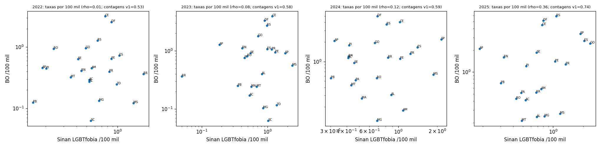
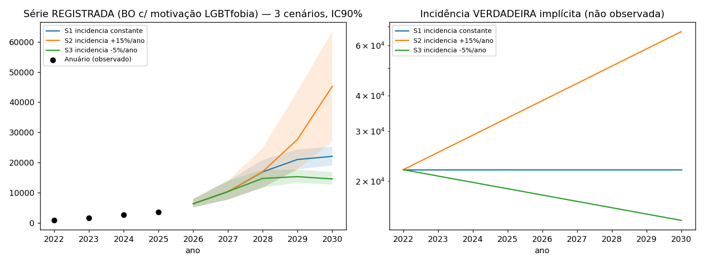

<div align="center">

# Existe um indicador confiável de violência motivada por LGBTfobia no Brasil?

**Não: os dados públicos brasileiros não separam incidência de registro, e nenhuma contagem de mídia, polícia ou saúde serve hoje como taxa. Este repositório entrega os dados derivados, o código e os testes que sustentam cada número dessa conclusão.**


</div>

> [!IMPORTANT]
> **Achados.** (1) A série policial de LGBTfobia (783 -> 3.481 boletins, 2022-2025) é estruturalmente não identificável entre incidência e
> registro: três incidências opostas (constante, +15%/ano, -5%/ano) reproduzem a série com o mesmo erro (0,0472). (2) No Sinan, o campo
> de motivação registra LGBTfobia em 0,5% das notificações e fica ignorado/em branco/"não se aplica" em 42-45% das interpessoais.
> (3) A concordância líquida de tamanho entre saúde e polícia por UF é 0,20 [-0,13; 0,50]: sem evidência de concordância.
> (4) Pelo autorrelato da PNS 2019, adultos LGB+ declaram violência física 14,70% x 3,82% dos heterossexuais (RP 3,84; ajustada 2,82
> [2,16; 3,68]): o risco existe e é medido por survey, não por registro. (5) Estimada direto no microdado da PNS, a parcela LGB+ entre
> vítimas adultas de violência física é 7,1% [5,1; 9,1]; no Sinan, 4,12% (2023) e 4,08% (2024), fora do intervalo: os dois canais
> concordam na direção e discordam na magnitude. (6) Sob risco igual ao dos pares, a contagem do GGB cobriria 22,9% (2023) e 28,7% (2024)
> das mortes esperadas com o total declarado, e 8,4%-19,7% (2023) e 16,5%-26,6% (2024) com numeradores comparáveis: numerador de mídia e
> denominador de survey não casam. (7) Nenhum dos 72 coeficientes do painel de governadores (351 UF-anos) é distinguível de zero; o teste
> de falsificação com causa indeterminada também é nulo, e o estudo de eventos é inconclusivo (a taxa cai depois de trocas nos dois sentidos).

Artigo: o repositório vem primeiro e o artigo deriva dele; o texto (`paper/paper.md`), o PDF e o DOCX entram num commit posterior, citam a URL e o `chain_hash` deste repositório e ficam FORA do selo (o hash do PDF final irá a `paper/PAPER-SHA256.txt`; ver [`REPRODUCIBILITY.md`](REPRODUCIBILITY.md)) · dossiê técnico: [`docs/dossies/DOSSIE-CONSOLIDADO-2026-10-12.md`](docs/dossies/DOSSIE-CONSOLIDADO-2026-10-12.md) · *English: public companion of a study on whether a reliable indicator of anti-LGBT violence exists in Brazil; derived data, code, dated pre-registrations with hashes and tests that lock every published number. No names, no third-party PDFs, no raw microdata.*

## O que há de novo na v0.3 (2026-10-24)

> [!NOTE]
> A v0.3 responde ao escrutínio externo da v0.2 (um modelo de linguagem de outra família como revisor hostil): cada ataque foi
> conferido no arquivo antes de virar correção, e o que não procedeu está dito como "não procede". Nenhum número antigo foi apagado:
> onde mudou, o anterior fica registrado ao lado (`manifest/MODIFICACOES.tsv`, sha256 antes e depois).

| O que mudou | Antes | Agora | Onde |
| --- | --- | --- | --- |
| Adultos LGB+ entrevistados na PNS 2019 | 1.674 (contagem esperada pela prevalência ponderada) | **1.554 observados**; o efeito mínimo detectável da violência física passa de 58,3% para **60,7%** | `docs/laudos/F2-custos-README.md`, `research-2026-10-21-rodada3/F2-custos/` |
| Adultos a triar por rodada para detectar +30% | 305.993 (arredondamento duplo) | **305.955** (um arredondamento, no fim); cerca de 330 mil se a fração não ponderada de LGB+ da PNS se repetir | idem |
| Série do Sinan por UF (planilha auxiliar do GGB) | total nacional somado duas vezes (2023: 4.346) | **2.173** em 2023; a soma das 27 UFs agora é conferida contra a linha Brasil | `research-2026-10-21-rodada3/F3-ggb/` |
| "A declaração de óbito tem 87 campos" | redação | o **arquivo** do SIM tem 87 campos; o **formulário** tem 59 variáveis em 9 blocos (manual do Ministério da Saúde, 2022, p. 10); nenhum dos dois registra orientação sexual ou identidade de gênero | `research-2026-10-21-rodada3/discurso/mortalidade/` |
| Pessoas trans e a PNS | "fora do denominador" | a PNS 2019 **não perguntou** identidade de gênero: pessoas trans não foram excluídas, só não são identificáveis; o numerador "sem pessoas trans" (N2) é **cenário**, não limite inferior (2024: 164 < 167 pelas marginais do GGB) | `dados/ggb/c08_numeradores.md` (seção 5), `dados/ggb/c08_cenarios_marginais.csv` |
| Concordância saúde x polícia | "r bruto 0,49 a 0,74; 22 a 25 UFs" | especificação principal: **0,53 a 0,74 com 22 a 23 UFs** (0,49 e 25 UFs são de uma variante) | `dados/concordancia/` |
| Intervalo do painel de governadores | só b ± 1,96 EP | também por **inversão do teste wild-cluster** (forma pré-registrada antes do cálculo): total -12,3% a +12,4% para 5 pontos de ideologia; os 6 desfechos contêm zero | `dados/painel/R6-PREREGISTRO-FORMA.md`, `dados/painel/r6_ic_wild_invertido.md` |
| Falas no Parlamento com fonte primária | uma codificação | duas, lado a lado: 0/49 (regra aplicada) e 1/49 (letra do livro de códigos); contra 2/38 da linha de base, Fisher p = 0,1879 para 0/49 e p = 0,5784 para 1/49 | `research-2026-10-21-rodada3/escrutinio/simetria/r7_parlamento_sensibilidade.md` |
| Validação do GGB 2019 | "31,3% (piso)" | **fração verificada hoje**, não piso nem teto do total | `research-2026-10-21-rodada3/F3-ggb/` |
| **Troca de presidente (C09, novo)** | não medido | nenhuma das 21 estimativas do painel de alinhamento governador x presidente é distinguível de zero (primária: -18,3% a +9,6%); a queda nacional de 2019 (-17,0%) **não é atribuível à troca**, porque o placebo de 2018 cai junto (-21,8%) | [`dados/presidencia/`](dados/presidencia/) |
| **Exposição por governo (C10, novo)** | não medido | o que a taxa fez quando o governo mudou, **sem atribuir causa**: nacional, Dilma +11,1%, Temer -4,2%, Bolsonaro -21,0% (-13,7% somando as mortes de causa indeterminada), Lula até 2024 -10,6%; nos estados, 67 trocas de partido: a taxa relativa subiu em 31 e caiu em 36 | [`dados/exposicao/`](dados/exposicao/) |
| Mortalidade por orientação sexual no mundo | "não sustentada como frase geral" | onde há dado oficial ligado ao censo, há excesso de mortalidade geral: Inglaterra e País de Gales, março de 2021 a novembro de 2024, razão de mortalidade por todas as causas 1,31 (1,28-1,33) entre pessoas de 16 anos ou mais que se declararam LGB+ no Censo de 2021 e as heterossexuais (ONS, 2026); nenhuma fonte lida tem razão populacional de **homicídio** por orientação; o Brasil segue **sem estimativa** | ledger `research-2026-10-24-v03/L-ledger/sources.jsonl` (ONS, 2026) |
| Disque 100 (canal de denúncias do governo federal) | não examinado | **descrito e contado, sem nenhuma conclusão dependendo dele:** 23 arquivos públicos (2011 a setembro de 2026, 14 GB, sem cadastro nem aceite de termos), três formatos, **nenhuma chave de pessoa** (o total de vítimas únicas não é calculável em nenhum ano) e unidade que muda entre períodos (linha até 2020, denúncia desde 2021). O módulo LGBT tem de 1.331 a 4.787 linhas por ano em 2011-2019 e de 1.367 a 9.346 denúncias em 2021-2025 (10.461 em 2026, até setembro); o canal inteiro quase triplicou no mesmo período e a série tem quatro quebras (2020S1, 2020S2, 2022S2, 2024): **mais denúncias não é mais violência**, e não se calcula taxa. Os microdados brutos não estão no repositório; ficam o catálogo com sha256, o pré-registro, o dicionário, as séries, os scripts e 63 testes | [`dados/disque100/`](dados/disque100/) |
| Inventário de fontes e scripts | gerado na árvore privada | **gerado deste repositório** (`scripts/inventario_publico.py`): restrito aos 17 ledgers do painel, reproduz exatamente 829 identificadores, 10 idiomas e a contagem por tipo; com os ledgers da v0.3, 853 identificadores em 18 ledgers | [`manifest/INVENTARIO-PUBLICO.md`](manifest/INVENTARIO-PUBLICO.md) |

## O que este repositório acrescenta

1. **Cada número publicado é uma asserção de teste.** `tests/` e `paper/tests/` leem os CSV/JSON derivados e travam os números-chave (o total de testes é o que `pytest -q` imprime; não há contagem digitada aqui) (PNS, painel, concordância, cobertura do GGB, taxas por sexo e raça, poder amostral, as quatro reanálises pré-registradas, C09, C10 e os valores desenhados nas figuras); mudar dado ou código sem mudar o número travado quebra o CI.
2. **Proveniência verificável.** `run_all.py` confere o selo SHA-256 de todos os arquivos distribuídos (o artigo fica fora do selo), recalcula os derivados numa réplica (29 passos), roda os testes e fecha o `chain_hash`. `manifest/MANIFESTO-FONTES.csv` traz 876 pares (identificador, URL) de todos os 18 ledgers distribuídos, todos com URL e data de acesso e 430 com o SHA-256 do arquivo lido, e 91 arquivos brutos; os microdados oficiais têm script de aquisição com hash esperado. O inventário público ([`manifest/INVENTARIO-PUBLICO.md`](manifest/INVENTARIO-PUBLICO.md)) conta 853 identificadores únicos (852 obras distintas: um preprint aparece com e sem `/v1`) em 18 ledgers, 10 idiomas e 166 scripts Python, só com os arquivos daqui.
3. **Pré-registros datados e com hash** (governos, mortalidade, mídia e os critérios das reanálises), com os desvios declarados, e **privacidade por construção**: nenhum nome de vítima, nenhum texto de terceiros, nenhum microdado bruto.
4. **Escrutínio aberto.** As quatro revisões hostis (modelos de famílias diferentes, atacando pela direita, pela esquerda e pelo método), a triagem de cada ataque, as reanálises com critério escrito antes e a busca simétrica entre flancos estão publicadas como vieram, em [`research-2026-10-21-rodada3/escrutinio/`](research-2026-10-21-rodada3/escrutinio/).

## Em resumo

| Pergunta | Resposta | Onde |
| --- | --- | --- |
| Existe taxa de mortes de pessoas LGBT+ no Brasil? | Não. O arquivo do SIM tem 87 campos (2023 e 2024) e o formulário da declaração de óbito, 59 variáveis: nenhum registra orientação sexual ou identidade de gênero; a contagem de mídia não tem denominador compatível | `docs/dossies/`, `dados/ggb/` |
| E fora do Brasil? | Onde há registro oficial ligado ao censo, quem se declarou LGB+ tem mortalidade geral maior (Inglaterra e País de Gales, 2021-2024, 16 anos ou mais: 1,31 [1,28-1,33]); nenhuma fonte lida mede homicídio por orientação na população | `research-2026-10-24-v03/L-ledger/sources.jsonl` |
| A série de BOs de LGBTfobia mede incidência? | Não é identificável (algebricamente) | `simulacao/` |
| O Sinan resolve? | Não: LGBTfobia em 0,5% das notificações; faltante efetivo do campo 55 em 42-45% das interpessoais | `dados/sinan/` |
| Saúde e polícia concordam por UF? | Sem evidência de concordância líquida de tamanho (pooled 0,20 [-0,13; 0,50]) | `dados/concordancia/` |
| LGB+ sofrem mais violência? | Sim, no autorrelato: física 14,70% x 3,82% (RP 3,84; ajustada 2,82), sexual 4,86% x 0,68% (ajustada 5,00) | `dados/pns/` |
| Registro de saúde e survey concordam? | Na direção, não na magnitude: LGB+ = 7,1% [5,1; 9,1] das vítimas de violência física na PNS (estimativa direta) x 4,12%/4,08% no Sinan | `dados/pns/`, `dados/sinan/` |
| A contagem do GGB é uma taxa? | Não: cobertura implícita 22,9%/28,7% (total declarado) e 8,4% a 26,6% nos cenários de numerador (cenários, não limites: `dados/ggb/c08_numeradores.md`, seção 5), validação 2019 com 31,3% verificáveis hoje (fração verificada, não piso nem teto do total), variações anuais sem relação com o SIM (r = 0,20) | `dados/ggb/`, `research-2026-10-21-rodada3/F3-ggb`, `GGB-completo` |
| Governador de direita/esquerda muda a taxa de homicídio? | Não detectável (IC95% cruza zero em todos os coeficientes; falsificação com causa indeterminada nula; estudo de eventos inconclusivo; poder baixo) | `dados/painel/` |
| A troca de presidente muda a taxa? | Não detectável: 21 estimativas do painel de alinhamento, nenhuma distinguível de zero; a queda de 2019 começou em 2018 (placebo) | `dados/presidencia/` |
| O que a taxa fez em cada governo? | Exposição, sem causa: Dilma +11,1%, Temer -4,2%, Bolsonaro -21,0% (-13,7% com causa indeterminada), Lula até 2024 -10,6%; 67 trocas de governador: subiu em 31, caiu em 36 | `dados/exposicao/` |
| Quem é mais ou menos exposto à agressão fatal? | Padronizado por idade, 2022-24: mulheres não negras 2,6; negras 4,3; homens não negros 20,0; negros 51,7 por 100 mil | `dados/sim/` |
| O que seria preciso medir? | Survey bienal de vitimização com orientação sexual e identidade de gênero: com deff 5,1, ~306 mil adultos triados por rodada para detectar +30% | `research-2026-10-21-rodada3/F2-custos/` |

## As fontes, em linguagem comum

| Sigla | O que é | O que conta | O que NÃO diz |
| --- | --- | --- | --- |
| PNS | Pesquisa Nacional de Saúde (IBGE, 2019): entrevista em domicílios sorteados, adultos de 18 anos ou mais | o que a pessoa **declara** ter sofrido em 12 meses, e a orientação sexual que declara | motivo do agressor; identidade de gênero (não foi perguntada); nada depois de 2019 |
| Sinan | Sistema de Informação de Agravos de Notificação (Ministério da Saúde): ficha que o serviço de saúde preenche quando atende uma vítima de violência | atendimentos notificados, com um campo de "motivação" (campo 55) | quantas violências aconteceram (só as que chegaram ao serviço e foram notificadas) |
| SIM | Sistema de Informações sobre Mortalidade (Ministério da Saúde): a declaração de óbito digitalizada | mortes por causa (agressão, causa indeterminada), sexo, raça, idade, local | orientação sexual, identidade de gênero e motivação: não existem no formulário nem no arquivo |
| GGB | Grupo Gay da Bahia, organização da sociedade civil: lista anual de mortes de pessoas LGBT+ reunidas de notícias e relatos | mortes que chegaram ao noticiário ou à organização | taxa (não tem denominador) nem a fração que escapa ao noticiário |
| BO / Anuário | boletins de ocorrência da polícia, compilados por estado no Anuário Brasileiro de Segurança Pública | boletins classificados como LGBTfobia (783 em 2022, 3.481 em 2025) | se a violência subiu ou caiu: registro e incidência não se separam (seção 4 abaixo) |
| Disque 100 | canal federal de denúncias de violações de direitos humanos | denúncias recebidas | quantas vítimas únicas (nenhum arquivo traz chave de pessoa; a unidade, linha ou denúncia, muda entre períodos); se há mais violência (mais denúncias não é mais violência) |

## Quick start

```bash
python3 -m pip install -r requirements.txt
python3 -I run_all.py
```

Saída esperada (últimas linhas):

```text
[ok] dados/concordancia/concordancia_v2.py (31s)
...
[~] dados/painel/c02_indet_resultados.csv: numérico (<= 1 unidade da última casa; precisão total: diferença relativa <= 1e-10)
[~] dados/painel/c03_event_pesos_resultados.csv: numérico (<= 1 unidade da última casa; precisão total: diferença relativa <= 1e-10)
arquivos RECALCULADOS pelos scripts e conferidos com o commitado: 60 idênticos byte a byte, 2 equivalentes numéricos, 3 figuras PNG regeneradas (informativas); 0 falha(s)/divergência(s)
[ok] test_reanalises_publicadas.py::test_c08_numeradores_e_cobertura
testes: 98/98 passaram (3 pulados)
provenance verified: <chain_hash de output/provenance.json> (N arquivos)
```

Recálculo real (28 passos) em macOS arm64 na v0.3, Python 3.12.12 com numpy 2.5.4, pandas 3.1.0, scipy 1.18.1 e matplotlib 3.11.2 (mais novos que o `requirements.lock`, que registra o ambiente 3.14.8 do selo): 296 s somando os passos. Os dois `[~]` são esperados: os CSV de C02 e C03 guardam
números em precisão total, e a soma em BLAS multithread muda os últimos bits entre execuções (ver `REPRODUCIBILITY.md`).

Os 3 testes pulados comparam cópias de figura com a pasta de trabalho do autor (ausente num clone) e são contados à parte, nunca como aprovados. Só a integridade e os testes (segundos): `python3 -I run_all.py --rapido`. Detalhes, versões e o que não se refaz: [`REPRODUCIBILITY.md`](REPRODUCIBILITY.md).

## Results

### 1. Autorrelato: violência em 12 meses por orientação sexual (PNS 2019, adultos 18+)

| Desfecho | Heterossexuais | LGB+ | RP bruta [IC95%] | RP ajustada [IC95%] |
| --- | --- | --- | --- | --- |
| Física | 3,82% [3,57; 4,08] | 14,70% [10,72; 18,67] | 3,84 [2,92; 5,06] | 2,82 [2,16; 3,68] |
| Sexual | 0,68% [0,55; 0,80] | 4,86% [2,87; 6,84] | 7,17 [4,57; 11,26] | 5,00 [3,17; 7,89] |
| Psicológica | 16,73% [16,20; 17,26] | 40,03% [35,48; 44,58] | 2,39 [2,12; 2,69] | 1,87 [1,66; 2,11] |

Ajuste: sexo, faixa etária, cor, instrução, região, urbano/rural (Poisson ponderado, variância robusta de desenho). Reproduz a Tabela 2 de
Vasconcelos et al. (2023) com divergência 0. LGB+ = 1,89% dos adultos (1,73-2,07), ~3,01 milhões. Uma onda, autorrelato, sem motivo do agressor.

### 2. Registro: Sinan x PNS (violência física, adultos)

| | 2023 | 2024 |
| --- | --- | --- |
| Notificações de violência física, adultos 18+ | 197.779 | 202.416 |
| LGB+ entre as com orientação válida (Sinan) | 4,12% | 4,08% |
| Parcela LGB+ implícita na PNS (cenário A; IC95% Monte Carlo) | 7,13% [5,43; 9,32] | idem |
| Parcela LGB+ estimada direto no microdado da PNS (razão de totais, desenho complexo; IC95% de desenho) | 7,12% [5,11; 9,13] | idem |
| Não respondidas que precisariam ser LGB+ para igualar a PNS | 16,5% | 16,7% |

### 3. Concordância saúde x polícia por UF (correlação parcial de Spearman, controlando o tamanho da UF)

| Ano | n UFs | rho parcial [IC95% bootstrap por UF] | rho de contagens brutas |
| --- | --- | --- | --- |
| 2022 | 22 | 0,14 [-0,33; 0,62] | 0,53 |
| 2023 | 23 | 0,17 [-0,30; 0,56] | 0,58 |
| 2024 | 23 | 0,15 [-0,28; 0,51] | 0,59 |
| 2025 | 22 | 0,32 [-0,16; 0,68] | 0,74 |
| Pooled 2022-25 | | **0,20 [-0,13; 0,50]** | |

A correlação de contagens (0,53-0,74) é o tamanho da UF; descontado, o IC inclui zero em todos os anos. Poder baixo (n = 22-23 UFs na especificação principal; 22-25 incluindo as variantes): ausência de evidência, não evidência de discordância.



### 4. A série de BOs não identifica a incidência



| Cenário (incidência verdadeira) | Erro de ajuste (SSE log) | Registrada em 2030 (mediana, IC90) |
| --- | --- | --- |
| Constante | 0,0472 | 22.026 (19.030-25.229) |
| +15%/ano | 0,0472 | 45.232 (26.866-63.400) |
| -5%/ano | 0,0472 | 14.529 (12.645-16.827) |

### 5. Cobertura implícita da contagem do GGB (exercício de escala, não estimativa de mortes)

| Ano | Pop. LGB+ adulta | GGB | Esperado com risco igual ao dos pares | Cobertura | Com RR 2,82 | Com RR 3,84 |
| --- | --- | --- | --- | --- | --- | --- |
| 2023 | 3.025.764 | 257 | 1.122 | 23% | 8% | 6% |
| 2024 | 3.027.156 | 291 | 1.013 | 29% | 10% | 8% |

Com numeradores comparáveis (reanálise C08: homicídios + latrocínios declarados, 221 em 2023 e 269 em 2024; e esse número menos todas as
pessoas trans da tabela de identidade, 94 e 167), a cobertura sob risco igual fica entre 8,4% e 19,7% (2023) e entre 16,5% e 26,6% (2024). Esses são cenários, não limites: pelas marginais publicadas do GGB, os cis LGB dentro do primeiro numerador ficam entre 100 e 118 (2023) e entre 164 e 168 (2024), e a PNS 2019 não perguntou identidade de gênero (pessoas trans que declararam orientação LGB estão no denominador, sem identificação); ver `dados/ggb/c08_cenarios_marginais.csv`.

Validação de uma amostra de 160 dos 329 casos de 2019: 50 verificáveis em fonte que corresponde ao caso, morte violenta e LGBT+ explícito =
31,3% [24,6; 38,8] (fração verificada hoje, não piso nem teto do total: as 54 fontes não recuperadas contam como não verificadas). Variações anuais GGB x SIM, 2001-2024: r = 0,20 [-0,37; 0,60], sinal igual em 13/24.
Captura-recaptura (só 2019 tem duas listas públicas): N = 186 [175; 198], cobertura do GGB para o recorte trans 63% [60; 68].

### 6. Painel UF x ano: ideologia do governador e taxa de agressão (351 UF-anos, 2012-2024)

| Desfecho | b por ponto de ideologia | EP | IC95% | p wild-cluster |
| --- | --- | --- | --- | --- |
| Total | +0,0009 | 0,0121 | [-0,023; +0,025] | 0,943 |
| Homens | +0,0005 | 0,0125 | [-0,024; +0,025] | 0,970 |
| Mulheres | -0,0007 | 0,0105 | [-0,021; +0,020] | 0,951 |
| Negros | -0,0070 | 0,0146 | [-0,036; +0,021] | 0,661 |
| Não negros | -0,0016 | 0,0171 | [-0,035; +0,032] | 0,911 |
| Arma de fogo | +0,0009 | 0,0185 | [-0,035; +0,037] | 0,970 |

Partido de eleição (TSE) + ideologia BRC por período; especificação **escolhida depois de ver as variantes** (sem pré-especificação), as 72 variantes de
`research-2026-10-21-rodada3/ideologia/sensibilidade_twfe.md` dão o mesmo. Exploratório, não causal.

Reanálises com critério escrito antes (`research-2026-10-21-rodada3/escrutinio/reanalise/CRITERIOS.md`, sha256 gravado): numa troca de 5 pontos
de ideologia, o IC normal publicado (b ± 1,96 EP) exclui efeitos fora de -10,8% a +13,1% no total (conversão exata 100[exp(5b)-1]; -16,2% a +20,4% em arma de fogo). Pela inversão do teste wild-cluster bootstrap-t (adendo v0.3 com forma pré-registrada: `dados/painel/R6-PREREGISTRO-FORMA.md`, `dados/painel/r6_ic_wild_invertido.md`), a faixa do total é -12,3% a +12,4% (arma de fogo: -19,5% a +19,7%); com t(26), -11,3% a +13,7%. Todas contêm zero.
Somando a causa indeterminada (Y10-Y34) às agressões, nenhum grupo se distingue de zero (total: -9,1% a +14,0%), e a parcela de indeterminadas
(13,4%) não varia com a ideologia (+0,15 p.p. por ponto [-0,57; +0,86]; p wild 0,68). O estudo de eventos empilhado é **inconclusivo**: depois
de trocas nos dois sentidos a taxa registrada cai em relação aos controles (-20% [-30%; -8%] com 9 eventos esquerda->direita; -19% [-31%; -4%]
com 10 eventos direita->esquerda), o que não é assinatura de ideologia. Pesos do TWFE: 46,2% das observações com resíduo de ideologia negativo,
sem inclinações de sinais opostos significativos. Scripts e saídas: `dados/painel/painel_c02_indet.py`, `painel_c03_event_pesos.py`.

### 7. Taxas de agressão (X85-Y09) padronizadas por idade, Brasil, 2022-24 (por 100 mil)

| Grupo | Taxa padronizada | Razão |
| --- | --- | --- |
| Mulheres não negras | 2,6 | referência |
| Mulheres negras | 4,3 | 1,7 x |
| Homens não negros | 20,0 | 7,7 x |
| Homens negros | 51,7 | 19,9 x |

Homens/mulheres 10,8; negros/não negros 2,56 (extremos por raça ignorada: 2,42-2,60). 89% a 99% da diferença bruta entre grupos é diferença de taxa por idade, não de composição etária (Kitagawa).

### 8. O que um survey precisaria (PNS 2019: efeito de desenho medido 5,1 para LGB+)

Para detectar +30% de violência física entre rodadas (alfa 5%, poder 80%): **305.955 adultos triados por rodada** (5.786,3 LGB+, arredondados para 5.787; o total é arredondado uma vez, no fim); o cálculo ingênuo (AAS) dava 59.948. A PNS 2019 observada (88.531 adultos, 1.554 LGB+ entrevistados) detecta variação de 60,7% na violência física. Se a fração não ponderada de LGB+ da PNS (1,755%) se repetir, a triagem sobe para cerca de 330 mil adultos.

### 9. Troca de presidente (C09, v0.3; pré-registrada antes dos desfechos)

| Desenho | Resultado | Leitura pré-registrada |
| --- | --- | --- |
| Painel UF x ano, interação governador x presidente (primária; 351 UF-anos, 2012-2024) | governador 5 pontos mais à direita com presidente PT -> PSL: **-18,3% a +9,6%** na taxa (p wild 0,459); efeito mínimo detectável -18,9% / +23,3% | não distinguível de zero; 0 de 21 estimativas distinguíveis |
| Série nacional padronizada, quebra em 2019 | -17,0% [-29,5; -2,4], mas o placebo de 2018 dá -21,8% [-37,4; -2,4] | não atribuível à troca: a queda começou em 2018 |
| Quebras de 2016 e 2023 | +2,6% [-9,1; +15,9] e -3,9% [-17,1; +11,3] | não distinguíveis de zero |

O efeito do ano absorve o do presidente: só o alinhamento entre governador e presidente é identificável, com poder baixo. Nada aqui é sobre
violência contra pessoas LGBT. Arquivos: [`dados/presidencia/`](dados/presidencia/) (pré-registro, scripts, saídas, relatório).

### 10. Exposição por governo (C10, v0.3): o que a taxa fez, sem atribuir causa

| Governo | Anos comparados | Taxa nacional padronizada (por 100 mil) | Variação [IC de contagem] | Somando causa indeterminada |
| --- | --- | --- | --- | --- |
| Dilma | 2010 -> 2015 | 25,93 -> 28,81 | +11,1% [+9,8; +12,5] | +7,9% |
| Temer | 2015 -> 2018 | 28,81 -> 27,61 | -4,2% [-5,3; -3,0] | -0,4% [-1,4; +0,7] |
| Bolsonaro | 2018 -> 2022 | 27,61 -> 21,81 | -21,0% [-22,0; -20,0] | -13,7% |
| Lula (2 de 4 anos) | 2022 -> 2024 | 21,81 -> 19,50 | -10,6% [-11,8; -9,4] | -6,1% |

A fração de óbitos com causa indeterminada sobe de 14,4% (2015) para 30,1% (2024), por isso a queda com indeterminadas é sempre menor. Nos
estados, em 67 trocas de partido no governo a taxa relativa ao Brasil subiu em 31 e caiu em 36 (mediana -0,7%); somando as indeterminadas,
34 e 33. A comparação com estados sem troca usa poucos estados por ano, concentrados no Nordeste em 2018-2019: a diferença pode ser região, não
troca. Isto descreve; não diz que algum governo causou a mudança. Arquivos: [`dados/exposicao/`](dados/exposicao/).

### 11. Disque 100 (v0.3; pré-registrado antes das contagens): o que o canal permite contar

O Disque 100 é o canal federal de denúncias de violações de direitos humanos. Os 23 arquivos públicos (2011 a setembro de 2026) não têm chave de pessoa:
**o total de vítimas únicas não é calculável**, e não se calcula taxa de vitimização. O que se conta é registro, e a unidade muda: linha do arquivo até 2020
(vítima x suspeito de um atendimento), denúncia desde 2021.

| Período | Módulo LGBT | Unidade | Parte do canal | Observação |
| --- | --- | --- | --- | --- |
| 2011-2019 | 1.331 a 4.787 por ano | linhas | 0,4% a 1,6% (linhas) | formato A |
| 2020 | 3.412 | linhas (dois formatos) | 0,8% | quebra B -> C no ano |
| 2021 / 2022 / 2023 | 1.367 / 4.163 / 6.173 | denúncias com ao menos uma linha | 0,6% / 1,4% / 1,4% | formulário novo em 2022S2 |
| 2024 / 2025 | 8.176 / 9.346 | denúncias | 1,5% / 1,5% | a categoria de motivação por orientação some do formulário (não é ausência de motivação) |
| 2026 (até setembro) | 10.461 | denúncias | 1,9% | parcial |

De 2021 a 2025 o canal inteiro foi de 222 mil a 638 mil denúncias (2,9 vezes) e o módulo LGBT de 1.367 a 9.346 (6,8 vezes): **aumento de denúncias não é
aumento de violência**. Comparado por estado com o Sinan e o Anuário, o tamanho do estado explica a maior parte da concordância; nada é somado. Arquivos e como
reproduzir (o recálculo das séries roda na réplica; a tabulação dos 14 GB de bruto, não): [`dados/disque100/`](dados/disque100/). Figura:
`paper/figures/fig28_disque100_serie.png`.

## Artigo e escrutínio

| Peça | Onde | Observação |
| --- | --- | --- |
| Artigo científico (PT-BR) | entra num commit posterior: `paper/paper.md`, PDF e DOCX | deriva deste repositório (cita a URL e o `chain_hash`); fora do selo; o sha256 do PDF final irá a `paper/PAPER-SHA256.txt`, também fora do selo |
| Revisão externa da v0.2 e respostas | [`O que há de novo na v0.3`](#o-que-há-de-novo-na-v03-2026-10-24), `manifest/MODIFICACOES.tsv` (linhas `v0.3-R` e `v0.3-S`) | cada ataque conferido no arquivo; correção com o número antigo ao lado, ou "não procede" |
| Figuras do artigo | [`paper/figures/`](paper/figures/) (`make_figures.py`, valores desenhados, cópias das fontes com sha256) | `paper/tests/test_figuras.py` reabre as fontes com parser próprio e confere cada barra e intervalo |
| Revisão hostil | [`escrutinio/revisao_{codex,grok,agy,opus}.md`](research-2026-10-21-rodada3/escrutinio/), pacote enviado (`PACOTE-ESCRUTINIO.md`) | 4 revisores de famílias diferentes, 48 ataques; publicadas como vieram, exceto caminhos locais e termos de operação trocados, um a um em `manifest/MODIFICACOES.tsv` |
| Triagem dos ataques | [`TRIAGEM.md`](research-2026-10-21-rodada3/escrutinio/TRIAGEM.md), `TRIAGEM.csv`, `_build_triagem.py` | cada ataque com evidência verificada, decisão e frase de correção ou limitação |
| Reanálises pré-registradas | [`reanalise/`](research-2026-10-21-rodada3/escrutinio/reanalise/) (`CRITERIOS.md` + sha256 gravado antes, `RESULTADOS.md`) e scripts em `dados/{painel,pns,ggb}/` | C02 e C03 recalculadas pelo `run_all.py`; C05 e C08 pela Trilha 2 (microdado da PNS) |
| Busca simétrica entre flancos | [`simetria/`](research-2026-10-21-rodada3/escrutinio/simetria/) (`CRITERIOS.md`, adendos, `SIMETRIA.md`, scripts, tabelas) | trechos de imprensa substituídos por sha256; ficam URL, sha256 do arquivo lido e a classificação |
| Painel de contagens | [`dashboard/`](dashboard/) (`KPIS-FINAIS.md`, `dashboard_dados.publico.json`, `build_dashboard.py`) | o script é ferramenta do autor: conta a árvore completa do projeto de origem e não roda a partir deste repositório |

> [!WARNING]
> **Divergências conhecidas entre o dossiê, os testes e o código.** (1) O selo vigente está em [`output/hash-chain.md`](output/hash-chain.md); o artigo, que o cita, fica fora dele. (2) Onde o dossiê e os dados
> arredondam diferente, valem os dados e os testes. (3) `dados/ggb/cobertura_implicita.py` usa 273 homicídios declarados do GGB em 2024 (inclui 4 mortes "outras"); a reanálise C08 usa 269
> (homicídios + latrocínios, numerador A, `dados/ggb/c08_numeradores.md`), que dá 26,6% de cobertura em vez de 27%; as duas definições estão tabuladas na reanálise.

## O que exibimos para ninguém ter que pedir nada

| Você quer | Está em |
| --- | --- |
| Os números de cada resultado, prontos para conferir | `dados/*/` (CSV e MD gerados pelos scripts ao lado), [`dados/presidencia/`](dados/presidencia/), [`dados/exposicao/`](dados/exposicao/) |
| Saber o que cada teste trava | [`tests/`](tests/), [`paper/tests/`](paper/tests/) |
| Os pré-registros e quando foram gravados | [`docs/PRE-REGISTROS/`](docs/PRE-REGISTROS/), `dados/presidencia/PREREGISTRO-C09.*`, `dados/exposicao/PREREGISTRO-C10.*`, `dados/painel/R6-PREREGISTRO-FORMA.*`, [`research-2026-10-21-rodada3/escrutinio/reanalise/CRITERIOS.md`](research-2026-10-21-rodada3/escrutinio/reanalise/CRITERIOS.md) |
| Toda fonte consultada, com URL, data e hash do arquivo lido | 18 ledgers `sources.jsonl` (lista em [`manifest/INVENTARIO-PUBLICO.md`](manifest/INVENTARIO-PUBLICO.md)), [`manifest/MANIFESTO-FONTES.csv`](manifest/MANIFESTO-FONTES.csv) |
| O que foi lido em texto integral e o veredito | [`research-2026-10-21-rodada3/A-textointegral/verificacao-metadados.csv`](research-2026-10-21-rodada3/A-textointegral/verificacao-metadados.csv) (139 conferências: periódico, quartil, texto lido, veredito) |
| Contagens de fontes, idiomas, tipos e scripts, refeitas deste repositório | [`manifest/INVENTARIO-PUBLICO.md`](manifest/INVENTARIO-PUBLICO.md) (`python3 -I scripts/inventario_publico.py --check`) |
| As revisões hostis, a triagem e as reanálises | [`research-2026-10-21-rodada3/escrutinio/`](research-2026-10-21-rodada3/escrutinio/) |
| O que mudou em cada arquivo copiado do projeto de origem | [`manifest/MODIFICACOES.tsv`](manifest/MODIFICACOES.tsv) (sha256 antes e depois, motivo) |
| O que se recalcula, o que só se confere e o que não se refaz | [`REPRODUCIBILITY.md`](REPRODUCIBILITY.md) (matriz de reprodução) |
| As ressalvas e o que NÃO se pode afirmar | a seção abaixo; [`dados/presidencia/RELATORIO-C09.md`](dados/presidencia/RELATORIO-C09.md); [`dados/exposicao/RELATORIO-EXPOSICAO.md`](dados/exposicao/RELATORIO-EXPOSICAO.md) |
| A auditoria de publicação (literatura, inventário, privacidade, publicação) | `python3 -I scripts/auditar_publicacao.py --check <nome>` |

## O que este repositório permite e NÃO permite afirmar

> [!NOTE]
> Esta seção é o escopo (claims-scope). Ver o dossiê para as marcas ✅ conferido / ⚠️ secundário / 🚫 não encontrado.

| Permite afirmar | NÃO permite afirmar |
| --- | --- |
| Que a série de BOs de LGBTfobia 2022-2025 não identifica incidência | Que a violência por LGBTfobia subiu ou caiu em 2022-2025 |
| Que o autorrelato (PNS 2019) mostra risco de violência maior para LGB+ do que para heterossexuais, antes e depois de ajuste | Qualquer taxa de mortes de pessoas LGBT+ no Brasil, ou comparação "mais ou menos que héteros" (o SIM não tem campo de orientação) |
| Que a contagem do GGB é de mortes noticiadas, com inclusão ampla, sem denominador, e não pode ser lida como taxa | Que o GGB (ou ANTRA, TDoR, TMM) fraude, superestime ou subestime por determinado fator: a cobertura implícita limita a leitura, não mede erro |
| Que GGB, ANTRA, TDoR e TMM não são independentes antes de 2019, e que o GGB não acompanha o SIM ano a ano | Ranking de UFs ou de países por LGBTfobia, ou "o país que mais mata" |
| Que não há evidência de efeito da ideologia do governador sobre taxas de homicídio, nesse desenho e com esse poder | Que governos de esquerda ou de direita são "mais seguros" ou "mais perigosos" (desenho exploratório, não causal; IC compatível com efeitos de até ~±3% por ponto da escala) |
| As taxas padronizadas por sexo e raça do SIM (agressão X85-Y09), com a ressalva de denominadores 2023-24 extrapolados | Que a diferença racial/sexual seja "só" de motivação ou "não" de motivação: o SIM não mede motivo |
| Que um survey com SOGI sobreamostrado é o instrumento que falta, e quanto ele custa em amostra | Que a PNS 2019 (uma onda, orientação "experimental" do IBGE) represente 2024-2025 |
| O que a taxa de homicídio registrado fez em cada governo, federal e estadual (exposição) | Que um governo causou a subida ou a queda: o desenho não separa o governo do que mudou junto (C10) |
| Que a troca de presidente e o alinhamento governador x presidente não têm efeito detectável, com o intervalo que o desenho exclui (C09) | Que "o presidente não importa": o efeito do ano absorve o do presidente e o poder é baixo |
| Que, fora do Brasil, há excesso de mortalidade geral em populações LGB+ ou trans definidas por censo ou registro | Que gays morrem mais ou menos **por homicídio** no Brasil ou no mundo: nenhuma fonte lida tem razão populacional de homicídio por orientação |
| Que nenhum ato de perseguição estatal foi achado no Brasil em 2016-2024 (negativo enumerado, com busca registrada) | Que "nunca houve" perseguição estatal: ausência numa busca enumerada não é prova de inexistência |

**Congelado, não re-rodável:** coletas de notícia, buscas em portais, arquivos preliminares do DATASUS, curadoria da Wikipédia, leitura de PDFs. Ver [`REPRODUCIBILITY.md`](REPRODUCIBILITY.md).

**Limites declarados:** 11 entradas da bibliografia do dossiê levam a marca ⚠️ "não verificado em texto integral" (McVeigh 2003, Mills et al. 2024, Pezzella et al. 2019, Szwarcwald et al. 2025, Thoennes & Tjaden 1990, Spohn et al. 2014, Katz-Wise & Hyde 2012, Grattet & Jenness 2005, King 2007, Baía et al. 2021, Devine 2021; seção Integridade do dossiê consolidado), outras citações são de segunda mão sem entrada completa, e várias usam periódico com quartil não verificado; os números delas não são travados aqui e não decidem nenhum veredito. A especificação principal do painel foi escolhida depois de ver as variantes. A amostra de discurso (871 itens) teve um codificador; um segundo codificador de outra família recodificou 216 itens.

## Integridade

```bash
python3 -I make_provenance.py --verify     # confere SHA-256 de todos os arquivos e o chain_hash
python3 -I scripts/reproduzir.py           # recalcula os derivados numa réplica e compara
python3 -m pytest -q                       # testes (também rodam sem pytest via run_all.py)
python3 -I scripts/inventario_publico.py --check            # inventário de fontes e scripts igual ao gravado
python3 -I scripts/auditar_publicacao.py --check literatura # também: inventario, privacidade, release (0 ok, 1 falhou, 2 não exercido)
```

chain_hash: ver [`output/hash-chain.md`](output/hash-chain.md). Pré-registros (hash gravado antes da coleta): [`docs/PRE-REGISTROS/`](docs/PRE-REGISTROS/).

## Estrutura

```text
paper/                         figuras (PNG, SVG, PDF), valores desenhados e testes de figura; o artigo (texto, PDF, DOCX) e suas ferramentas entram depois, fora do selo
dados/                         séries e painéis derivados, scripts e saídas (SIM, Sinan, PNS, Anuário, governos, GGB; reanálises c02/c03/c05/c08; R6)
dados/presidencia/             C09: troca de presidente (pré-registro, scripts, saídas, relatório)
dados/exposicao/               C10: exposição por governo, federal e estadual (pré-registro, scripts, saídas, relatório)
dados/disque100/               Disque 100: catálogo dos 23 arquivos, pré-registro, dicionário, séries, scripts e testes (sem os microdados)
simulacao/                     identificabilidade da série de BOs, poder do survey, projeção registrada 2026-2030
research-2026-10-21-rodada3/   frentes F2 (custos), F3 (GGB), F5 (economia política), F6, F8 (literatura), GGB-completo, ideologia, discurso, escrutinio
dashboard/                     números do painel de contagens (extrato público) e o script que os contou
research-consolidado/          ledger unificado de fontes (571 registros); ledgers por rodada em research-2026-10-1x/
research-2026-10-24-v03/       ledger da revisão de literatura da v0.3 (mortalidade no mundo; os arquivos lidos não são distribuídos)
fontes/                        só entradas abertas pequenas (SIDRA/IBGE, Power & Zucco CC0); o resto é baixado por scripts/acquire_*.py
docs/dossies/                  dossiê consolidado e partes 1 e 2
docs/laudos/                   laudos das frentes (GGB, mortalidade, governos, mídia, F2/F3/F5/F6/F8, ideologia)
docs/PRE-REGISTROS/            pré-registros com hash e hora
docs/briefings/                briefings de pesquisa (método)
manifest/                      SHA256SUMS.txt, MANIFESTO-FONTES.csv (URL, data, SHA-256), MODIFICACOES.tsv, INVENTARIO-PUBLICO.{md,json}
scripts/                       acquire_*.py (microdado oficial + hash), reproduzir.py (réplica), inventario_publico.py, auditar_publicacao.py
tests/                         números publicados, reanálises, integridade, privacidade
output/                        provenance.json, hash-chain.md
```

## Privacidade e o que ficou de fora

- **Nenhum nome de vítima.** Os casos do GGB 2019 entram como id de 10 hex (SHA-256 com sal não publicado), UF, categoria e domínio da fonte. Teste e varredura em `tests/test_integridade.py`.
- **Nenhum PDF/HTML de terceiros** e nenhum texto integral de notícia: a amostra de mídia e os eventos da busca simétrica trazem o sha256 do trecho; o trecho verbatim fica só para o Parlamento e para documento oficial. Ficaram fora do escrutínio: os itens com texto de notícia/resumo acadêmico enviados ao segundo codificador (`itens_C27.jsonl`; ids, hashes e códigos estão em `itens_cruzados_C27.csv`), as respostas cruas do modelo (`brutos_C27/`; os códigos estão em `codif_segundo_*.json`), filas de navegador e logs de execução.
- **Uso de modelos de linguagem.** Agentes de modelo de linguagem buscaram fontes, leram textos, escreveram scripts e codificaram itens; nenhum número entra sem arquivo e script que o recalcule (`REPRODUCIBILITY.md`). Os nomes dos modelos usados como revisores e codificadores estão nos próprios arquivos. Ferramentas que chamam esses modelos pela assinatura do autor estão marcadas como "ferramenta do autor" e não rodam a partir do clone.
- **Nenhum microdado bruto grande** (SIM, Sinan, PNS, TSE): scripts de aquisição com URL oficial e SHA-256 esperado.
- As bases de terceiros mantêm as licenças de origem (ver `NOTICE`); o artigo, quando entrar, segue a licença de texto do repositório.

## Autor

Carlos Ulisses Flores · [ORCID 0000-0002-6034-7765](https://orcid.org/0000-0002-6034-7765) · [ulissesflores.com](https://ulissesflores.com) · [Lattes](http://lattes.cnpq.br/6905246706890561)

## Citação

```bibtex
@dataset{flores_lgbt_indicador_violencia,
  author  = {Flores, Carlos Ulisses},
  title   = {Viol{\^e}ncia motivada por LGBTfobia no Brasil: o que os dados p{\'u}blicos sustentam (dados derivados, c{\'o}digo, pr{\'e}-registros e testes)},
  year    = {2026},
  version = {0.1.0},
  url     = {https://github.com/ulissesflores/lgbt-indicador-violencia}
}
```

Sem DOI nesta versão (a ser atribuído no release); o DOI de conceito entrará aqui, no `CITATION.cff`, no `codemeta.json` e no `.zenodo.json` depois da publicação. Ver [`CITATION.cff`](CITATION.cff).

## Licença

Código Apache-2.0 ([`LICENSE`](LICENSE), [`LICENSES/Apache-2.0.txt`](LICENSES/Apache-2.0.txt)); dados derivados, tabelas, figuras e texto CC BY 4.0 ([`LICENSES/CC-BY-4.0.txt`](LICENSES/CC-BY-4.0.txt)); microdados oficiais do IBGE, DATASUS e TSE seguem os termos das fontes e não são redistribuídos aqui. Detalhes em [`NOTICE`](NOTICE).

## Referências-âncora

Vasconcelos et al. (2023, PNS 2019, violência segundo a orientação sexual); Zucco & Power (2023, doi:10.7910/DVN/6KVTUV); Anuário Brasileiro de Segurança Pública (FBSP, 2024-2026); Atlas da Violência (IPEA, 2020-2026); Haber & Stornetta (1991, doi:10.1007/bf00196791). Bibliografia completa, com quartil e marca de verificação, no dossiê e em `manifest/MANIFESTO-FONTES.csv`.
