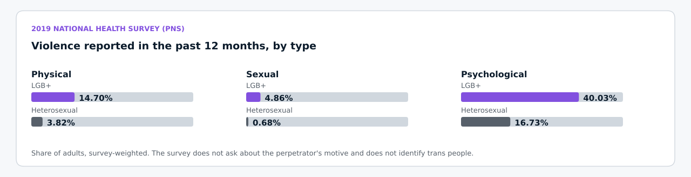

<div align="center">

<picture>
  <source media="(prefers-color-scheme: dark)" srcset="assets/brand/banner-en-dark.svg">
  
</picture>

<h3>The same yardstick for both sides of the debate: what Brazilian public data measure about violence against LGBT+ people, and what they cannot.</h3>

[](https://doi.org/10.5281/zenodo.23873858)
[](LICENSE)
[](LICENSES/CC-BY-4.0.txt)
[](pyproject.toml)
[](tests/)
[](https://github.com/ulissesflores/lgbt-indicador-violencia/actions/workflows/verify.yml)
[](REUSE.toml)
[](https://scorecard.dev/viewer/?uri=github.com/ulissesflores/lgbt-indicador-violencia)
[](output/hash-chain.md)
[](REPRODUCIBILITY.md#pre-registrations)
[](https://colab.research.google.com/github/ulissesflores/lgbt-indicador-violencia/blob/main/colab/replication.ipynb)

**English** · [Português (Brasil)](README.pt-BR.md) · [Español](README.es.md) · [Italiano](README.it.md) · [עברית](README.he.md)

</div>

<picture>
  <source media="(prefers-color-scheme: dark)" srcset="assets/brand/findings-en-dark.svg">
  
</picture>

<picture>
  <source media="(prefers-color-scheme: dark)" srcset="assets/demo/verify-dark.gif">
  
</picture>
<p align="center"><sub>Replay of the sealed check, no network: the seal, then the tests that lock every published number. Scripted with <a href="https://github.com/charmbracelet/vhs">vhs</a> in <a href="assets/demo/">assets/demo/</a>; re-recorded after the final seal.</sub></p>

> [!IMPORTANT]
> **Finding.** In the 2019 National Health Survey, 14.70% of lesbian, gay, bisexual or other non-heterosexual (LGB+)
> adults reported physical violence in the previous year, against 3.82% of heterosexual adults; the adjusted ratio is
> 2.82 (95% interval, 2.16 to 3.68). Brazilian death records carry neither sexual orientation nor gender identity, so
> no national LGBT+ mortality rate exists. Of 160 cases sampled from the Grupo Gay da Bahia list for 2019, 50 were
> confirmed by the cited source (48 by news reports): the list is neither a rate nor a total, and unverified cases are
> not invented cases. After 67 changes of governor's party, state homicide relative to Brazil's changed by −0.7%
> (median), against +4.6% without a change; only across the 21 changes with no other change nearby is the fall marked
> (−10.2%, against +6.7%). The comparison is exploratory and shows coincidence, not an effect of government.

## The paper

| Edition | File |
|---|---|
| **English** | [`docs/paper/paper-final-en.pdf`](docs/paper/paper-final-en.pdf) |
| Portuguese (Brazil), original | [`docs/paper/paper-final.pdf`](docs/paper/paper-final.pdf) |

Each edition has its own DOI and its figures labelled in its own language; the figure code in `figures/` keeps the
study's Portuguese labels. The Spanish and Italian editions of v1.2.0 are not part of this version: they carry two
readings corrected in [`docs/corrections.md`](docs/corrections.md) and will return
with their own DOI. Hebrew readers are served by the English edition.

## What this contributes

1. **One yardstick for both sides of the debate.** Twenty-five statements that circulate in the Brazilian debate, from
   either side, are checked against the same public sources with one fixed verdict vocabulary, in which "not
   testable" is an answer and "false" is never used for a claim about motivation or mortality. Eight components of
   the analysis were pre-registered, each with its timestamp and SHA-256.
2. **A re-analysis of the one survey that measures the gap.** The 2019 National Health Survey microdata, under the
   complex sampling design: LGB+ adults report physical violence 3.84 times as often as heterosexual adults without
   adjustment and 2.82 times after it, and the gap holds under separate adjustments for marital status, spouse in the
   household and interview mode.
3. **An audit of the most-cited count by random sample.** 160 cases drawn from the Grupo Gay da Bahia list for 2019,
   each checked against the source the list itself cites. Fifty are confirmed; the list is neither a rate nor a total,
   and unverified cases are not invented cases.
4. **Every published number as a test.** The tests lock each number of the paper to the file that produced it, and one
   SHA-256 chain hash seals code, tests, data and derived results. The official microdata are not redistributed; the
   scripts download them and check each file against its expected SHA-256.

## At a glance

| | |
|---|---|
| What it is | The study package of the paper: derived data, code, pre-registrations, tests and the paper in two editions |
| Period | 2010–2026 |
| Sources | 2019 National Health Survey (PNS), death records (SIM), health notifications (Sinan), police reports (FBSP Yearbook), the Disque 100 hotline, the Grupo Gay da Bahia list, electoral data (TSE) |
| Pre-registered | 8 components (Table B2 of the paper) and the Disque 100 analysis, each with its timestamp and SHA-256, in [`preregistrations/`](preregistrations/) and beside the analysis it fixes ([list](REPRODUCIBILITY.md#pre-registrations)); the PNS re-analysis and the draw of the 160 list cases were not pre-registered |
| Check the seal | Python standard library only; seconds |
| Recompute | Python 3.12+ and [`requirements.txt`](requirements.txt); minutes |
| Not distributed | Victims' names, third-party PDFs and news texts, raw official microdata (privacy or licence) |

## How to check it

```bash
python3 -m pip install -r requirements.txt
python3 -I make_provenance.py --verify     # SHA-256 of every distributed file and the chain hash
python3 -I run_all.py --rapido             # integrity, tests and seal (seconds)
python3 -I run_all.py                      # also recomputes the derived results in a separate copy (minutes)
shasum -a 256 -c docs/paper/SHA256SUMS.txt # the paper PDF
```

Expected output of the first two commands (the scripts print in the study's Portuguese):

```text
provenance verified: <chain hash> (<n> arquivos)
...
testes: <n>/<n> passaram (2 pulados)
provenance verified: <chain hash> (<n> arquivos)
```

The chain hash of this version is in [`output/hash-chain.md`](output/hash-chain.md). What can and cannot be re-run, and
why, is in [`REPRODUCIBILITY.md`](REPRODUCIBILITY.md).

No local setup: [`colab/replication.ipynb`](colab/replication.ipynb) ([open in
Colab](https://colab.research.google.com/github/ulissesflores/lgbt-indicador-violencia/blob/main/colab/replication.ipynb))
clones this repository, verifies the seal, runs `run_all.py`, then shows every number the paper prints next to the
value in the file that holds it; optionally it downloads the 2019 PNS microdata from IBGE and reruns the five scripts
that read it.

## Results

Eight of the twenty-five statements checked in the paper (Table 2 of the English edition), condensed from its wording. The four
headline numbers are drawn in the cards at the top of this page.

<picture>
  <source media="(prefers-color-scheme: dark)" srcset="assets/brand/results-en-dark.svg">
  
</picture>

| Statement in the debate | What the data show | What they do not show |
|---|---|---|
| LGB+ adults report more physical violence than heterosexual adults | 14.70% versus 3.82% in 12 months, adjusted ratio 2.82 | The type of perpetrator or the motive |
| They also report more sexual and psychological violence | Sexual 4.86% versus 0.68%; psychological 40.03% versus 16.73% | The motive; trans people are not identified |
| Police reports of homophobia and transphobia exploded, so violence exploded | The reports went from 783 (2022) to 3,481 (2025), and the same series is consistent with violence that is flat, rising or falling | That violence stayed flat |
| LGBT+ people die more in Brazil | The death certificate records neither sexual orientation nor gender identity, so no national rate exists | That they die in the same proportion |
| LGB+ people die more outside Brazil | In England and Wales, those who declared themselves LGB+ in the Census had 31% higher all-cause mortality (ratio 1.31) | It is not homicide, and it does not apply to Brazil |
| The Grupo Gay da Bahia figures are fabricated | In 50 of the 160 randomly sampled cases from 2019, the cited source supported a violent death and an LGBT+ victim | That the list is complete |
| A right-wing (or left-wing) government changes homicide levels | The panel found no detectable association between the governor's party and overall homicide (from −12.3% to +12.4%); across the 21 changes of party with no other change nearby, the state rate relative to Brazil's fell (−10.2%, against +6.7%), in an exploratory analysis | That the government is irrelevant |
| Brazil is the country that kills the most LGBT+ people | The search found only comparisons of reported deaths of trans people, with no common coverage across countries; in Parliament, 1 of 49 speeches using this phrase cites a primary source | That Brazil kills few |

Where each result lives in the repository, file by file:
[`docs/reproducibility-and-result-locations.md`](docs/reproducibility-and-result-locations.md).

## What is and is not claimed

| Claimed | Not claimed |
|---|---|
| LGB+ adults report more physical, sexual and psychological violence than heterosexual adults (2019) | That this gap measures discrimination or lifestyle: the data do not separate the two |
| No public record allows a national LGBT+ mortality rate | That LGBT+ people are or are not killed more often than others |
| Police reports, hotline complaints and notifications measure recording | That violence against LGBT+ people rose or fell under any government |
| State homicide relative to Brazil's fell after the 21 changes of governor's party with no other change nearby (−10.2%, against +6.7%); exploratory comparison | That this fall is an effect of government |
| 50 of the 160 sampled 2019 list cases (31.3%) are verifiable from the source the list itself cites | That the list is complete, or that it is invented |

## Integrity

[`output/hash-chain.md`](output/hash-chain.md) holds one SHA-256 chain hash over every distributed file: code, tests,
data, pre-registrations and derived results. To check that nothing changed since it was sealed:

```bash
python3 -I make_provenance.py --verify
```

It needs only the standard library. Four folders stay outside the seal by design: `docs/paper/`, checked by its
own [`SHA256SUMS.txt`](docs/paper/SHA256SUMS.txt); `assets/demo/`, whose recording shows the chain hash and is made
after the seal; `runs/`, the record of the sealed run; and `timestamps/`, the time-stamps of the seal.

Three checks do not depend on trusting the author. The seal files of commit `e68396f` are time-stamped in Bitcoin
(OpenTimestamps) and by an RFC 3161 authority ([`timestamps/`](timestamps/README.md)). On every push to `main`,
GitHub Actions signs a build-provenance attestation of the seal files
(`gh attestation verify manifest/SHA256SUMS.txt -R ulissesflores/lgbt-indicador-violencia`). The licence of every file is
machine-readable in [`REUSE.toml`](REUSE.toml) and checked by `reuse lint` in the same workflow.

## Layout

| Folder or file | Contents |
|---|---|
| `data/` | Derived data and the code that produces them: survey re-analysis (`pns/`), mortality rates (`sim/`), violence notifications (`sinan/`), police reports (`anuario/`), the Disque 100 hotline (`disque100/`), the governor panel (`painel/`, `presidencia/`, `exposicao/`) |
| `analysis/` | The other analyses the paper relies on: audit of the Grupo Gay da Bahia list (`ggb-audit/`, `ggb-series/`, `counterpoint/`), survey power and cost (`survey-cost/`), identifiability simulation (`simulation/`), public discourse (`discourse/`), robustness checks (`robustness/`), ideology scores (`ideology/`), literature (`literature/`, `full-text/`) |
| `figures/` | Code and data for every figure (`make_figures.py`, `fontes/` with the plotted values) and the figures of the paper (`article/`) |
| `preregistrations/` | Pre-registrations with their timestamps and SHA-256, as cited in the paper |
| `timestamps/` | Independent time-stamps of the pre-registrations and the seal (OpenTimestamps and RFC 3161), with the commands to check them |
| `sources/` | Public source copies used by the scripts (`public/`), the source ledgers (`ledgers/`) and journal quartiles |
| `manifest/` | Source manifest (URL, access date and, when a file was saved, SHA-256), public inventory and the seal's checksums |
| `docs/` | Reproducibility and where each result lives (`reproducibility-and-result-locations.md`), use of language models (`language-model-use.md`) and corrections (`corrections.md`), each with a Portuguese version (`.pt-BR.md`); the paper (`paper/`) |
| `assets/` | The art of this README, drawn by code from the sealed data (`brand/make_brand.py`), the laboratory's mark, and the terminal recording with its vhs scripts (`demo/`) |
| `tests/` | Tests that lock every published number to the file that produced it |
| `scripts/` | Download of the official microdata (with the expected SHA-256), the reproduction runner and the audits |
| `colab/` | The replication notebook: every check above, from the repository, in Google Colab with no setup |
| `run_all.py`, `make_provenance.py`, `output/` | Integrity check, recomputation and the SHA-256 chain |

The source manifest (`manifest/MANIFESTO-FONTES.csv`) and the public inventory (`manifest/INVENTARIO-PUBLICO.md`) count
1022 identifiers from 20 ledgers; the repository holds 182 scripts. Code, comments and data columns keep the original
Portuguese of the study.

## Author

<picture>
  <source media="(prefers-color-scheme: dark)" srcset="assets/brand/lab-lockup-dark.png">
  
</picture>

**Carlos Ulisses Flores** — CTO and Chief Researcher, Codex Hash Research Laboratory; master's student in Artificial
Intelligence, American Global Tech University.

[](https://orcid.org/0000-0002-6034-7765)
[](https://ulissesflores.com)
[](https://lattes.cnpq.br/6905246706890561)

How language models were used, and where they were not, is in [`docs/language-model-use.md`](docs/language-model-use.md).

## Citation

Cite the DOI below to point at the study; it always resolves to the latest version. Each version and each edition of
the paper also has its own DOI on Zenodo.

```bibtex
@dataset{flores_lgbt_indicador_violencia,
  author    = {Flores, Carlos Ulisses},
  title     = {Mortality and violence against LGBT+ people in Brazil: what public data allow us to claim --- an audit of sources and indicators, 2010--2026},
  year      = {2026},
  publisher = {Zenodo},
  doi       = {10.5281/zenodo.23873858},
  url       = {https://doi.org/10.5281/zenodo.23873858}
}
```

GitHub's "Cite this repository" button reads [`CITATION.cff`](CITATION.cff).

## License

Code: Apache-2.0 ([`LICENSE`](LICENSE), [`LICENSES/Apache-2.0.txt`](LICENSES/Apache-2.0.txt)). Derived data, text and
figures: CC BY 4.0 ([`LICENSES/CC-BY-4.0.txt`](LICENSES/CC-BY-4.0.txt)). The Codex Hash Research Laboratory mark
(`assets/brand/lab-lockup-*.png`) is not covered by either licence. Official microdata from IBGE, DATASUS and TSE keep
their own terms and are not redistributed. See [`NOTICE`](NOTICE). The licence of each file, including the
third-party data and certificates, is listed in [`REUSE.toml`](REUSE.toml).

## Anchor references

The works this package is built against: the indicator problem it tests, the official sources it audits and the
civil-society counts it reads. The full list is in the article.

- Campbell, D. T. (1979). Assessing the impact of planned social change. *Evaluation and Program Planning*, 2(1), 67–90. Reprinted in *Journal of MultiDisciplinary Evaluation*, 7(15), 3–43, 2011. https://doi.org/10.56645/jmde.v7i15.297
- Grupo Gay da Bahia. (2020). *Mortes violentas de LGBT+ no Brasil, 2019: Relatório do Grupo Gay da Bahia* [Violent deaths of LGBT+ people in Brazil, 2019: Grupo Gay da Bahia report]. https://grupogaydabahia.com.br/wp-content/uploads/bsk-pdf-manager/2024/02/relatorio-2019.pdf
- Instituto Brasileiro de Geografia e Estatística. (2022). *Pesquisa Nacional de Saúde 2019: Orientação sexual autoidentificada da população adulta* [National Health Survey 2019: Self-identified sexual orientation of the adult population]. https://biblioteca.ibge.gov.br/visualizacao/livros/liv101934.pdf
- Instituto de Pesquisa Econômica Aplicada & Fórum Brasileiro de Segurança Pública. (2025). *Atlas da Violência 2025* [Atlas of violence 2025]. https://repositorio.ipea.gov.br/handle/11058/17165
- Fórum Brasileiro de Segurança Pública. (2025). *Anuário Brasileiro de Segurança Pública 2025* [Brazilian public security yearbook 2025]. https://forumseguranca.org.br/wp-content/uploads/2025/07/anuario-2025.pdf
- Benevides, B. G. (2026). *Dossiê: Assassinatos e violências contra travestis e transexuais brasileiras em 2025* [Dossier: Murders and violence against Brazilian travestis and transsexuals in 2025]. Associação Nacional de Travestis e Transexuais. https://antrabrasil.org/wp-content/uploads/2026/01/dossie-antra-2026.pdf
