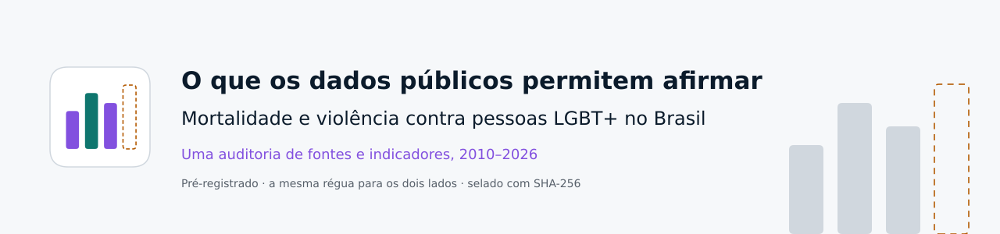
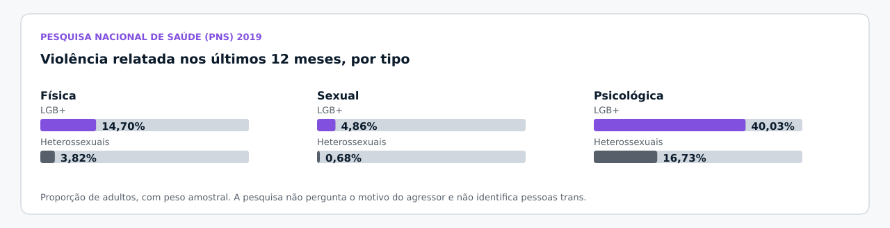

<div align="center">

<picture>
  <source media="(prefers-color-scheme: dark)" srcset="assets/brand/banner-pt-BR-dark.svg">
  
</picture>

<h3>A mesma régua para os dois lados do debate: o que os dados públicos brasileiros medem sobre a violência contra pessoas LGBT+, e o que não conseguem medir.</h3>

[](https://doi.org/10.5281/zenodo.23873858)
[](LICENSE)
[](LICENSES/CC-BY-4.0.txt)
[](pyproject.toml)
[](tests/)
[](https://github.com/ulissesflores/lgbt-indicador-violencia/actions/workflows/verify.yml)
[](output/hash-chain.md)
[](REPRODUCIBILITY.md#pre-registrations)
[](https://colab.research.google.com/github/ulissesflores/lgbt-indicador-violencia/blob/main/colab/replication.ipynb)

[English](README.md) · **Português (Brasil)** · [Español](README.es.md) · [Italiano](README.it.md) · [עברית](README.he.md)

</div>

<picture>
  <source media="(prefers-color-scheme: dark)" srcset="assets/brand/findings-pt-BR-dark.svg">
  
</picture>

<picture>
  <source media="(prefers-color-scheme: dark)" srcset="assets/demo/verify-dark.gif">
  
</picture>
<p align="center"><sub>Reprodução da verificação selada, sem rede: o selo e, depois, os testes que travam cada número publicado. Roteiro em <a href="https://github.com/charmbracelet/vhs">vhs</a> em <a href="assets/demo/">assets/demo/</a>; regravada depois do selo final. A gravação do terminal está em inglês.</sub></p>

> [!IMPORTANT]
> **Achado.** Na Pesquisa Nacional de Saúde de 2019, 14,70% dos adultos lésbicas, gays, bissexuais ou de outra
> orientação não heterossexual (LGB+) relataram violência física no ano anterior, contra 3,82% dos adultos
> heterossexuais; a razão ajustada é 2,82 (intervalo de 95%, 2,16 a 3,68). Os registros de óbito brasileiros não trazem
> orientação sexual nem identidade de gênero, por isso não existe taxa nacional de mortalidade LGBT+. Dos 160 casos
> amostrados da lista do Grupo Gay da Bahia de 2019, 50 foram confirmados pela fonte citada (48 por notícia): a lista
> não é taxa nem total, e caso não verificado não é caso inventado. Após 67 trocas de partido do governador, o homicídio
> do estado, relativo ao nacional, variou −0,7% (mediana), contra +4,6% sem troca; só nas 21 trocas sem outra troca
> próxima a queda é marcada (−10,2%, contra +6,7%). A comparação é exploratória e mostra coincidência, não efeito do
> governo.

## O artigo

| Edição | Arquivo |
|---|---|
| **Português (Brasil), original** | [`docs/paper/paper-final.pdf`](docs/paper/paper-final.pdf) |
| Inglês | [`docs/paper/paper-final-en.pdf`](docs/paper/paper-final-en.pdf) |

Cada edição tem DOI próprio e figuras com rótulos no seu idioma; o código das figuras em `figures/` mantém os rótulos em
português do estudo. As edições em espanhol e italiano da v1.2.0 não fazem parte desta versão: trazem duas leituras
corrigidas em [`docs/corrections.pt-BR.md`](docs/corrections.pt-BR.md) e voltam com DOI
próprio. Leitores de hebraico contam com a edição em inglês.

## O que este trabalho traz

1. **Uma régua só para os dois lados do debate.** Vinte e cinco afirmações que circulam no debate brasileiro, de um
   lado e de outro, são conferidas contra as mesmas fontes públicas, com um vocabulário de veredito fixo, em que "não
   testável" é resposta e "falso" nunca é usado para afirmação sobre motivação ou mortalidade. Oito componentes da
   análise foram pré-registrados, cada um com seu carimbo de tempo e SHA-256.
2. **Uma reanálise da única pesquisa que mede a diferença.** Os microdados da Pesquisa Nacional de Saúde de 2019, com o
   desenho amostral complexo: adultos LGB+ relatam violência física 3,84 vezes mais que heterossexuais sem ajuste e
   2,82 vezes depois dele, e a diferença se mantém em ajustes separados por estado civil, cônjuge no domicílio e modo
   de entrevista.
3. **Uma auditoria por amostra aleatória da contagem mais citada.** 160 casos sorteados da lista do Grupo Gay da Bahia
   de 2019, cada um conferido contra a fonte que a própria lista cita. Cinquenta se confirmam; a lista não é taxa nem
   total, e caso não verificado não é caso inventado.
4. **Cada número publicado vira teste.** Os testes travam cada número do artigo no arquivo que o produziu, e um único
   hash de cadeia SHA-256 sela código, testes, dados e resultados derivados. Os microdados oficiais não são
   redistribuídos; os scripts os baixam e conferem cada arquivo contra o SHA-256 esperado.

## Em resumo

| | |
|---|---|
| O que é | O pacote de estudo do artigo: dados derivados, código, pré-registros, testes e o artigo em duas edições |
| Período | 2010–2026 |
| Fontes | Pesquisa Nacional de Saúde de 2019 (PNS), registros de óbito (SIM), notificações de saúde (Sinan), boletins de ocorrência (Anuário do FBSP), o Disque 100, a lista do Grupo Gay da Bahia, dados eleitorais (TSE) |
| Pré-registrado | 8 componentes (Tabela B2 do artigo) e a análise do Disque 100, cada um com seu carimbo de tempo e SHA-256, em [`preregistrations/`](preregistrations/) e ao lado da análise que fixa ([lista](REPRODUCIBILITY.md#pre-registrations)); a reanálise da PNS e o sorteio dos 160 casos da lista não foram pré-registrados |
| Conferir o selo | Só a biblioteca padrão do Python; segundos |
| Recalcular | Python 3.12+ e [`requirements.txt`](requirements.txt); minutos |
| Não distribuído | Nomes de vítimas, PDFs e textos de notícia de terceiros, microdados oficiais brutos (privacidade ou licença) |

## Como verificar

```bash
python3 -m pip install -r requirements.txt
python3 -I make_provenance.py --verify     # SHA-256 of every distributed file and the chain hash
python3 -I run_all.py --rapido             # integrity, tests and seal (seconds)
python3 -I run_all.py                      # also recomputes the derived results in a separate copy (minutes)
shasum -a 256 -c docs/paper/SHA256SUMS.txt # the paper PDF
```

Saída esperada dos dois primeiros comandos:

```text
provenance verified: <chain hash> (<n> arquivos)
...
testes: <n>/<n> passaram (2 pulados)
provenance verified: <chain hash> (<n> arquivos)
```

O hash da cadeia desta versão está em [`output/hash-chain.md`](output/hash-chain.md). O que pode e o que não pode ser
executado de novo, e por quê, está em [`REPRODUCIBILITY.md`](REPRODUCIBILITY.md).

Sem instalar nada: [`colab/replication.ipynb`](colab/replication.ipynb) ([abrir no
Colab](https://colab.research.google.com/github/ulissesflores/lgbt-indicador-violencia/blob/main/colab/replication.ipynb))
clona este repositório, confere o selo, roda o `run_all.py` e mostra cada número que o artigo imprime ao lado do valor
no arquivo que o guarda; opcionalmente baixa do IBGE o microdado da PNS 2019 e roda de novo os cinco scripts que o
leem.

## Resultados

Oito das vinte e cinco afirmações conferidas no artigo (Tabela 2 da edição em português), condensadas do texto dele. Os quatro
números principais estão desenhados nos cartões do alto desta página.

<picture>
  <source media="(prefers-color-scheme: dark)" srcset="assets/brand/results-pt-BR-dark.svg">
  
</picture>

| Afirmação no debate | O que o dado mostra | O que não mostra |
|---|---|---|
| Adultos LGB+ relatam mais violência física que heterossexuais | 14,70% contra 3,82% em 12 meses, razão ajustada 2,82 | O tipo de agressor nem o motivo |
| Também relatam mais violência sexual e psicológica | Sexual 4,86% contra 0,68%; psicológica 40,03% contra 16,73% | O motivo; pessoas trans não são identificadas |
| Os boletins de homofobia e transfobia explodiram, logo a violência explodiu | Os boletins foram de 783 (2022) para 3.481 (2025), e a mesma série cabe em violência parada, subindo ou caindo | Que a violência ficou parada |
| Pessoas LGBT+ morrem mais no Brasil | A declaração de óbito não tem orientação sexual nem identidade de gênero, e por isso não existe taxa nacional | Que morrem na mesma proporção |
| Pessoas LGB+ morrem mais fora do Brasil | Na Inglaterra e no País de Gales, quem se declarou LGB+ no Censo teve mortalidade geral 31% maior (razão 1,31) | Não é homicídio, e não vale para o Brasil |
| Os números do Grupo Gay da Bahia são inventados | Em 50 dos 160 casos sorteados de 2019, a fonte citada sustentava morte violenta e vítima LGBT+ | Que a lista está completa |
| Governo de direita (ou de esquerda) muda os homicídios | O painel não achou associação detectável entre o partido do governador e o homicídio geral (de −12,3% a +12,4%); nas 21 trocas de partido sem outra troca próxima, a taxa do estado relativa à do Brasil caiu (−10,2%, contra +6,7%), em análise exploratória | Que o governo é irrelevante |
| O Brasil é o país que mais mata LGBT+ | A busca só achou comparações de mortes noticiadas de pessoas trans, sem cobertura comum entre países; no Parlamento, 1 de 49 falas com essa frase cita fonte primária | Que o Brasil mata pouco |

Onde cada resultado está no repositório, arquivo por arquivo:
[`docs/reproducibility-and-result-locations.pt-BR.md`](docs/reproducibility-and-result-locations.pt-BR.md).

## O que se afirma e o que não se afirma

| Afirmado | Não afirmado |
|---|---|
| Adultos LGB+ relatam mais violência física, sexual e psicológica que adultos heterossexuais (2019) | Que essa diferença mede discriminação ou estilo de vida: os dados não separam as duas coisas |
| Nenhum registro público permite uma taxa nacional de mortalidade LGBT+ | Que pessoas LGBT+ são ou não são mortas com mais frequência que as demais |
| Registros policiais, denúncias telefônicas e notificações medem o registro | Que a violência contra pessoas LGBT+ subiu ou caiu sob qualquer governo |
| O homicídio do estado, relativo ao nacional, caiu nas 21 trocas de partido do governador sem outra troca próxima (−10,2%, contra +6,7%); comparação exploratória | Que essa queda seja efeito do governo |
| 50 dos 160 casos amostrados da lista de 2019 (31,3%) são verificáveis a partir da fonte que a própria lista cita | Que a lista é completa, ou que é inventada |

## Integridade

[`output/hash-chain.md`](output/hash-chain.md) guarda um único hash de cadeia SHA-256 sobre todos os arquivos
distribuídos: código, testes, dados, pré-registros e resultados derivados. Para conferir que nada mudou desde o selo:

```bash
python3 -I make_provenance.py --verify
```

Basta a biblioteca padrão. Duas pastas ficam fora do selo por construção: `docs/paper/`, conferida pelo seu próprio
[`SHA256SUMS.txt`](docs/paper/SHA256SUMS.txt), e `assets/demo/`, cuja gravação mostra o hash da cadeia e é feita
depois do selo.

## Organização

| Pasta ou arquivo | Conteúdo |
|---|---|
| `data/` | Dados derivados e o código que os produz: reanálise da pesquisa (`pns/`), taxas de mortalidade (`sim/`), notificações de violência (`sinan/`), registros policiais (`anuario/`), o serviço telefônico de denúncias Disque 100 (`disque100/`), o painel de governadores (`painel/`, `presidencia/`, `exposicao/`) |
| `analysis/` | As demais análises em que o artigo se apoia: auditoria da lista do Grupo Gay da Bahia (`ggb-audit/`, `ggb-series/`, `counterpoint/`), poder estatístico e custo da pesquisa (`survey-cost/`), simulação de identificabilidade (`simulation/`), discurso público (`discourse/`), testes de robustez (`robustness/`), escores de ideologia (`ideology/`), literatura (`literature/`, `full-text/`) |
| `figures/` | Código e dados de cada figura (`make_figures.py`, `fontes/` com os valores plotados) e as figuras do artigo (`article/`) |
| `preregistrations/` | Pré-registros com seus carimbos de tempo e SHA-256, conforme citados no artigo |
| `sources/` | Cópias de fontes públicas usadas pelos scripts (`public/`), os registros de fontes (`ledgers/`) e os quartis de periódicos |
| `manifest/` | Manifesto de fontes (URL, data de acesso e, quando um arquivo foi salvo, SHA-256), inventário público e as somas de verificação do selo |
| `docs/` | Reprodutibilidade e localização de cada resultado (`reproducibility-and-result-locations.pt-BR.md`), uso de modelos de linguagem (`language-model-use.pt-BR.md`) e correções (`corrections.pt-BR.md`), cada um com a versão em inglês (sem o sufixo `.pt-BR`); o artigo (`paper/`) |
| `assets/` | A arte deste README, desenhada por código a partir dos dados selados (`brand/make_brand.py`), a marca do laboratório e a gravação de terminal com seus roteiros vhs (`demo/`) |
| `tests/` | Testes que vinculam cada número publicado ao arquivo que o produziu |
| `scripts/` | Download dos microdados oficiais (com o SHA-256 esperado), o executor da reprodução e as auditorias |
| `colab/` | O notebook de replicação: todas as conferências acima, a partir do repositório, no Google Colab, sem instalar nada |
| `run_all.py`, `make_provenance.py`, `output/` | Verificação de integridade, recálculo e a cadeia SHA-256 |

O manifesto de fontes (`manifest/MANIFESTO-FONTES.csv`) e o inventário público (`manifest/INVENTARIO-PUBLICO.md`) contam
1022 identificadores de 20 registros; o repositório contém 182 scripts. Código, comentários e colunas de dados mantêm o
português original do estudo.

## Autor

<picture>
  <source media="(prefers-color-scheme: dark)" srcset="assets/brand/lab-lockup-dark.png">
  
</picture>

**Carlos Ulisses Flores** — CTO e pesquisador-chefe, Codex Hash Research Laboratory; mestrando em Inteligência
Artificial, American Global Tech University.

[](https://orcid.org/0000-0002-6034-7765)
[](https://ulissesflores.com)
[](https://lattes.cnpq.br/6905246706890561)

Como os modelos de linguagem foram usados, e onde não foram, está em
[`docs/language-model-use.pt-BR.md`](docs/language-model-use.pt-BR.md).

## Citação

Cite o DOI abaixo para apontar o estudo; ele sempre resolve para a versão mais recente. Cada versão e cada edição do
artigo também têm DOI próprio no Zenodo.

```bibtex
@dataset{flores_lgbt_indicador_violencia,
  author    = {Flores, Carlos Ulisses},
  title     = {Mortality and violence against LGBT+ people in Brazil: what public data allow us to claim --- an audit of sources and indicators, 2010--2026},
  year      = {2026},
  publisher = {Zenodo},
  doi       = {10.5281/zenodo.23873858},
  url       = {https://doi.org/10.5281/zenodo.23873858}
}
```

O botão "Cite this repository" do GitHub lê o [`CITATION.cff`](CITATION.cff).

## Licença

Código: Apache-2.0 ([`LICENSE`](LICENSE), [`LICENSES/Apache-2.0.txt`](LICENSES/Apache-2.0.txt)). Dados derivados, texto e
figuras: CC BY 4.0 ([`LICENSES/CC-BY-4.0.txt`](LICENSES/CC-BY-4.0.txt)). A marca do Codex Hash Research Laboratory
(`assets/brand/lab-lockup-*.png`) não está coberta por nenhuma das duas licenças. Os microdados oficiais do IBGE, do
DATASUS e do TSE mantêm seus próprios termos e não são redistribuídos. Veja [`NOTICE`](NOTICE).

## Referências-âncora

As obras contra as quais este pacote foi construído: o problema do indicador que ele testa, as fontes oficiais que
ele audita e as contagens da sociedade civil que ele lê. A lista completa está no artigo.

- Campbell, D. T. (1979). Assessing the impact of planned social change. *Evaluation and Program Planning*, 2(1), 67–90. Reprinted in *Journal of MultiDisciplinary Evaluation*, 7(15), 3–43, 2011. https://doi.org/10.56645/jmde.v7i15.297
- Grupo Gay da Bahia. (2020). *Mortes violentas de LGBT+ no Brasil, 2019: Relatório do Grupo Gay da Bahia*. https://grupogaydabahia.com.br/wp-content/uploads/bsk-pdf-manager/2024/02/relatorio-2019.pdf
- Instituto Brasileiro de Geografia e Estatística. (2022). *Pesquisa Nacional de Saúde 2019: Orientação sexual autoidentificada da população adulta*. https://biblioteca.ibge.gov.br/visualizacao/livros/liv101934.pdf
- Instituto de Pesquisa Econômica Aplicada & Fórum Brasileiro de Segurança Pública. (2025). *Atlas da Violência 2025*. https://repositorio.ipea.gov.br/handle/11058/17165
- Fórum Brasileiro de Segurança Pública. (2025). *Anuário Brasileiro de Segurança Pública 2025*. https://forumseguranca.org.br/wp-content/uploads/2025/07/anuario-2025.pdf
- Benevides, B. G. (2026). *Dossiê: Assassinatos e violências contra travestis e transexuais brasileiras em 2025*. Associação Nacional de Travestis e Transexuais. https://antrabrasil.org/wp-content/uploads/2026/01/dossie-antra-2026.pdf
