## Resumo

Com oito componentes pré-registrados e régua igual para os dois lados do debate, este artigo examina o que o dado público brasileiro permite afirmar sobre violência contra pessoas LGBT+. Na Pesquisa Nacional de Saúde de 2019, 14,70% dos adultos lésbicas, gays e bissexuais (LGB+) e 3,82% dos heterossexuais relataram violência física em 12 meses (razão ajustada de 2,82; intervalo de 95%, 2,16 a 3,68). Sem orientação sexual no óbito, a mortalidade LGBT+ no Brasil não é estimável com dado público; na Inglaterra e no País de Gales, em registro ligado ao censo, a razão de mortalidade geral entre LGB+ e heterossexuais é 1,31 ("sustentada" pela regra complementar, posterior aos estudos; "parcial" pela pré-registrada), sem razão populacional para homicídio. A contagem do Grupo Gay da Bahia não é taxa nem total auditável: dos 160 casos sorteados de 2019, 50 (31,3%; 40 em correspondência estrita) foram verificados, fração que não é piso nem teto. Os boletins de ocorrência por homofobia ou transfobia, de 783 (2022) a 3.481 (2025), não separam violência de registro. O partido do governador não se associou de forma detectável à taxa geral de homicídio, descrita em cada governo sem atribuição de causa. Em 60 consultas pré-registradas sobre seis governos federais (2003 a 2026), não se localizou perseguição por agentes do Estado, e sim omissão ou corte de política em cinco mandatos e hostilidade retórica e administrativa em 2019; agentes estaduais e locais ficaram fora da busca. No Parlamento, 1 de 49 falas sobre "o país que mais mata" cita fonte primária (0 de 49 na codificação original), contra 2 de 38 com outras estatísticas, diferença indistinguível do acaso. A tendência exige levantamento de vitimização repetido; a mortalidade, orientação no óbito ou vinculação a fonte com denominador compatível.

*Palavras-chave:* violência; LGBT+; mortalidade; subnotificação; identificabilidade; pré-registro

## Abstract

With eight pre-registered components and the same yardstick for both sides of the debate, this article examines what Brazilian public data allow one to state about violence against LGBT+ people. In the 2019 National Health Survey, 14.70% of lesbian, gay and bisexual (LGB+) adults and 3.82% of heterosexuals reported physical violence in the past 12 months (adjusted ratio of 2.82; 95% interval, 2.16 to 3.68). With no sexual orientation at death, LGBT+ mortality in Brazil cannot be estimated with public data; in England and Wales, in records linked to the census, the all-cause mortality ratio of LGB+ to heterosexual people is 1.31 ("supported" under the complementary rule, defined after the studies; "partial" under the pre-registered one), with no population ratio for homicide. The Grupo Gay da Bahia count is neither a rate nor an auditable total: of 160 sampled 2019 cases, 50 (31.3%; 40 under strict matching) were verified, a fraction that is neither a floor nor a ceiling. Police reports of homophobia or transphobia, from 783 (2022) to 3,481 (2025), do not separate violence from recording. The governor's party showed no detectable association with the general homicide rate, described under each government without causal attribution. In 60 pre-registered queries on six federal governments (2003 to 2026), no persecution by state agents was found, but omission or policy cuts in five terms and hostile rhetoric and administrative action in 2019; state and local agents were outside the search. In Parliament, 1 of 49 speeches on "the country that kills the most" cites a primary source (0 of 49 under the original coding), against 2 of 38 with other statistics, a difference indistinguishable from chance. The trend requires a repeated victimisation survey; mortality, orientation recorded at death or linkage to a source with a compatible denominator.

*Keywords:* violence; LGBT+; mortality; underreporting; identifiability; pre-registration

## 1. Introdução

Adultos brasileiros que se declaram lésbicas, gays ou bissexuais relatam mais violência que heterossexuais na Pesquisa Nacional de Saúde (PNS) de 2019, levantamento domiciliar por amostra do Instituto Brasileiro de Geografia e Estatística (IBGE), resultado publicado por Vasconcelos et al. (2023). O debate público, porém, gira em torno da violência letal e de números cuja origem raramente acompanha a frase: "o país que mais mata", "a violência por ódio disparou" e, no sentido oposto, "o dado é inventado". As séries brasileiras sobre mortes de pessoas LGBT+ são registros, e nenhuma delas dispõe de medida externa da propensão de registro, isto é, da parcela da violência ocorrida que chega a ser registrada. Campbell (1979) descreveu o risco de que um indicador usado para decidir e cobrar mude por causa do próprio uso, como a taxa de crime registrada, que varia com o esforço de registro sem que o fato varie; neste artigo, essa ideia orienta a leitura dos registros e não é testada, porque melhoras de acesso, de reconhecimento e de procedimento também elevam registros.

A pergunta tem duas metades de mesmo peso: o que o dado público brasileiro e a literatura revisada por pares permitem afirmar sobre violência letal e não letal contra pessoas LGBT+, e o que esses mesmos dados não permitem afirmar, qualquer que seja o lado do debate que formula a frase. A distinção tem fundamento causal. Holland (1986) mostrou que um atributo não manipulável não é causa no sentido experimental, e Greiner e Rubin (2011) deslocaram a pergunta causal para a percepção do atributo por quem decide. A frase "morreu porque é LGBT+" admite três leituras, motivação documentada do agressor, viés percebido pela vítima e efeito causal da discriminação, e nenhuma delas é estimada em escala nacional pelas fontes brasileiras consultadas (Tabela 1).

As respostas são organizadas em quatro níveis de pergunta, porque uma afirmação pode valer num nível e não em outro. O primeiro nível (N1, ocorrência, medida como prevalência ou como taxa) pergunta quantas pessoas sofrem violência ou morrem, em proporção ao tamanho do grupo; o segundo (N2, disparidade residual) pergunta se a diferença entre grupos persiste depois de descontar idade, cor, instrução e região, o que não equivale à parcela atribuível à discriminação (VanderWeele & Robinson, 2014); o terceiro (N3, contexto) pergunta em que circunstância a violência ocorre, por exemplo quem agrediu e onde; o quarto (N4, motivação) pergunta se o agressor agiu por causa da orientação sexual, da identidade de gênero ou da cor da vítima. Cada termo técnico é definido no primeiro uso, e o glossário do Apêndice C (Tabela C1) os reúne. O texto usa LGB+ quando a fonte mede só orientação sexual, como a PNS de 2019, que não perguntou identidade de gênero (IBGE, 2022b), e LGBT+ quando a fonte inclui pessoas trans.

As frases que circulam no debate foram convertidas em sete hipóteses, testadas na ordem em que os resultados são apresentados (seções 3.1 a 3.10) e julgadas na mesma ordem na Discussão (seção 4.1):

1. Hipótese 1 (vitimização não letal): adultos LGB+ relatam mais violência física, sexual e psicológica que heterossexuais, também depois de descontar sexo, idade, cor, instrução, região e situação urbana ou rural (seção 3.1).
2. Hipótese 2 (mortalidade): pessoas LGB+ ou trans morrem mais que heterossexuais ou pessoas cisgênero, no Brasil e fora dele (seções 3.2 e 3.3).
3. Hipótese 3 (contagem de mortes da sociedade civil): a contagem do Grupo Gay da Bahia mede a mortalidade violenta de pessoas LGBT+ como taxa ou como total; na forma oposta, a contagem é inventada (seção 3.4).
4. Hipótese 4 (séries de registro): o crescimento dos registros administrativos, isto é, boletins de ocorrência, fichas dos serviços de saúde e denúncias ao Disque 100, indica crescimento da violência contra pessoas LGBT+ (seção 3.5).
5. Hipótese 5 (governo e homicídio): a orientação ideológica do governo estadual ou federal associa-se à taxa de homicídio registrada (seções 3.6 e 3.7).
6. Hipótese 6 (violência de Estado): governos brasileiros de 2003 a 2026 perseguiram pessoas LGBT+ por meio de agentes do Estado; e a perseguição estatal de homossexuais é própria de regimes de um só tipo político, forma presente em falas do Parlamento que atribuem a perseguição a regimes estrangeiros (seções 3.8 a 3.10).
7. Hipótese 7 (circulação): a afirmação de que o Brasil é "o país que mais mata" pessoas LGBT+ circula no Parlamento sem fonte primária com frequência diferente da de outras estatísticas ditas em plenário (seção 3.10).

O artigo contribui de seis modos. Primeiro, formaliza a não identificação da incidência pela série policial de LGBTfobia: com incidência e propensão de registro crescendo a taxas constantes, cada crescimento da primeira corresponde a um crescimento diferente da segunda (seção 3.5); Silva et al. (2026), segundo o resumo, já advertem que os registros de 2021 a 2025 não devem ser lidos como incidência, sem modelo nem cálculo de poder. Segundo, audita a contagem do Grupo Gay da Bahia pela amostra do único ano com lista nominal publicada (2019), testa a dependência entre as listas de mídia e mede a escala da contagem sob hipóteses declaradas; no espaço de busca enumerado não foi localizada avaliação independente dessa contagem em periódico indexado, o que não equivale a inexistência. Terceiro, reanalisa a PNS de 2019 com o desenho amostral complexo e reproduz o artigo publicado a 0,05 ponto percentual (Vasconcelos et al., 2023). Quarto, estima a associação entre o partido do governador e os homicídios e descreve o que a taxa de homicídio fez a cada troca de governo, sem atribuição de causa. Quinto, mede a circulação das afirmações no Parlamento, com segundo codificador e linha de base. Sexto, dimensiona o levantamento de vitimização que daria a resposta para a violência não letal, com o efeito de desenho medido no microdado, e sintetiza a evidência sobre mortalidade por orientação sexual fora do Brasil publicada entre 2023 e 2026 (ONS, 2026a; Zachry et al., 2025).

A seção 2 descreve fontes, busca bibliográfica, hipóteses, pré-registros e métodos; a seção 3 apresenta os resultados; a seção 4 sintetiza os vereditos, responde às objeções previsíveis e discute as implicações para a vigilância e a agenda de pesquisa; as seções 5 e 6 tratam das ameaças à validade e da reprodutibilidade; a seção 7 conclui.

## 2. Método

### 2.1. Fontes de dado

Todas as fontes são públicas; nenhum dado foi solicitado a pessoa ou instituição, e o que uma fonte não publica é tratado como resultado (não publicado e, portanto, não auditável), e não como pendência. Três bases de microdados oficiais sustentam as estimativas. A primeira é a PNS de 2019, que perguntou a 88.531 adultos de domicílios sorteados se sofreram violência nos 12 meses anteriores e qual é a sua orientação sexual; o próprio IBGE registra que a pesquisa captou só a orientação sexual, "não havendo, naquele momento, coleta a respeito da identidade de gênero" (IBGE, 2022a; IBGE, 2022b, p. 7). A segunda é o Sistema de Informações sobre Mortalidade (SIM), o registro nacional de óbitos do Ministério da Saúde, alimentado pela declaração de óbito, de onde vêm as mortes por agressão (códigos X85-Y09 da Classificação Internacional de Doenças, décima revisão, CID-10) e as de intenção indeterminada (Y10-Y34), com denominadores do Censo 2022 e das estimativas de população do IBGE (DATASUS, 2026a; IBGE, 2026). A terceira é o Sistema de Informação de Agravos de Notificação (Sinan), cuja ficha de violência interpessoal é preenchida pelo serviço de saúde que atende a vítima e contém um campo de orientação sexual (campo 36) e um de motivação da violência (campo 55), aqui de 2015 a 2025 (DATASUS, 2026b).

As séries agregadas vieram do Anuário Brasileiro de Segurança Pública, compilado pelo Fórum Brasileiro de Segurança Pública (FBSP) a partir dos boletins de ocorrência das polícias estaduais (FBSP, 2026); do Atlas da Violência (IPEA & FBSP, 2026); dos relatórios do Grupo Gay da Bahia (GGB), associação da sociedade civil de ativismo LGBT+ que conta mortes de pessoas LGBT+ noticiadas pela imprensa (GGB, 2020, 2026); e do dossiê da Associação Nacional de Travestis e Transexuais (ANTRA) sobre mortes de pessoas trans (Benevides, 2026). A ideologia dos partidos veio do escore de especialistas de Bolognesi et al. (2023), que vai de 0 (esquerda) a 10 (direita), por período (Bolognesi et al., 2025), com a escala de Zucco e Power (2023) como sensibilidade; o partido de cada governador eleito veio dos dados abertos do Tribunal Superior Eleitoral (TSE, 2026). As falas em plenário vieram das interfaces de dados abertos da Câmara dos Deputados (2026) e do Senado Federal (2026). Os 23 arquivos públicos do Disque 100, canal federal de denúncia de violações de direitos humanos, cerca de 14 GB entre 2011 e setembro de 2026, foram baixados sem cadastro nem aceite de termos e apenas contados, porque nenhum deles traz chave que identifique a pessoa (MDHC, 2026). A Tabela 1 resume o que cada fonte conta e o que não diz; a Figura 1 mostra em que etapa do caminho do dado cada uma se posiciona, e a Figura 2, que período cada uma cobre.

**Tabela 1**

*Fontes de dado: quem produz, o que conta, o que não diz e como o artigo as usa*

| Fonte | Quem produz | O que conta e quem entra | O que não diz | Uso no artigo |
|---|---|---|---|---|
| Pesquisa Nacional de Saúde 2019 (PNS) | IBGE, levantamento em domicílios sorteados | violência que a pessoa diz ter sofrido em 12 meses, por orientação sexual; 88.531 adultos, tenham ou não procurado serviço ou polícia | homicídio; identidade de gênero (não perguntada: pessoas trans podem estar na amostra, sem identificação); motivo do agressor; tendência (uma só edição) | seção 3.1 |
| Sistema de Informações sobre Mortalidade (SIM) | Ministério da Saúde, a partir da declaração de óbito; arquivos distribuídos pelo Departamento de Informática do Sistema Único de Saúde (DATASUS) | toda morte com declaração de óbito, com causa, sexo, raça ou cor, idade e município | orientação sexual, identidade de gênero e motivo: nem o formulário nem o arquivo os registram | seções 3.2, 3.3 e 3.7 |
| Sistema de Informação de Agravos de Notificação (Sinan), ficha de violência | Ministério da Saúde; ficha preenchida pelo serviço de saúde que atende a vítima | violência atendida, com campo de orientação sexual e de motivo; a regra de notificação não é a mesma para todos os grupos | quem não procurou serviço; quanta violência existe; o motivo em boa parte das fichas | seção 3.5 |
| Boletim de ocorrência, reunido no Anuário Brasileiro de Segurança Pública | polícias estaduais; compilação do FBSP, organização da sociedade civil | registros de "racismo por homofobia ou transfobia", enquadramento adotado após o julgamento da Ação Direta de Inconstitucionalidade por Omissão 26 pelo Supremo Tribunal Federal (2019) | quanta violência existe; motivo provado; comparação entre estados | seção 3.5 |
| Grupo Gay da Bahia (GGB) | associação da sociedade civil (ativismo LGBT+) | mortes violentas noticiadas de pessoas identificadas como LGBT+, com critério largo (inclui suicídio e latrocínio) | taxa; cobertura; crime de ódio comprovado; a lista de casos de 2023 a 2025 não foi publicada | seção 3.4 |
| Associação Nacional de Travestis e Transexuais (ANTRA) | associação da sociedade civil (ativismo LGBT+), dossiê anual | mortes noticiadas de pessoas trans; até 2016, a série é a do GGB | taxa; cobertura; a lista nominal não é publicada | seção 3.4 |
| Atlas da Violência | Instituto de Pesquisa Econômica Aplicada (IPEA) e FBSP | estimativas de homicídio a partir do SIM, inclusive a diferença entre homicídios estimados e registrados | orientação sexual (herda o limite do SIM) | seção 3.6 |
| Disque 100 | Ministério dos Direitos Humanos e da Cidadania (MDHC), dados abertos | denúncias recebidas, em 23 arquivos de três formatos (2011 a setembro de 2026); desde o segundo semestre de 2022, pessoas trans aparecem na coluna de orientação sexual | fatos; pessoas únicas (nenhum formato tem chave de pessoa); série contínua (quatro quebras de formato) | seção 3.5 |
| Tribunal Superior Eleitoral (TSE) e escore de ideologia dos partidos | TSE: partido do governador eleito; especialistas: nota de 0 a 10 por partido | quem governava e em que posição da escala estava o partido | o que o governo executou; qualquer medida de violência | seções 3.6 e 3.7 |
| Câmara dos Deputados e Senado Federal | as duas Casas, dados abertos | falas em plenário: 258.011 de 2015 a outubro de 2026 | se a frase dita é verdadeira; qualquer taxa de violência | seção 3.10 |

*Nota.* Sobre o Sinan, o Guia de Vigilância em Saúde exclui da notificação a violência comunitária ou extrafamiliar contra homens de 20 a 59 anos, "exceto nas condições de vulnerabilidade", entre elas pertencer à população LGBT (Ministério da Saúde, 2024, p. 1222). Fonte: IBGE (2022a, 2022b), DATASUS (2026a, 2026b), FBSP (2026), GGB (2020, 2026), Benevides (2026), IPEA e FBSP (2026), MDHC (2026), TSE (2026), Bolognesi et al. (2023), Câmara dos Deputados (2026) e Senado Federal (2026).

**Figura 1**

*Etapas do caminho do dado, do fato à contagem publicada, e a etapa em que cada fonte se posiciona*

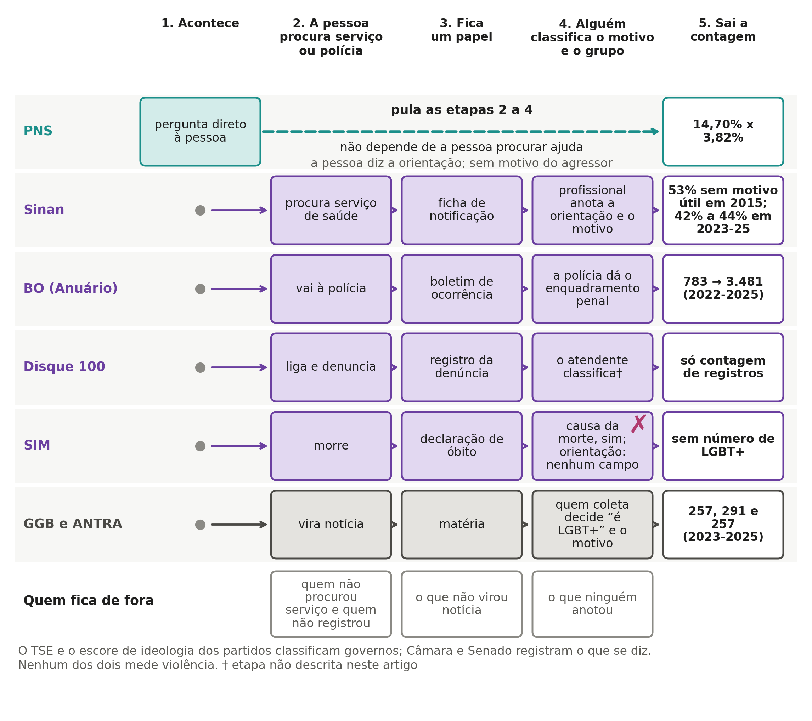

*Nota.* Cada linha corresponde a uma fonte e cada coluna, a uma etapa do caminho do dado: o fato, a procura por serviço de saúde ou polícia, o registro, a classificação do motivo e a contagem publicada. A seta tracejada indica que o levantamento domiciliar (PNS) pergunta diretamente à pessoa e não depende de ela ter procurado ajuda; o sinal de exclusão marca, no registro de óbitos (SIM), a etapa em que a orientação sexual deixa de existir. Esquema: a largura das etapas não representa quantidade de casos. Fonte: elaboração do autor a partir das fontes da Tabela 1.

**Figura 2**

*Período coberto e grandeza medida por cada fonte*

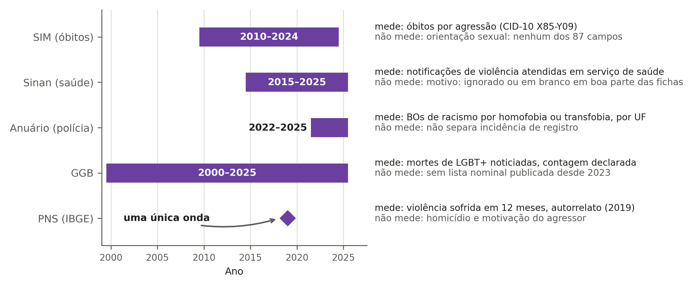

*Nota.* Cada barra indica o período com dados de cada fonte, e o losango, um levantamento de um só ano; à direita, o que cada fonte mede e o que não mede. Fontes cujas barras não se sobrepõem não podem ser comparadas ano a ano, e nenhuma fonte, sozinha, fornece taxa de morte de pessoas LGBT+. Fonte: elaboração do autor a partir das fontes da Tabela 1.

### 2.2. Busca bibliográfica e regras de evidência

A busca bibliográfica consultou sete bases (PubMed, Crossref, OpenAlex, SciELO, Europe PMC, LILACS e Dialnet), além de buscadores gerais e de sítios oficiais de estatística, de 10 a 25 de outubro de 2026; cada fonte foi registrada com identificador, idioma, tipo, endereço e data de acesso, e as fontes registradas estão em 11 idiomas (Flores, 2026). Três regras governam o que entra como evidência. A primeira, fixada no pré-registro, admite no veredito sobre mortalidade apenas artigo de periódico do primeiro quartil (Q1, os 25% mais bem classificados da área no SCImago Journal Rank, no triênio 2023 a 2025, conferido em tabela local) cujo texto integral tenha sido lido; periódico sem quartil conferido aparece com aviso e não decide. O corte é critério de elegibilidade, não prova de validade. A segunda regra exige que toda afirmação de ausência seja escrita como "não localizado no espaço enumerado de busca", com o espaço declarado, porque ausência num espaço de busca não equivale a inexistência; quando há controle positivo, isto é, uma consulta que deveria encontrar algo e encontrou, ele é registrado. A terceira fixa um vocabulário único de veredito para as afirmações de qualquer sentido: "sustentada", "parcial", "contrariada pela evidência num dado nível", "não sustentada pelo que foi medido" e "não testável"; a palavra "falso" não é usada para afirmação sobre motivação ou mortalidade.

Uma regra complementar de elegibilidade foi definida em 24 de outubro de 2026, depois de identificados estudos recentes de mortalidade que a regra original não admitia; por isso ela não é prospectiva. Pela regra complementar, resultados oficiais obtidos por vinculação de registros, como os do Escritório Nacional de Estatística do Reino Unido (Office for National Statistics, ONS; ONS, 2026a), entram na categoria de documento oficial lido, sem quartil, e o quartil Q1 dos periódicos JAMA e JAMA Network Open foi conferido em páginas do SCImago salvas com impressão digital SHA-256, obtidas por serviço de extração de páginas e não por navegador. O quartil é informação bibliométrica, e a avaliação substantiva de cada estudo considera desenho, identificação, mensuração e aplicabilidade. A seção 3.2 apresenta o veredito sob as duas regras, para que o efeito da ampliação fique visível.

### 2.3. Hipóteses, desfechos e métodos

A Tabela 2 liga cada hipótese ao desfecho medido, à fonte, ao método e à seção em que o resultado aparece. As hipóteses sobre motivação do agressor (nível N4) não têm desfecho estimável com as fontes consultadas, e por isso aparecem como limite de cada resultado, e não como hipótese própria.

**Tabela 2**

*Hipóteses, desfechos, fontes, métodos e seção do resultado*

| Hipótese | Desfecho ou variável | Fonte | Método | Seção |
|---|---|---|---|---|
| 1. Vitimização não letal maior entre adultos LGB+ | prevalência de violência física, sexual, psicológica e qualquer em 12 meses; agressor e local | PNS 2019 (IBGE, 2022a) | prevalências com desenho complexo; razão de prevalências bruta e ajustada | 3.1 |
| 2. Mortalidade maior entre pessoas LGB+ ou trans | campos de orientação e identidade no óbito; razões de mortalidade em estudos de população definida; taxas padronizadas por sexo e raça como controle positivo | SIM (DATASUS, 2026a); ONS (2025, 2026a, 2026b); periódicos | leitura do arquivo e do formulário; síntese por causa, população e estimador; padronização por idade | 3.2 e 3.3 |
| 3. Contagem do GGB como taxa ou total, ou como invenção | fração verificável, motivo atribuído, duplicatas, dependência entre listas, razão entre contagem e mortes esperadas | GGB (2020, 2026); SIM; PNS | amostra aleatória de 160 casos; captura-recaptura; padronização indireta sob hipóteses | 3.4 |
| 4. Crescimento dos registros como crescimento da violência | série de boletins de ocorrência; completude do campo de motivo; série do Disque 100 | FBSP (2026); DATASUS (2026b); MDHC (2026) | modelo de identificabilidade; descrição de completude e de quebras | 3.5 |
| 5. Ideologia do governo associada ao homicídio | log da taxa de homicídio registrada por estado e ano; taxa nacional por mandato | SIM; TSE; escore de ideologia | efeitos fixos duplos; estudo de eventos; exposição descritiva por governo | 3.6 e 3.7 |
| 6. Perseguição de pessoas LGBT+ por agentes do Estado | episódios por tipo de ato de governo, 2003 a 2026; perseguição documentada em outros regimes | imprensa e documentos oficiais; relatórios de órgãos internacionais | busca simétrica pré-registrada; leitura de documentos primários | 3.8 e 3.9 |
| 7. Circulação de "o país que mais mata" sem fonte primária | proporção de falas com fonte primária | Câmara dos Deputados (2026); Senado Federal (2026) | contagem por dicionário; amostra codificada; segundo codificador; teste exato de Fisher | 3.10 |

*Nota.* As seções 3.11 a 3.13 trazem resultados de contexto: alegações falsas e retratação, sistemas de medida de outros países e poder estatístico de um levantamento de vitimização. Fonte: elaboração do autor.

### 2.4. Pré-registros e desvios

O SHA-256 é a impressão digital de um arquivo: um código de 64 caracteres calculado de todo o conteúdo, que muda inteiro se uma única vírgula muda. Ele verifica que um texto é o mesmo que foi registrado; a anterioridade, isto é, que o texto foi escrito antes da análise, depende de evidência temporal independente, e, sem carimbo de tempo externo, as horas da Tabela 3 são declaração do protocolo do autor. Pré-registro, aqui, é o texto das regras de análise escrito a priori, isto é, antes de qualquer classificação ou script que lesse o desfecho, e selado por SHA-256; o que mudou depois foi registrado em adendos datados, sem reescrever o texto original. Oito componentes da análise foram pré-registrados (Tabela 3). Onde a especificação foi escolhida depois de ver resultados, o fato é dito no parágrafo do resultado, e o Apêndice B lista os desvios (Tabela B1). Os tipos de ato de governo são designados por nome no texto, porque os dois documentos que os definem usam numerações diferentes (Apêndice B).

**Tabela 3**

*Pré-registros e critérios congelados: hora declarada (UTC) e impressão digital do texto original*

| Componente | Gravado em | SHA-256 (16 primeiros dígitos) | O que fixa |
|---|---|---|---|
| Mortalidade por orientação sexual | 2026-10-22T21:19:32Z | a17cf2f7d994ccf4 | só periódico do primeiro quartil com texto integral lido decide o veredito |
| Governos e perseguição | 2026-10-22T21:29:37Z | dc231b3f9cf016ed | tipos de ato de governo, níveis de gravidade e espaço de busca |
| Mídia e discurso | 2026-10-22T21:37:13Z | 1d1856c0286acb4c | as quatro frases que circulam, dicionário de busca e sorteio |
| Busca simétrica de atos de governo, Cuba e segundo codificador | 2026-10-23T19:43:24Z | b11fc8f95f872985 | 6 governantes x 10 consultas; concordância entre codificadores abaixo de 0,60 torna o resultado indicativo |
| Reanálises da revisão adversarial | 2026-10-23T19:46:07Z | c3113104e6932d93 | leitura do estudo de eventos, falsificação, intervalo direto, contagem do GGB |
| Troca de presidente | 2026-10-24T20:06:38Z | f48b1ee4172ea087 | interação entre a ideologia do governador e a do presidente; série nacional com placebo |
| Intervalo do painel por inversão do teste (forma da análise) | 2026-10-24T20:38:08Z | c6f07e2c0391c117 | grade, reamostragem e regra de leitura do intervalo invertido |
| Exposição por governo | 2026-10-24T20:43:46Z | 83c4ef0f7e73bce2 | mandatos, janelas, referência de acaso e grupos |

*Nota.* Os textos integrais e as impressões digitais completas estão no repositório (Apêndice D). Fonte: Flores (2026).

### 2.5. Métodos estatísticos

A PNS de 2019 foi analisada com o desenho amostral complexo (574 estratos, 8.027 unidades primárias de amostragem e peso calibrado), com intervalos de confiança de 95% (IC95%), isto é, a faixa de valores compatíveis com os dados dado o erro de amostragem, calculados por linearização de Taylor e conferidos por jackknife de unidade primária (IBGE, 2022a). A razão de prevalências, que diz quantas vezes a proporção de vítimas num grupo é maior que no outro, foi ajustada por sexo, faixa etária, cor, instrução, região e situação urbana ou rural numa regressão de Poisson ponderada com variância robusta de desenho; a disparidade ajustada é condicional a essas covariáveis e não é parcela atribuível a discriminação (VanderWeele & Robinson, 2014). A parcela de LGB+ entre as vítimas foi estimada como razão de totais ponderados. O efeito de desenho, que mede quanto a amostragem por conglomerados e os pesos aumentam a variância em relação a uma amostra aleatória simples, foi medido por desfecho e por bootstrap de unidades primárias, com 500 réplicas (Flores, 2026).

O painel de governadores compara cada estado com ele mesmo ao longo do tempo e com os demais estados no mesmo ano, por meio de efeitos fixos de unidade da federação e de ano (efeitos fixos duplos). A variável explicada é o logaritmo da taxa de óbito por agressão por 100 mil habitantes do grupo, em 351 combinações de estado e ano de 2012 a 2024 (DATASUS, 2026a), e a variável explicativa é o escore de ideologia do partido do governador (Bolognesi et al., 2023). O erro-padrão é agrupado por estado, e o p-valor vem de um bootstrap wild-cluster, reamostragem adequada a poucos grupos (27). Os intervalos descrevem a associação sob o modelo, que supõe tendências paralelas e efeito constante no tempo, e são reportados por três métodos: o intervalo normal (estimativa mais ou menos 1,96 erro-padrão), o intervalo obtido por inversão do teste wild-cluster, cuja forma foi pré-registrada (Tabela 3), e o intervalo com a distribuição t de 26 graus de liberdade. A decomposição de Goodman-Bacon (2021), formulada para tratamento binário com adoção escalonada, não se aplica literalmente a um regressor contínuo e reversível; calculou-se, como diagnóstico descritivo, a fração de observações com resíduo de ideologia negativo. Um estudo de eventos empilhado, em janela de três anos antes a três anos depois de cada troca, foi lido com regras escritas antes. A variação percentual para uma troca de 5 pontos de ideologia usa a conversão exata 100·[exp(5*b*) − 1] sobre os limites do intervalo.

A exposição por governo compara a taxa nacional padronizada por idade no último ano inteiro antes de cada mandato com a do último ano inteiro dentro dele, com intervalo que mede só a incerteza de contagem (Poisson); nos estados, compara a variação da taxa do estado com a do Brasil entre os três anos anteriores e os três posteriores a cada uma das 67 trocas de partido do governador, contra uma referência de acaso formada pelos estados sem troca no mesmo ano, com 9.999 reamostragens pareadas por ano (DATASUS, 2026a; TSE, 2026). A análise da troca de presidente estima, no mesmo painel, a interação entre os escores de ideologia do governador e do presidente, porque o efeito do presidente em si é absorvido pelo efeito fixo de ano, e, na série nacional de 2010 a 2024, a mudança de nível a cada troca contra um placebo um ano antes (Flores, 2026).

A identificabilidade da série policial, isto é, a possibilidade de separar violência e registro a partir do dado observado, foi examinada com um modelo em que o número registrado no ano *t*, *R*~t~, segue distribuição de Poisson de média *I*~t~·*p*~t~, com incidência *I*~t~ = *I*~0~(1 + *g*)^*t*^ e propensão de registro *p*~t~ = *p*~0~(1 + *h*)^*t*^, limitada a 1 (FBSP, 2026). A validação do GGB usou amostra aleatória simples de 160 dos 329 casos de 2019 (semente 20261021), com intervalo de Wilson para proporções, e captura-recaptura, que estima o total pela sobreposição de duas listas, pelo estimador de Chapman entre a lista do GGB e a do Transgender Day of Remembrance (TDoR), seguindo o desenho de Feldman et al. (2017) e com o mesmo pressuposto frágil de independência entre as listas (Lum et al., 2013). O teste de escala da contagem do GGB calcula a razão C = N/(E₀·RR), em que N é a contagem, E₀ são as mortes por agressão esperadas se adultos LGB+ tivessem o mesmo risco que pessoas de mesmo sexo, raça e faixa etária, e RR é o risco relativo suposto (GGB, 2026; DATASUS, 2026a). A concordância entre codificadores foi medida pelo κ de Cohen, que desconta a concordância esperada por acaso, com intervalo por bootstrap, e diferenças de proporção com n pequeno usam o teste exato de Fisher. As taxas de óbito por sexo e raça foram padronizadas por idade, com a população de 2022 como padrão e 17 faixas, e a diferença bruta foi decomposta em efeito da composição etária e efeito das taxas pelo método de Kitagawa: com *c*~a~ a fração da população do grupo na faixa etária *a* e *r*~a~ a taxa na faixa, a diferença entre dois grupos é a soma, nas faixas, de (*r*~1a~ − *r*~2a~)(*c*~1a~ + *c*~2a~)/2, efeito das taxas, e de (*c*~1a~ − *c*~2a~)(*r*~1a~ + *r*~2a~)/2, efeito da composição (DATASUS, 2026a; IBGE, 2026).

### 2.6. Revisão adversarial e uso de modelos de linguagem

Agentes de modelo de linguagem buscaram fontes, leram textos integrais, escreveram scripts e codificaram itens de discurso, com a dupla codificação descrita abaixo e as comparações pelo teste exato de Fisher da seção 3.10. Nenhum número de resultado foi gerado por modelo: todo número entra no artigo a partir de arquivo local que o produza ou o cite com página, e as contagens de discurso somam os rótulos gravados item a item em arquivo (Flores, 2026). A verificação teve quatro camadas: trechos entre aspas conferidos por script contra o texto local, com zero falhas nos 50 estudos de mortalidade; reprodução dos números publicados antes de cada reanálise, com interrupção automática em caso de divergência; segundo codificador de outra família de modelo onde houve codificação, com κ declarado (216 itens de discurso, 60 falas de linha de base e 23 casos do GGB); e uma suíte de testes que trava os números centrais, os valores desenhados em cada figura e identidades contábeis, como a soma das 27 unidades da federação igual ao total nacional do Sinan. O texto passou por revisão adversarial feita por modelos de linguagem: quatro modelos de famílias diferentes, instruídos a atacar o texto a partir de posições políticas opostas e do método, produziram 48 ataques, e um quinto modelo examinou a versão seguinte com acesso ao repositório; cada ataque foi conferido nos arquivos antes de qualquer mudança, e os relatórios e a adjudicação de cada ataque estão no repositório, no diretório research-2026-10-21-rodada3/escrutinio. Num segundo exame, sobre a versão 0.4 deste texto, um juiz de rubrica, o quinto modelo e um sexto modelo examinaram o artigo, o juiz só em parte, por um corte no programa que o executava; cada achado foi conferido nos arquivos, e os três relatórios e a adjudicação de cada achado estão no diretório docs/revisao (Flores, 2026). Num terceiro exame, sobre as versões 0.4.1 e 0.4.2, as mesmas instruções do juiz de rubrica foram enviadas a dois modelos de famílias distintas, com prova de leitura do texto inteiro; os vereditos estão nos arquivos rodada-v4-3 e rodada-v4-4 do diretório paper/build/juiz, a adjudicação de cada desconto em paper/AUDIT.md e as correções em docs/historico-de-correcoes.md, seções 9 e 10 (Flores, 2026). Num quarto exame, sobre a versão 0.4.3, as instruções do juiz de rubrica voltaram ao modelo que o executava, desta vez com o texto inteiro entregue na mensagem e prova de leitura; o veredito está no arquivo rodada-v4-5 do mesmo diretório, a adjudicação em paper/AUDIT.md e as correções em docs/historico-de-correcoes.md, seção 11 (Flores, 2026). Nenhum parecerista humano revisou o texto. A redação foi assistida por modelo de linguagem; a autoria, as decisões de escopo e a responsabilidade pelo conteúdo são do autor.

## 3. Resultados

### 3.1. Vitimização não letal entre adultos LGB+ e heterossexuais

A reanálise dos microdados da PNS de 2019 reproduz as seis prevalências da Tabela 2 de Vasconcelos et al. (2023) com divergência zero na tolerância de 0,05 ponto percentual (IBGE, 2022a; Flores, 2026). Entre adultos, a violência física em 12 meses atinge 14,70% dos LGB+ (IC95% 10,72 a 18,67) e 3,82% dos heterossexuais (3,57 a 4,08), isto é, cerca de 1 em cada 7 contra cerca de 1 em cada 26 (Figura 3). A violência sexual atinge 4,86% contra 0,68%, e qualquer violência, 41,63% contra 17,61% (Figura 4). Sem descontar nada, a razão de prevalências é 3,84 (IC95% 2,92 a 5,06) para violência física, 7,17 (4,57 a 11,26) para sexual e 2,36 (2,11 a 2,65) para qualquer violência; descontadas as covariáveis, 2,82 (2,16 a 3,68), 5,00 (3,17 a 7,89) e 1,84 (1,64 a 2,07). A amostra observada tem 1.554 adultos LGB+ entrevistados (796 homens e 758 mulheres); pelo peso calibrado, correspondem a cerca de 3,01 milhões de adultos e a cerca de 442 mil vítimas de violência física em 12 meses (IC95% de aproximadamente mais ou menos 132 mil). As estimativas completas e por subgrupo estão nas Tabelas A1 a A5 do Apêndice A.

**Figura 3**

*Proporção de adultos que sofreram violência física em 12 meses, LGB+ e heterossexuais, Brasil, 2019*

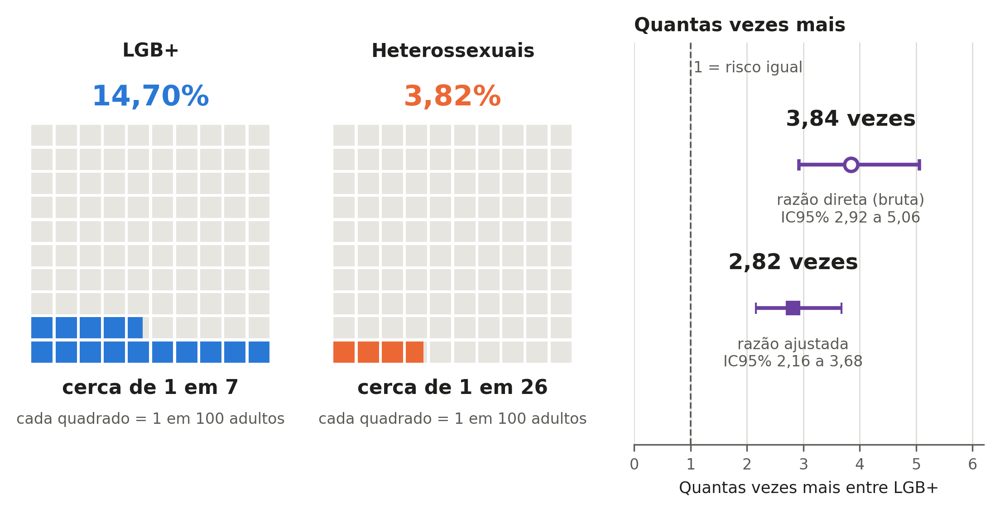

*Nota.* Cada quadriculado tem 100 quadrados; os coloridos indicam quantos adultos em cada 100 sofreram violência física nos últimos 12 meses (azul, LGB+; laranja, heterossexuais): 14,70% e 3,82%. À direita, a razão de prevalências, em que 1 indica igualdade: o círculo vazado é a razão bruta, de 3,84, e o quadrado cheio, a razão ajustada por sexo, idade, cor, instrução, região e situação urbana ou rural, de 2,82 (IC95% 2,16 a 3,68). Fonte: IBGE (2022a), microdados da PNS 2019; cálculo do autor (Flores, 2026).

**Figura 4**

*Razão de prevalências de violência física, sexual e qualquer violência, LGB+ em relação a heterossexuais, bruta e ajustada*

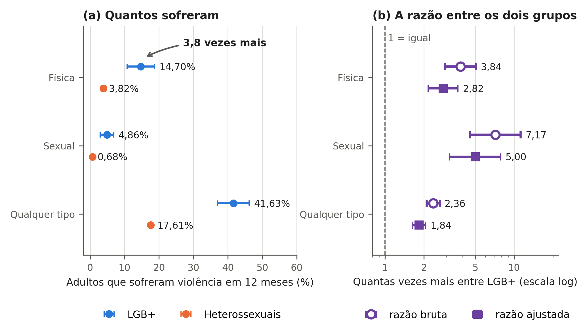

*Nota.* No painel (a), cada ponto é a prevalência de violência em 12 meses no grupo (azul, adultos LGB+; laranja, heterossexuais), com IC95%. No painel (b), a razão de prevalências entre os grupos, em escala logarítmica: o círculo vazado é a razão bruta, e o quadrado cheio, a ajustada; a linha tracejada em 1 marca igualdade entre os grupos. Fonte: IBGE (2022a); cálculo do autor (Flores, 2026).

A composição etária não explica sozinha a disparidade. Embora 57% dos adultos LGB+ tenham de 18 a 29 anos, a razão para violência física fica acima de 1 nas faixas de 18 a 29 anos (2,93; IC95% 2,08 a 4,13), de 30 a 44 (2,27; 1,37 a 3,76) e de 60 anos ou mais (5,80; 1,93 a 17,36, com 88 entrevistados LGB+ e intervalo largo); o intervalo inclui 1 apenas na faixa de 45 a 59 anos (1,61; 0,79 a 3,31) (Tabela A2). No nível de contexto, entre as 179 vítimas LGB+ de violência física, o agressor foi parceiro ou ex-parceiro em 32,9% dos casos (heterossexuais, 37,1%), familiar em 31,2% (19,3%; razão de 1,62, IC95% 0,96 a 2,72) e pessoa desconhecida em 16,3% (23,0%), e o local foi o domicílio em 44,1% (55,2%) (Tabela A4).

Os resultados referem-se a adultos classificados pelas respostas de orientação sexual de uma única edição da PNS. A pesquisa não identifica separadamente pessoas trans, não inclui menores nem homicídio, não pergunta a motivação do agressor e não permite tendência (IBGE, 2022b). Por isso sustenta a disparidade de vitimização (níveis N1 e N2), mas não sustenta que a violência seja motivada pela orientação (N4), nem que o grupo morra mais, nem taxa de homicídio. Szwarcwald et al. (2025) tratam do mesmo tema na PNS de 2019; o artigo foi lido apenas pelo título e pelo resumo, e nenhum número dele é usado.

### 3.2. Mortalidade por orientação sexual e identidade de gênero

No Brasil, a pergunta não é testável com dado público. O formulário da declaração de óbito tem 59 variáveis em 9 blocos, segundo o manual oficial de preenchimento, e nenhuma registra orientação sexual ou identidade de gênero (Ministério da Saúde, 2022, p. 10); o cabeçalho dos arquivos de microdados do SIM de 2023 e 2024 também não tem variável de orientação ou de identidade, verificação feita no próprio arquivo (DATASUS, 2026a). Rafael et al. (2024) registram o mesmo limite e mostram que a vinculação probabilística entre as fichas do Sinan e os óbitos do SIM no Rio de Janeiro tem acurácia de 93,3%, sem gerar taxa populacional. A vinculação nacional publicada tem o mesmo limite: Luis et al. (2026) parearam as notificações de violência contra pessoas trans do Sinan (36.452 casos de 2014 a 2022, reorganizados em registros individuais) com o SIM e encontraram 1.325 óbitos, dos quais 563 (42,5% dos óbitos pareados, e não das notificações) por causas violentas, categoria que reúne homicídio, suicídio e intenção indeterminada. A população do estudo é a de pessoas trans já notificadas por violência, e não há denominador; o estudo descreve fatores associados ao óbito violento dentro desse grupo, e não uma taxa nem uma razão entre pessoas trans e cisgênero. O pareamento usou nome, nome da mãe e data de nascimento, obtidos pelos autores por solicitação com termo de confidencialidade, e por isso não é reproduzível com dado aberto. Fora do Brasil, Clark e Blosnich (2024) mostram que 84,5% dos óbitos do sistema norte-americano de registro de mortes violentas têm orientação sexual ausente ou desconhecida.

Fora do Brasil, os dados publicados entre 2023 e 2026 sustentam excesso de mortalidade por todas as causas em populações bem definidas (Tabela 4 e Figura 5). O ONS ligou o Censo de 2021 aos registros de óbito da Inglaterra e do País de Gales: entre 21 de março de 2021 e 30 de novembro de 2024, entre 28.659.465 pessoas de 16 anos ou mais que responderam elas mesmas à pergunta de orientação (59,0% das pessoas de 16 anos ou mais do Censo; o Censo foi vinculado ao cadastro do serviço nacional de saúde em 94,6% e os óbitos em 90,2%, com pesos de pós-estratificação para a perda de vinculação), a taxa de mortalidade por todas as causas padronizada por idade foi de 982,8 por 100 mil no grupo LGB+ e de 752,6 por 100 mil entre heterossexuais, razão de 1,31 (IC95% 1,28 a 1,33); para gays e lésbicas a razão foi 1,31 (1,28 a 1,35), para bissexuais 1,33 (1,28 a 1,38) e, só entre homens gays, 1,23 (1,20 a 1,27) (ONS, 2026a). As taxas são do período inteiro, e não anuais; a padronização usa a distribuição etária do grupo LGB+, mais jovem, de modo que a taxa dos heterossexuais é a que eles teriam com a idade dos LGB+; e o próprio ONS escreve que a análise é descritiva e não permite dizer se a orientação é fator causal (ONS, 2026a). No mesmo desenho, a taxa de suicídio padronizada, que inclui óbitos de intenção indeterminada, foi de 50,3 contra 23,1 por 100 mil entre março de 2021 e dezembro de 2023, cerca de 2,2 vezes (ONS, 2025). A expectativa de vida aos 20 anos, estimativa experimental sem teste formal de significância, foi 1,2 ano menor para homens LGB+ (59,4 contra 60,7) e 0,9 ano menor para mulheres LGB+ (63,0 contra 64,0), diferenças calculadas sobre valores não arredondados, em estimativas experimentais que, segundo o próprio ONS, tendem a superestimar a expectativa de vida (ONS, 2026b).

**Tabela 4**

*Mortalidade e violência por orientação sexual ou identidade de gênero, evidência brasileira e internacional publicada de 2023 a 2026: população, desfecho, medida e resultado de cada estudo*

| Estudo | População e país | Desfecho | Medida | Resultado | Tipo de fonte |
|---|---|---|---|---|---|
| ONS (2026a) | 16 anos ou mais, Censo 2021 ligado a óbitos; Inglaterra e País de Gales | todas | razão de taxas padronizadas LGB+/heterossexuais | 1,31 (1,28 a 1,33) | documento oficial |
| ONS (2025) | mesma base, 2021 a 2023 | suicídio (com intenção indeterminada) | taxas padronizadas por 100 mil | 50,3 e 23,1 | documento oficial |
| ONS (2026b) | mesma base, 2021 a 2024 | todas | expectativa de vida aos 20 anos | -1,2 ano (homens); -0,9 ano (mulheres) | documento oficial; estatística experimental |
| McKetta et al. (2024) | enfermeiras, Estados Unidos | todas | fator de aceleração (menor que 1 = morte mais cedo) | 0,74 (0,64 a 0,84) | periódico Q1 |
| Erlangsen et al. (2023) | pessoas trans identificadas por registro, Dinamarca | todas; suicídio | razão ajustada de taxas | 2,0 (1,7 a 2,4); 3,5 (2,0 a 6,3) | periódico Q1 |
| Zachry et al. (2025) | revisão de 43 estudos, vários países | várias | contagem de estudos | 14 sustentam, 28 em parte, 1 não | periódico Q1 |
| Luis et al. (2026) | pessoas trans notificadas no Sinan e pareadas ao SIM, Brasil | óbito por causas violentas | proporção entre óbitos pareados | 563 de 1.325 (42,5%); sem denominador | periódico, quartil não conferido |
| McLellan et al. (2026) | adultos trans e de gênero diverso, meta-análise de 94 estudos, vários países | violência física ou sexual ao longo da vida, não letal; homicídio | prevalência combinada | 64,23% (47,38% a 78,17%; 9 estudos); sem estudo de homicídio identificado | periódico Q1 |

*Nota.* As medidas são diferentes e não se somam nem se comparam num eixo único de risco. Nenhuma linha estima homicídio por orientação sexual, e a linha de McLellan et al. (2026) mede violência não letal. O quartil Q1 de McKetta et al. (2024), de Erlangsen et al. (2023) e de McLellan et al. (2026) foi conferido pela regra complementar da seção 2.2; o de Zachry et al. (2025), pela regra original. Fonte: estudos citados na primeira coluna.

**Figura 5**

*Mortalidade e violência contra pessoas LGB+ e trans, evidência brasileira e internacional publicada de 2023 a 2026, por estudo e medida*

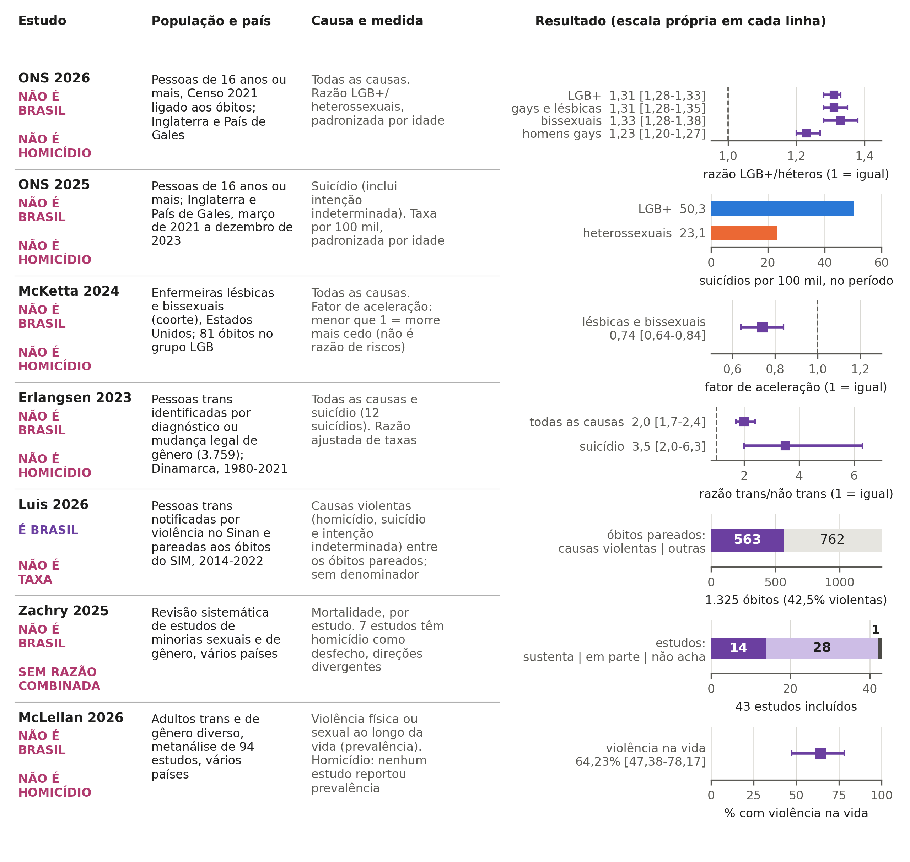

*Nota.* Cada linha é um estudo, e cada painel tem escala própria, porque as medidas (razão de taxas, taxa por 100 mil, fator de aceleração, contagem de estudos e prevalência) são diferentes e não formam um único risco. Os rótulos da primeira coluna indicam o que o estudo não é: não é Brasil, não é homicídio, não é taxa ou não tem razão combinada. Só o estudo de Luis et al. (2026) é brasileiro, e ele não traz taxa, por falta de denominador. Fonte: ONS (2025, 2026a, 2026b), McKetta et al. (2024), Erlangsen et al. (2023), Luis et al. (2026), Zachry et al. (2025) e McLellan et al. (2026).

Duas coortes em periódico do primeiro quartil apontam no mesmo sentido em populações mais estreitas. Entre 90.833 enfermeiras norte-americanas nascidas de 1945 a 1964, as lésbicas e bissexuais morreram mais cedo, com fator de aceleração ajustado de 0,74 (0,64 a 0,84), medida de antecipação do tempo até o óbito que não é razão de riscos nem percentual de expectativa de vida, sobre 81 óbitos no grupo em 27 anos (McKetta et al., 2024). Na Dinamarca, 3.759 pessoas trans identificadas por diagnóstico hospitalar ou mudança legal de gênero tiveram razão ajustada de 2,0 (1,7 a 2,4) para mortalidade por todas as causas e de 3,5 (2,0 a 6,3) para suicídio, esta sobre 12 suicídios, entre 1980 e 2021; a identificação administrativa seleciona a parcela da população trans que chegou ao hospital ou ao cartório (Erlangsen et al., 2023). Três coortes recentes de pessoas trans identificadas por registro, na Austrália (Saxby et al., 2026), em Taiwan (Hsu et al., 2025) e na Suécia (Clark et al., 2026), lidas no texto disponível em HTML, também encontram excesso de mortalidade geral, que em Taiwan desaparece na comparação entre irmãos, salvo para suicídio; os periódicos não tiveram o quartil conferido, e as três ficam fora do veredito. A revisão sistemática de Zachry et al. (2025), lida em texto integral, conclui que nenhum governo coleta orientação sexual e identidade de gênero em processo padronizado no óbito e que a heterogeneidade das definições impede uma razão combinada; dos 43 estudos incluídos, 14 sustentam mortalidade maior em minorias sexuais e de gênero, 28 a sustentam em parte, por exemplo para uma causa e não para outra, e 1 não encontra excesso, e a síntese dos autores é que os achados, embora mistos, sugerem mortalidade elevada.

Para homicídio, que é a forma em que a pergunta circula no Brasil, nenhuma das fontes lidas produz razão populacional por orientação sexual, resultado de busca enumerada e não afirmação de inexistência. O ONS não publica taxa de homicídio por orientação; o homicídio aparece só na tabela de causas principais, nos estratos em que está entre as dez primeiras, e o grupo LGB+ aparece nela apenas entre mulheres de 16 a 24 anos, com 5 óbitos, em contagens arredondadas a múltiplos de cinco (ONS, 2026a). A meta-análise de McLellan et al. (2026), com 94 estudos publicados em 137 artigos, estima prevalência de violência física ou sexual ao longo da vida de 64,23% (9 estudos; 47,38% a 78,17%) entre adultos trans e de gênero diverso, mas não identificou estudo que reportasse prevalência de homicídio; a errata publicada em abril de 2026 trocou rótulos de uma figura e repôs uma figura do suplemento, sem alterar as estimativas citadas. Dos estudos da revisão de Zachry et al. (2025), 7 têm homicídio como desfecho, com direções divergentes. Listas de casos documentados descrevem vítimas, e não risco: Halliwell et al. (2025) reúnem 229 mortes violentas documentadas de mulheres trans nos Estados Unidos entre 2013 e 2021, 78,6% delas negras, a partir de bases de organizações e da imprensa, e declaram que a amostra não é nacionalmente representativa. Para homicídio de pessoas trans, Dinno (2017) obtém taxas de 3,66 a 110 por 100 mil conforme a prevalência suposta e a subcontagem, mas 8 de 12 cenários de razão de risco entre pessoas trans e cisgênero ficam abaixo de 1, com numerador predominantemente de mídia; são cenários de um mesmo estudo, e não estudos independentes.

A evidência anterior a 2023 varia por causa, população e período. Entre homens em casamento do mesmo sexo na Dinamarca, a razão de mortalidade padronizada por todas as causas foi 2,25 (2,01 a 2,50) de 1989 a 1995 e 1,33 (1,04 a 1,68) depois de 1995, com indicador de casamento que cobre de 1% a 6% dos homens gays, e o excesso de óbitos caiu de 9,63 para 1,53 por 1.000 pessoas-ano, queda que coincide no tempo com a terapia antirretroviral, sem causa de morte no estudo (Frisch & Brønnum-Hansen, 2009). No General Social Survey, a razão de riscos foi 1,04 (0,82 a 1,31) para homens, 6,28 (1,45 a 27,22) para suicídio entre mulheres com parceira e 1,29 (0,47 a 3,51) para HIV, com intervalo que inclui 1 (Cochran & Mays, 2015). Citações também se transformam no caminho: McKetta et al. (2026) escrevem que pessoas LGB nos Estados Unidos têm o dobro de chance de morrer por suicídio e citam Zachry et al. (2025), mas a revisão não traz razão combinada, e o único valor de 2,18 vezes sobre suicídio nela é a taxa bruta de uma coorte de veteranos (82,5 contra 37,7 por 100 mil pessoas-ano). A afirmação de que minorias sexuais em comunidades com alto nível de preconceito vivem 12 anos menos vem de um artigo retratado (Hatzenbuehler et al., 2014); refeita a codificação, a associação com mortalidade desaparece na amostra completa (Hatzenbuehler et al., 2020), e a medida adequada de expectativa de vida, onde existe, mostra diferenças da ordem de um ano aos 20 anos (ONS, 2026b).

O veredito depende da regra de elegibilidade só fora do Brasil. Sob a regra original do pré-registro, a evidência mundial é Zachry et al. (2025), Frisch e Brønnum-Hansen (2009), Cochran e Mays (2015) e Dinno (2017), e a afirmação de que pessoas LGB+ morrem mais que heterossexuais é "parcial" para mortalidade por todas as causas: a revisão é mista, embora sugira excesso, e os estudos antigos variam por causa e período. Com a regra complementar, que admite o dado oficial por vinculação e o quartil conferido nas páginas do SCImago, a afirmação passa a "sustentada" para mortalidade por todas as causas em populações definidas: pessoas que se declararam LGB+ no Censo da Inglaterra e do País de Gales (ONS, 2026a), uma coorte de enfermeiras lésbicas e bissexuais nos Estados Unidos (McKetta et al., 2024) e pessoas trans identificadas em registros na Dinamarca (Erlangsen et al., 2023), com estimadores diferentes e sem identificação causal; o ONS sozinho já sustenta a mudança. Sob as duas regras, a afirmação não é sustentada como frase universal, não tem razão populacional para homicídio em nenhuma fonte lida e não é testável no Brasil.

### 3.3. Mortes por agressão segundo sexo e raça: o nível medido quando o registro contém o atributo

Quando o registro de óbito contém o atributo, o nível N1 é medido; o resultado funciona como controle positivo do argumento da seção 3.2, porque mostra que o limite para pessoas LGBT+ é a ausência do campo, e não do sistema (DATASUS, 2026a). Na média de 2022 a 2024, a taxa de óbito por agressão padronizada por idade vai de 2,6 por 100 mil entre mulheres não negras a 51,7 entre homens negros (Tabela 5 e Figura 6); a razão entre homens e mulheres é 10,8, e a razão entre negros e não negros é 2,56 (de 2,42 a 2,60 conforme a alocação dos óbitos com raça ignorada). A decomposição de Kitagawa atribui de 89% a 99% da diferença bruta às taxas por idade, e não à composição etária. A ordem das taxas é a mesma em todos os anos de 2012 a 2024 (Tabela A15); os denominadores de 2023 e 2024 foram extrapolados do Censo 2022 por interpolação geométrica (IBGE, 2026), o que afeta os níveis, e a sensibilidade a denominadores alternativos não foi testada. Para raça, a disparidade residual condicional aparece nos dois estudos lidos, ambos sem controle de renda e nenhum em periódico do primeiro quartil: no Rio de Janeiro de 2010, negros têm 23,5% mais chances de homicídio (Cerqueira & Coelho, 2017), e no Brasil de 2022 a razão de chances entre óbitos vai de 1,49 a 2,29, medida entre os que morreram e não risco populacional (Silva & Pazin-Filho, 2026).

**Tabela 5**

*Taxa de óbito por agressão (CID-10 X85-Y09) padronizada por idade, por sexo e raça, Brasil, média de 2022 a 2024, por 100 mil*

| Grupo | Taxa padronizada | Razão em relação a mulheres não negras |
|---|---|---|
| Mulheres não negras | 2,6 | 1,0 |
| Mulheres negras | 4,3 | 1,7 |
| Homens não negros | 20,0 | 7,7 |
| Homens negros | 51,7 | 19,9 |

*Nota.* Padrão: população do Brasil em 2022; denominadores de 2023 e 2024 extrapolados. Comparação descritiva de razões marginais, e não medida de importância causal. Fonte: DATASUS (2026a) e IBGE (2026); cálculo do autor (Flores, 2026).

**Figura 6**

*Taxa de óbito por agressão padronizada por idade, por sexo e raça, Brasil, média de 2022 a 2024*

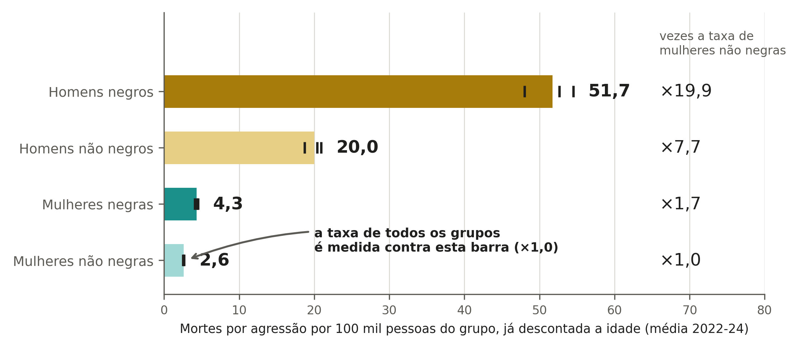

*Nota.* Cada barra é a média de 2022 a 2024, e cada traço vertical, um dos três anos. A coluna da direita expressa a taxa de cada grupo como múltiplo da taxa das mulheres não negras, tomada como referência: a taxa de homens negros é 19,9 vezes a de mulheres não negras. Populações de 2023 e 2024 estimadas a partir do Censo 2022. Fonte: DATASUS (2026a) e IBGE (2026); cálculo do autor (Flores, 2026).

### 3.4. A contagem do Grupo Gay da Bahia: verificabilidade, dependência entre listas e escala

O GGB é associação da sociedade civil de ativismo LGBT+; sua série de mortes vem de notícias de jornal e de internet, alertas de busca e correspondência, sem verificação sistemática em inquérito, instituto médico-legal ou processo, com critério de inclusão declaradamente largo (suicídio, latrocínio e toda profissional do sexo trans morta "na pista" entram na contagem) e com população LGBT+ estimada pela própria organização em "mais de 10%", contra 1,89% de adultos LGB+ na PNS (GGB, 2026; IBGE, 2022a). A organização declara subnotificação; critério largo e subnotificação coexistem, de modo que nenhum dos dois vieses é exclusivo. Mendes e Silva (2020), o artigo que mais usa a série, trabalham com dados cedidos pelo GGB e revistos com técnico do GGB, o que não configura validação independente.

A validação de 2019, único ano com lista nominal e fonte por caso nos relatórios anuais (GGB, 2020), seguiu os 160 casos sorteados por etapas (Figura 7). Em 106 a matéria jornalística foi recuperada, e em 54 não, por link morto, sítio inacessível, bloqueio ou falta de link; 88 tinham a matéria do próprio caso; 73 tinham morte violenta confirmada, e, dos 15 restantes, 13 tinham causa não informada ou circunstância aberta e 2 eram atropelamentos sem indício de intenção, fora do critério que o próprio GGB declara; e 50 das 73 identificavam expressamente a vítima como LGBT+. Os 50 casos (31,3%; intervalo de Wilson de 24,6 a 38,8) são a fração verificável hoje, que não delimita o total nem por baixo nem por cima; 10 deles têm correspondência apenas parcial, por cidade, data e perfil, porque a matéria não traz o nome da vítima, e com correspondência estrita a fração é de 40 em 160 (25,0%) (Flores, 2026). Condicionada a que a fonte seja a matéria do caso (88 de 160), a fração verificável é 56,8% (46,4 a 66,7), e a morte violenta é confirmada em 83,0% (73 de 88). Entre as 73 mortes violentas confirmadas, a própria fonte atribui o crime à LGBTfobia em 3 (4,1%; 1,4 a 11,4) e deixa o motivo desconhecido em 35 (47,9%); ausência de menção ao motivo não equivale a ausência de viés, e roubo, vínculo íntimo e LGBTfobia podem coexistir. A duplicata é de 1 par provável em 329 casos (0,3%), o que não sustenta a hipótese de fabricação. A recontagem dos rótulos é pública; a ligação entre caso e fonte não é reproduzível com o repositório, porque exige a lista nominal, não distribuída por privacidade (Flores, 2026). As contagens de 2023 a 2025 (257, 291 e 257) não têm lista nominal publicada e não são auditáveis (GGB, 2026).

**Figura 7**

*Etapas da verificação dos 160 casos sorteados da lista do Grupo Gay da Bahia de 2019*

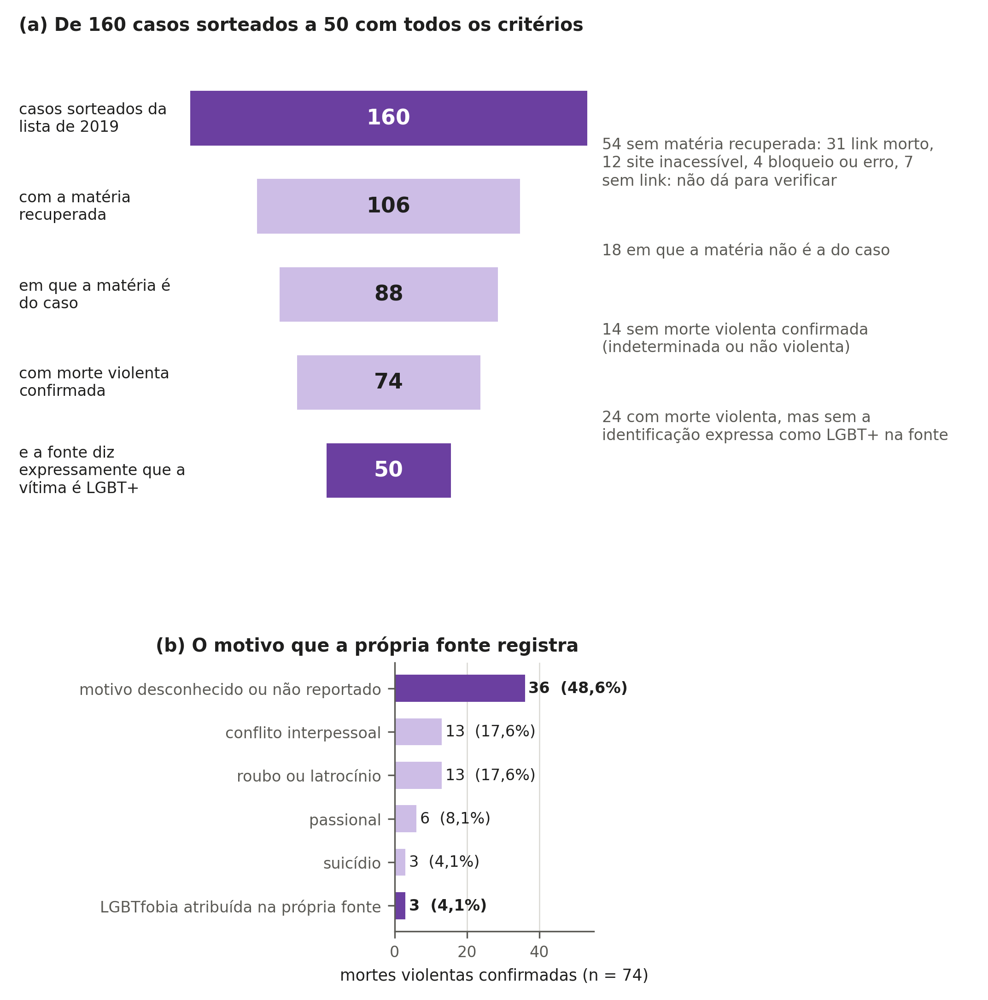

*Nota.* No painel (a), cada barra é o número de casos que passou por uma etapa de conferência, e o texto à direita descreve os que saíram; caso sem matéria recuperada ou fora do critério é caso não verificável, e não caso inventado. Ao fim, 50 casos (31,3%) são verificáveis nos critérios do artigo, 40 deles com correspondência estrita. No painel (b), entre as 73 mortes violentas confirmadas, o motivo registrado pela própria fonte (matéria, polícia ou família), e não pelo codificador; a LGBTfobia aparece em 3. Nenhum caso é identificado. Fonte: GGB (2020); verificação do autor (Flores, 2026).

A captura-recaptura só é estimável para pessoas trans em 2019: o total estimado de Chapman é 186 (175 a 198), e, sob as hipóteses do estimador, os 118 casos trans do GGB correspondem a cerca de 63% (60% a 68% pelo intervalo do total) do noticiário sobre mortes de pessoas trans daquele ano (Feldman et al., 2017). A regra de pareamento entre as listas pesa mais que o intervalo: com pareamento estrito, só por endereço da matéria ou por dois termos do nome, o total sobe para 221 e a parcela do GGB cai para 53%, e entre os seis cenários calculados o total vai de 151 a 221 e a parcela, de 53% a 69% (Flores, 2026). O intervalo estatístico não representa toda a incerteza: as duas listas são de mídia, a dependência positiva entre elas tende a subestimar o total, e listas desse tipo só dão limite inferior do total real quando o pareamento é perfeito e a captura é homogênea, hipótese que em geral não se sustenta (Lum et al., 2013). As séries de mídia não são independentes antes de 2019: o texto dos registros do TDoR cita o GGB em 72% a 94% dos casos de 2013 a 2018 (0,7% em 2019), e a própria ANTRA declara, no dossiê de 2017, que até 2016 a contagem de pessoas trans era a do GGB (Benevides, 2026; Flores, 2026). A concordância entre GGB, ANTRA e TDoR nesse período repete a mesma coleta. Contra o SIM, não se detecta co-variação das variações anuais (r = 0,20; IC95% -0,37 a 0,60; 24 anos; bootstrap com 20.000 réplicas), embora de 2017 a 2024 as séries caiam juntas (GGB -34,6%, SIM -37,3%, ANTRA -31,8%) (DATASUS, 2026a).

Por estado, em 2019, a contagem do GGB por milhão de habitantes cresce com a taxa geral de homicídio: num modelo de Poisson que inclui também o acesso à internet, cada desvio-padrão a mais de homicídio corresponde a 1,33 vez a contagem (IC95% 1,13 a 1,57), e a associação com a internet fica imprecisa, com intervalo que inclui 1 (0,98; 0,83 a 1,16); a correlação negativa entre internet e contagem (ρ = -0,43) deixa de se sustentar quando o homicídio entra no modelo, em que a associação com a internet fica imprecisa (Figura 8; IBGE, 2026; GGB, 2020). É associação entre 27 estados num único ano, e não causa: o padrão é compatível com uma contagem que acompanha a violência em geral, e não sustenta nem a leitura de que a contagem reflete o acesso à internet nem a de que mede uma taxa própria de violência contra pessoas LGBT+.

**Figura 8**

*Contagem do Grupo Gay da Bahia por milhão de habitantes e taxa de homicídio, por estado, 2019*

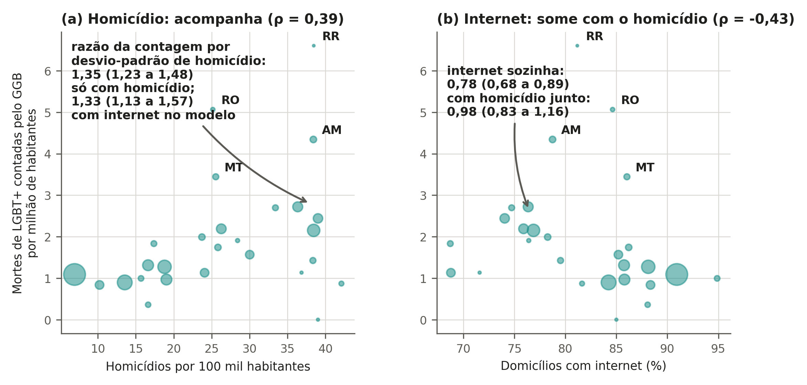

*Nota.* Cada bolha é um estado, com área proporcional à população. No painel (a), estados com taxa de homicídio maior têm contagem maior: 1,33 vez por desvio-padrão de homicídio (IC95% 1,13 a 1,57). No painel (b), a proporção de domicílios com internet associa-se a contagem menor quando entra sozinha no modelo, mas a associação fica imprecisa (0,98; 0,83 a 1,16) quando o homicídio entra junto. Associação entre 27 estados, e não causa; 2019 é o único ano com dado por estado no repositório. Fonte: GGB (2020), DATASUS (2026a) e IBGE (2026); cálculo do autor (Flores, 2026).

O teste de escala responde a uma pergunta delimitada: se adultos LGB+ tivessem o mesmo risco de morrer por agressão que as demais pessoas de mesmo sexo, raça e faixa etária, quantas mortes seriam esperadas, e quanto a contagem do GGB representaria delas (Figura 9). O cálculo segue cinco passos:

1. Adultos LGB+ em 2023 são estimados em 1,89% dos adultos projetados, ou 3.025.764 pessoas (IBGE, 2022a; IBGE, 2026).
2. Em cada célula de sexo, raça e faixa etária, a taxa de morte por agressão dos adultos da célula (DATASUS, 2026a) é multiplicada pelo número de adultos LGB+ estimados nela pela composição da PNS de 2019; a soma dá 1.122 mortes esperadas em 2023 e 1.013 em 2024 sob risco igual ao dos pares.
3. A razão entre as mortes declaradas e as esperadas é 257/1.122 = 22,9% em 2023 e 291/1.013 = 28,7% em 2024 (GGB, 2026).
4. Com numeradores alternativos, o numerador A (homicídios mais latrocínios: 221 em 2023 e 269 em 2024) e o numerador B, cenário que subtrai do A todas as pessoas trans da tabela de identidade (94 e 167), a razão fica entre 8,4% e 19,7% em 2023 e entre 16,5% e 26,6% em 2024.
5. Se o risco fosse 2,82 vezes o dos pares, o esperado de 2023 subiria para 3.165, e, nos dois anos, a razão não passaria de 10,2% (Tabela A6).

O numerador B não é limite inferior, porque o GGB inclui heterossexuais (6 em 2024), não cruza causa com identidade e inclui menores. Pelas marginais publicadas, as pessoas cisgênero LGB dentro do numerador A ficam entre 100 e 118 em 2023 (razão de 8,9% a 10,5%) e entre 164 e 168 em 2024 (16,2% a 16,6%); por exemplo, 269 menos 99 pessoas trans e 6 heterossexuais dá 164, abaixo dos 167 do numerador B (Tabela A7). Na causa agressão, com a prevalência de 1,89% e somados os anos de 2023 e 2024 e os cenários, a razão sob risco igual vai de 8,2% (2023, descontando também a faixa etária até 18 anos; Tabela A7) a 28,7% (total declarado de 2024), e sob risco 2,82 a 3,84 vezes maior não passa de 10,2% (Tabela A6); somando a causa indeterminada ou com a prevalência de 1,96%, as razões ficam menores (Tabela A6). Essas razões não estimam cobertura real, porque o risco de morte de pessoas LGB+ não foi medido, e a razão de prevalências da violência não letal não fixa o risco de morte. A conta pode ser invertida: a contagem igualaria 100% do esperado só se o risco de adultos LGB+ fosse de 0,08 a 0,29 vez o dos pares, conforme o ano e o numerador (RR* = N/E₀, conta de hipótese e não estimativa; Figura 10).

**Figura 9**

*Razão entre a contagem do Grupo Gay da Bahia e as mortes por agressão esperadas, por ano, numerador e risco suposto*

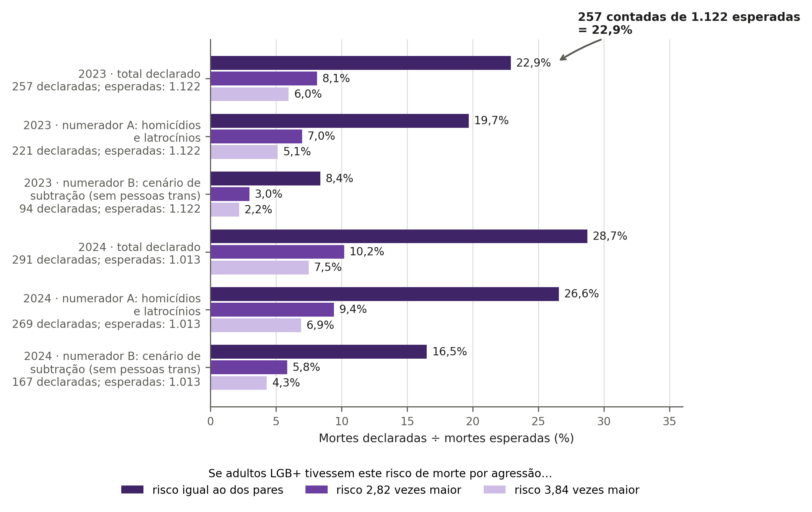

*Nota.* Cada grupo de três barras compara a contagem do GGB com as mortes por agressão esperadas se adultos LGB+ morressem por agressão no mesmo ritmo que pessoas do mesmo sexo, raça e idade (risco igual) ou 2,82 e 3,84 vezes mais. Barra curta indica contagem distante das mortes esperadas. A razão mede escala e não conta mortes de pessoas LGB+; nos cenários exibidos, chega a 28,7% e não estima a cobertura real; o numerador B é um cenário de subtração, e não limite inferior. Fonte: GGB (2026), DATASUS (2026a), IBGE (2022a, 2026); cálculo do autor (Flores, 2026).

**Figura 10**

*Risco relativo que faria a contagem do Grupo Gay da Bahia igualar as mortes esperadas*

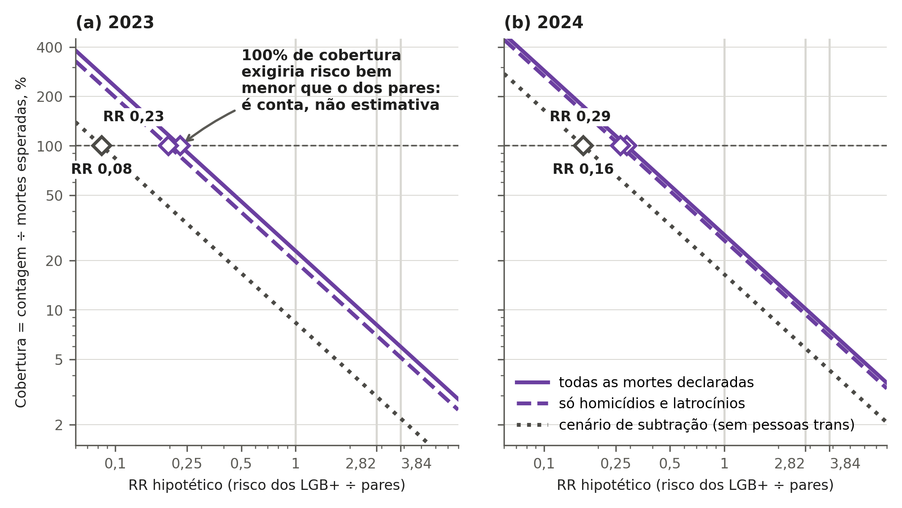

*Nota.* Quanto maior o risco relativo suposto para adultos LGB+, mais mortes seriam esperadas e menor a cobertura da contagem; no eixo vertical, 100% indica contagem igual às mortes esperadas. Cada losango marca o risco relativo em que a cobertura chegaria a 100%: com o total declarado, de 0,23 a 0,29 vez o risco dos pares; no cenário de subtração, 0,08 e 0,16. É conta de hipótese, feita de trás para a frente para mostrar a escala, e não estimativa do risco, que não foi medido; as linhas verticais claras marcam os riscos 1, 2,82 e 3,84. Fonte: GGB (2026), DATASUS (2026a), IBGE (2022a, 2026); cálculo do autor (Flores, 2026).

A razão não pode ser lida como estimativa de mortes de LGB+, porque o numerador inclui menores, fora do denominador adulto, heterossexuais incluídos pelo GGB e pessoas trans, que a PNS de 2019 não identifica: as pessoas trans que declararam orientação LGB estão no denominador, sem identificação (IBGE, 2022b). A razão é inversamente proporcional à prevalência suposta: com 3% ela cai para 14% e 18% sob risco igual, e com 1,35%, o menor valor de prevalência associado ao modo de preenchimento, o maior valor da tabela subiria a cerca de 40% (28,7% × 1,89/1,35). Três bases de população LGB+ adulta aparecem no artigo, todas com a mesma prevalência de 1,89% e por isso coerentes: cerca de 3,01 milhões pelo peso calibrado da PNS de 2019 (seção 3.1), 3.025.764 sobre os adultos projetados para 2023 e 2,92 milhões sobre os 154,3 milhões de adultos do Censo 2022 (IBGE, 2026). Pelo mesmo motivo, a "taxa" de 8,8 e 10,0 por 100 mil, obtida dividindo a contagem do GGB por 2,92 milhões de adultos LGB+, 2,4 a 3 vezes menor que a taxa adulta geral (26,4 e 24,2), não indica que pessoas LGB+ morrem menos: indica que numerador de mídia e denominador populacional são incompatíveis.

### 3.5. Registros administrativos: fichas de saúde, boletins de ocorrência e denúncias

Nas fichas de violência dos serviços de saúde, entre 197.779 notificações de violência física interpessoal de adultos em 2023 e 202.416 em 2024, a orientação sexual veio preenchida com valor utilizável em 75,7%, e entre essas homossexuais e bissexuais somam 4,12% e 4,08% (DATASUS, 2026b). Na PNS, entre as vítimas adultas de violência física que declararam orientação heterossexual ou LGB+, a parcela LGB+ ponderada pelo desenho amostral é 7,1% (IC95% de desenho 5,1 a 9,1), com Taylor e jackknife concordantes; na amostra não ponderada, são 179 de 3.291 vítimas, razão que não reproduz o percentual ponderado (IBGE, 2022a; Tabela A5). As duas parcelas ficam acima dos 1,89% que LGB+ representam na população adulta, mas descrevem universos diferentes, e uma não valida nem invalida a outra (Figura 11): a PNS descreve pessoas vitimadas, tenham ou não procurado serviço, e o Sinan descreve notificações, sujeitas a atendimento, preenchimento, possível repetição da mesma pessoa e a uma regra de elegibilidade que não é igual para todos. O Guia de Vigilância em Saúde exclui da notificação a violência comunitária ou extrafamiliar contra homens de 20 a 59 anos, "exceto nas condições de vulnerabilidade", entre elas a população LGBT, e manda notificar violências homofóbicas em todas as idades (Ministério da Saúde, 2024, p. 1222); essa regra pode, sozinha, sobre-representar pessoas LGBT+ nas fichas, antes de qualquer diferença de atendimento. A parcela da PNS tem gradiente etário forte: 13,8% entre 18 e 29 anos, 3,9% entre 30 e 44 e 1,5% acima de 45.

**Figura 11**

*Parcela de LGB+ entre vítimas adultas de violência física no levantamento domiciliar e nas fichas dos serviços de saúde, e na população adulta*

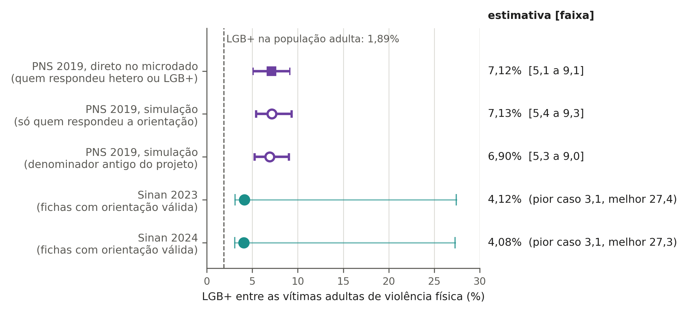

*Nota.* Cada linha é a parcela de LGB+ entre vítimas adultas de violência física num universo diferente: pessoas vitimadas, tenham ou não procurado serviço, na PNS, e notificações elegíveis pela regra de notificação, no Sinan; a linha tracejada marca a parcela de LGB+ na população adulta. As duas parcelas ficam acima da linha tracejada e diferem em magnitude; no Sinan, a barra fina mostra a faixa possível quando as fichas sem orientação registrada são alocadas no pior e no melhor caso. Como os universos e as regras de entrada diferem, uma linha não valida nem contradiz a outra. Fonte: IBGE (2022a) e DATASUS (2026b); cálculo do autor (Flores, 2026).

O campo 55 da ficha, que registra o motivo da violência como relatado, ficou sem informação útil, somando motivo ignorado, em branco e "não se aplica", em 53% das fichas em 2015 e em 42% a 44% de 2023 a 2025; a parcela "não se aplica" ficou estável em cerca de 15%, e a LGBTfobia aparece como motivo em 0,4% a 0,5% das notificações (Figura 12; DATASUS, 2026b). O motivo ignorado ou em branco variou, em 2023, de 11% das fichas em Roraima a 61% no Distrito Federal. O Sinan permite descrever as notificações e suas mudanças; inferir vitimização populacional exige hipóteses adicionais sobre elegibilidade, atendimento e registro. Marinho Neto et al. (2024) documentam, para pessoas trans, uma cobertura municipal de notificação que sobe enquanto a série de notificações cai; a leitura de que isso impede tratar a série como tendência de violência é deste artigo, e não dos autores.

**Figura 12**

*Composição do campo de motivo da violência nas fichas de notificação, Sinan, 2015 a 2025*

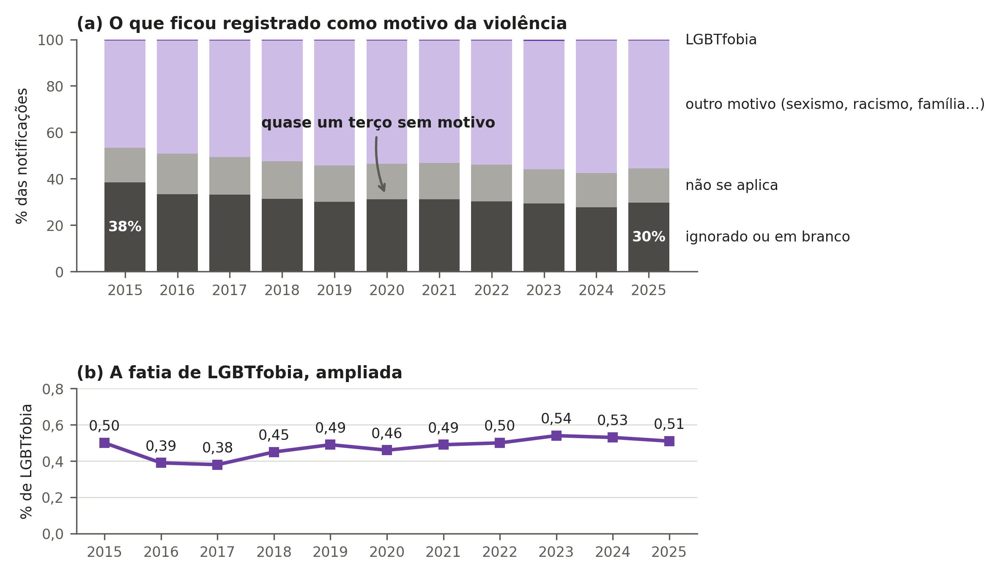

*Nota.* Cada coluna do painel (a) soma 100% das notificações do ano; o cinza-escuro é o campo de motivo ignorado ou em branco, e a LGBTfobia, ampliada no painel (b), mal aparece. Como o motivo fica sem informação útil em 42% a 53% das fichas, conforme o ano, e o preenchimento varia entre os anos, o número de casos registrados como LGBTfobia não mede a incidência. Em 2025, motivo ignorado ou em branco em 30% das fichas, 44% somando "não se aplica"; LGBTfobia em cerca de 0,5%. Fonte: DATASUS (2026b); cálculo do autor (Flores, 2026).

Não há evidência de concordância líquida entre saúde e polícia por estado (Figura 13). A correlação de Spearman entre as contagens por estado das notificações de LGBTfobia no Sinan e dos boletins de ocorrência no Anuário vai de 0,53 a 0,74 conforme o ano e diminui quando se controla o tamanho do estado: a correlação parcial fica entre 0,14 e 0,32, com intervalo de 95% que inclui zero em todos os anos (juntando os anos, 0,20; -0,13 a 0,50; de 22 a 23 estados por ano) (DATASUS, 2026b; FBSP, 2026).

**Figura 13**

*Notificações de LGBTfobia no Sinan e boletins de ocorrência por estado, correlação bruta e parcial*

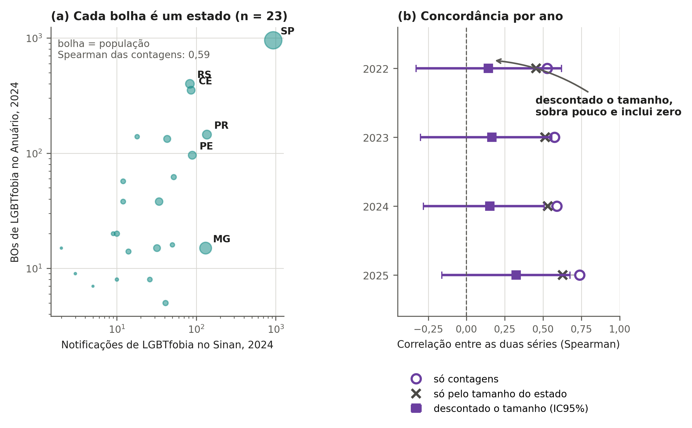

*Nota.* No painel (a), cada bolha é um estado: os mais populosos têm mais registros nas duas fontes, e as contagens sobem juntas. No painel (b), por ano, o círculo vazado é a correlação de Spearman bruta, o x é a correlação esperada só pelo tamanho do estado, e o quadrado cheio, a correlação parcial depois de descontado o tamanho, entre 0,14 e 0,32, com faixa que inclui zero em todos os anos. Fonte: DATASUS (2026b) e FBSP (2026); cálculo do autor (Flores, 2026).

O Anuário registra 783, 1.633, 2.567 e 3.481 boletins de ocorrência de "racismo por homofobia ou transfobia" de 2022 a 2025, alta de 4,4 vezes; são registros das secretarias estaduais compilados por uma organização da sociedade civil, e não foi localizada série oficial nacional equivalente (FBSP, 2026). Cada ano vem da edição mais recente do Anuário, que revisa a própria série: 2023 tinha 2.090 boletins na edição de 2024 e 1.633 na de 2025, que marca o ano como atualização das informações publicadas, e 2024 tinha 2.480 na edição de 2025 e 2.567 na de 2026 (Flores, 2026). O número que chega à estatística é a violência que existe multiplicada pela parcela dela que alguém registra; se as duas crescem ao mesmo tempo, o resultado sobe, e nada no número diz qual delas subiu. Sob o modelo da seção 2.5, enquanto *p*~t~ < 1, a série registrada esperada é *I*~0~·*p*~0~·[(1 + *g*)(1 + *h*)]^*t*^: mantido o crescimento registrado, cada crescimento g da incidência corresponde a um crescimento h da propensão de registro, e um g maior exige um h menor; o teto *p*~t~ = 1 só restringe a projeção depois que a propensão satura, o que nos cenários ajustados ocorre depois de 2025 (Figura 14). O próprio Anuário descreve os números recebidos como "baixos demais", com "variações anormais de um ano a outro" (FBSP, 2026). A demonstração tem cinco passos:

1. O registrado é a incidência vezes a propensão de registrar: R = I × p (seção 2.5).
2. Se a incidência cresce g ao ano e a propensão h ao ano, o registrado cresce (1+g)(1+h) ao ano.
3. A série de 783, 1.633, 2.567 e 3.481 boletins (2022 a 2025) é ajustada com o mesmo erro (soma de quadrados em log de 0,0472) por três histórias: incidência parada e registro crescendo 63,7% ao ano (1,00 × 1,637); incidência crescendo 15% e registro 42,3% (1,15 × 1,423 ≈ 1,636); incidência caindo 5% e registro crescendo 72,3% (0,95 × 1,723 ≈ 1,637) (Flores, 2026).
4. O produto é praticamente o mesmo, e a série observada também; o resultado não muda para *p*~0~ de 0,02 a 0,15 (Figura 14).
5. Só um dado externo ao registro fixa p e separa as histórias: levantamento de vitimização, segunda lista para captura-recaptura ou auditoria de completude (seção 4.4).

O resultado é estrutural, e não da simulação (Figura 14): sem restrição externa sobre a propensão de registro, a série isolada é compatível tanto com a frase "a LGBTfobia disparou" quanto com a frase "é só registro" e não distingue as duas.

**Figura 14**

*Três trajetórias de incidência e de propensão de registro que produzem a mesma série de boletins de ocorrência por homofobia ou transfobia, 2022 a 2025*

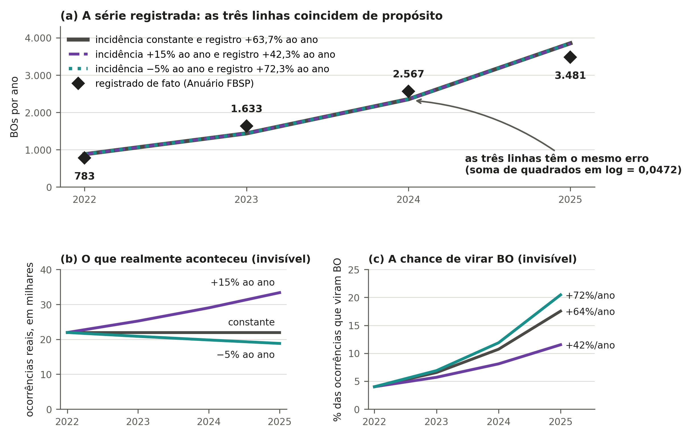

*Nota.* No painel (a), os losangos são os boletins registrados, e as três linhas, o que cada trajetória prevê: as linhas coincidem. Nos painéis (b) e (c), o que cada trajetória supõe: violência estável, subindo 15% ao ano ou caindo 5% ao ano, compensada por propensão de registro crescente. As três reproduzem a mesma série observada, de 783 (2022) a 3.481 (2025); sem medida externa, os dados não permitem escolher entre elas. Fonte: FBSP (2026); simulação do autor (Flores, 2026).

O Disque 100 publica o registro das denúncias em 23 arquivos abertos, de 2011 a setembro de 2026 (MDHC, 2026). Os arquivos mudam de formato três vezes, e nenhum traz chave que identifique a pessoa: o total de vítimas únicas não é calculável em nenhum ano, e o que se conta é registro, uma linha do arquivo até 2020 e uma denúncia a partir de 2021, o que impede também uma taxa, porque falta o denominador de pessoas e quem denuncia não é amostra da população. O módulo LGBT do canal soma de 1.331 a 4.787 linhas por ano de 2011 a 2019 e, de 2021 a 2025, de 1.367 a 9.346 denúncias com ao menos uma linha no módulo, de 1,4% a 1,5% das denúncias do canal de 2022 a 2025; em 2026 são 10.461 até setembro, 1,9% do canal (Figura 15). O canal inteiro quase triplicou no mesmo período, de 222 mil para 638 mil denúncias, e a série tem quatro quebras: o primeiro e o segundo semestres de 2020, o segundo semestre de 2022, quando um formulário novo passa a permitir que o grupo varie dentro da mesma denúncia, e 2024, quando a categoria de motivação por orientação ou identidade deixa de existir no formulário, o que não é ausência de motivação. Mais denúncias, portanto, não significam mais violência: a série não separa violência de divulgação, de canais novos e de mudança de formulário, e é mais um registro cuja propensão de registro nenhuma fonte mede.

**Figura 15**

*Denúncias do módulo LGBT e do canal inteiro do Disque 100, 2011 a setembro de 2026*

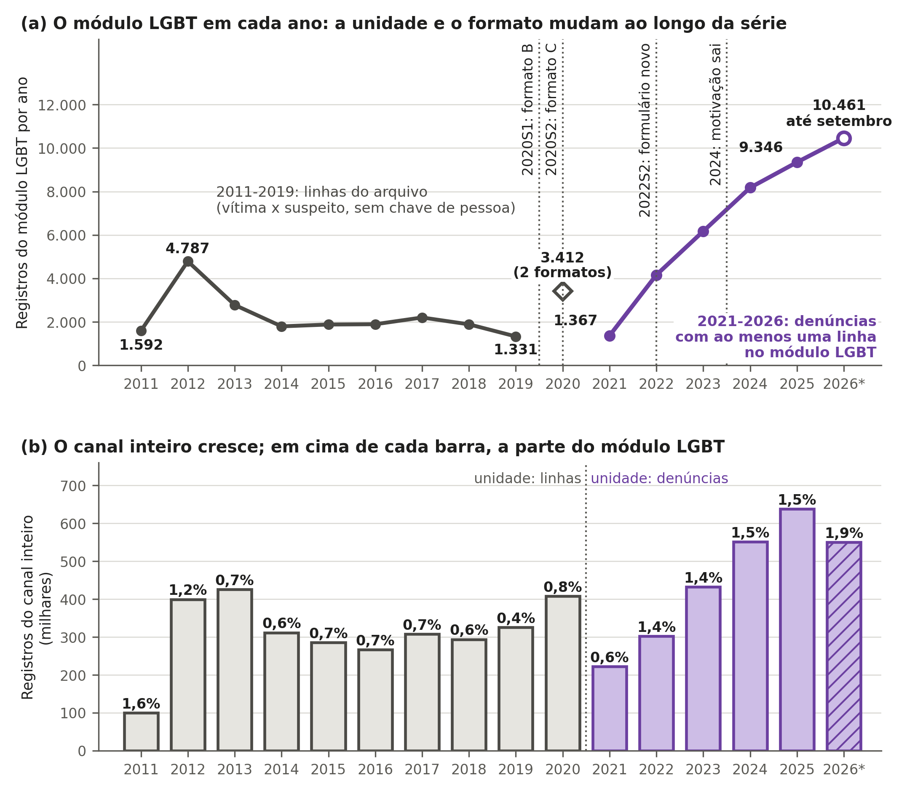

*Nota.* No painel (a), a linha cinza é o número de linhas do módulo LGBT nos arquivos de 2011 a 2019 (cada linha é uma vítima em um atendimento, e não uma pessoa); a linha roxa, de 2021 em diante, conta denúncias com ao menos uma linha do módulo; o losango é 2020, que mistura dois formatos. As linhas verticais pontilhadas marcam mudanças de formato do arquivo ou do formulário, entre as quais a série não é contínua. No painel (b), cada barra é o canal inteiro, na mesma unidade do painel (a), e o número acima, a parcela do módulo LGBT. De 2021 a 2025, o módulo LGBT foi de 1.367 a 9.346 denúncias (6,8 vezes) e o canal inteiro, de 222 mil a 638 mil (2,9 vezes); 2026 vai até setembro. Mais denúncias não indicam mais violência. Fonte: MDHC (2026); contagem do autor (Flores, 2026).

### 3.6. Ideologia do governador e homicídios: painel de estados e estudo de eventos

O painel estima associações entre o escore de ideologia do partido do governador e os homicídios gerais registrados; nenhum dos seus desfechos identifica pessoas LGBT+, e um efeito específico sobre esse grupo poderia não aparecer na taxa agregada (DATASUS, 2026a). Nas 351 combinações de estado e ano, nenhum dos 72 coeficientes estimados (cinco variantes contínuas do escore e uma binária, seis desfechos e duas versões de partido) se distingue de zero (Flores, 2026), e na especificação principal o p do bootstrap wild-cluster fica entre 0,66 e 0,97 (Tabela A8). Numa troca de governador do Partido dos Trabalhadores (PT, escore 2,97) para o Democratas ou o Partido Liberal (cerca de 8), isto é, de 5 pontos na escala de Bolognesi et al. (2023), e mantidos os efeitos de estado e de ano do modelo (ceteris paribus), o intervalo normal vai de -10,8% a +13,1% na taxa total, de -10,1% a +10,5% entre mulheres, de -16,3% a +11,3% entre negros e de -16,2% a +20,4% para mortes por arma de fogo (Tabela 6 e Figura 16). Pela inversão do teste wild-cluster, que respeita os 27 estados, as faixas ficam em -12,3% a +12,4% (total), -12,3% a +10,5% (mulheres), -18,2% a +9,9% (negros) e -19,5% a +19,7% (arma de fogo); com a distribuição t de 26 graus de liberdade, -11,3% a +13,7% no total. Todas contêm zero. O resultado é ausência de evidência de associação grande entre o partido do governador e a taxa registrada, nos dois sentidos; não demonstra ausência de efeito: as faixas reúnem os valores compatíveis com os dados sob o modelo, e associações dentro delas não se distinguem de zero com estes dados. A especificação principal, partido de eleição no TSE e escore por período, foi escolhida depois de ver as variantes, e todas dão o mesmo resultado (TSE, 2026; Bolognesi et al., 2025).

**Tabela 6**

*Painel de governadores: variação da taxa de homicídio registrada associada a uma troca de 5 pontos de ideologia, por três métodos de intervalo (%)*

| Grupo | Normal (estimativa ± 1,96 erro-padrão) | Inversão do bootstrap wild-cluster | t com 26 graus de liberdade | p wild |
|---|---|---|---|---|
| Total | -10,8 a +13,1 | -12,3 a +12,4 | -11,3 a +13,7 | 0,94 |
| Homens | -11,3 a +13,4 | -12,9 a +12,8 | -11,9 a +14,0 | 0,97 |
| Mulheres | -10,1 a +10,5 | -12,3 a +10,5 | -10,5 a +11,0 | 0,95 |
| Negros | -16,3 a +11,3 | -18,2 a +9,9 | -16,9 a +12,1 | 0,66 |
| Não negros | -16,1 a +17,3 | -18,2 a +17,0 | -16,8 a +18,3 | 0,91 |
| Arma de fogo | -16,2 a +20,4 | -19,5 a +19,7 | -16,9 a +21,4 | 0,97 |

*Nota.* 351 combinações de estado e ano, 2012 a 2024; 9.999 reamostragens, semente 20261024. As faixas variam por desfecho, e a das mulheres é mais estreita que a do total. Fonte: DATASUS (2026a), TSE (2026) e Bolognesi et al. (2023); cálculo do autor (Flores, 2026).

**Figura 16**

*Associação entre a ideologia do governador e a taxa de homicídio registrada, por grupo: o que o painel consegue descartar*

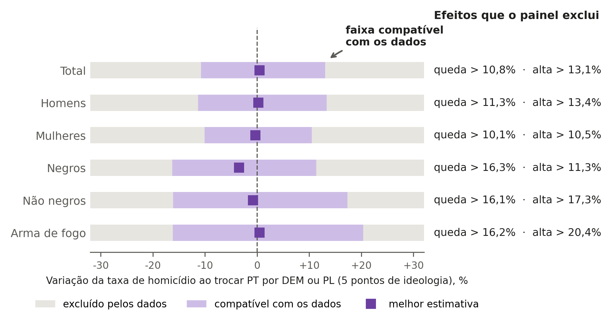

*Nota.* A barra clara é o intervalo de associações compatíveis com os dados, de uma queda a uma alta, e o cinza, o que o painel exclui. Como todos os intervalos incluem zero, o resultado é ausência de associação detectável, e não ausência de associação: associações pequenas, dentro da faixa clara, continuam compatíveis com os dados. A figura desenha o intervalo normal (total: -10,8% a +13,1%); pela inversão do bootstrap wild-cluster, -12,3% a +12,4% (Tabela 6). Fonte: DATASUS (2026a), TSE (2026) e Bolognesi et al. (2023); cálculo do autor (Flores, 2026).

Dois testes delimitam essa leitura. O teste de falsificação soma a causa indeterminada (Y10-Y34) às agressões: nenhum grupo se distingue de zero (total: troca de 5 pontos entre -9,1% e +14,0%), e não se detecta associação da parcela de indeterminadas, 13,4% do total, com a ideologia (+0,15 ponto percentual por ponto de escore; IC95% -0,57 a +0,86; p wild 0,68); a faixa de viés de reclassificação que daí se calcula, de -4,9% a +3,4%, é condicionada à fórmula e à composição adotadas e não limita todo viés de classificação (Tabela A8). Os resíduos de ideologia são negativos em 46,2% das observações, e as inclinações estimadas só com as observações de resíduo positivo e só com as de resíduo negativo não diferem de zero; isso descreve a residualização e não demonstra ausência de efeitos heterogêneos (Goodman-Bacon, 2021; Figura 17).

**Figura 17**

*Taxa de homicídio e ideologia do governador depois de descontadas as diferenças fixas entre estados e entre anos*

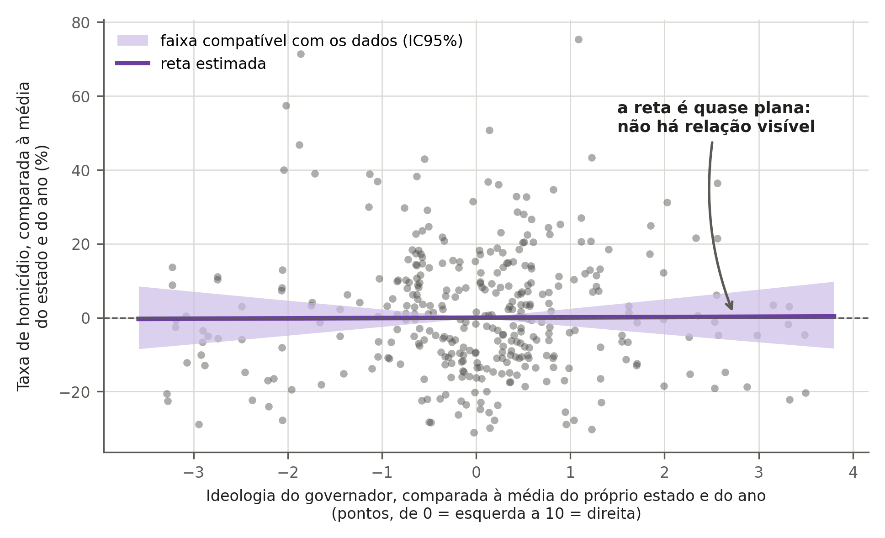

*Nota.* Cada ponto é um estado num ano (351 combinações). O eixo horizontal indica quanto o governador estava mais à direita ou à esquerda que o habitual para aquele estado, e o vertical, quanto a taxa de homicídio estava acima ou abaixo do habitual. A nuvem não tem direção (inclinação de 0,0009 por ponto de ideologia), e a faixa clara, que admite retas inclinadas para os dois lados, indica que o painel não distingue a inclinação de zero. Fonte: DATASUS (2026a), TSE (2026) e Bolognesi et al. (2023); cálculo do autor (Flores, 2026).

O estudo de eventos empilhado, que compara estados que trocaram de governador com estados que não trocaram, é inconclusivo (Figura 18 e Tabela A10). Depois de trocas nos dois sentidos, a taxa registrada cai em relação aos controles: -20% da esquerda para a direita (IC95% -30% a -8%; 9 eventos) e -19% da direita para a esquerda (-31% a -4%; 10 eventos). As antecipações, isto é, a diferença já existente antes da troca, são distinguíveis de zero em duas das quatro especificações (p = 0,009 e p = 0,028), e o mesmo sinal nos dois sentidos não aponta para efeito de ideologia. Com 15 a 16 estados no grupo de comparação, o desenho não separa seleção dos controles, tendência prévia e efeito de qualquer troca de governo. A literatura internacional encontra o mesmo obstáculo de registro em outra escala: nos Estados Unidos, o anúncio da legalização do casamento entre pessoas do mesmo sexo associa-se a uma queda de cerca de 30% nos crimes de ódio anti-LGBT registrados por condado e trimestre, que se dissipa em cerca de um ano e deixa de ser significativa com tendências estaduais (Pettis et al., 2022), e o reconhecimento de uniões aumenta a incidência registrada sem que os autores consigam decidir entre mais violência e mais registro (Levy & Levy, 2017). No Brasil, a diferença entre homicídios estimados e registrados passou de 1,8 para 2,6 por 100 mil depois de 2018, o que indica que parte da queda registrada pode vir da piora do registro, parte essa não quantificada (IPEA & FBSP, 2025).

**Figura 18**

*Painel de governadores com e sem a causa indeterminada (a) e estudo de eventos empilhado por sentido da troca (b)*

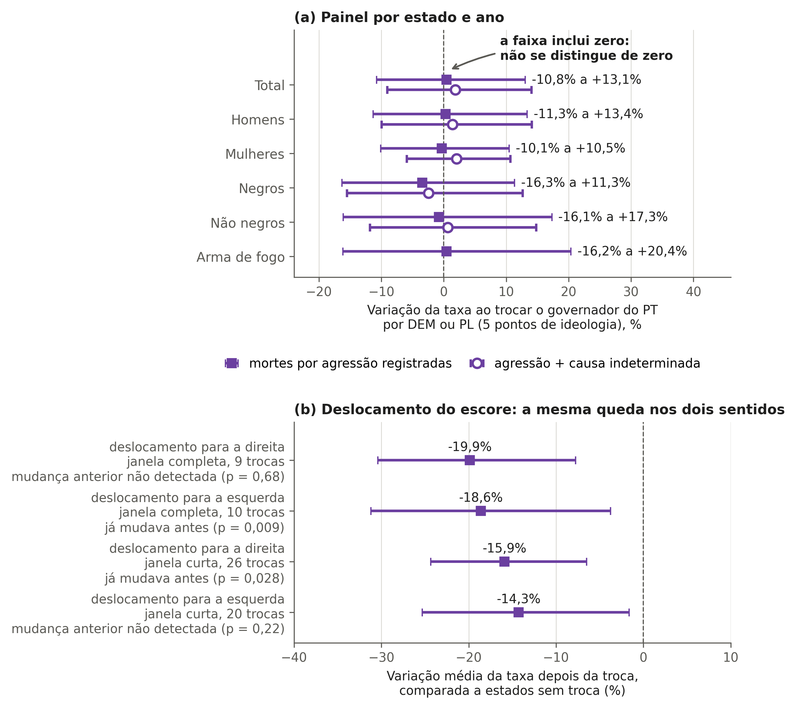

*Nota.* No painel (a), cada ponto é a estimativa, e a barra, o intervalo compatível com os dados, com e sem a causa indeterminada; intervalo que passa por zero indica associação não distinguível de zero (são os intervalos normais da Figura 16). No painel (b), a taxa nos anos antes e depois de cada troca, por sentido da troca: depois da troca, a taxa registrada caiu nos dois sentidos, e em duas das quatro análises a taxa já mudava antes da troca, o que impede ler a queda como efeito do governador. Fonte: DATASUS (2026a) e TSE (2026); cálculo do autor (Flores, 2026).

### 3.7. Exposição: o que a taxa de homicídio fez quando o governo mudou

Esta seção descreve o que a taxa de homicídio registrada fez quando o governo mudou; atribuir a mudança ao governo não é possível com este desenho e não é feito. As regras foram fixadas em pré-registro antes de qualquer script ler os desfechos (Tabela 3), e os desfechos são homicídios gerais registrados no SIM, que não registra orientação sexual, identidade de gênero nem motivação (DATASUS, 2026a).

No plano federal, a Tabela 7 e a Figura 19 comparam a taxa nacional padronizada por idade no último ano inteiro antes de cada mandato com a do último ano inteiro dentro dele. A taxa de agressão subiu 11,1% no governo Dilma Rousseff (2010 a 2015), caiu 4,2% no governo Michel Temer (2015 a 2018), 21,0% no governo Jair Bolsonaro (2018 a 2022) e 10,6% nos dois primeiros anos do terceiro governo Luiz Inácio Lula da Silva (2022 a 2024, mandato em curso). Os intervalos medem só a incerteza de contagem, e não tendência nem causa. A parcela de óbitos de causa indeterminada subiu de 18,0% em 2018 para 25,9% em 2022 e 30,1% em 2024, e por isso a queda medida somando agressão e causa indeterminada é sempre menor (-13,7% no governo Bolsonaro). A tendência dos três anos anteriores à posse entra como contexto descritivo, e não como contrafactual: a taxa vinha subindo 3,4% antes do governo Temer, caindo 4,2% antes do governo Bolsonaro e estável (+0,2%) antes do terceiro governo Lula. O governo Lula de 2007 a 2010 não aparece, porque a série do SIM usada começa em 2010, ano do Censo que ancora os denominadores por sexo, cor e idade, interpolados até o Censo de 2022. Os grupos de sexo e cor e as mortes por arma de fogo estão na Tabela A11; no governo Bolsonaro, por exemplo, a taxa de mulheres negras caiu 22,4% em agressão e 6,1% somando a causa indeterminada.

**Tabela 7**

*Taxa nacional de homicídio registrado (agressão, padronizada por idade, por 100 mil) no início e no fim de cada governo federal*

| Governo | Anos comparados | Taxa | Variação [intervalo de contagem] | Somando causa indeterminada | Três anos antes da posse (contexto) |
|---|---|---|---|---|---|
| Dilma Rousseff | 2010 a 2015 | 25,93 a 28,81 | +11,1% [+9,8; +12,5] | +7,9% | não disponível |
| Michel Temer | 2015 a 2018 | 28,81 a 27,61 | -4,2% [-5,3; -3,0] | -0,4% | +3,4% |
| Jair Bolsonaro | 2018 a 2022 | 27,61 a 21,81 | -21,0% [-22,0; -20,0] | -13,7% | -4,2% |
| Luiz Inácio Lula da Silva (em curso, 2 de 4 anos) | 2022 a 2024 | 21,81 a 19,50 | -10,6% [-11,8; -9,4] | -6,1% | +0,2% |

*Nota.* O ano de 2016 foi dividido entre os governos Dilma Rousseff (até 11 de maio) e Michel Temer; denominadores de 2023 e 2024 extrapolados do Censo 2022. Exposição do que ocorreu em cada governo, sem atribuição de causa. Fonte: DATASUS (2026a) e IBGE (2026); cálculo do autor (Flores, 2026).

**Figura 19**

*Taxa nacional de homicídio registrado padronizada por idade, 2010 a 2024, por governo federal*

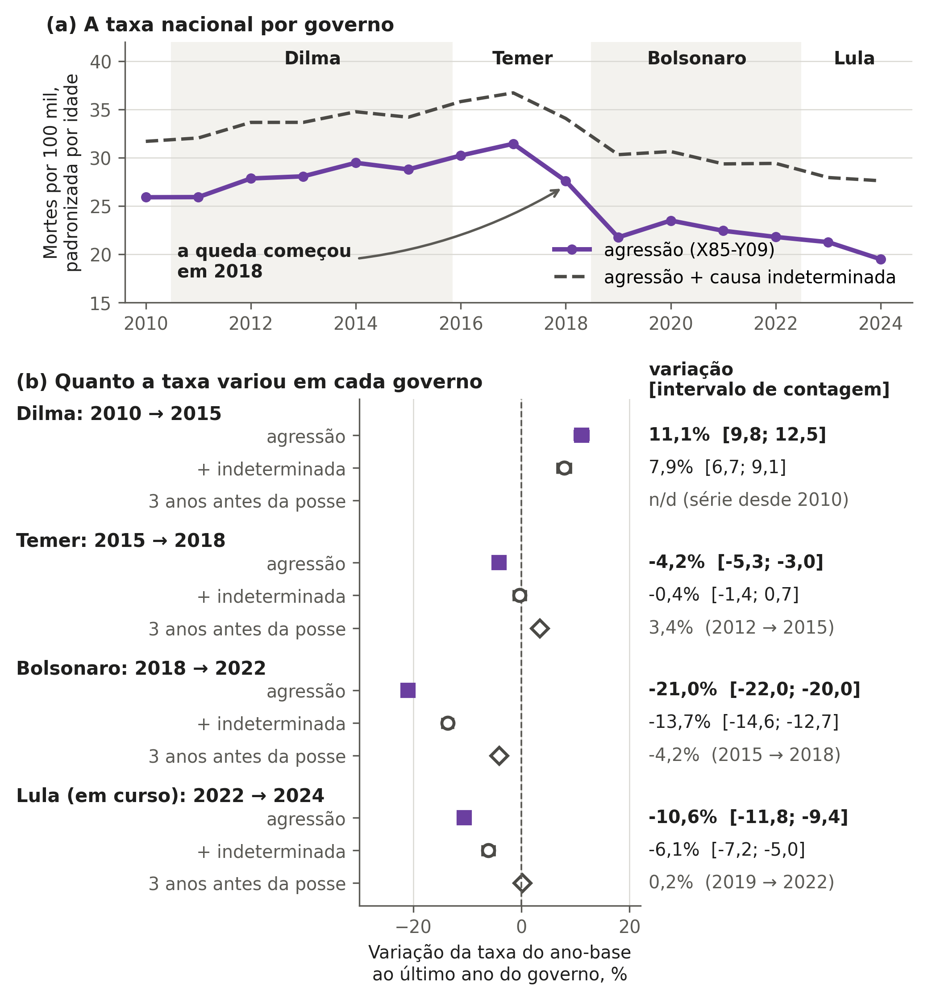

*Nota.* No painel (a), cada faixa alternada, cinza ou branca, é um governo, e a linha, a taxa por 100 mil. No painel (b), o quadrado é a variação da taxa entre o ano anterior à posse e o último ano inteiro do governo; o círculo vazado faz a mesma conta somando as mortes de causa indeterminada; o losango mostra a tendência dos três anos anteriores à posse, como contexto. Queda de 21,0% entre 2018 e 2022 (13,7% somando a causa indeterminada), iniciada em 2018. A figura descreve o que ocorreu durante cada governo e não atribui causa; o óbito não registra orientação sexual. Fonte: DATASUS (2026a) e IBGE (2026); cálculo do autor (Flores, 2026).

Na série nacional de 2010 a 2024, a taxa tem queda de nível estimada de 17,0% em 2019 (IC95% -29,5% a -2,4%), mas o placebo de 2018, um ano antes da troca de presidente, dá -21,8% (-37,4% a -2,4%): a queda não pode ser atribuída à troca presidencial, porque já aparece antes dela (Figura 20 e Tabela A13). Em 2016 a variação foi de +2,6% (-9,1% a +15,9%), e em 2023, de -3,9% (-17,1% a +11,3%); com 15 pontos e autocorrelação não tratada no erro clássico, os efeitos mínimos detectáveis ficam entre ±15% e ±25%. Somando a causa indeterminada, a queda de 2019 é de 9,6%. No painel de estados, a interação entre os escores de ideologia do governador e do presidente não foi distinguível de zero (β = -0,00214; p wild = 0,459). Para o contraste especificado no protocolo, governador 5 pontos mais à direita e presidente passando do PT para o Partido Social Liberal (PSL), o intervalo normal de 95% corresponde a -18,3% a +9,6%, e com a distribuição t de 26 graus de liberdade, a -18,9% a +10,4%; o efeito mínimo detectável com 80% de poder, isto é, o menor efeito que a análise veria com 80% de probabilidade, é -18,9% ou +23,3% (Figura 21 e Tabela A14). A distância ideológica entre governador e presidente (de -5,4% a +11,1%) e o governador do mesmo partido do presidente (de -9,8% a +12,5%) são operacionalizações distintas, apresentadas separadamente. O efeito nacional da Presidência é absorvido pelos efeitos fixos de ano no painel, e na série nacional as três trocas ficam confundidas com a queda iniciada em 2018, a pandemia de COVID-19, a política de armas, as facções e a piora do registro de óbitos (IPEA & FBSP, 2025). Não detectar associação na interação especificada não demonstra que a Presidência não importa. Pela regra pré-registrada, 1 das 36 células da série por grupo coincide com a troca: mulheres negras em 2019, -19,7% (-30,2% a -7,6%), padrão que fica impreciso, com intervalo que inclui zero, ao incluir a causa indeterminada (-6,1%; -15,3% a +4,1%); com 36 testes, até cerca de 1,8 células com intervalo que exclui zero seriam esperadas por acaso se nenhum efeito existisse, e a regra, que exige também placebo não detectável, espera menos que isso, e a leitura de reclassificação ou acaso é interpretação posterior, e não mecanismo demonstrado.

**Figura 20**

*Mudança de nível da taxa nacional de homicídio a cada troca de presidente e no placebo um ano antes, 2010 a 2024*

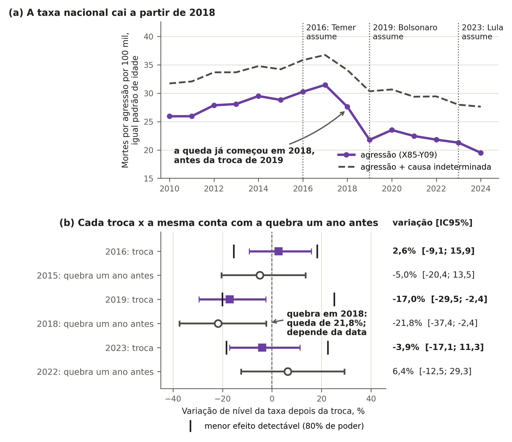

*Nota.* No painel (a), a linha é a taxa por 100 mil, e as linhas pontilhadas marcam as trocas de presidente. No painel (b), o quadrado é a mudança de nível estimada depois de cada troca, e o círculo vazado, a mesma conta um ano antes (placebo); quando o placebo mostra queda semelhante, a queda não pode ser creditada à troca. Os traços verticais marcam o menor efeito detectável. A queda de 2019 é distinguível de zero (-17,0%; IC95% -29,5% a -2,4%; p = 0,030), mas o placebo de 2018 também cai (-21,8%; -37,4% a -2,4%), e por isso a queda não pode ser atribuída à troca; as mudanças de 2016 e 2023 não se distinguem de zero, com poder baixo. Fonte: DATASUS (2026a); cálculo do autor (Flores, 2026).

**Figura 21**

*Interação entre a ideologia do governador e a do presidente: estimativas e efeito mínimo detectável*

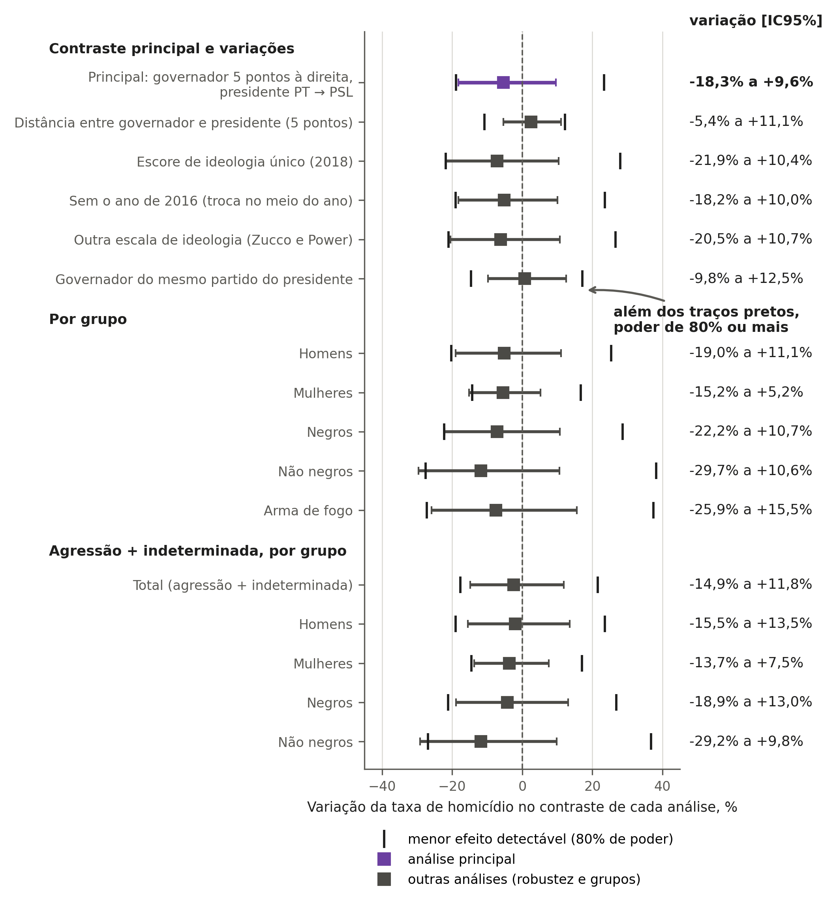

*Nota.* Cada quadrado é a estimativa, e a barra, o intervalo compatível com os dados; todos os intervalos passam por zero (principal: -18,3% a +9,6%). Os traços verticais marcam o efeito mínimo detectável, o menor efeito que a análise detectaria com 80% de probabilidade (-18,9% e +23,3% na análise principal); efeitos menores têm probabilidade de detecção abaixo de 80%, e a barra, e não o traço, indica os valores compatíveis com os dados. O efeito do presidente em si é absorvido pelo efeito de ano, e o resultado não indica que o presidente não importe. Fonte: DATASUS (2026a), TSE (2026) e Bolognesi et al. (2023); cálculo do autor (Flores, 2026).

Nos estados, nas 67 trocas de partido do governador entre 2013 e 2024, a variação da taxa do estado menos a variação nacional, entre os três anos anteriores e os três posteriores, subiu em 31 trocas e caiu em 36 (mediana -0,7%; quartis -9,4% e +12,1%) (Figura 22 e Tabela A12). As janelas ficam dentro de 2012 a 2024, com ao menos um ano de cada lado: 47 das 67 trocas têm três anos antes e três depois, e nas 20 trocas de 2013, 2014, 2023 e 2024 a janela é mais curta. Nos estados sem troca no mesmo ano, a mediana de referência ficou entre +0,8% e +7,8% (95%), com p = 0,016 (0,073 com a correção de Holm para os seis grupos). A referência usa a mesma janela de cada troca; só com as 47 janelas completas, a taxa relativa subiu em 20 trocas e caiu em 27 (mediana -0,8%; referência entre +0,8% e +11,0%, 95%; p = 0,008). Somando a causa indeterminada, a diferença deixa de se distinguir da referência: 34 trocas subiram e 33 caíram, mediana +0,5%, p = 0,54. Da esquerda para a direita, a taxa relativa subiu em 8 de 12 trocas (mediana +9,5%, p = 0,36), e da direita para a esquerda, em 5 de 8 (mediana +3,5%, p = 0,74); nos dois sentidos, o resultado não se distingue do que ocorre nos estados que não trocaram de governo no mesmo ano. A referência é formada por poucos estados (de 3 a 15 por ano; em 2018 e 2019, 9 estados, 7 deles do Nordeste) e não é neutra, de modo que uma diferença pode ser de região, e o p, que mede só o sorteio dentro desse grupo fixo, é anticonservador; esse limite foi observado depois do cálculo e registrado em adendo datado do pré-registro (Apêndice B). Trocas sobrepostas do mesmo estado não são independentes (DATASUS, 2026a; TSE, 2026).

**Figura 22**

*Variação da taxa de homicídio do estado relativa à do Brasil nas 67 trocas de partido do governador, 2013 a 2024*

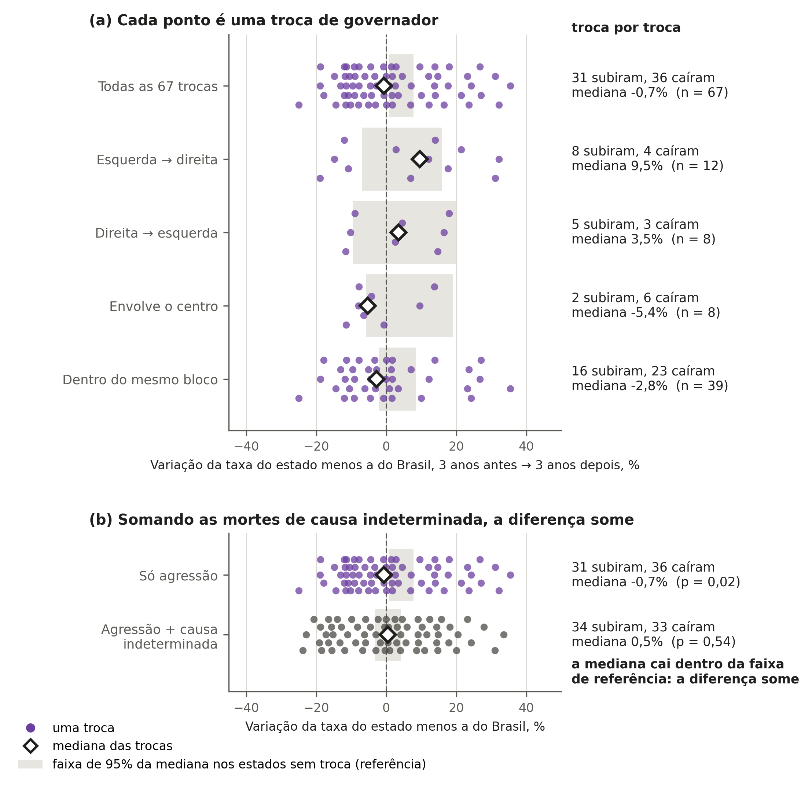

*Nota.* Cada ponto é uma troca de governador e indica se a taxa do estado, relativa à do Brasil, ficou mais alta (à direita) ou mais baixa (à esquerda) depois dela; o losango é a mediana das trocas, e a faixa cinza, o intervalo em que a mediana cairia por acaso nos estados sem troca no mesmo ano. A taxa relativa subiu em 31 trocas e caiu em 36 (mediana -0,7%); no painel (b), somando a causa indeterminada, a mediana passa a +0,5% (34 subiram, 33 caíram) e entra na faixa de referência. A referência é formada por poucos estados (3 a 15 por ano), não neutros. Exposição, e não prova de causa. Fonte: DATASUS (2026a) e TSE (2026); cálculo do autor (Flores, 2026).

### 3.8. Atos de governo contra pessoas LGBT+ no Brasil, 2003 a 2026

A busca simétrica aplicou o mesmo número de consultas, os mesmos descritores e a mesma regra de leitura aos seis mandatos presidenciais de 2003 a 2026: dez consultas por mandato, cinco descritores em português e em inglês, 60 no total, com 51 de 55 páginas úteis lidas (Tabela 8). Os critérios pré-registrados definem cinco tipos de ato: retórica hostil do próprio governante, quando a fala ridiculariza, desqualifica moralmente ou ataca homossexuais ou pessoas LGBT+ como pessoas ou grupo; omissão ou corte de política, como suspensão de programa, corte de verba ou silêncio documentado diante de fato que envolve pessoas LGBT+; ato administrativo hostil, isto é, decreto, portaria, veto, ordem ou censura que restringe direitos de pessoas LGBT+ ou as tem como alvo expresso; perseguição ou extermínio por agentes do Estado, como operação policial ou militar, prisão em massa, internação ou ordem de eliminação, com autoria estatal em fonte; e proteção ou ampliação de direitos (Flores, 2026).

Perseguição ou extermínio de pessoas LGBT+ por agentes do Estado não foi localizado, no espaço de busca, em nenhum dos seis mandatos; as consultas usam o nome de cada presidente, e agentes estaduais ou locais, como as polícias, não foram inventariados. Omissão ou corte de política foi localizado em cinco dos seis mandatos, com 8 episódios, e proteção ou ampliação de direitos, em quatro, com 10 episódios. Retórica hostil do governante e ato administrativo hostil com alvo expresso tiveram um episódio cada, ambos em 2019: a fala de 25 de abril de 2019, relatada por jornalistas presentes e publicada pela imprensa, sem transcrição oficial localizada, e a ordem de suspender verba para filmes e roteiros com temática LGBT+, de agosto de 2019, noticiada depois de fala em transmissão ao vivo, sem instrumento normativo lido (Tabela 8). A regra de leitura pré-registrada, que exige episódio de hostilidade ou omissão em governos dos dois lados da escala de ideologia para concluir que a lista existe dos dois lados, é satisfeita pelos episódios de omissão ou corte.

**Tabela 8**

*Episódios localizados na busca simétrica de atos de governo, por mandato presidencial e tipo de ato, 2003 a 2026*

| Mandato | Consultas | Páginas úteis lidas / selecionadas | Páginas publicadas durante o mandato | Retórica hostil do governante | Omissão ou corte de política | Ato administrativo hostil | Perseguição ou extermínio | Proteção ou ampliação |
|---|---|---|---|---|---|---|---|---|
| Lula, 1º mandato (2003 a 2006) | 10 | 6/8 | 0/6 | 0 | 0 | 0 | 0 | 1 |
| Lula, 2º mandato (2007 a 2010) | 10 | 7/8 | 1/7 | 0 | 1 | 0 | 0 | 5 |
| Dilma Rousseff (2011 a 2016) | 10 | 10/10 | 6/10 | 0 | 2 | 0 | 0 | 3 |
| Michel Temer (2016 a 2018) | 10 | 8/9 | 6/8 | 0 | 2 | 0 | 0 | 0 |
| Jair Bolsonaro (2019 a 2022) | 10 | 10/10 | 7/10 | 1 | 2 | 1 | 0 | 0 |
| Lula, 3º mandato (2023 a 2026) | 10 | 10/10 | 3/10 | 0 | 1 | 0 | 0 | 1 |
| Total | 60 | 51/55 | 23/51 | 1 | 8 | 1 | 0 | 10 |

*Nota.* Retórica hostil de ministro ou aliado foi contada à parte, com zero episódios em todos os mandatos; as consultas foram desenhadas para o governante, e não para ministros, e esse zero é limite do espaço de busca, e não ausência de episódios. Dois episódios de classificação duvidosa como omissão (um no governo Temer e um no governo Bolsonaro) não entram na soma. As fontes dos episódios de retórica e de ato hostil são de imprensa, e não atos oficiais. A cobertura do buscador é desigual no tempo: só 1 das 13 páginas úteis sobre os dois primeiros mandatos de Lula foi publicada durante o mandato, e a ausência de hostilidade nesses anos é limite do espaço de busca, e não prova de equivalência. Fonte: busca pré-registrada (Tabela 3), com endereço, trecho e SHA-256 de cada episódio no repositório (Flores, 2026).

### 3.9. Violência de Estado contra homossexuais em regimes de tipos distintos

A mesma régua de gravidade se aplica a regimes de qualquer orientação política: o pré-registro de governos classifica como nível 3 a prisão, a internação ou o trabalho forçado documentados por órgão internacional, tribunal ou relatório oficial (Flores, 2026). O nível mede o tipo de documento que registra o ato, e não a certeza do fato nem a originalidade da investigação. A forma da Hipótese 6 segundo a qual a perseguição seria própria de um só tipo de regime circula no Parlamento: das 33 falas da família F3 que afirmam perseguição, 10 a atribuem a regimes ou grupos estrangeiros (seção 3.10; Flores, 2026). Documentos oficiais e pesquisa acadêmica registram perseguição estatal de homossexuais sob rótulos políticos opostos, inclusive em democracias, e os casos reunidos na Tabela 9 são ilustrativos, e não uma amostra do mundo. Na Alemanha nazista, houve cerca de 100 mil prisões e de 5 mil a 15 mil homens enviados a campos de concentração (United States Holocaust Memorial Museum, 2021); no território da antiga Alemanha Ocidental, já democrática, uma estimativa de cerca de 64 mil condenações entre 1949 e 1994 foi adotada em projeto de lei do governo federal (Deutscher Bundestag, 2017). Na ditadura militar brasileira (1964 a 1985), a Comissão Nacional da Verdade registra demissões, censura e operações policiais, como as rondas de 1980 no centro de São Paulo contra travestis, prostitutas e homossexuais; escreve que a ideologia do regime "continha claramente uma perspectiva homofóbica, que relacionava a homossexualidade às esquerdas e à subversão" e ressalva que "não houve uma política de Estado formalizada" de extermínio (Comissão Nacional da Verdade, 2014, pp. 301, 307). Na Espanha de Franco, a lei de periculosidade social de 1970 previa internamento para reeducação; os atos de homossexualidade foram retirados dessa lei em janeiro de 1979, e a perseguição foi reconhecida na lei de memória democrática de 2022 (España, 1970, 1979, 2022; Fernández Turuelo, 2024). Na União Soviética, que criminalizou as relações entre homens em 1934 (Kondakov, 2022), a estatística judicial compilada por Valodzin (2020) soma mais de 38 mil condenações de 1946 a 1991, sem os tribunais do Gulag; por estimativa aproximada do autor, cerca de metade dos casos envolvia coerção ou menores, e os anos de 1934 a 1945 não estão cobertos.

Em Cuba, as Unidades Militares de Ajuda à Produção teriam internado cerca de 35 mil pessoas entre 1965 e 1968, segundo estimativa de dois ex-agentes de inteligência citada por Tahbaz (2013), que adverte que os relatos de ex-internos não permitem conhecer a proporção de homossexuais no conjunto; nas fontes lidas, não há estimativa confiável do número de homossexuais internados. O informe da Comissão Interamericana de Direitos Humanos nomeia os homossexuais entre os condenados a essas unidades, o que corresponde ao nível 3, com as ressalvas de que o informe se apoia em fontes secundárias, dá para o fim das unidades uma data divergente da literatura e foi lido por cópia de arquivo da web (CIDH, 1983). No Irã, a pena de morte é prevista em lei, com execuções relatadas de forma esparsa (ILGA World, 2020); em 2015, as Nações Unidas documentaram, em Mosul, execuções de homens acusados de homossexualidade pelo Estado Islâmico, organização armada com controle territorial de fato (UNAMI & OHCHR, 2015); e, na Chechênia, a OSCE concluiu haver "overwhelming evidence" de graves violações em 2017, com detenção e tortura reconhecidas também em caso julgado pelo Tribunal Europeu dos Direitos Humanos, e com mortes relatadas que a Human Rights Watch não pôde verificar de forma independente (OSCE, 2018; Human Rights Watch, 2017; Tribunal Europeu dos Direitos Humanos, 2023). Regimes de um mesmo campo divergiram: a Polônia comunista não criminalizava atos consensuais desde 1932, embora a Operação Hyacinth tenha reunido cerca de 11 mil fichas policiais entre 1985 e 1987 (Szulc, 2016, 2018).

**Tabela 9**

*Casos históricos selecionados de perseguição estatal por práticas homossexuais ou orientação sexual real ou presumida*

| Regime e período | Ato documentado | Contagem citada e o que ela conta | Fonte |
|---|---|---|---|
| Alemanha nazista, 1933 a 1945 | prisão e condenação pelo parágrafo 175 do Código Penal; campos de concentração | cerca de 100 mil prisões; cerca de 53,4 mil condenações; de 5 mil a 15 mil em campos | United States Holocaust Memorial Museum (2021) |
| Alemanha Ocidental (democracia), 1949 a 1994 | manutenção do parágrafo 175 | estimativa de cerca de 64 mil condenações (cerca de 50 mil até 1969), adotada em projeto de lei | Deutscher Bundestag (2017) |
| Espanha franquista e transição, 1954 a 1979 | "estado perigoso" e internamento para reeducação; atos de homossexualidade retirados da lei em janeiro de 1979 | sem estimativa nacional confiável; em Valladolid, 12 expedientes e 4 condenações em 1971 e 1972 | España (1970, 1979); Fernández Turuelo (2024) |
| Brasil, ditadura militar, 1964 a 1985 | demissões, censura, rondas policiais | sem estimativa confiável; 15 diplomatas cassados em 1969, 7 deles por "prática de homossexualismo" | Comissão Nacional da Verdade (2014) |
| União Soviética, 1946 a 1991 (lei desde 1934) | artigo 154-a, depois 121, do código penal da república russa, com pena de até cinco anos | mais de 38 mil condenações (estatística judicial, sem os tribunais do Gulag; cerca de metade por coerção ou menores, estimativa aproximada); 1934 a 1945 não coberto | Valodzin (2020) |
| Cuba, 1965 a 1968 | Unidades Militares de Ajuda à Produção, trabalho forçado | cerca de 35 mil internados no total (estimativa de terceiros); sem estimativa confiável do número de homossexuais | Tahbaz (2013); CIDH (1983) |
| Polônia comunista, 1985 a 1987 | registro policial (Operação Hyacinth) | cerca de 11 mil fichas | Szulc (2016) |
| Irã, desde 1979 | pena de morte prevista; execuções relatadas | sem estimativa confiável | ILGA World (2020) |
| Estado Islâmico, 2015 | execuções públicas em Mosul | dois episódios documentados pelas Nações Unidas; 30 mortes alegadas por "sodomia e outros crimes de moralidade", compiladas por organização não governamental | UNAMI & OHCHR (2015); OutRight Action International (2015) |
| Chechênia (Rússia), 2017 | detenção e tortura | aparentemente mais de 100 pessoas afetadas; mortes relatadas, que a Human Rights Watch não pôde verificar de forma independente | Human Rights Watch (2017); OSCE (2018) |

*Nota.* Levantamento ilustrativo, sem pretensão de exaustividade. As contagens têm unidades, coberturas e períodos distintos (prisões, condenações, internados, fichas, alegações) e não permitem ordenar regimes por intensidade da perseguição. "Sem estimativa confiável" indica que as fontes consultadas não estabelecem um total verificável; não significa ausência de vítimas, de registros ou de estudos. O Estado Islâmico é organização armada com controle territorial de fato. Fonte: elaboração do autor a partir das fontes da última coluna.

As fontes não permitem estimar mortos, ordenar regimes por número de vítimas nem concluir que a ideologia do governo seja irrelevante para a perseguição (Tabela 9). Os estudos transnacionais consultados, lidos pelo resumo, associam a criminalização da homossexualidade e os direitos legais à democracia, à religião, à origem jurídica e ao desenvolvimento (Asal et al., 2013; Encarnación, 2014); os que testam a ideologia do governo têm como desfecho direitos legais, e não perseguição, e obtêm resultados que dependem do desfecho e da medida (Reynolds, 2013; Siegel & Wang, 2018). Não foi localizado, no espaço de busca, estudo que use a posição do governo na escala esquerda-direita como preditor da perseguição estatal violenta. A evidência lida não sustenta que a perseguição estatal de homossexuais seja própria de um só tipo de regime, e a simetria do critério documental, com as mesmas colunas para todos os regimes, não equivale a simetria de resultados. As análises brasileiras deste artigo (seções 3.6 a 3.8) descrevem o que acompanha a mudança de governo, usam a escala de ideologia dos partidos como classificação e não como causa testada, e não identificam efeitos causais sobre a violência contra pessoas LGBT+.

### 3.10. Circulação das afirmações no Parlamento e na imprensa

As quatro frases que circulam no debate foram tratadas como famílias de afirmação: F1, "gays ou pessoas LGBT morrem mais"; F2, "o Brasil é o país que mais mata"; F3, "o governo mata ou persegue"; e F4, "não existe violência específica ou o dado é inventado". O corpus mais abrangente é o Parlamento, com 219.562 discursos da Câmara e 38.449 do Senado, 258.011 falas de 2015 a outubro de 2026, baixadas das interfaces públicas de dados abertos das duas Casas, com até 5,1% da Câmara sem a última página e texto integral do Senado só para 375 candidatos (Câmara dos Deputados, 2026; Senado Federal, 2026). A amostra codificada tem 871 itens, 60 por família e universo, ou o censo quando havia menos de 60 (Tabela A17). O dicionário de busca pré-registrado inflava as contagens, porque, por exemplo, "trans" sem fronteira de palavra casava "transporte", e a versão revista, escrita depois de ver a primeira contagem e registrada como desvio (Apêndice B), reduziu as famílias de 23, 161, 692 e 4 para 14, 56, 148 e 2 falas; as contagens são o número de falas recuperadas, e não o total dito em plenário.

Nas 56 falas sobre "o país que mais mata", 49 afirmam ou relatam a frase (Figura 23). Três variáveis são distintas. Fonte nomeada, qualquer fonte mencionada, aparece em 8 de 49 falas, 7 delas de organização da sociedade civil e 1 oficial sem referência localizável. Fonte primária, documento oficial ou estudo com nome e ano localizáveis, aparece em 1 de 49 falas pela regra literal do livro de códigos, adotada como análise principal, e em 0 de 49 pela regra aplicada pelo codificador original, que tratou um relatório com título e ano como de organização (análise de sensibilidade). Fonte primária é, aqui, categoria documental do livro de códigos, definida pela origem do documento, e não medida de quão perto a fonte está do fato. Fonte capaz de sustentar a afirmação, isto é, que mede o que a fala afirma, por exemplo uma comparação internacional de incidência, não foi codificada (Tabela A18). As cadeias das citações de organização terminam em contagens declaradas de mídia. Das 14 falas da família F1, 13 tratam da expectativa de vida, e 11 dão de 27 a 36 anos para pessoas trans, e nenhuma cita fonte primária; o valor de 35 anos leva a uma única autora citada pela ANTRA, que a própria organização diz não ser estudo sistemático (Benevides, 2026).

**Figura 23**

*Frequência das quatro frases em 258.011 falas da Câmara e do Senado (a) e proporção de falas com fonte primária (b), 2015 a 2026*

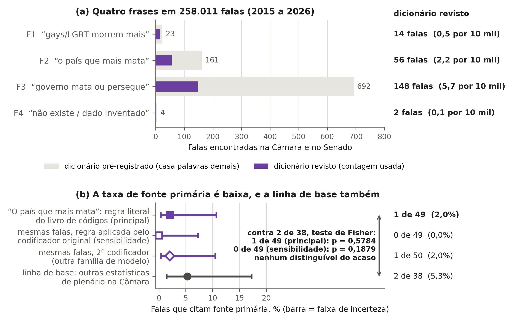

*Nota.* No painel (a), as barras mostram quantas falas contêm cada frase com o dicionário pré-registrado (barra clara) e com o dicionário revisto (barra escura, contagem usada; desvio declarado no Apêndice B). No painel (b), o ponto é a proporção de falas que citam documento oficial ou estudo com autor e ano, e a barra, o IC95% de Wilson. Pela regra literal do livro de códigos (análise principal), 1 de 49; pela regra aplicada pelo codificador original (sensibilidade), 0 de 49; linha de base, 2 de 38. Nenhuma diferença se distingue do acaso (teste exato de Fisher: p = 0,58 e p = 0,19). Fonte: Câmara dos Deputados (2026) e Senado Federal (2026); codificação do autor (Flores, 2026).

O segundo codificador, de outra família de modelo e cego aos rótulos, concorda com o original na família F2 no Parlamento (κ de postura 0,73, IC95% 0,46 a 0,92; κ de fonte 0,66, 0,31 a 0,93) e, entre as 50 falas que ele classificou como afirmação, encontra 1 com fonte primária, o mesmo relatório que a regra literal classifica como primária. A linha de base não mostra diferença distinguível entre temas na falta de fonte: de 60 falas da Câmara sorteadas entre as que trazem estatística fora dos quatro temas, 22 ficaram fora do critério, e nas 38 com estatística afirmada, 2 (5%; intervalo de Wilson de 1,5% a 17%) citam fonte primária com nome e ano. A diferença para 1 de 49 (teste exato de Fisher, p = 0,58) e para 0 de 49 (p = 0,19) não se distingue do acaso, e com n pequeno isso não prova equivalência; só a comparação 1 de 50 contra 2 de 38 (p = 0,58) usa o mesmo codificador nos dois lados (Tabela A18). Na família F3, o κ de postura é 0,43, e, por regra escrita antes, os percentuais dessa família e os de fora do Parlamento (κ de fonte 0,47) são indicativos (Tabela 3). Na imprensa, só o título foi codificado, e a contagem do agregador de notícias é número mínimo sem série temporal; a série que serviria para tendência ficou inacessível por recusa persistente do servidor (resposta HTTP 429, excesso de pedidos), e um controle positivo vazio foi registrado como falha, e não como zero (Flores, 2026).

### 3.11. Falsas alegações e retratação

A literatura separa três fenômenos que o debate mistura: alegação provadamente falsa, alegação não substanciada e retratação. Para denúncias de agressão sexual de adultos à polícia, em outros países, a meta-análise de Ferguson e Malouff (2016) estima 5,2% de alegações provadamente falsas (IC95% 3,0 a 8,9) com definição estrita, a partir de estudos que vão de 2,0% a 13,7%, com heterogeneidade alta (I² próximo de 95%); a estimativa só se reproduz com o valor da tabela do próprio artigo para um dos estudos (13,7%), que diverge do texto (4,5%; Ferguson & Malouff, 2016, Tabela 1 e p. 1189). Retratação é comum: em violência por parceiro íntimo denunciada à polícia, 21,6% das vítimas retiraram formalmente a queixa e 26,7% se desengajaram do processo, e, nos casos com motivo registrado, o mais frequente foi a reconciliação (Sleath & Smith, 2017). Essas estimativas tratam de outras populações e procedimentos e não estimam alegações falsas de LGBTfobia no Brasil; nenhuma medida nacional dos três fenômenos foi localizada em PubMed, Crossref, buscas gerais em três idiomas e fontes oficiais. A Lei nº 15.380/2026 alterou a audiência de retratação da Lei Maria da Penha, quebra datada que qualquer série futura terá de modelar (Brasil, 2026).

### 3.12. Sistemas de medida em outros países

Reino Unido e Nova Zelândia medem a motivação percebida em levantamento probabilístico de vitimização. No Reino Unido, o levantamento estima 176.000 incidentes de ódio por ano, dos quais 44% chegam à polícia, enquanto o registro policial conta 137.550 crimes de ódio, 18.702 por orientação sexual e 3.809 por transfobia, no ano encerrado em março de 2025 (Home Office, 2025). No Canadá, a polícia registrou 4.882 crimes de ódio em 2024, 11,9 por 100 mil habitantes, com cobertura acima de 99% (Statistics Canada, 2026). Na Nova Zelândia, o levantamento de 8.008 entrevistas mede 38% de adultos LGBTQ+ vítimas de ao menos uma ofensa, contra 28% na média (Ministry of Justice, 2025). Na União Europeia, o levantamento sobre pessoas LGBTIQ da Agência da União Europeia para os Direitos Fundamentais, com 100.577 respondentes, mede de 13% a 14% de pessoas atacadas em cinco anos (FRA, 2024), e 46 Estados da Organização para a Segurança e Cooperação na Europa enviam ao seu escritório de direitos humanos dado oficial de crime de ódio (OSCE/ODIHR, 2025). Onde se audita, o registro policial de motivação é frouxo: na Alemanha, só 17,6% dos relatórios policiais auditados explicitam o motivo, segundo estudo do instituto de criminologia da Baixa Saxônia publicado em livro (Henningsmeier et al., 2025, p. 99), e o levantamento nacional da polícia criminal federal mede taxa de denúncia de 2,6% para violência por orientação sexual (Bundeskriminalamt, 2026). O Brasil difere por não ter levantamento regular de vitimização nem pesquisa oficial dedicada à população LGBT+, porque a PNS de 2019 mediu orientação sexual uma única vez, num módulo de saúde e sem identidade de gênero (IBGE, 2022b). Em contrapartida, um campo obrigatório de motivação no registro de saúde como o do Sinan não foi localizado em nenhum outro país do inventário consultado, de 47 fontes oficiais das Américas, da Europa, da Ásia, da África e da Oceania, e sua fragilidade é a completude (DATASUS, 2026b; Flores, 2026).

### 3.13. Poder estatístico e dimensionamento de um levantamento de vitimização

Para saber se a violência não letal contra pessoas LGB+ sobe ou desce, é preciso perguntar a uma amostra de adultos, repetidamente, se sofreram violência; um levantamento repetido de vitimização com pergunta de orientação sexual fornece essa restrição externa sobre o registro, ao passo que a mortalidade requer desenho próprio, com orientação identificada e denominador compatível (Home Office, 2025; ONS, 2026a). O efeito de desenho medido no microdado da PNS de 2019 para violência física entre LGB+ é 5,1 (bootstrap de 500 réplicas, 2,6 a 6,4), e o cálculo por amostragem aleatória simples subestima o tamanho necessário nessa proporção (IBGE, 2022a; Flores, 2026). Com esse efeito, num teste de duas proporções com nível de significância de 5% bilateral e poder de 80%, detectar um aumento de 30% entre rodadas exige cerca de 5.787 adultos LGB+ por rodada, ou 305.955 adultos triados (5.786,3 LGB+ divididos pela prevalência não arredondada, de 1,8912%, com arredondamento único no fim); a PNS de 2019, com 88.531 adultos e 1.554 LGB+ entrevistados, só detecta variação de 60,7% na violência física (Figura 24). O cálculo combina a prevalência ponderada (1,89%) com o efeito de desenho da PNS; se a fração não ponderada de LGB+ da PNS (1,76% dos entrevistados) se repetir num desenho igual, o número de adultos a contatar sobe para cerca de 330 mil (329.644). Num desenho domiciliar sem informação prévia sobre quem mora em cada endereço, a sobreamostra não reduz esse número, porque encontrar os mesmos adultos LGB+ exige contatar os mesmos domicílios; cadastros auxiliares ou seleção dirigida de domicílios poderiam reduzi-lo, possibilidade não avaliada aqui.

**Figura 24**

*Variação detectável na violência física contra adultos LGB+ entre duas rodadas, segundo o número de adultos triados*

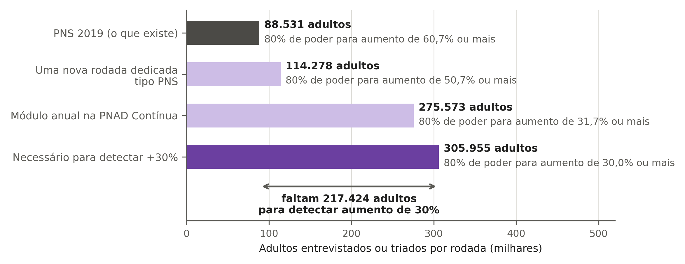

*Nota.* Cada barra é o número de adultos entrevistados em cada desenho, e o texto ao lado, a menor mudança na violência física entre duas rodadas que esse tamanho permite detectar. A PNS de 2019 detecta mudanças de cerca de 61%; para detectar 30%, seriam necessários cerca de 306 mil adultos triados, porque só uma pequena fração dos adultos é LGB+ e a amostra é sorteada por conglomerados, com pesos desiguais. Fonte: IBGE (2022a); cálculo do autor (Flores, 2026).

A Tabela 10 compara três desenhos. Todos supõem, por falta de medida própria, um efeito de desenho igual ao da PNS de 2019, suposição que, por hipótese não testada, superestima o tamanho necessário para o painel por endereços, e os custos são cenários calculados a partir de documentos públicos, e não orçamentos (Ministério da Justiça e Segurança Pública & IBGE, 2021; Ministério da Saúde & IBGE, 2023). O custo de referência do módulo anual na Pesquisa Nacional por Amostra de Domicílios Contínua (PNAD Contínua), R$ 6,85 milhões, vem do plano de trabalho oficial dos módulos de vitimização e segurança dessa pesquisa contratados em 2021 (valor total de R$ 3.596.904 para um trimestre de coleta): soma o custo de tecnologia da informação, pago uma vez, ao custo variável por domicílio visitado (diárias, combustível e passagens) multiplicado pelos 337,6 mil domicílios do desenho, com valores atualizados pelo Índice Nacional de Preços ao Consumidor Amplo (IPCA) até setembro de 2026 (Ministério da Justiça e Segurança Pública & IBGE, 2021; IBGE, 2026). A Pesquisa Nacional de Demografia e Saúde de 2023 perguntou orientação sexual e identidade de gênero em 133 mil domicílios (IBGE, 2023) e não havia publicado os resultados até 11 de outubro de 2026, data da última consulta.

**Tabela 10**

*Capacidade e custo de um ciclo de três desenhos de levantamento de vitimização (R$ de setembro de 2026)*

| Desenho | Adultos | LGB+ | Variação detectável (física / qualquer) | Custo de referência |
|---|---|---|---|---|
| Módulo anual na PNAD Contínua | 275.573 | 5.212 | 31,7% / 12,2% | R$ 6,85 milhões |
| Rodada dedicada semelhante à PNS | 114.278 | 2.161 | 50,7% / 19,0% | R$ 29,0 milhões |
| Painel ou levantamento probabilístico pela internet | 114.278 | 2.161 | 50,7% / 19,0% | R$ 42,0 milhões |

*Nota.* Custos marginais ao financiador, sem a folha permanente do instituto. O custo de referência é o cenário com o precedente de preço mais próximo; as faixas (R$ 6,85 a 69,9, 25,3 a 32,7 e 42,0 a 89,1 milhões) acrescentam cenários mais caros: o teto do módulo supõe visita própria ao custo por domicílio da PNS, e o do painel, o preço por entrevista de um levantamento presencial estrangeiro. O valor de referência da rodada dedicada divide o valor global da minuta de plano de trabalho da PNS (R$ 22,29 milhões) pelo número de domicílios. Fonte: Ministério da Justiça e Segurança Pública e IBGE (2021), Ministério da Saúde e IBGE (2023) e IBGE (2026); cálculo do autor (Flores, 2026).

## 4. Discussão

### 4.1. Vereditos por hipótese

A Tabela 11 resume o veredito de cada hipótese, na ordem da Introdução, com o nível de pergunta e a evidência que decide; a Figura 25 desenha, para o Brasil, as três perguntas centrais por nível. A primeira hipótese é sustentada: no Brasil, adultos que se declararam LGB+ relataram violência física em 12 meses 3,84 vezes mais que heterossexuais na conta direta e 2,82 vezes depois do ajuste, com o padrão presente em três das quatro faixas etárias, o que sustenta a disparidade nos níveis N1 e N2, e não a motivação do agressor (seção 3.1). A segunda hipótese não é testável no Brasil, porque nem o formulário de óbito nem o arquivo do SIM registram orientação sexual ou identidade de gênero, e nenhuma estimativa nacional comparável foi localizada; fora do Brasil, é sustentada para mortalidade por todas as causas em populações definidas sob a regra complementar e parcial sob a regra original, sem razão populacional para homicídio em nenhuma fonte lida (seção 3.2). Onde o registro contém o atributo, como sexo e raça, a mortalidade por agressão é medida, de 2,6 a 51,7 por 100 mil, o que localiza o limite na ausência do campo (seção 3.3).

A terceira hipótese não é sustentada como taxa ou total e é contrariada como invenção, isto é, como fabricação de casos. A contagem do GGB não mede taxa nem total, porque depende do que virou notícia, tem critério largo e não tem denominador compatível; e a invenção é contrariada pela evidência no nível de ocorrência (N1), porque 50 de 160 casos de 2019 são verificáveis hoje (40 com correspondência estrita) e a duplicata é de 0,3%, embora a amostra tenha achado 2 atropelamentos sem indício de intenção, fora do critério que o próprio GGB declara, entre 88 matérias correspondentes (seção 3.4). A quarta hipótese é não testável com as séries isoladas: o crescimento de 4,4 vezes dos boletins de ocorrência de 2022 a 2025 é compatível tanto com mais violência quanto com mais registro, o campo de motivo das fichas de saúde tem faltante efetivo acima de 40%, e o Disque 100 tem quatro quebras de formato e nenhuma chave de pessoa (seção 3.5). Nenhuma das fontes brasileiras consultadas aplica, em padrão nacional, a separação entre motivação e contexto da Classificação Internacional de Crimes para Fins Estatísticos, a ICCS (UNODC, 2015) nem os indicadores de viés documentados no registro recomendados pela OSCE (OSCE/ODIHR, 2014).

A quinta hipótese não é sustentada pelo que foi medido: o painel de estados descarta associações entre o partido do governador e a taxa de homicídio registrada fora de -12,3% a +12,4% pela inversão do teste wild-cluster, o estudo de eventos é inconclusivo, e a interação entre a ideologia do governador e a do presidente não se distingue de zero, com poder baixo (seções 3.6 e 3.7). A exposição federal descreve o que a taxa fez em cada governo, alta de 11,1% no governo Dilma Rousseff e quedas de 4,2%, 21,0% e 10,6% nos governos Temer, Bolsonaro e no terceiro governo Lula, com a queda iniciada em 2018 e a parcela de causa indeterminada em alta; nada disso é sobre violência contra pessoas LGBT+ nem atribui causa (Tabela 7). Na sexta hipótese, perseguição por agentes do Estado entre 2003 e 2026 não foi localizada na busca pré-registrada de 60 consultas sobre os seis governos federais, que não inventariou agentes estaduais ou locais e contou episódios de omissão ou corte de política em cinco dos seis mandatos e um episódio de retórica hostil e um de ato administrativo hostil, ambos em 2019 (Tabela 8); a forma segundo a qual a perseguição estatal de homossexuais seria própria de um só tipo de regime é contrariada pela documentação lida, que registra perseguição estatal de homossexuais sob rótulos políticos opostos, da Alemanha nazista à União Soviética e a Cuba, da ditadura militar brasileira à Alemanha Ocidental democrática e ao Irã, em casos ilustrativos que não permitem comparar a intensidade da perseguição entre regimes (seção 3.9; Tabela 9). A sétima hipótese não é sustentada pelo que foi medido: a afirmação de que o Brasil é "o país que mais mata" circula no Parlamento quase sempre sem fonte primária (1 de 49 falas pela regra literal), mas outras estatísticas ditas em plenário também (2 de 38), e a diferença não é detectável (p = 0,58), o que, com amostras desse tamanho, não prova equivalência; a própria afirmação não tem comparação de taxas entre países que a sustente (seção 3.10).

**Tabela 11**

*Veredito de cada hipótese, nível de pergunta e evidência que decide*

| Hipótese | Veredito | Nível | Evidência que decide | Seção |
|---|---|---|---|---|
| 1. Vitimização não letal maior entre adultos LGB+ | sustentada; motivação do agressor não testável | N1, N2 | violência física em 12 meses: 14,70% e 3,82%; razão ajustada 2,82 (IC95% 2,16 a 3,68) | 3.1 |
| 2. Mortalidade maior entre pessoas LGB+ ou trans | Brasil: não testável com dado público. Fora do Brasil: sustentada para todas as causas em populações definidas (parcial sob a regra original); sem razão populacional para homicídio | N1 | formulário de óbito sem campo de orientação; Inglaterra e País de Gales: 1,31 (1,28 a 1,33) | 3.2 e 3.3 |
| 3. Contagem do GGB como taxa ou total; ou como invenção | não sustentada como taxa ou total; contrariada como invenção, isto é, como fabricação de casos | N1, N4 | 50 de 160 casos verificáveis (40 com correspondência estrita); duplicata de 0,3%; LGBTfobia atribuída em 3 de 73 mortes violentas | 3.4 |
| 4. Crescimento dos registros como crescimento da violência | não testável com as séries isoladas | N1, N4 | 783 a 3.481 boletins (2022 a 2025) ajustados com o mesmo erro por três histórias | 3.5 |
| 5. Ideologia do governo associada ao homicídio | não sustentada pelo que foi medido; associações dentro das faixas compatíveis não se distinguem de zero | N1 (homicídio geral) | troca de 5 pontos: -12,3% a +12,4%; placebo de 2018 com queda de mesmo sinal que a de 2019 | 3.6 e 3.7 |
| 6. Perseguição por agentes do Estado, 2003 a 2026; perseguição própria de um tipo de regime | Brasil 2003 a 2026: não localizada no espaço de busca, que cobre os governos federais e não agentes estaduais ou locais; tipo único de regime: contrariada | episódios por tipo de ato | 0 episódios de perseguição ou extermínio em 60 consultas; documentos oficiais e de órgãos internacionais sobre regimes distintos | 3.8 e 3.9 |
| 7. "O país que mais mata" circula sem fonte primária com frequência diferente | não sustentada pelo que foi medido; com 1 de 49 contra 2 de 38, a diferença não é detectável (p = 0,58); a frase também não é sustentada por comparação de taxas | circulação | 1 de 49 falas com fonte primária, contra 2 de 38 (p = 0,58) | 3.10 |

*Nota.* Vocabulário de veredito definido na seção 2.2. Fonte: seções indicadas na última coluna.

**Figura 25**

*Respostas para o Brasil por pergunta e nível: violência não letal contra LGB+, morte de pessoas LGBT+ e morte de mulheres e negros*

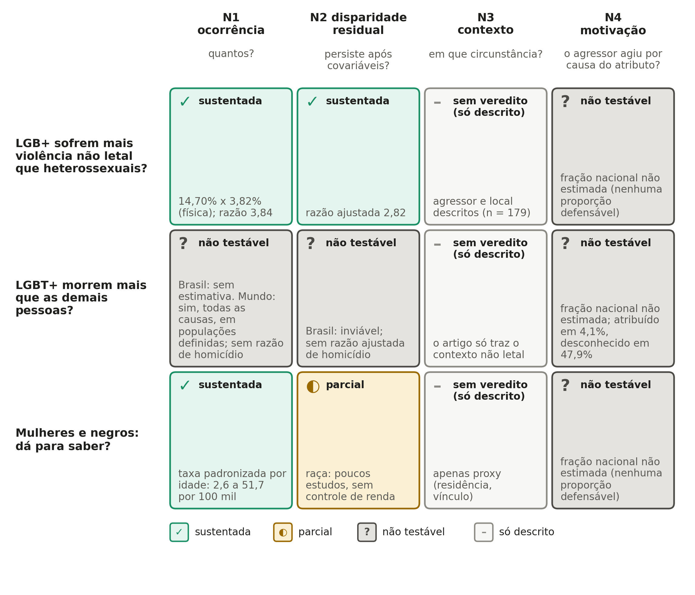

*Nota.* Cada linha é uma pergunta, e cada coluna, um nível de análise, de ocorrência (N1) a motivação (N4). Verde: o dado sustenta a resposta; amarelo: sustentação parcial; cinza-escuro: não há dado que permita testar; cinza-claro: o artigo só descreve, sem veredito. Na coluna de motivação (N4), as três células são "não testável": nenhuma fração nacional foi estimada, porque nenhum dado nacional permite estimá-la, o que não afirma nem nega a motivação dos agressores. A disparidade residual (N2) para mulheres e negros é parcial porque, nos dois estudos lidos, só há resultado para raça e sem controle de renda. Fonte: seções 3.1 a 3.3.

### 4.2. Interpretação e relação com a literatura

O fato mais firme que o dado brasileiro sustenta é a disparidade de vitimização não letal, medida por instituto oficial sem intermediário (Vasconcelos et al., 2023). O segundo é negativo e igualmente firme: não existe, nas bases brasileiras consultadas, numerador letal com denominador compatível para pessoas LGBT+, e por isso nenhuma taxa, tendência ou classificação internacional de homicídio de pessoas LGBT+ é sustentada (seções 3.2 e 3.4). Motivação documentada do agressor, viés percebido pela vítima e efeito causal da discriminação são perguntas distintas (Greiner & Rubin, 2011), e o artigo não estima fração nacional atribuível à LGBTfobia, o que não refuta casos documentados nem efeitos estruturais da discriminação.

O padrão é compatível com a preocupação de Campbell (1979): toda série letal disponível sobre pessoas LGBT+ no Brasil é registro sem restrição externa sobre a propensão de registrar, e o esforço institucional que amplia a cobertura de um registro pode comprometer sua comparabilidade no tempo. O mecanismo não foi testado. A literatura internacional encontra o mesmo obstáculo, porque mudanças de política alteram o registro de crimes de ódio sem que se possa separar violência de registro (Levy & Levy, 2017; Pettis et al., 2022), e os países que separam as duas coisas o fazem com levantamento de vitimização paralelo ao registro policial (Home Office, 2025; Ministry of Justice, 2025). Kahan et al. (2017) mostram, num experimento nos Estados Unidos, que maior habilidade numérica aumenta a polarização no acerto de um problema de covariância quando a resposta correta contraria a posição política do sujeito; estender o resultado a contagens de violência é analogia deste artigo, mas o mecanismo, se vale, vale para os dois lados e justifica publicar sempre a fonte contrária e o intervalo.

### 4.3. Objeções previsíveis e respostas

As objeções a seguir são as que mudariam a interpretação de um resultado se procedessem; cada resposta indica o dado que a decide e a seção ou tabela em que ele é apresentado (seções 3.1 a 3.13).

1. A ausência de registro oficial seria produto de descaso, e uma contagem da sociedade civil, mesmo imperfeita, seria melhor que nenhuma, papel que D'Ignazio et al. (2022) documentam para os contradados de feminicídio. O argumento sustenta a existência da contagem e a necessidade de dado oficial, mas não as frases de taxa e classificação construídas sobre ela: tratada como total, a contagem do GGB daria 8,8 a 10,0 mortes por 100 mil adultos LGB+, abaixo da taxa adulta geral, o que indica incompatibilidade entre numerador de mídia e denominador populacional, e não risco menor (seção 3.4; Figura 9).
2. Contagens de organizações de militância teriam incentivo para crescer e critério largo, e por isso a violência desproporcional seria inventada. O argumento sustenta que a contagem não é taxa nem crime de ódio comprovado, mas não a ausência de violência desproporcional: o levantamento oficial mostra razão ajustada de 2,82 (IC95% 2,16 a 3,68), e a duplicata de 0,3% na lista de 2019 não sustenta fabricação, embora o teste não alcance 2023 a 2025 (Vasconcelos et al., 2023; seção 3.4).
3. Se pessoas LGB+ morrem mais na Inglaterra e no País de Gales, morreriam mais também no Brasil. Os estudos lidos medem populações, causas e estimadores próprios, e o ONS declara que a análise é descritiva (ONS, 2026a); transportar a razão para o Brasil exige uma hipótese sobre a população brasileira que nenhum dado público testa, porque o óbito não registra orientação (Ministério da Saúde, 2022, p. 10).
4. A queda de homicídios num governo provaria efeito desse governo, ou a ausência de associação provaria que o governo não importa. A queda nacional iniciada em 2018 aparece no placebo um ano antes da troca de presidente (-21,8%), a parcela de causa indeterminada subiu de 18,0% para 25,9%, e a interação entre governador e presidente só teria 80% de poder para efeitos de cerca de -19% ou +23%; o desenho descreve o que aconteceu e não atribui causa em nenhum dos dois sentidos (seção 3.7; Figuras 19 a 21).
5. A alta dos boletins de ocorrência provaria que a LGBTfobia aumentou, ou, no sentido oposto, que o aumento é só de registro. Três histórias de incidência produzem a mesma série observada (Figura 14), e o próprio compilador descreve os números recebidos como "baixos demais", com "variações anormais de um ano a outro" (FBSP, 2026).
6. As parcelas de LGB+ entre vítimas, cerca de 4% nas fichas de saúde e cerca de 7% no levantamento domiciliar, validariam uma à outra ou se contradiriam. As duas descrevem universos diferentes, e a regra de notificação exclui da ficha a violência comunitária contra homens de 20 a 59 anos, salvo em condição de vulnerabilidade como pertencer à população LGBT (Ministério da Saúde, 2024, p. 1222; Figura 11).
7. A busca de atos de governo favoreceria um dos lados. A busca aplicou 10 consultas idênticas a cada um dos seis mandatos, com a mesma regra de leitura pré-registrada e os mesmos tipos de ato para todos; o procedimento é simétrico, e o resultado não: proteção ou ampliação de direitos foi localizada só nos quatro mandatos do PT (10 episódios), retórica hostil do governante e ato administrativo hostil, um episódio cada, só em 2019, e omissão ou corte de política nos dois lados (4 episódios nos mandatos do PT e 4 nos de Temer e Bolsonaro). A cobertura desigual da imprensa de 2003 a 2010 está declarada como limite do espaço de busca (Tabela 8).
8. A codificação e a busca feitas por modelos de linguagem enviesariam os resultados. O segundo codificador, de outra família de modelo e cego aos rótulos, concordou com o primeiro na família F2 (κ de postura 0,73), os percentuais com concordância abaixo de 0,60 foram rebaixados a indicativos por regra escrita antes, e os trechos citados foram conferidos por script contra os arquivos (seções 2.6 e 3.10).

### 4.4. Implicações para a vigilância

A primeira implicação é a necessidade de uma restrição externa sobre a propensão de registro. Para a violência não letal, a forma usada por outros países é um levantamento probabilístico de vitimização repetido, com pergunta de orientação sexual, de identidade de gênero e de motivação percebida pela vítima, paralelo ao registro policial (Home Office, 2025; Ministry of Justice, 2025; FRA, 2024). Dimensionado pelo efeito de desenho medido na PNS, um módulo anual na PNAD Contínua com cerca de 275 mil adultos detectaria variações de cerca de 32% na violência física, a um custo de referência de R$ 6,85 milhões por ciclo, cenário calculado a partir do plano de trabalho oficial dos módulos de vitimização da mesma pesquisa (Ministério da Justiça e Segurança Pública & IBGE, 2021; Tabela 10). Com ele, os registros de ocorrência e de notificação, como a série policial e o campo de motivação do Sinan, passariam a ser calibráveis; as contagens de mortes da sociedade civil, não, porque dependem do registro da orientação e da identidade no óbito (terceira implicação).

A segunda implicação diz respeito ao registro da motivação. Os padrões internacionais separam a motivação do contexto do crime (UNODC, 2015) e pedem indicadores de viés documentados em cada registro (OSCE/ODIHR, 2014); no Brasil, o campo de motivação da ficha de saúde existe e é obrigatório, mas tem faltante efetivo de 42% a 44% (DATASUS, 2026b), e a regra de elegibilidade da notificação difere por sexo, idade e grupo (Ministério da Saúde, 2024, p. 1222). A motivação do agressor, no sentido de Greiner e Rubin (2011), continua a exigir registro com indicadores de viés, e não apenas o relato da vítima.

A terceira implicação é que a mortalidade de pessoas LGBT+ só se torna mensurável com orientação sexual e identidade de gênero registradas no óbito, ou com a vinculação do óbito a uma fonte que as registre e tenha denominador compatível, como fez o Reino Unido com o Censo (ONS, 2026a). Nenhum governo coleta essas informações em processo padronizado no óbito (Zachry et al., 2025), e a vinculação probabilística entre bases brasileiras já mostrou acurácia de 93,3% no Rio de Janeiro (Rafael et al., 2024). Para registros com quebras de formato, como o Disque 100, documentar cada quebra e publicar chave pseudonimizada de pessoa permitiria contar vítimas, e não apenas denúncias (MDHC, 2026); para contagens da sociedade civil, publicar a lista de casos com a fonte de cada caso permite a auditoria que foi possível para 2019 e não para 2023 a 2025 (GGB, 2020, 2026).

### 4.5. Agenda de pesquisa

Cinco linhas de pesquisa mudariam as respostas da seção 4.1; dependem de mandato institucional ou de acesso a dados não públicos e são apresentadas como possibilidades científicas.

1. Quando a Pesquisa Nacional de Demografia e Saúde de 2023 for publicada, com orientação sexual e identidade de gênero coletadas em 133 mil domicílios (IBGE, 2023), repetir a comparação da seção 3.5 com uma segunda medida de prevalência, inclusive de pessoas trans; o mesmo vale para a edição seguinte da PNS, objeto do plano de trabalho de 2023 (Ministério da Saúde & IBGE, 2023), se ela mantiver a pergunta de orientação sexual e tiver variáveis, pesos e documentação divulgados.
2. Exercer a vinculação entre SIM, Sinan e registros policiais com chave pseudonimizada, o que permitiria captura-recaptura com três listas e estimativas de total menos dependentes da independência entre duas listas de mídia (Lum et al., 2013; Rafael et al., 2024; Luis et al., 2026).
3. Auditar as listas por caso do GGB anteriores a 2019, disponíveis em arquivo da web, pelo mesmo protocolo de amostra aleatória aplicado a 2019 (GGB, 2020; seção 3.4).
4. Medir, com amostra probabilística de processos e codificação dupla cega, as taxas brasileiras de alegação provadamente falsa, de alegação não substanciada e de retratação, hoje só estimadas para outras populações (Ferguson & Malouff, 2016; Sleath & Smith, 2017).
5. Estimar a mortalidade por orientação sexual em coortes brasileiras com orientação declarada e vinculação ao SIM, no desenho do ONS, com padronização por idade e decomposição por causa (ONS, 2026a; McKetta et al., 2024).

## 5. Ameaças à validade

### 5.1. Validade de construto

A medida de vitimização não letal é autorrelato de adultos classificados pela orientação sexual declarada numa única edição da PNS; a pesquisa não identifica pessoas trans, menores, motivação nem tendência (IBGE, 2022b). A orientação autodeclarada pode ser subestimada sob estigma, e o modo de preenchimento associa-se à prevalência declarada de LGB+, 3,26% quando o próprio morador preenche o módulo e 1,35% quando o entrevistador o faz, associação que pode refletir autosseleção e não demonstra viés de revelação (IBGE, 2022a). A PNS mede a prevalência de pessoas vitimadas, e não o número de episódios. O Sinan descreve notificações sujeitas a regra de elegibilidade diferente por sexo, idade e grupo (Ministério da Saúde, 2024, p. 1222), e não mede vitimização populacional. O que se pode afirmar com segurança é a disparidade de prevalência de vitimização autorrelatada entre adultos LGB+ e heterossexuais em 2019; tendência e motivação ficam fora do alcance da medida.

### 5.2. Validade interna

O painel de estados depende de tendências paralelas e de efeito constante no tempo; o regressor é contínuo e reversível, a decomposição de Goodman-Bacon (2021) não se aplica literalmente, o diagnóstico de resíduos não resolve a ameaça de efeitos heterogêneos, o teste de antecipação tem poder baixo, e o escore partidário, atribuído por especialistas (Bolognesi et al., 2023), tem ruído; se o erro de medida for clássico, isto é, independente do escore verdadeiro e dos demais termos do modelo, ele atenua o coeficiente, e, se não for, a direção do viés não é garantida; a literatura metodológica sobre efeitos fixos com tratamento contínuo e reversível não foi integrada, e a sensibilidade das taxas a denominadores alternativos não foi testada. O efeito fixo de ano absorve o governo federal; a análise da troca de presidente identifica só a interação com o governador, com 27 estados e poucas trocas presidenciais, e a série nacional tem 15 pontos, autocorrelação não tratada no erro clássico e pós-período curto em 2023. A exposição por governo é descritiva: as trocas coincidem com a pandemia, a política de armas, as facções, a demografia, a piora do registro de óbitos e o ciclo eleitoral (IPEA & FBSP, 2025), e a referência dos estados sem troca é pequena e não neutra. Os resultados de governo sustentam, portanto, a ausência de associação grande e a descrição do que ocorreu, e não a ausência de efeito nem a sua atribuição.

### 5.3. Validade externa

Os estudos de mortalidade fora do Brasil valem para as populações, os períodos e os estimadores em que foram feitos (ONS, 2026a; McKetta et al., 2024; Erlangsen et al., 2023), e a identificação administrativa de pessoas trans seleciona quem chegou ao hospital ou ao cartório. O dimensionamento do levantamento de vitimização transporta para outros desenhos o efeito de desenho medido na PNS de 2019, suposição não testada. As contagens da imprensa referem-se a títulos de notícia, e televisão, rádio, redes sociais e aplicativos de mensagem não foram medidos; o Disque 100 descreve quem denuncia, que não é amostra da população (MDHC, 2026). A busca em bases latino-americanas não foi sistemática, 28 artigos de mortalidade ficaram sem texto integral por meio legítimo, 22 periódicos ficaram sem quartil conferido, e doze trabalhos citados na literatura consultada foram lidos só pelo resumo, nenhum deles decisivo para um veredito (Flores, 2026); a literatura sobre coortes brasileiras de pessoas vivendo com HIV e a sobre a seleção, pela imprensa, das mortes que viram notícia não foram integradas. Os vereditos sobre mortalidade fora do Brasil valem, assim, para as populações estudadas, e não como estimativa para o Brasil.

### 5.4. Validade de conclusão estatística e confiabilidade

Os intervalos do painel são reportados por três métodos, e o p do bootstrap wild-cluster é o adequado a 27 grupos; a comparação estadual tem p anticonservador, porque a referência é um grupo fixo e pequeno, e trocas sobrepostas do mesmo estado não são independentes (seção 3.7). A codificação de discurso teve um codificador de modelo na primeira passada, com recodificação de 20 itens não cega (19 iguais), e o segundo codificador ficou abaixo do limiar de 0,60 de concordância na família F3, cujos percentuais são indicativos; a classificação dos atos de governo foi feita por um codificador, e dez consultas por mandato não garantem igual recuperação (seções 3.8 e 3.10). O teste de escala do GGB pareia só por sexo, raça e idade, usa denominador extrapolado para 2023 e 2024, supõe a prevalência LGB+ de 2019 estável até 2024 e não tem numerador harmonizado, porque não há cruzamento público de causa, orientação, identidade e idade (GGB, 2026). O SHA-256 dos pré-registros verifica correspondência de conteúdo, e, sem carimbo de tempo externo, a anterioridade é declaração do protocolo do autor; nos pontos em que a especificação foi escolhida depois de ver resultados, há risco de leitura post hoc, isto é, posterior aos dados, declarado no parágrafo do resultado e no Apêndice B. Vinculação de bases e novas pesquisas aparecem como possibilidades científicas, porque este estudo usa apenas dados publicados e acessíveis sem solicitação. As análises de painel e de circulação sustentam ausência de associação grande e baixa frequência de fonte primária, e não equivalência entre grupos ou governos.

## 6. Reprodutibilidade

O repositório público é a referência primária deste estudo, e o artigo deriva dele (Flores, 2026; https://github.com/ulissesflores/lgbt-indicador-violencia). O repositório reúne os dados derivados, o código, os pré-registros com suas impressões digitais, os relatórios da revisão adversarial e os testes que travam os números publicados. A integridade do conjunto é verificada por um selo de proveniência, uma cadeia de hashes calculada a partir do SHA-256 de cada arquivo distribuído do repositório, exceto o artigo, seu PDF e as ferramentas que o constroem, que muda se qualquer um desses arquivos mudar e que se confere com um único comando (Apêndice D, Tabela D1). A versão do repositório da qual este artigo deriva tem o selo d1d2e4d77e2be87486b635c230d2e88025b6ac87888682e89f4dcf87942b215b, calculado sobre 724 arquivos e registrado em output/hash-chain.md (Flores, 2026). O PDF do artigo não integra o conjunto selado; sua impressão digital SHA-256 é publicada em arquivo próprio do repositório, de modo que o leitor pode conferir que o PDF lido é o derivado da versão analisada. O selo verifica que os arquivos são os mesmos; não verifica, sozinho, quando foram escritos.

A reprodução tem duas trilhas (Flores, 2026). A trilha leve recalcula, em cerca de seis minutos, os números das etapas listadas na matriz de reprodução do repositório; os demais, como o dimensionamento da seção 3.13, são conferidos por teste. A trilha pesada parte do microdado oficial e foi exercida de ponta a ponta para a PNS de 2019, cujo arquivo foi baixado do IBGE com SHA-256 conferido e reproduziu quatro derivados byte a byte (IBGE, 2022a); os agregados do SIM e do Sinan não foram reexecutados a partir do bruto (DATASUS, 2026a, 2026b). As tabelas do Apêndice A são copiadas por script dos arquivos do repositório, sem número digitado, e as figuras são geradas com saída determinística, conferida por testes que comparam os valores desenhados com os arquivos de origem e reprovam quando um valor plotado é alterado, controle negativo exercido.

Não são redistribuídos os microdados brutos do SIM, do Sinan, da PNS, do TSE e do Disque 100, que são arquivos oficiais grandes, baixáveis por scripts de aquisição com SHA-256 esperado (DATASUS, 2026a, 2026b; IBGE, 2022a; TSE, 2026; MDHC, 2026); textos de terceiros, por direitos autorais, dos quais o repositório guarda endereço, data de acesso e, quando o arquivo foi salvo, SHA-256; e listas nominais de vítimas, por privacidade, razão pela qual a ligação entre caso e fonte na validação da contagem do GGB de 2019 não é reproduzível publicamente (GGB, 2020). O inventário completo de fontes e scripts, o índice do que o repositório contém e o histórico de revisões do texto estão no próprio repositório (Apêndice D).

## 7. Conclusão

Os dados públicos brasileiros sustentam uma afirmação firme sobre violência contra pessoas LGBT+: adultos LGB+ relatam violência física 3,84 vezes mais que heterossexuais na conta direta e 2,82 vezes depois do ajuste, segundo o levantamento oficial de 2019 (Vasconcelos et al., 2023; seção 3.1). Sobre mortes, não sustentam afirmação em nenhum dos dois sentidos, porque o registro de óbito não contém orientação sexual nem identidade de gênero, e as contagens disponíveis são registros sem medida da propensão de registrar (seções 3.2, 3.4 e 3.5). Mudanças de governo coincidiram com altas e quedas da taxa geral de homicídio que o desenho descreve sem atribuir, e a busca pré-registrada de 60 consultas sobre os seis governos federais de 2003 a 2026 não localizou, nesse espaço, perseguição por agentes do Estado, sem inventariar agentes estaduais ou locais (seções 3.7 e 3.8). A resposta à pergunta sobre mortalidade depende de dado que ainda não existe no Brasil: orientação e identidade registradas no óbito ou vinculação a fonte com denominador compatível, e, para a tendência da violência não letal, um levantamento de vitimização repetido (seções 4.4 e 4.5).

## Referências

Asal, V., Sommer, U., & Harwood, P. G. (2013). Original sin: A cross-national study of the legality of homosexual acts. *Comparative Political Studies*, *46*(3), 320-351. https://doi.org/10.1177/0010414012453693

Benevides, B. G. (2026). *Dossiê: Assassinatos e violências contra travestis e transexuais brasileiras em 2025*. Associação Nacional de Travestis e Transexuais. https://antrabrasil.org/wp-content/uploads/2026/01/dossie-antra-2026.pdf

Bolognesi, B., Codato, A., Ribeiro, E., & Silva, B. F. (2025). *Database on the ideological classification of all Brazilian political parties (2018-2022)* [Conjunto de dados]. Harvard Dataverse. https://doi.org/10.7910/DVN/MFIXKW

Bolognesi, B., Ribeiro, E., & Codato, A. (2023). Uma nova classificação ideológica dos partidos políticos brasileiros. *Dados*, *66*(2). https://doi.org/10.1590/dados.2023.66.2.303

Brasil. (2026). *Lei nº 15.380, de 6 de abril de 2026: Altera a Lei nº 11.340, de 7 de agosto de 2006 (Lei Maria da Penha), quanto à audiência de retratação*. Presidência da República. https://www.planalto.gov.br/ccivil_03/_ato2023-2026/2026/lei/l15380.htm

Bundeskriminalamt. (2026). *Sicherheit und Kriminalität in Deutschland (SKiD) 2024: Ergebnisbericht*. https://skid.bka.de/assets/files/SKiD2024_Ergebnisbericht.pdf

Câmara dos Deputados. (2026). *Dados abertos da Câmara dos Deputados: API, versão 2* [Interface de dados abertos; discursos em plenário de 2015 a outubro de 2026]. Recuperado em 22 de outubro de 2026, de https://dadosabertos.camara.leg.br/api/v2

Campbell, D. T. (1979). Assessing the impact of planned social change. *Evaluation and Program Planning*, *2*(1), 67-90. Reimpresso em *Journal of MultiDisciplinary Evaluation*, *7*(15), 3-43, 2011. https://doi.org/10.56645/jmde.v7i15.297

Cerqueira, D., & Coelho, D. S. C. (2017). *Democracia racial e homicídios de jovens negros na cidade partida* (Texto para Discussão nº 2267). Instituto de Pesquisa Econômica Aplicada. https://www.ipea.gov.br/portal/images/stories/PDFs/TDs/td_2267.pdf

CIDH. (1983). *Informe sobre la situación de los derechos humanos en Cuba* (OEA/Ser.L/V/II.61, Doc. 29 rev. 1). Comisión Interamericana de Derechos Humanos, Organización de los Estados Americanos. https://www.cidh.oas.org/countryrep/Cuba83sp/capitulo10.htm

Clark, K. A., & Blosnich, J. R. (2024). Limitations of sexual orientation and gender identity information as reported in the National Violent Death Reporting System. *LGBT Health*, *11*(3), 173-177. https://doi.org/10.1089/lgbt.2022.0297

Clark, K. D., White, R. A., Jackson, S. S., Skalkidou, A., Frisell, T., & Papadopoulos, F. C. (2026). Nationwide estimates of all-cause and cause-specific mortality among individuals with gender dysphoria in Sweden, 2001-2023: A register-based cohort study. *eClinicalMedicine*, *98*, Artigo 104088. https://doi.org/10.1016/j.eclinm.2026.104088

Cochran, S. D., & Mays, V. M. (2015). Mortality risks among persons reporting same-sex sexual partners: Evidence from the 2008 General Social Survey-National Death Index data set. *American Journal of Public Health*, *105*(2), 358-364. https://doi.org/10.2105/ajph.2014.301974

Comissão Nacional da Verdade. (2014). *Relatório: Volume II, textos temáticos* (Texto 7, Ditadura e homossexualidades). https://web.archive.org/web/2016id_/http://cnv.memoriasreveladas.gov.br/images/pdf/relatorio/volume_2_digital.pdf

DATASUS. (2026a). *Sistema de Informações sobre Mortalidade (SIM): Microdados de óbitos por residência, 2010 a 2024* [Conjunto de dados]. Departamento de Informática do Sistema Único de Saúde, Ministério da Saúde. Recuperado em 22 de outubro de 2026, de https://ftp.datasus.gov.br/dissemin/publicos/SIM/CID10/DORES/DOBR2024.dbc

DATASUS. (2026b). *Sistema de Informação de Agravos de Notificação (Sinan): Microdados de violência interpessoal e autoprovocada, 2015 a 2025* [Conjunto de dados]. Departamento de Informática do Sistema Único de Saúde, Ministério da Saúde. Recuperado em 11 de outubro de 2026, de https://datasus.saude.gov.br/transferencia-de-arquivos/

Deutscher Bundestag. (2017). *Entwurf eines Gesetzes zur strafrechtlichen Rehabilitierung der nach dem 8. Mai 1945 wegen einvernehmlicher homosexueller Handlungen verurteilten Personen und zur Änderung des Einkommensteuergesetzes* (Drucksache 18/12038). https://dserver.bundestag.de/btd/18/120/1812038.pdf

D'Ignazio, C., Cruxên, I., Suárez Val, H., Martinez Cuba, A., García-Montes, M., Fumega, S., Suresh, H., & So, W. (2022). Feminicide and counterdata production: Activist efforts to monitor and challenge gender-related violence. *Patterns*, *3*(7), Artigo 100530. https://doi.org/10.1016/j.patter.2022.100530

Dinno, A. (2017). Homicide rates of transgender individuals in the United States: 2010-2014. *American Journal of Public Health*, *107*(9), 1441-1447. https://doi.org/10.2105/ajph.2017.303878

Encarnación, O. G. (2014). Gay rights: Why democracy matters. *Journal of Democracy*, *25*(3), 90-104. https://doi.org/10.1353/jod.2014.0044

Erlangsen, A., Jacobsen, A. L., Ranning, A., Delamare, A. L., Nordentoft, M., & Frisch, M. (2023). Transgender identity and suicide attempts and mortality in Denmark. *JAMA*, *329*(24), 2145-2153. https://doi.org/10.1001/jama.2023.8627

España. (1970). *Ley 16/1970, de 4 de agosto, sobre peligrosidad y rehabilitación social*. Boletín Oficial del Estado. https://www.boe.es/buscar/doc.php?id=BOE-A-1970-854

España. (1979). *Ley 77/1978, de 26 de diciembre, de modificación de la Ley de Peligrosidad y Rehabilitación Social y de su Reglamento*. Boletín Oficial del Estado, 10, 658-659. https://www.boe.es/buscar/doc.php?id=BOE-A-1979-700

España. (2022). *Ley 20/2022, de 19 de octubre, de Memoria Democrática*. Boletín Oficial del Estado. https://www.boe.es/buscar/act.php?id=BOE-A-2022-17099

FBSP. (2026). *Anuário Brasileiro de Segurança Pública 2026*. Fórum Brasileiro de Segurança Pública. https://forumseguranca.org.br/wp-content/uploads/2026/07/anuario-2026.pdf

Feldman, J. M., Gruskin, S., Coull, B. A., & Krieger, N. (2017). Quantifying underreporting of law-enforcement-related deaths in United States vital statistics and news-media-based data sources: A capture-recapture analysis. *PLOS Medicine*, *14*(10), Artigo e1002399. https://doi.org/10.1371/journal.pmed.1002399

Ferguson, C. E., & Malouff, J. M. (2016). Assessing police classifications of sexual assault reports: A meta-analysis of false reporting rates. *Archives of Sexual Behavior*, *45*(5), 1185-1193. https://doi.org/10.1007/s10508-015-0666-2

Fernández Turuelo, M. (2024). Homosexuales inductores del delito: Peligrosidad social y protección de la comunidad en el Valladolid tardofranquista (1971-1972). *Revista Historia Autónoma*, *24*, 111-132. https://doi.org/10.15366/rha2024.24.006

Flores, C. U. (2026). *Mortalidade e violência contra pessoas LGBT+ no Brasil: O que os dados públicos permitem afirmar — uma auditoria de fontes e indicadores, 2010–2026* [Software e conjunto de dados]. Codex Hash Research Laboratory. https://github.com/ulissesflores/lgbt-indicador-violencia

FRA. (2024). *LGBTIQ equality at a crossroads: Progress and challenges*. European Union Agency for Fundamental Rights. https://fra.europa.eu/en/publication/2024/lgbtiq-equality-crossroads-progress-and-challenges

Frisch, M., & Brønnum-Hansen, H. (2009). Mortality among men and women in same-sex marriage: A national cohort study of 8333 Danes. *American Journal of Public Health*, *99*(1), 133-137. https://doi.org/10.2105/ajph.2008.133801

GGB. (2020). *Mortes violentas de LGBT+ no Brasil, 2019: Relatório do Grupo Gay da Bahia*. Grupo Gay da Bahia. https://grupogaydabahia.com.br/wp-content/uploads/bsk-pdf-manager/2024/02/relatorio-2019.pdf

GGB. (2026). *Release: Observatório de mortes violentas de LGBT+ no Brasil, 2025*. Grupo Gay da Bahia. https://grupogaydabahia.com.br/wp-content/uploads/2026/01/RELEASE-Mortes-Violentas-de-LGBT%5EM%5EJ-2025-GGB.pdf

Goodman-Bacon, A. (2021). Difference-in-differences with variation in treatment timing. *Journal of Econometrics*, *225*(2), 254-277. https://doi.org/10.1016/j.jeconom.2021.03.014

Greiner, D. J., & Rubin, D. B. (2011). Causal effects of perceived immutable characteristics. *Review of Economics and Statistics*, *93*(3), 775-785. https://doi.org/10.1162/rest_a_00110

Halliwell, P., Blumenthal, J., Kennedy, R., Lahn, L., & Smith, L. R. (2025). Characterizing the prevalence and perpetrators of documented fatal violence against Black transgender women in the United States (2013-2021). *Violence Against Women*, *31*(14), 3756-3779. https://doi.org/10.1177/10778012241289425

Hatzenbuehler, M. L., Bellatorre, A., Lee, Y., Finch, B. K., Muennig, P., & Fiscella, K. (2014). Structural stigma and all-cause mortality in sexual minority populations [Artigo retratado]. *Social Science & Medicine*, *103*, 33-41. https://doi.org/10.1016/j.socscimed.2013.06.005

Hatzenbuehler, M. L., Rutherford, C., McKetta, S., Prins, S. J., & Keyes, K. M. (2020). Structural stigma and all-cause mortality among sexual minorities: Differences by sexual behavior? *Social Science & Medicine*, *244*, Artigo 112463. https://doi.org/10.1016/j.socscimed.2019.112463

Henningsmeier, I., Dreißigacker, A., Witthuhn, J., Bartsch, T., & Meier, B.-D. (2025). *Strafrechtliche Verfolgung von Vorurteilskriminalität*. Nomos. https://doi.org/10.5771/9783748963455

Holland, P. W. (1986). Statistics and causal inference. *Journal of the American Statistical Association*, *81*(396), 945-960. https://doi.org/10.1080/01621459.1986.10478354

Home Office. (2025). *Hate crime, England and Wales, year ending March 2025*. UK Government. https://www.gov.uk/government/statistics/hate-crime-england-and-wales-year-ending-march-2025/hate-crime-england-and-wales-year-ending-march-2025

Hsu, C.-W., Brian Chen, Y.-C., Wang, L.-J., Chen, M.-H., Yang, Y.-H., Liang, C.-S., Chen, P.-Y., & Chia-Cheng Lai, E. (2025). Mortality among transgender persons: A Taiwan matched-population and sibling-comparison cohort study. *The Lancet Regional Health: Western Pacific*, *64*, Artigo 101715. https://doi.org/10.1016/j.lanwpc.2025.101715

Human Rights Watch. (2017). *"They have long arms and they can find me": Anti-gay purge by local authorities in Russia's Chechen Republic*. https://backend.hrw.org/sites/default/files/report_pdf/chechnya0517_web.pdf

IBGE. (2022a). *Pesquisa Nacional de Saúde 2019: Microdados* (Versão de 25 de maio de 2022) [Conjunto de dados]. Instituto Brasileiro de Geografia e Estatística. https://ftp.ibge.gov.br/PNS/2019/Microdados/Dados/PNS_2019_20220525.zip

IBGE. (2022b). *Pesquisa Nacional de Saúde 2019: Orientação sexual autoidentificada da população adulta*. Instituto Brasileiro de Geografia e Estatística. https://biblioteca.ibge.gov.br/visualizacao/livros/liv101934.pdf

IBGE. (2023). *Lançamento da Pesquisa Nacional de Demografia e Saúde 2023* [Apresentação]. Instituto Brasileiro de Geografia e Estatística. https://agenciadenoticias.ibge.gov.br/media/com_mediaibge/arquivos/db450d396a021e9bebabb1b436dcd7f8.pdf

IBGE. (2026). *Sistema IBGE de Recuperação Automática (SIDRA): Tabelas 9514, 6579, 7307 e 1737* [Interface de dados]. Instituto Brasileiro de Geografia e Estatística. Recuperado em 21 de outubro de 2026, de https://apisidra.ibge.gov.br/values/t/9514/n3/all/v/93/p/2022

ILGA World. (2020). *State-sponsored homophobia 2020: Global legislation overview update*. International Lesbian, Gay, Bisexual, Trans and Intersex Association. https://ilga.org/downloads/ILGA_World_State_Sponsored_Homophobia_report_global_legislation_overview_update_December_2020.pdf

IPEA & FBSP. (2025). *Atlas da Violência 2025*. Instituto de Pesquisa Econômica Aplicada e Fórum Brasileiro de Segurança Pública. https://repositorio.ipea.gov.br/handle/11058/17165

IPEA & FBSP. (2026). *Atlas da Violência 2026*. Instituto de Pesquisa Econômica Aplicada e Fórum Brasileiro de Segurança Pública. https://publicacoes.forumseguranca.org.br/items/e9c64cd8-f18c-4448-94e7-dc0190efa6ae

Kahan, D. M., Peters, E., Dawson, E. C., & Slovic, P. (2017). Motivated numeracy and enlightened self-government. *Behavioural Public Policy*, *1*(1), 54-86. https://doi.org/10.1017/bpp.2016.2

Kondakov, A. S. (2022). *Violent affections: Queer sexuality, techniques of power, and law in Russia*. UCL Press. https://doi.org/10.14324/111.9781800082939

Levy, B. L., & Levy, D. L. (2017). When love meets hate: The relationship between state policies on gay and lesbian rights and hate crime incidence. *Social Science Research*, *61*, 142-159. https://doi.org/10.1016/j.ssresearch.2016.06.008

Luis, M. A., Mota, J. C., D'Oliveira, C. A. F. B., Vasconcelos, C. H., Silva, R. P., Dantas Junior, A. B., Regina, F. L., Lima, C. M., Sá, N. B., & Cardoso, L. O. (2026). Fatores associados à mortalidade de pessoas trans por causas violentas: Estudo transversal, Brasil, 2014-2022. *Epidemiologia e Serviços de Saúde*, *35*, Artigo e20240748. https://doi.org/10.1590/S2237-96222026v35e20240748.pt

Lum, K., Price, M. E., & Banks, D. (2013). Applications of multiple systems estimation in human rights research. *The American Statistician*, *67*(4), 191-200. https://doi.org/10.1080/00031305.2013.821093

Marinho Neto, K. R. E., Tomazelli, J., & Girianelli, V. R. (2024). Temporal trend and characteristics of notifications of self-inflicted and interpersonal violence in the transgender population in Brazilian municipalities, 2015-2022. *Epidemiologia e Serviços de Saúde*, *33*(spe1). https://doi.org/10.1590/s2237-96222024v33e2024296.especial.en

McKetta, S., Hoatson, T., Hughes, L. D., Everett, B. G., Haneuse, S., Austin, S. B., Hughes, T. L., & Charlton, B. M. (2024). Disparities in mortality by sexual orientation in a large, prospective cohort of female nurses. *JAMA*, *331*(19), 1638-1645. https://doi.org/10.1001/jama.2024.4459

McKetta, S., Hughes, L. D., Anderson, A. M., Barzilay, R., Rahman, B., & Clark, K. A. (2026). Sexual orientation-related differences in alcohol use and suicide death. *JAMA Network Open*, *9*(1), Artigo e2554680. https://doi.org/10.1001/jamanetworkopen.2025.54680

McLellan, C., Yeh, P. T., Kennedy, C. E., Barré-Quick, M., Rich, A. J., Poteat, T., & Cooney, E. E. (2026). Global burden of violence against transgender and gender-diverse adults: A systematic review and meta-analysis. *JAMA Network Open*, *9*(1), Artigo e2552953. https://doi.org/10.1001/jamanetworkopen.2025.52953

MDHC. (2026). *Dados abertos do Disque Direitos Humanos (Disque 100): Microdados de 2011 a 2026* [Conjunto de dados]. Ministério dos Direitos Humanos e da Cidadania. Recuperado em 24 de outubro de 2026, de https://www.gov.br/mdh/pt-br/acesso-a-informacao/dados-abertos/disque100

Mendes, W. G., & Silva, C. M. F. P. (2020). Homicídios da população de lésbicas, gays, bissexuais, travestis, transexuais ou transgêneros (LGBT) no Brasil: Uma análise espacial. *Ciência & Saúde Coletiva*, *25*(5), 1709-1722. https://doi.org/10.1590/1413-81232020255.33672019

Ministério da Justiça e Segurança Pública & IBGE. (2021). *Termo de Execução Descentralizada nº 02/2021: Plano de trabalho. Aspectos da vitimização e da segurança (módulos da Pesquisa Nacional por Amostra de Domicílios Contínua)*. Instituto Brasileiro de Geografia e Estatística. https://www.ibge.gov.br/np_download/novoportal/documentos_institucionais/Termo_de_Execucao_Descentralizada_02_2021_MJ_IBGE_Plano_de_Trabalho.pdf

Ministério da Saúde & IBGE. (2023). *Plano de trabalho do Termo de Execução Descentralizada nº 119/2023: Pesquisa Nacional de Saúde 2024* [Minuta]. Instituto Brasileiro de Geografia e Estatística. https://www.ibge.gov.br/np_download/novoportal/documentos_institucionais/ted/Plano_de_Trabalho_TED_119_2023_PNS.pdf

Ministério da Saúde. (2022). *Declaração de Óbito: Manual de instruções para preenchimento*. Secretaria de Vigilância em Saúde. https://www.gov.br/saude/pt-br/centrais-de-conteudo/publicacoes/svsa/vigilancia/declaracao-de-obito-manual-de-instrucoes-para-preenchimento.pdf

Ministério da Saúde. (2024). *Guia de Vigilância em Saúde* (6ª ed. rev., Vol. 3). Secretaria de Vigilância em Saúde e Ambiente. https://www.gov.br/saude/pt-br/centrais-de-conteudo/publicacoes/svsa/vigilancia/guia-de-vigilancia-em-saude-volume-3-6a-edicao

Ministry of Justice. (2025). *New Zealand Crime and Victims Survey: Key results, cycle 8 (2025)*. New Zealand Government. https://www.justice.govt.nz/assets/Documents/Publications/NZCVS-2025-Key-Results-Cycle-8.pdf

ONS. (2025). *Self-harm and suicide by sexual orientation, England and Wales: March 2021 to December 2023* [Boletim estatístico]. Office for National Statistics. https://www.ons.gov.uk/peoplepopulationandcommunity/healthandsocialcare/mentalhealth/bulletins/selfharmandsuicidebysexualorientationenglandandwales/march2021todecember2023

ONS. (2026a). *All-cause and cause-specific mortality by sexual orientation, England and Wales: March 2021 to November 2024* [Boletim estatístico e conjunto de dados]. Office for National Statistics. https://www.ons.gov.uk/peoplepopulationandcommunity/healthandsocialcare/healthinequalities/bulletins/allcauseandcausespecificmortalitybysexualorientationenglandandwales/march2021tonovember2024

ONS. (2026b). *Life expectancy by sexual orientation, England and Wales: March 2021 to March 2024* [Boletim estatístico; estatística experimental]. Office for National Statistics. https://www.ons.gov.uk/peoplepopulationandcommunity/healthandsocialcare/healthandlifeexpectancies/bulletins/lifeexpectancybysexualorientationenglandandwales/march2021tomarch2024

OSCE. (2018). *Report under the Moscow Mechanism on alleged human rights violations and impunity in the Chechen Republic of the Russian Federation* (Relator W. Benedek). Organization for Security and Co-operation in Europe. https://www.osce.org/files/Moscow%20Mechanism%20Document_ENG.pdf

OSCE/ODIHR. (2014). *Hate crime data-collection and monitoring mechanisms: A practical guide*. Office for Democratic Institutions and Human Rights. https://www.osce.org/files/f/documents/3/a/124533.pdf

OSCE/ODIHR. (2025). *2024 hate crime data findings*. Office for Democratic Institutions and Human Rights. https://hatecrime.osce.org/sites/default/files/2025-11/2024%20Hate%20Crime%20Data%20Findings_FINAL_0.pdf

OutRight Action International. (2015, 24 de agosto). *First-ever UN Security Council briefing on violence against LGBTI people focuses on ISIS*. https://outrightinternational.org/press-release/first-ever-un-security-council-briefing-violence-against-lgbti-people-focus-isis-0

Pettis, R. W., Valencia, Z., & Williams, B. J. (2022). Pride and prejudice: Same-sex marriage legalization announcements and hate crimes. *The Journal of Law and Economics*, *65*(4), 811-835. https://doi.org/10.1086/721700

Rafael, R. M. R., Silva, K. P., Santos, H. G. S., Depret, D. G., Caravaca-Morera, J. A., & Breda, K. M. L. (2024). Accuracy, potential, and limitations of probabilistic record linkage in identifying deaths by gender identity and sexual orientation in the state of Rio de Janeiro, Brazil. *BMC Public Health*, *24*(1), Artigo 1475. https://doi.org/10.1186/s12889-024-19002-x

Reynolds, A. (2013). Representation and rights: The impact of LGBT legislators in comparative perspective. *American Political Science Review*, *107*(2), 259-274. https://doi.org/10.1017/S0003055413000051

Saxby, K., Bailey, S., Petrie, D., & Nolan, B. J. (2026). All-cause and cause-specific mortality among transgender and gender diverse people: A nationwide cohort study in Australia. *The Lancet Regional Health: Western Pacific*, *67*, Artigo 101813. https://doi.org/10.1016/j.lanwpc.2026.101813

Senado Federal. (2026). *Dados abertos do Senado Federal: Serviços de pronunciamentos em plenário* [Interface de dados abertos]. Recuperado em 22 de outubro de 2026, de https://legis.senado.leg.br/dadosabertos

Siegel, S., & Wang, Y. A. (2018). Broken rainbows: The partisan politics of marriage equality in Europe. *European Politics and Society*, *19*(4), 377-395. https://doi.org/10.1080/23745118.2018.1429195

Silva, M. B. D., Magalhães, P. H., Carvalho, M. V., Reis, S. H. C. C., Mendes, E. T. B., Leite, A. C. C. B., Dables, J. K. O., & Magalhães, C. R. (2026). Registros de injúria racial, racismo e racismo por homofobia ou transfobia no Brasil: Evolução temporal e desigualdades territoriais, 2021-2025. *Revista DCS*, *23*(94), Artigo e6713. https://doi.org/10.54899/dcs.v23i94.6713

Silva, R. P., & Pazin-Filho, A. (2026). Desigualdades raciais e regionais nos homicídios no Brasil: Uma análise geoestatística e de escore de propensão. *Ciência & Saúde Coletiva*, *31*(1). https://doi.org/10.1590/1413-81232026311.00252024

Sleath, E., & Smith, L. L. (2017). Understanding the factors that predict victim retraction in police reported allegations of intimate partner violence. *Psychology of Violence*, *7*(1), 140-149. https://doi.org/10.1037/vio0000035

Statistics Canada. (2026). *Police-reported hate crime in Canada, 2024* [The Daily, 30 de março de 2026]. https://www150.statcan.gc.ca/n1/daily-quotidien/260330/dq260330a-eng.pdf

Supremo Tribunal Federal. (2019). *Ação Direta de Inconstitucionalidade por Omissão 26/DF* (Relator: Min. Celso de Mello; Plenário, acórdão de 13 de junho de 2019; inteiro teor, 566 p.). https://portal.stf.jus.br/processos/downloadPeca.asp?id=15344606459&ext=.pdf

Szulc, L. (2016). *Operation Hyacinth and Poland's pink files*. LSE Research Online. https://researchonline.lse.ac.uk/id/eprint/86934

Szulc, L. (2018, 22 de abril). Was homosexuality illegal in communist Europe? *Public Seminar*. https://publicseminar.org/2018/04/was-homosexuality-illegal-in-communist-europe/

Szwarcwald, C. L., Souza Júnior, P. R. B., Almeida, W. S., & Castilho, E. A. (2025). Sexual orientation-motivated violent victimizations in Brazil: Using representative data from the 2019 National Health Survey. *Journal of Interpersonal Violence*, *40*(23-24), 5377-5401. https://doi.org/10.1177/08862605241303957

Tahbaz, J. (2013). Demystifying las UMAP: The politics of sugar, gender, and religion in 1960s Cuba. *Delaware Review of Latin American Studies*, *14*(2). https://www1.udel.edu/LAS/Vol14-2Tahbaz.html

Tribunal Europeu dos Direitos Humanos. (2023). *Lapunov v. Russia* (Petição nº 28834/19, acórdão de 12 de setembro de 2023). Conselho da Europa. https://hudoc.echr.coe.int/app/conversion/pdf/?library=ECHR&id=001-226449&filename=CASE%20OF%20LAPUNOV%20v.%20RUSSIA.pdf

TSE. (2026). *Repositório de dados eleitorais: Consulta de candidatos, 2010, 2014, 2018 e 2022* [Conjunto de dados]. Tribunal Superior Eleitoral. Recuperado em 21 de outubro de 2026, de https://cdn.tse.jus.br/estatistica/sead/odsele/consulta_cand/consulta_cand_2022.zip

UNAMI & OHCHR. (2015). *Report on the protection of civilians in the armed conflict in Iraq: 11 December 2014 - 30 April 2015*. United Nations Assistance Mission for Iraq e Office of the United Nations High Commissioner for Human Rights. http://www.ohchr.org/Documents/Countries/IQ/UNAMI_OHCHR_4th_POCReport-11Dec2014-30April2015.pdf

United States Holocaust Memorial Museum. (2021). Persecution of homosexuals in the Third Reich. Em *Holocaust Encyclopedia*. https://encyclopedia.ushmm.org/content/en/article/persecution-of-homosexuals-in-the-third-reich

UNODC. (2015). *International Classification of Crime for Statistical Purposes (ICCS), version 1.0*. United Nations Office on Drugs and Crime. https://www.unodc.org/documents/data-and-analysis/statistics/crime/ICCS/ICCS_English_2016_web.pdf

Valodzin, U. (2020). *Criminal prosecution of homosexuals in the Soviet Union (1946-1991): Numbers and discourses* (EUI Working Paper HEC 2020/02). European University Institute. https://cadmus.eui.eu/server/api/core/bitstreams/ac4b5322-0c04-5bc4-b9eb-2978414ac243/content

VanderWeele, T. J., & Robinson, W. R. (2014). On the causal interpretation of race in regressions adjusting for confounding and mediating variables. *Epidemiology*, *25*(4), 473-484. https://doi.org/10.1097/ede.0000000000000105

Vasconcelos, N. M., Alves, F. T. A., Andrade, G. N., Pinto, I. V., Soares Filho, A. M., Pereira, C. A., & Malta, D. C. (2023). Violence against LGB+ people in Brazil: Analysis of the 2019 National Survey of Health. *Revista Brasileira de Epidemiologia*, *26*(Supl. 1). https://doi.org/10.1590/1980-549720230005.supl.1

Zachry, C. E., O'Brien, R. P., Clark, K. A., Ding, M. L., & Blosnich, J. R. (2025). Mortality among sexual and gender minority populations: A systematic review. *PLOS ONE*, *20*(2), Artigo e0307688. https://doi.org/10.1371/journal.pone.0307688

Zucco, C., & Power, T. (2023). *Replication data for: The ideology of Brazilian parties and presidents: A research note on coalitional presidentialism under stress* [Conjunto de dados]. Harvard Dataverse. https://doi.org/10.7910/DVN/6KVTUV

## Apêndice A — Tabelas complementares de resultados

As tabelas deste apêndice são copiadas por script dos arquivos do repositório, sem número digitado; só a vírgula decimal e os rótulos de categoria mudam. A Tabela A6 usa o rótulo "B" para o cenário de subtração do numerador da contagem do GGB, e a Tabela A17 reproduz a amostra de discurso com a regra aplicada pelo codificador original, cuja comparação com a regra literal do livro de códigos está na Tabela A18 (Flores, 2026).

<!-- apendice-a:inicio -->

**Tabela A1**

*Violência em 12 meses por orientação sexual, adultos, PNS 2019*

| desfecho | heterossexual | LGB+ | homossexual | bissexual | RP LGB+/het [IC] | diferença LGB+ - het (p.p.) |
|---|---|---|---|---|---|---|
| física | 3,82% [3,57; 4,08] | 14,70% [10,72; 18,67] | 12,85% [8,33; 17,38] | 18,27% [10,59; 25,96] | 3,84 [2,92; 5,06] | +10,9 [+6,9; +14,8] |
| sexual | 0,68% [0,55; 0,80] | 4,86% [2,87; 6,84] | 2,85% [0,85; 4,85] | 8,58% [4,29; 12,88] | 7,17 [4,57; 11,26] | +4,2 [+2,2; +6,2] |
| psicológica | 16,73% [16,20; 17,26] | 40,03% [35,48; 44,58] | 35,24% [29,89; 40,58] | 48,66% [40,49; 56,82] | 2,39 [2,12; 2,69] | +23,3 [+18,7; +27,9] |
| qualquer | 17,61% [17,08; 18,15] | 41,63% [37,06; 46,20] | 37,21% [31,77; 42,64] | 49,78% [41,67; 57,89] | 2,36 [2,11; 2,65] | +24,0 [+19,4; +28,6] |

*Nota.* Valores copiados sem alteração do arquivo dados/pns/seguro_pns2019.md do repositório, com vírgula decimal. Fonte: Flores (2026).

**Tabela A2**

*Violência física em 12 meses, LGB+ e heterossexuais, por subgrupo*

| subgrupo | n LGB+ | het | LGB+ | RP [IC95%] | diferença p.p. |
|---|---|---|---|---|---|
| Homens | 796 | 3,71% [3,38; 4,04] | 13,45% [7,95; 18,95] | 3,62 [2,39; 5,50] | +9,7 |
| Mulheres | 758 | 3,92% [3,53; 4,32] | 15,84% [10,20; 21,47] | 4,04 [2,81; 5,80] | +11,9 |
| Negros (pretos+pardos) | 916 | 4,58% [4,24; 4,92] | 18,48% [12,26; 24,70] | 4,03 [2,87; 5,67] | +13,9 |
| Não negros | 637 | 2,90% [2,56; 3,23] | 9,81% [6,05; 13,57] | 3,39 [2,27; 5,05] | +6,9 |
| Idade 18-29 | 697 | 6,66% [5,97; 7,35] | 19,54% [13,19; 25,90] | 2,93 [2,08; 4,13] | +12,9 |
| Idade 30-44 | 506 | 4,28% [3,81; 4,74] | 9,69% [4,94; 14,44] | 2,27 [1,37; 3,76] | +5,4 |
| Idade 45-59 | 263 | 3,02% [2,61; 3,43] | 4,87% [1,42; 8,32] | 1,61 [0,79; 3,31] | +1,9 |
| Idade 60+ | 88 | 1,49% [1,23; 1,75] | 8,63% [0,00; 17,96] | 5,80 [1,93; 17,36] | +7,1 |
| Instrução baixa | 188 | 3,63% [3,24; 4,02] | 26,04% [13,68; 38,40] | 7,18 [4,42; 11,64] | +22,4 |
| Instrução média | 669 | 4,41% [4,02; 4,79] | 18,13% [11,43; 24,83] | 4,11 [2,84; 5,96] | +13,7 |
| Instrução alta | 697 | 2,93% [2,40; 3,47] | 7,58% [4,46; 10,70] | 2,58 [1,64; 4,06] | +4,6 |
| Região Norte | 256 | 4,17% [3,67; 4,68] | 15,18% [6,76; 23,61] | 3,64 [2,06; 6,41] | +11,0 |
| Região Nordeste | 458 | 4,25% [3,84; 4,66] | 14,27% [8,15; 20,39] | 3,36 [2,17; 5,21] | +10,0 |
| Região Sudeste | 403 | 3,55% [3,07; 4,04] | 16,87% [9,54; 24,20] | 4,75 [3,04; 7,42] | +13,3 |
| Região Sul | 232 | 3,65% [3,11; 4,19] | 11,66% [5,84; 17,48] | 3,19 [1,89; 5,40] | +8,0 |
| Região Centro-Oeste | 205 | 3,89% [3,27; 4,50] | 7,13% [3,21; 11,05] | 1,83 [1,04; 3,24] | +3,2 |
| Urbano | 1427 | 3,96% [3,67; 4,25] | 14,07% [9,99; 18,15] | 3,55 [2,64; 4,77] | +10,1 |
| Rural | 127 | 2,97% [2,57; 3,37] | 23,86% [7,20; 40,51] | 8,02 [4,01; 16,05] | +20,9 |

*Nota.* Valores copiados sem alteração do arquivo dados/pns/seguro_pns2019.md do repositório, com vírgula decimal. Negros são pretos e pardos (códigos 2 e 4 da variável C009, cor ou raça) e não negros são brancos, amarelos e indígenas (códigos 1, 3 e 5), pela regra de dados/pns/seguro_pns2019.py; 1 adulto LGB+ tem cor ou raça ignorada (código 9) e não entra em nenhuma das duas linhas, por isso 916 + 637 = 1.553 dos 1.554. Fonte: Flores (2026).

**Tabela A3**

*Razão de prevalências ajustada por sexo, idade, cor, instrução, região e situação urbana ou rural*

| desfecho | RP bruta | RP ajustada [IC95%] |
|---|---|---|
| física | 3,84 | 2,82 [2,16; 3,68] |
| sexual | 7,17 | 5,00 [3,17; 7,89] |
| psicológica | 2,39 | 1,87 [1,66; 2,11] |
| qualquer | 2,36 | 1,84 [1,64; 2,07] |

*Nota.* Valores copiados sem alteração do arquivo dados/pns/seguro_pns2019.md do repositório, com vírgula decimal. Fonte: Flores (2026).

**Tabela A4**

*Quem agrediu e onde, entre vítimas de violência física (nível de contexto, não letal)*

| categoria | heterossexuais | LGB+ |
|---|---|---|
| Quem agrediu (V018) | n het = 3112 | n LGB+ = 179 |
| Cônjuge/companheiro(a) | 20,21% [16,29; 24,12] | 5,05% [1,25; 8,85] |
| Ex-cônjuge/ex-companheiro(a) | 12,63% [10,65; 14,61] | 16,17% [2,63; 29,72] |
| Parceiro(a)/namorado(a)/ex | 4,26% [3,27; 5,26] | 11,70% [3,95; 19,45] |
| Pai/mãe/padrasto/madrasta | 3,70% [2,38; 5,02] | 13,01% [3,73; 22,28] |
| Filho(a)/enteado(a) | 2,81% [2,00; 3,63] | 0,00% [0,00; 0,00] |
| Irmão(ã) | 4,71% [3,57; 5,85] | 15,90% [0,23; 31,56] |
| Outro parente | 8,02% [6,28; 9,77] | 2,27% [0,00; 5,12] |
| Amigo(a)/colega/vizinho(a) | 15,15% [12,77; 17,54] | 12,60% [4,25; 20,96] |
| Empregado(a) | 0,38% [0,13; 0,62] | 0,61% [0,00; 1,57] |
| Patrão/chefe | 0,73% [0,27; 1,18] | 4,13% [0,00; 10,63] |
| Pessoa desconhecida | 23,02% [20,28; 25,77] | 16,29% [8,06; 24,52] |
| Policial | 2,19% [1,32; 3,07] | 0,61% [0,00; 1,26] |
| Outro | 2,18% [1,24; 3,12] | 1,67% [0,00; 3,33] |
| Onde (V019) | n het = 3112 | n LGB+ = 179 |
| Domicílio | 55,19% [51,79; 58,59] | 44,11% [29,05; 59,18] |
| Trabalho | 6,52% [5,11; 7,92] | 8,92% [1,03; 16,81] |
| Escola/faculdade | 1,42% [0,73; 2,11] | 2,10% [0,13; 4,07] |
| Bar/restaurante | 4,92% [3,72; 6,12] | 9,47% [1,89; 17,05] |
| Via pública/local público | 29,05% [26,08; 32,02] | 34,22% [19,68; 48,77] |
| Outro | 2,90% [1,77; 4,04] | 1,18% [0,00; 2,70] |

*Nota.* Valores copiados sem alteração do arquivo dados/pns/seguro_pns2019.md do repositório, com vírgula decimal. Fonte: Flores (2026).

**Tabela A5**

*Parcela de LGB+ entre vítimas adultas de violência física, estimativa direta no microdado*

| base | corte | vítimas (n) | LGB+ (n) | % LGB+ | IC95% de desenho (Taylor) |
|---|---|---|---|---|---|
| (a) todos os adultos vítimas | total | 3440 | 179 | 6,70 | [4,80; 8,60] |
| (a) todos os adultos vítimas | 18-29 | 1123 | 106 | 12,54 | [8,23; 16,84] |
| (a) todos os adultos vítimas | 30-44 | 1229 | 52 | 3,73 | [1,83; 5,64] |
| (a) todos os adultos vítimas | 45+ | 1088 | 21 | 1,46 | [0,57; 2,35] |
| (a) todos os adultos vítimas | homens | 1572 | 81 | 6,40 | [3,64; 9,16] |
| (a) todos os adultos vítimas | mulheres | 1868 | 98 | 6,95 | [4,33; 9,58] |
| (b) só heterossexuais ou LGB+ (mesmo recorte de orientação do Sinan) | total | 3291 | 179 | 7,12 | [5,11; 9,13] |
| (b) só heterossexuais ou LGB+ (mesmo recorte de orientação do Sinan) | 18-29 | 1047 | 106 | 13,82 | [9,15; 18,50] |
| (b) só heterossexuais ou LGB+ (mesmo recorte de orientação do Sinan) | 30-44 | 1194 | 52 | 3,85 | [1,89; 5,82] |
| (b) só heterossexuais ou LGB+ (mesmo recorte de orientação do Sinan) | 45+ | 1050 | 21 | 1,52 | [0,59; 2,45] |
| (b) só heterossexuais ou LGB+ (mesmo recorte de orientação do Sinan) | homens | 1505 | 81 | 6,87 | [3,92; 9,81] |
| (b) só heterossexuais ou LGB+ (mesmo recorte de orientação do Sinan) | mulheres | 1786 | 98 | 7,34 | [4,58; 10,09] |

*Nota.* Valores copiados sem alteração do arquivo dados/pns/c05_razao_direta.csv do repositório, com vírgula decimal. A coluna % LGB+ é a razão de totais ponderados pelo peso do desenho amostral; as colunas de n são contagens da amostra, sem ponderação, e a razão entre elas não reproduz o percentual. Fonte: Flores (2026).

**Tabela A6**

*Razão entre a contagem do Grupo Gay da Bahia e as mortes esperadas, por ano, numerador, prevalência e risco suposto*

| desfecho | ano | prevalência | numerador | n | esperado (RR 1) | razão RR 1 | RR 2,82 | RR 3,84 | ano sem SIM (proxy) |
|---|---|---|---|---|---|---|---|---|---|
| agressão | 2023 | 1,89% | total declarado | 257 | 1122,2 | 22,9% | 8,1% | 6,0% | não |
| agressão | 2023 | 1,89% | A: homicídio + latrocínio | 221 | 1122,2 | 19,7% | 7,0% | 5,1% | não |
| agressão | 2023 | 1,89% | B: cenário de subtração (A sem pessoas trans) | 94 | 1122,2 | 8,4% | 3,0% | 2,2% | não |
| agressão | 2023 | 1,96% | total declarado | 257 | 1161,8 | 22,1% | 7,8% | 5,8% | não |
| agressão | 2023 | 1,96% | A: homicídio + latrocínio | 221 | 1161,8 | 19,0% | 6,7% | 5,0% | não |
| agressão | 2023 | 1,96% | B: cenário de subtração (A sem pessoas trans) | 94 | 1161,8 | 8,1% | 2,9% | 2,1% | não |
| agressão | 2024 | 1,89% | total declarado | 291 | 1012,7 | 28,7% | 10,2% | 7,5% | não |
| agressão | 2024 | 1,89% | A: homicídio + latrocínio | 269 | 1012,7 | 26,6% | 9,4% | 6,9% | não |
| agressão | 2024 | 1,89% | B: cenário de subtração (A sem pessoas trans) | 167 | 1012,7 | 16,5% | 5,8% | 4,3% | não |
| agressão | 2024 | 1,96% | total declarado | 291 | 1048,4 | 27,8% | 9,8% | 7,2% | não |
| agressão | 2024 | 1,96% | A: homicídio + latrocínio | 269 | 1048,4 | 25,7% | 9,1% | 6,7% | não |
| agressão | 2024 | 1,96% | B: cenário de subtração (A sem pessoas trans) | 167 | 1048,4 | 15,9% | 5,6% | 4,1% | não |
| agressão | 2025 | 1,89% | total declarado | 257 | 1014,8 | 25,3% | 9,0% | 6,6% | sim |
| agressão | 2025 | 1,89% | A: homicídio + latrocínio | 221 | 1014,8 | 21,8% | 7,7% | 5,7% | sim |
| agressão | 2025 | 1,89% | B: cenário de subtração (A sem pessoas trans) | 154 | 1014,8 | 15,2% | 5,4% | 4,0% | sim |
| agressão | 2025 | 1,96% | total declarado | 257 | 1050,6 | 24,5% | 8,7% | 6,4% | sim |
| agressão | 2025 | 1,96% | A: homicídio + latrocínio | 221 | 1050,6 | 21,0% | 7,5% | 5,5% | sim |
| agressão | 2025 | 1,96% | B: cenário de subtração (A sem pessoas trans) | 154 | 1050,6 | 14,7% | 5,2% | 3,8% | sim |
| agressão + indeterminada | 2023 | 1,89% | total declarado | 257 | 1297,6 | 19,8% | 7,0% | 5,2% | não |
| agressão + indeterminada | 2023 | 1,89% | A: homicídio + latrocínio | 221 | 1297,6 | 17,0% | 6,0% | 4,4% | não |
| agressão + indeterminada | 2023 | 1,89% | B: cenário de subtração (A sem pessoas trans) | 94 | 1297,6 | 7,2% | 2,6% | 1,9% | não |
| agressão + indeterminada | 2023 | 1,96% | total declarado | 257 | 1343,3 | 19,1% | 6,8% | 5,0% | não |
| agressão + indeterminada | 2023 | 1,96% | A: homicídio + latrocínio | 221 | 1343,3 | 16,5% | 5,8% | 4,3% | não |
| agressão + indeterminada | 2023 | 1,96% | B: cenário de subtração (A sem pessoas trans) | 94 | 1343,3 | 7,0% | 2,5% | 1,8% | não |
| agressão + indeterminada | 2024 | 1,89% | total declarado | 291 | 1245,0 | 23,4% | 8,3% | 6,1% | não |
| agressão + indeterminada | 2024 | 1,89% | A: homicídio + latrocínio | 269 | 1245,0 | 21,6% | 7,7% | 5,6% | não |
| agressão + indeterminada | 2024 | 1,89% | B: cenário de subtração (A sem pessoas trans) | 167 | 1245,0 | 13,4% | 4,8% | 3,5% | não |
| agressão + indeterminada | 2024 | 1,96% | total declarado | 291 | 1288,9 | 22,6% | 8,0% | 5,9% | não |
| agressão + indeterminada | 2024 | 1,96% | A: homicídio + latrocínio | 269 | 1288,9 | 20,9% | 7,4% | 5,4% | não |
| agressão + indeterminada | 2024 | 1,96% | B: cenário de subtração (A sem pessoas trans) | 167 | 1288,9 | 13,0% | 4,6% | 3,4% | não |
| agressão + indeterminada | 2025 | 1,89% | total declarado | 257 | 1248,5 | 20,6% | 7,3% | 5,4% | sim |
| agressão + indeterminada | 2025 | 1,89% | A: homicídio + latrocínio | 221 | 1248,5 | 17,7% | 6,3% | 4,6% | sim |
| agressão + indeterminada | 2025 | 1,89% | B: cenário de subtração (A sem pessoas trans) | 154 | 1248,5 | 12,3% | 4,4% | 3,2% | sim |
| agressão + indeterminada | 2025 | 1,96% | total declarado | 257 | 1292,6 | 19,9% | 7,1% | 5,2% | sim |
| agressão + indeterminada | 2025 | 1,96% | A: homicídio + latrocínio | 221 | 1292,6 | 17,1% | 6,1% | 4,5% | sim |
| agressão + indeterminada | 2025 | 1,96% | B: cenário de subtração (A sem pessoas trans) | 154 | 1292,6 | 11,9% | 4,2% | 3,1% | sim |

*Nota.* Valores copiados sem alteração do arquivo dados/ggb/c08_numeradores.csv do repositório, com vírgula decimal. Fonte: Flores (2026).

**Tabela A7**

*Numerador da contagem do Grupo Gay da Bahia: cenários compatíveis com as marginais publicadas*

| ano | cenário | n | esperado (RR 1) | razão RR 1 |
|---|---|---|---|---|
| 2023 | A: homicídio + latrocínio (inclui pessoas trans e heterossexuais) | 221 | 1122,2 | 19,7% |
| 2023 | B: cenário de subtração (A menos todas as pessoas trans da tabela publicada) | 94 | 1122,2 | 8,4% |
| 2023 | cis LGB dentro de A: mínimo compatível com as marginais | 100 | 1122,2 | 8,9% |
| 2023 | cis LGB dentro de A: máximo compatível com as marginais | 118 | 1122,2 | 10,5% |
| 2023 | mínimo compatível menos toda a faixa etária até 18 anos do release (cenário de idade; idade não informada fica) | 92 | 1122,2 | 8,2% |
| 2024 | A: homicídio + latrocínio (inclui pessoas trans e heterossexuais) | 269 | 1012,7 | 26,6% |
| 2024 | B: cenário de subtração (A menos todas as pessoas trans da tabela publicada) | 167 | 1012,7 | 16,5% |
| 2024 | contraexemplo: 269 - 99 trans (102 - 3 suicidas) - 6 heterossexuais | 164 | 1012,7 | 16,2% |
| 2024 | cis LGB dentro de A: mínimo compatível com as marginais | 164 | 1012,7 | 16,2% |
| 2024 | cis LGB dentro de A: máximo compatível com as marginais | 168 | 1012,7 | 16,6% |
| 2024 | mínimo compatível menos toda a faixa etária até 18 anos do release (cenário de idade; idade não informada fica) | 148 | 1012,7 | 14,6% |

*Nota.* Valores copiados sem alteração do arquivo dados/ggb/c08_cenarios_marginais.csv do repositório, com vírgula decimal. Fonte: Flores (2026).

**Tabela A8**

*Painel de governadores (efeitos fixos duplos) e teste de falsificação com a causa indeterminada*

| grupo | desfecho | b por ponto | IC95% | troca de 5 pontos (%) | p wild |
|---|---|---|---|---|---|
| total | log taxa registrada (X85-Y09) | 0,0009 | [-0,0228; 0,0246] | -10,8 a 13,1 | 0,94 |
| homens | log taxa registrada (X85-Y09) | 0,0005 | [-0,0240; 0,0251] | -11,3 a 13,4 | 0,97 |
| mulheres | log taxa registrada (X85-Y09) | -0,0007 | [-0,0213; 0,0199] | -10,1 a 10,5 | 0,95 |
| negros | log taxa registrada (X85-Y09) | -0,0070 | [-0,0356; 0,0215] | -16,3 a 11,3 | 0,66 |
| não negros | log taxa registrada (X85-Y09) | -0,0016 | [-0,0352; 0,0320] | -16,1 a 17,3 | 0,91 |
| arma de fogo | log taxa registrada (X85-Y09) | 0,0009 | [-0,0353; 0,0371] | -16,2 a 20,4 | 0,97 |
| total | log taxa agressão + indeterminada | 0,0036 | [-0,0190; 0,0263] | -9,1 a 14,0 | 0,77 |
| total | parcela indeterminada (p.p. por ponto) | 0,1451 | [-0,5742; 0,8645] | n/a | 0,68 |
| homens | log taxa agressão + indeterminada | 0,0027 | [-0,0209; 0,0264] | -9,9 a 14,1 | 0,83 |
| homens | parcela indeterminada (p.p. por ponto) | 0,1323 | [-0,5356; 0,8001] | n/a | 0,69 |
| mulheres | log taxa agressão + indeterminada | 0,0040 | [-0,0122; 0,0203] | -5,9 a 10,7 | 0,64 |
| mulheres | parcela indeterminada (p.p. por ponto) | 0,1418 | [-0,9092; 1,1928] | n/a | 0,78 |
| negros | log taxa agressão + indeterminada | -0,0050 | [-0,0337; 0,0238] | -15,5 a 12,6 | 0,78 |
| negros | parcela indeterminada (p.p. por ponto) | 0,1189 | [-0,6291; 0,8669] | n/a | 0,76 |
| não negros | log taxa agressão + indeterminada | 0,0012 | [-0,0252; 0,0277] | -11,9 a 14,8 | 0,92 |
| não negros | parcela indeterminada (p.p. por ponto) | 0,0758 | [-0,8716; 1,0231] | n/a | 0,87 |

*Nota.* Valores copiados sem alteração do arquivo dados/painel/c02_indet_resultados.csv do repositório, com vírgula decimal. Fonte: Flores (2026).

**Tabela A9**

*Painel de governadores: troca de 5 pontos por três métodos de intervalo*

| grupo | b (EP) | normal (%) | wild invertido (%) | t26 (%) | p(0) da grade | p wild (bootstrap) |
|---|---|---|---|---|---|---|
| total | 0,00090 (0,01208) | -10,8 a +13,1 | -12,3 a +12,4 | -11,3 a +13,7 | 0,945 | 0,943 |
| homens | 0,00052 (0,01253) | -11,3 a +13,4 | -12,9 a +12,8 | -11,9 a +14,0 | 0,968 | 0,970 |
| mulheres | -0,00067 (0,01052) | -10,1 a +10,5 | -12,3 a +10,5 | -10,5 a +11,0 | 0,946 | 0,951 |
| negros | -0,00705 (0,01456) | -16,3 a +11,3 | -18,2 a +9,9 | -16,9 a +12,1 | 0,659 | 0,661 |
| não negros | -0,00160 (0,01712) | -16,1 a +17,3 | -18,2 a +17,0 | -16,8 a +18,3 | 0,920 | 0,911 |
| arma de fogo | 0,00087 (0,01846) | -16,2 a +20,4 | -19,5 a +19,7 | -16,9 a +21,4 | 0,963 | 0,970 |

*Nota.* Valores copiados sem alteração do arquivo dados/painel/r6_ic_wild_invertido.csv do repositório, com vírgula decimal. Fonte: Flores (2026).

**Tabela A10**

*Estudo de eventos empilhado, painel principal, quatro desfechos*

| desenho | direção | desfecho | eventos | grupos (estados) | média pós (%) [IC95%] | p antecipações | p pós |
|---|---|---|---|---|---|---|---|
| estrito | esquerda para direita | total | 9 | 15 | -19,9 [-30,4; -7,8] | 0,685 | 0,055 |
| estrito | esquerda para direita | mulheres | 9 | 15 | -19,5 [-29,0; -8,7] | 0,209 | 0,026 |
| estrito | esquerda para direita | negros | 9 | 15 | -24,7 [-35,1; -12,6] | 0,719 | 0,011 |
| estrito | esquerda para direita | arma de fogo | 9 | 15 | -28,6 [-42,6; -11,1] | 0,715 | 0,061 |
| estrito | direita para esquerda | total | 10 | 16 | -18,6 [-31,2; -3,7] | 0,009 | 0,142 |
| estrito | direita para esquerda | mulheres | 10 | 16 | -20,4 [-34,2; -3,6] | 0,062 | 0,002 |
| estrito | direita para esquerda | negros | 10 | 16 | -18,7 [-33,1; -1,2] | 0,003 | 0,272 |
| estrito | direita para esquerda | arma de fogo | 10 | 16 | -25,5 [-39,4; -8,5] | 0,002 | 0,064 |
| truncado | esquerda para direita | total | 26 | 27 | -15,9 [-24,4; -6,5] | 0,028 | 0,031 |
| truncado | esquerda para direita | mulheres | 26 | 27 | -9,9 [-17,2; -2,0] | 0,573 | 0,073 |
| truncado | esquerda para direita | negros | 26 | 27 | -18,7 [-27,5; -8,8] | 0,057 | 0,017 |
| truncado | esquerda para direita | arma de fogo | 26 | 27 | -23,9 [-35,7; -9,9] | 0,041 | 0,034 |
| truncado | direita para esquerda | total | 20 | 27 | -14,3 [-25,3; -1,6] | 0,219 | 0,264 |
| truncado | direita para esquerda | mulheres | 20 | 27 | -16,2 [-27,4; -3,3] | 0,449 | 0,051 |
| truncado | direita para esquerda | negros | 20 | 27 | -14,3 [-28,3; 2,4] | 0,571 | 0,455 |
| truncado | direita para esquerda | arma de fogo | 20 | 27 | -19,7 [-33,0; -3,8] | 0,273 | 0,140 |

*Nota.* Valores copiados sem alteração do arquivo dados/painel/c03_event_pesos_resultados.csv do repositório, com vírgula decimal. Fonte: Flores (2026).

**Tabela A11**

*Exposição federal: taxa nacional padronizada por governo, por grupo e desfecho*

| governo | grupo | desfecho | anos | taxa | variação % [intervalo de contagem] | 3 anos antes (%) |
|---|---|---|---|---|---|---|
| Dilma Rousseff | Brasil | agressão | 2010 a 2015 | 25,93 a 28,81 | +11,1 [+9,8; +12,5] | n/d |
| Dilma Rousseff | Brasil | agressão + indeterminada | 2010 a 2015 | 31,72 a 34,22 | +7,9 [+6,7; +9,1] | n/d |
| Dilma Rousseff | Mulheres negras | agressão | 2010 a 2015 | 5,43 a 5,67 | +4,5 [-0,9; +10,1] | n/d |
| Dilma Rousseff | Mulheres negras | agressão + indeterminada | 2010 a 2015 | 7,88 a 8,32 | +5,6 [+0,9; +10,6] | n/d |
| Dilma Rousseff | Mulheres não negras | agressão | 2010 a 2015 | 3,44 a 3,34 | -2,9 [-9,3; +3,9] | n/d |
| Dilma Rousseff | Mulheres não negras | agressão + indeterminada | 2010 a 2015 | 6,53 a 5,82 | -10,8 [-15,2; -6,2] | n/d |
| Dilma Rousseff | Homens negros | agressão | 2010 a 2015 | 65,52 a 72,97 | +11,4 [+9,7; +13,0] | n/d |
| Dilma Rousseff | Homens negros | agressão + indeterminada | 2010 a 2015 | 75,49 a 82,96 | +9,9 [+8,4; +11,4] | n/d |
| Dilma Rousseff | Homens não negros | agressão | 2010 a 2015 | 29,12 a 30,26 | +3,9 [+1,4; +6,5] | n/d |
| Dilma Rousseff | Homens não negros | agressão + indeterminada | 2010 a 2015 | 36,85 a 36,76 | -0,3 [-2,4; +2,0] | n/d |
| Dilma Rousseff | Arma de fogo | agressão | 2010 a 2015 | 17,81 a 20,44 | +14,7 [+13,1; +16,4] | n/d |
| Michel Temer | Brasil | agressão | 2015 a 2018 | 28,81 a 27,61 | -4,2 [-5,3; -3,0] | +3,4 |
| Michel Temer | Brasil | agressão + indeterminada | 2015 a 2018 | 34,22 a 34,09 | -0,4 [-1,4; +0,7] | +1,6 |
| Michel Temer | Mulheres negras | agressão | 2015 a 2018 | 5,67 a 5,62 | -0,9 [-5,8; +4,2] | -3,8 |
| Michel Temer | Mulheres negras | agressão + indeterminada | 2015 a 2018 | 8,32 a 8,48 | +1,9 [-2,4; +6,3] | -3,6 |
| Michel Temer | Mulheres não negras | agressão | 2015 a 2018 | 3,34 a 2,95 | -11,8 [-17,9; -5,2] | -1,5 |
| Michel Temer | Mulheres não negras | agressão + indeterminada | 2015 a 2018 | 5,82 a 6,03 | +3,5 [-1,6; +8,9] | -7,7 |
| Michel Temer | Homens negros | agressão | 2015 a 2018 | 72,97 a 70,92 | -2,8 [-4,2; -1,4] | +4,2 |
| Michel Temer | Homens negros | agressão + indeterminada | 2015 a 2018 | 82,96 a 82,36 | -0,7 [-2,0; +0,6] | +3,3 |
| Michel Temer | Homens não negros | agressão | 2015 a 2018 | 30,26 a 26,10 | -13,8 [-15,9; -11,6] | -1,7 |
| Michel Temer | Homens não negros | agressão + indeterminada | 2015 a 2018 | 36,76 a 34,60 | -5,9 [-7,9; -3,7] | -3,6 |
| Michel Temer | Arma de fogo | agressão | 2015 a 2018 | 20,44 a 20,20 | -1,2 [-2,5; +0,2] | +5,1 |
| Jair Bolsonaro | Brasil | agressão | 2018 a 2022 | 27,61 a 21,81 | -21,0 [-22,0; -20,0] | -4,2 |
| Jair Bolsonaro | Brasil | agressão + indeterminada | 2018 a 2022 | 34,09 a 29,44 | -13,7 [-14,6; -12,7] | -0,4 |
| Jair Bolsonaro | Mulheres negras | agressão | 2018 a 2022 | 5,62 a 4,36 | -22,4 [-26,3; -18,2] | -0,9 |
| Jair Bolsonaro | Mulheres negras | agressão + indeterminada | 2018 a 2022 | 8,48 a 7,96 | -6,1 [-9,9; -2,1] | +1,9 |
| Jair Bolsonaro | Mulheres não negras | agressão | 2018 a 2022 | 2,95 a 2,68 | -8,9 [-15,7; -1,7] | -11,8 |
| Jair Bolsonaro | Mulheres não negras | agressão + indeterminada | 2018 a 2022 | 6,03 a 6,32 | +4,8 [-0,2; +10,1] | +3,5 |
| Jair Bolsonaro | Homens negros | agressão | 2018 a 2022 | 70,92 a 54,49 | -23,2 [-24,3; -22,0] | -2,8 |
| Jair Bolsonaro | Homens negros | agressão + indeterminada | 2018 a 2022 | 82,36 a 67,86 | -17,6 [-18,7; -16,5] | -0,7 |
| Jair Bolsonaro | Homens não negros | agressão | 2018 a 2022 | 26,10 a 20,91 | -19,9 [-22,1; -17,6] | -13,8 |
| Jair Bolsonaro | Homens não negros | agressão + indeterminada | 2018 a 2022 | 34,60 a 30,70 | -11,3 [-13,4; -9,2] | -5,9 |
| Jair Bolsonaro | Arma de fogo | agressão | 2018 a 2022 | 20,20 a 15,59 | -22,8 [-23,9; -21,6] | -1,2 |
| Luiz Inácio Lula da Silva | Brasil | agressão | 2022 a 2024 | 21,81 a 19,50 | -10,6 [-11,8; -9,4] | +0,2 |
| Luiz Inácio Lula da Silva | Brasil | agressão + indeterminada | 2022 a 2024 | 29,44 a 27,63 | -6,1 [-7,2; -5,0] | -3,0 |
| Luiz Inácio Lula da Silva | Mulheres negras | agressão | 2022 a 2024 | 4,36 a 4,11 | -5,7 [-10,8; -0,4] | -2,7 |
| Luiz Inácio Lula da Silva | Mulheres negras | agressão + indeterminada | 2022 a 2024 | 7,96 a 7,79 | -2,2 [-6,2; +1,9] | -1,3 |
| Luiz Inácio Lula da Silva | Mulheres não negras | agressão | 2022 a 2024 | 2,68 a 2,51 | -6,6 [-13,9; +1,3] | +3,5 |
| Luiz Inácio Lula da Silva | Mulheres não negras | agressão + indeterminada | 2022 a 2024 | 6,32 a 6,44 | +1,9 [-2,9; +6,9] | +4,4 |
| Luiz Inácio Lula da Silva | Homens negros | agressão | 2022 a 2024 | 54,49 a 48,03 | -11,9 [-13,3; -10,4] | -1,5 |
| Luiz Inácio Lula da Silva | Homens negros | agressão + indeterminada | 2022 a 2024 | 67,86 a 62,32 | -8,2 [-9,5; -6,8] | -5,6 |
| Luiz Inácio Lula da Silva | Homens não negros | agressão | 2022 a 2024 | 20,91 a 18,69 | -10,6 [-13,3; -7,8] | +0,8 |
| Luiz Inácio Lula da Silva | Homens não negros | agressão + indeterminada | 2022 a 2024 | 30,70 a 29,15 | -5,0 [-7,4; -2,7] | -1,7 |
| Luiz Inácio Lula da Silva | Arma de fogo | agressão | 2022 a 2024 | 15,59 a 13,46 | -13,7 [-15,0; -12,3] | +3,0 |

*Nota.* Valores copiados sem alteração do arquivo paper/figures/fontes/c10_e1_federal.csv do repositório, com vírgula decimal. Fonte: Flores (2026).

**Tabela A12**

*Exposição estadual: 67 trocas de governador, taxa do estado relativa ao Brasil, por direção e grupo*

| direção | grupo | trocas | subiu | caiu | mediana % [p25; p75] | referência 95% da mediana | p mediana | p Holm |
|---|---|---|---|---|---|---|---|---|
| todas | total | 67 | 31 | 36 | -0,7 [-9,4; +12,1] | +0,8 a +7,8 | 0,016 | 0,073 |
| todas | homens | 67 | 32 | 35 | -0,5 [-9,9; +12,4] | +0,4 a +6,9 | 0,034 | 0,073 |
| todas | mulheres | 67 | 35 | 32 | +0,4 [-8,3; +10,7] | -0,0 a +10,7 | 0,151 | 0,151 |
| todas | negros | 67 | 33 | 34 | -0,1 [-10,1; +12,3] | +1,4 a +8,8 | 0,018 | 0,073 |
| todas | não negros | 67 | 30 | 37 | -1,4 [-10,7; +9,6] | -0,9 a +9,2 | 0,013 | 0,073 |
| todas | arma de fogo | 67 | 28 | 39 | -1,9 [-12,9; +13,9] | -0,9 a +9,8 | 0,012 | 0,073 |
| todas | total, agressão + indeterminada | 67 | 34 | 33 | +0,5 [-10,6; +10,6] | -3,2 a +4,2 | 0,538 | n/a |
| sentido: para a direita | total | 38 | 17 | 21 | -0,4 [-10,3; +11,5] | -0,7 a +9,3 | 0,063 | 0,250 |
| sentido: para a direita | homens | 38 | 18 | 20 | -0,3 [-10,0; +10,7] | -1,4 a +9,3 | 0,100 | 0,299 |
| sentido: para a direita | mulheres | 38 | 20 | 18 | +0,3 [-8,4; +13,1] | -0,4 a +11,3 | 0,271 | 0,299 |
| sentido: para a direita | negros | 38 | 18 | 20 | -1,7 [-9,9; +9,8] | -1,3 a +9,2 | 0,048 | 0,241 |
| sentido: para a direita | não negros | 38 | 15 | 23 | -1,8 [-10,3; +5,6] | -3,0 a +9,7 | 0,101 | 0,299 |
| sentido: para a direita | arma de fogo | 38 | 14 | 24 | -2,9 [-13,1; +8,9] | -2,4 a +11,9 | 0,039 | 0,232 |
| sentido: para a direita | total, agressão + indeterminada | 38 | 17 | 21 | -0,4 [-11,8; +12,2] | -4,1 a +4,8 | 0,948 | n/a |
| sentido: para a esquerda | total | 29 | 14 | 15 | -0,8 [-9,0; +13,9] | -2,1 a +11,9 | 0,117 | 0,587 |
| sentido: para a esquerda | homens | 29 | 14 | 15 | -2,3 [-8,8; +14,2] | -3,2 a +12,5 | 0,089 | 0,532 |
| sentido: para a esquerda | mulheres | 29 | 15 | 14 | +2,6 [-7,8; +10,1] | -2,7 a +11,7 | 0,795 | 0,795 |
| sentido: para a esquerda | negros | 29 | 15 | 14 | +0,7 [-10,1; +17,7] | -2,4 a +12,0 | 0,119 | 0,587 |
| sentido: para a esquerda | não negros | 29 | 15 | 14 | +0,4 [-10,6; +11,4] | -0,9 a +11,3 | 0,284 | 0,596 |
| sentido: para a esquerda | arma de fogo | 29 | 14 | 15 | -0,0 [-11,8; +14,5] | -4,1 a +16,1 | 0,199 | 0,596 |
| sentido: para a esquerda | total, agressão + indeterminada | 29 | 17 | 12 | +0,9 [-10,0; +9,0] | -7,3 a +5,8 | 0,682 | n/a |
| bloco: esquerda para direita | total | 12 | 8 | 4 | +9,5 [-11,2; +18,5] | -7,0 a +15,9 | 0,363 | 1,000 |
| bloco: esquerda para direita | homens | 12 | 8 | 4 | +8,8 [-11,9; +17,3] | -6,3 a +16,6 | 0,422 | 1,000 |
| bloco: esquerda para direita | mulheres | 12 | 9 | 3 | +15,0 [-1,9; +17,6] | -3,7 a +16,4 | 0,107 | 0,642 |
| bloco: esquerda para direita | negros | 12 | 8 | 4 | +6,1 [-13,8; +14,5] | -4,2 a +15,2 | 0,632 | 1,000 |
| bloco: esquerda para direita | não negros | 12 | 6 | 6 | +2,3 [-13,8; +17,2] | -8,5 a +22,9 | 0,998 | 1,000 |
| bloco: esquerda para direita | arma de fogo | 12 | 8 | 4 | +11,8 [-16,7; +22,6] | -5,5 a +23,2 | 0,461 | 1,000 |
| bloco: esquerda para direita | total, agressão + indeterminada | 12 | 5 | 7 | -0,3 [-8,2; +14,7] | -7,1 a +10,2 | 0,904 | n/a |
| bloco: direita para esquerda | total | 8 | 5 | 3 | +3,5 [-9,3; +15,1] | -9,6 a +19,9 | 0,742 | 1,000 |
| bloco: direita para esquerda | homens | 8 | 5 | 3 | +3,0 [-9,3; +17,4] | -9,5 a +20,6 | 0,773 | 1,000 |
| bloco: direita para esquerda | mulheres | 8 | 6 | 2 | +10,0 [+0,2; +10,9] | -7,7 a +16,3 | 0,545 | 1,000 |
| bloco: direita para esquerda | negros | 8 | 4 | 4 | +0,6 [-10,6; +10,0] | -8,0 a +18,6 | 0,515 | 1,000 |
| bloco: direita para esquerda | não negros | 8 | 5 | 3 | +9,5 [-6,2; +22,6] | -8,1 a +32,8 | 0,498 | 1,000 |
| bloco: direita para esquerda | arma de fogo | 8 | 4 | 4 | +2,8 [-9,5; +16,4] | -11,6 a +26,7 | 0,783 | 1,000 |
| bloco: direita para esquerda | total, agressão + indeterminada | 8 | 5 | 3 | +2,5 [-6,2; +6,6] | -11,7 a +14,4 | 0,751 | n/a |
| bloco: envolve centro | total | 8 | 2 | 6 | -5,4 [-7,9; +1,9] | -5,8 a +19,1 | 0,058 | 0,208 |
| bloco: envolve centro | homens | 8 | 2 | 6 | -4,7 [-7,0; +2,1] | -6,6 a +19,7 | 0,105 | 0,208 |
| bloco: envolve centro | mulheres | 8 | 2 | 6 | -4,9 [-7,9; -1,8] | -1,8 a +17,5 | 0,000 | 0,001 |
| bloco: envolve centro | negros | 8 | 3 | 5 | -5,1 [-8,5; +3,4] | -5,2 a +18,9 | 0,052 | 0,208 |
| bloco: envolve centro | não negros | 8 | 2 | 6 | -11,0 [-15,6; -4,7] | -7,1 a +37,8 | 0,023 | 0,115 |
| bloco: envolve centro | arma de fogo | 8 | 3 | 5 | -4,9 [-9,6; +3,3] | -7,6 a +26,7 | 0,086 | 0,208 |
| bloco: envolve centro | total, agressão + indeterminada | 8 | 4 | 4 | +0,9 [-10,5; +11,7] | -8,3 a +11,2 | 0,895 | n/a |
| bloco: mesmo bloco | total | 39 | 16 | 23 | -2,8 [-9,4; +5,2] | -2,1 a +8,4 | 0,028 | 0,142 |
| bloco: mesmo bloco | homens | 39 | 17 | 22 | -2,8 [-9,9; +6,8] | -1,9 a +8,0 | 0,047 | 0,189 |
| bloco: mesmo bloco | mulheres | 39 | 18 | 21 | -0,7 [-11,4; +6,2] | -3,6 a +9,9 | 0,155 | 0,189 |
| bloco: mesmo bloco | negros | 39 | 18 | 21 | -2,9 [-9,7; +14,3] | -2,4 a +9,2 | 0,021 | 0,128 |
| bloco: mesmo bloco | não negros | 39 | 17 | 22 | -1,4 [-7,1; +8,8] | -1,8 a +9,2 | 0,090 | 0,189 |
| bloco: mesmo bloco | arma de fogo | 39 | 13 | 26 | -3,2 [-13,1; +4,6] | -3,5 a +11,8 | 0,054 | 0,189 |
| bloco: mesmo bloco | total, agressão + indeterminada | 39 | 20 | 19 | +0,5 [-10,8; +10,0] | -7,4 a +4,8 | 0,490 | n/a |

*Nota.* Valores copiados sem alteração do arquivo paper/figures/fontes/c10_e2_resumo.csv do repositório, com vírgula decimal. Fonte: Flores (2026).

**Tabela A13**

*Troca de presidente: série nacional, mudança de nível em cada troca e placebo*

| série | desfecho | troca | variação de nível [IC95%] | placebo (ano) [IC95%] | leitura pré-registrada |
|---|---|---|---|---|---|
| Brasil | agressão | 2016 | +2,6% [-9,1; +15,9] | -5,0% (2015) [-20,4; +13,5] | não distinguível de zero |
| Brasil | agressão | 2019 | -17,0% [-29,5; -2,4] | -21,8% (2018) [-37,4; -2,4] | não atribuível à troca (placebo dispara com o mesmo sinal) |
| Brasil | agressão | 2023 | -3,9% [-17,1; +11,3] | +6,4% (2022) [-12,5; +29,3] | não distinguível de zero |
| Brasil | agressão + indeterminada | 2016 | +2,7% [-4,0; +9,8] | -3,5% (2015) [-10,5; +4,1] | não distinguível de zero |
| Brasil | agressão + indeterminada | 2019 | -9,6% [-17,3; -1,2] | -13,2% (2018) [-21,1; -4,5] | não atribuível à troca (placebo dispara com o mesmo sinal) |
| Brasil | agressão + indeterminada | 2023 | -3,4% [-11,0; +4,7] | +5,0% (2022) [-3,4; +14,1] | não distinguível de zero |
| Homens negros | agressão | 2016 | +3,9% [-9,1; +18,8] | -4,3% (2015) [-20,6; +15,3] | não distinguível de zero |
| Homens negros | agressão | 2019 | -17,9% [-31,4; -1,8] | -23,0% (2018) [-39,0; -2,8] | não atribuível à troca (placebo dispara com o mesmo sinal) |
| Homens negros | agressão | 2023 | -4,9% [-19,2; +11,9] | +4,6% (2022) [-14,8; +28,4] | não distinguível de zero |
| Homens negros | agressão + indeterminada | 2016 | +3,7% [-4,6; +12,8] | -2,9% (2015) [-11,2; +6,1] | não distinguível de zero |
| Homens negros | agressão + indeterminada | 2019 | -11,0% [-20,4; -0,4] | -15,9% (2018) [-24,7; -5,9] | não atribuível à troca (placebo dispara com o mesmo sinal) |
| Homens negros | agressão + indeterminada | 2023 | -3,6% [-13,0; +6,7] | +4,8% (2022) [-4,9; +15,6] | não distinguível de zero |
| Homens não negros | agressão | 2016 | +0,5% [-8,8; +10,8] | -5,0% (2015) [-19,1; +11,6] | não distinguível de zero |
| Homens não negros | agressão | 2019 | -13,4% [-24,0; -1,4] | -19,5% (2018) [-34,3; -1,5] | não atribuível à troca (placebo dispara com o mesmo sinal) |
| Homens não negros | agressão | 2023 | -2,2% [-13,1; +10,1] | +12,1% (2022) [-6,1; +33,9] | não distinguível de zero |
| Homens não negros | agressão + indeterminada | 2016 | +1,0% [-4,8; +7,1] | -4,2% (2015) [-10,4; +2,5] | não distinguível de zero |
| Homens não negros | agressão + indeterminada | 2019 | -6,4% [-13,4; +1,2] | -9,4% (2018) [-16,8; -1,5] | não distinguível de zero |
| Homens não negros | agressão + indeterminada | 2023 | -2,2% [-8,9; +5,0] | +7,2% (2022) [-0,5; +15,4] | não distinguível de zero |
| Mulheres negras | agressão | 2016 | -0,2% [-10,1; +10,8] | -6,9% (2015) [-22,1; +11,4] | não distinguível de zero |
| Mulheres negras | agressão | 2019 | -19,7% [-30,2; -7,6] | -16,6% (2018) [-33,4; +4,3] | coincide com a troca (descritivo; não causal) |
| Mulheres negras | agressão | 2023 | +2,5% [-9,8; +16,3] | +7,4% (2022) [-11,8; +30,8] | não distinguível de zero |
| Mulheres negras | agressão + indeterminada | 2016 | -0,6% [-8,0; +7,4] | -4,4% (2015) [-11,9; +3,7] | não distinguível de zero |
| Mulheres negras | agressão + indeterminada | 2019 | -6,1% [-15,3; +4,1] | -4,7% (2018) [-14,0; +5,6] | não distinguível de zero |
| Mulheres negras | agressão + indeterminada | 2023 | -3,0% [-11,7; +6,5] | +2,6% (2022) [-6,2; +12,3] | não distinguível de zero |
| Mulheres não negras | agressão | 2016 | -4,3% [-14,0; +6,4] | -7,5% (2015) [-16,8; +2,8] | não distinguível de zero |
| Mulheres não negras | agressão | 2019 | -11,5% [-23,2; +2,0] | -13,7% (2018) [-24,4; -1,4] | não distinguível de zero |
| Mulheres não negras | agressão | 2023 | -1,9% [-13,8; +11,5] | +12,1% (2022) [-0,1; +25,9] | não distinguível de zero |
| Mulheres não negras | agressão + indeterminada | 2016 | -0,6% [-5,5; +4,5] | -2,1% (2015) [-8,9; +5,1] | não distinguível de zero |
| Mulheres não negras | agressão + indeterminada | 2019 | -3,1% [-9,4; +3,6] | +4,9% (2018) [-4,1; +14,7] | não distinguível de zero |
| Mulheres não negras | agressão + indeterminada | 2023 | -5,2% [-10,8; +0,7] | +1,8% (2022) [-5,9; +10,1] | não distinguível de zero |
| Brasil | arma de fogo | 2016 | +4,1% [-10,0; +20,2] | -5,1% (2015) [-24,2; +18,8] | não distinguível de zero |
| Brasil | arma de fogo | 2019 | -21,7% [-35,4; -5,0] | -25,6% (2018) [-43,9; -1,4] | não atribuível à troca (placebo dispara com o mesmo sinal) |
| Brasil | arma de fogo | 2023 | -6,4% [-21,4; +11,6] | +6,9% (2022) [-16,4; +36,9] | não distinguível de zero |
| Brasil | parcela de indeterminadas (p.p.) | 2016 | -0,1 p.p. [-5,5; +5,3] | +1,2 p.p. (2015) [-7,5; +9,9] | não distinguível de zero |
| Brasil | parcela de indeterminadas (p.p.) | 2019 | +6,5 p.p. [-0,6; +13,7] | +8,3 p.p. (2018) [-2,6; +19,2] | não distinguível de zero |
| Brasil | parcela de indeterminadas (p.p.) | 2023 | +0,4 p.p. [-6,1; +6,9] | -1,0 p.p. (2022) [-10,6; +8,6] | não distinguível de zero |

*Nota.* Valores copiados sem alteração do arquivo paper/figures/fontes/c09_d1_resultados.csv do repositório, com vírgula decimal. Fonte: Flores (2026).

**Tabela A14**

*Troca de presidente: interação entre a ideologia do governador e a do presidente no painel*

| análise | grupo | desfecho | b [IC95%] | efeito no contraste [IC95%] | p wild | efeito mínimo detectável |
|---|---|---|---|---|---|---|
| principal | total | log da taxa registrada | -0,00214 [-0,00786; 0,00357] | -18,3% a +9,6% | 0,459 | -18,9% / +23,3% |
| S1: distância ideológica | total | log da taxa registrada | 0,00497 [-0,01108; 0,02101] | -5,4% a +11,1% | 0,526 | -10,8% / +12,1% |
| S2: por grupo | homens | log da taxa registrada | -0,00206 [-0,00822; 0,00410] | -19,0% a +11,1% | 0,493 | -20,2% / +25,4% |
| S2: por grupo | mulheres | log da taxa registrada | -0,00223 [-0,00642; 0,00197] | -15,2% a +5,2% | 0,289 | -14,3% / +16,6% |
| S2: por grupo | negros | log da taxa registrada | -0,00292 [-0,00979; 0,00395] | -22,2% a +10,7% | 0,404 | -22,3% / +28,7% |
| S2: por grupo | não negros | log da taxa registrada | -0,00489 [-0,01370; 0,00392] | -29,7% a +10,6% | 0,265 | -27,6% / +38,2% |
| S2: por grupo | arma de fogo | log da taxa registrada | -0,00303 [-0,01168; 0,00562] | -25,9% a +15,5% | 0,480 | -27,2% / +37,4% |
| S3: agressão + indeterminada | total | log da taxa de agressão + indeterminada | -0,00096 [-0,00626; 0,00434] | -14,9% a +11,8% | 0,714 | -17,7% / +21,5% |
| S3: agressão + indeterminada | homens | log da taxa de agressão + indeterminada | -0,00081 [-0,00656; 0,00495] | -15,5% a +13,5% | 0,780 | -19,0% / +23,5% |
| S3: agressão + indeterminada | mulheres | log da taxa de agressão + indeterminada | -0,00146 [-0,00575; 0,00282] | -13,7% a +7,5% | 0,481 | -14,5% / +17,0% |
| S3: agressão + indeterminada | negros | log da taxa de agressão + indeterminada | -0,00170 [-0,00817; 0,00477] | -18,9% a +13,0% | 0,597 | -21,1% / +26,8% |
| S3: agressão + indeterminada | não negros | log da taxa de agressão + indeterminada | -0,00490 [-0,01342; 0,00363] | -29,2% a +9,8% | 0,249 | -26,9% / +36,7% |
| S3: parcela de indeterminadas | total | parcela de indeterminadas (p.p.) | 0,08777 [-0,04236; 0,21790] | -1,1 p.p. a +5,6 p.p. | 0,182 | -4,8 p.p. / +4,8 p.p. |
| S3: parcela de indeterminadas | homens | parcela de indeterminadas (p.p.) | 0,09641 [-0,01829; 0,21110] | -0,5 p.p. a +5,4 p.p. | 0,097 | -4,2 p.p. / +4,2 p.p. |
| S3: parcela de indeterminadas | mulheres | parcela de indeterminadas (p.p.) | 0,04378 [-0,22332; 0,31087] | -5,7 p.p. a +8,0 p.p. | 0,752 | -9,8 p.p. / +9,8 p.p. |
| S3: parcela de indeterminadas | negros | parcela de indeterminadas (p.p.) | 0,09246 [-0,03162; 0,21654] | -0,8 p.p. a +5,6 p.p. | 0,141 | -4,6 p.p. / +4,6 p.p. |
| S3: parcela de indeterminadas | não negros | parcela de indeterminadas (p.p.) | 0,00206 [-0,17565; 0,17977] | -4,5 p.p. a +4,6 p.p. | 0,986 | -6,5 p.p. / +6,5 p.p. |
| S4: escore único de ideologia | total | log da taxa registrada | -0,00288 [-0,00960; 0,00384] | -21,9% a +10,4% | 0,396 | -21,9% / +28,0% |
| S5: sem o ano de 2016 | total | log da taxa registrada | -0,00205 [-0,00781; 0,00372] | -18,2% a +10,0% | 0,469 | -19,1% / +23,6% |
| S6: outra escala de ideologia (Zucco e Power) | total | log da taxa registrada | -0,04432 [-0,15908; 0,07045] | -20,5% a +10,7% | 0,450 | -21,0% / +26,6% |
| S7: mesmo partido do presidente | total | log da taxa registrada | 0,00738 [-0,10338; 0,11814] | -9,8% a +12,5% | 0,895 | -14,6% / +17,1% |

*Nota.* Valores copiados sem alteração do arquivo paper/figures/fontes/c09_d2_resultados.csv do repositório, com vírgula decimal. Fonte: Flores (2026).

**Tabela A15**

*Taxa de óbito por agressão padronizada por idade, por ano, por 100 mil*

| grupo | 2012 | 2016 | 2020 | 2022 | 2023 | 2024 |
|---|---|---|---|---|---|---|
| Brasil | 27,9 [27,6; 28,1] (bruta 29,3) | 30,3 [30,0; 30,5] (bruta 31,3) | 23,5 [23,3; 23,7] (bruta 23,8) | 21,8 [21,6; 22,0] (bruta 21,8) | 21,3 [21,1; 21,5] (bruta 21,2) | 19,5 [19,3; 19,7] (bruta 19,3) |
| Homens | 51,9 [51,5; 52,4] (bruta 55,0) | 56,8 [56,4; 57,3] (bruta 59,3) | 44,1 [43,6; 44,5] (bruta 45,0) | 40,7 [40,3; 41,1] (bruta 41,1) | 39,6 [39,2; 40,0] (bruta 39,8) | 36,2 [35,9; 36,6] (bruta 36,2) |
| Mulheres | 4,7 [4,6; 4,8] (bruta 4,8) | 4,6 [4,4; 4,7] (bruta 4,6) | 3,7 [3,6; 3,8] (bruta 3,7) | 3,6 [3,5; 3,8] (bruta 3,6) | 3,7 [3,6; 3,8] (bruta 3,7) | 3,4 [3,3; 3,5] (bruta 3,4) |
| Negros | 38,0 [37,6; 38,3] (bruta 41,2) | 41,4 [41,1; 41,8] (bruta 44,4) | 32,3 [32,0; 32,6] (bruta 34,0) | 29,3 [29,0; 29,6] (bruta 30,5) | 28,5 [28,2; 28,8] (bruta 29,5) | 25,9 [25,7; 26,2] (bruta 26,7) |
| Não negros | 16,5 [16,2; 16,8] (bruta 16,7) | 16,6 [16,3; 16,8] (bruta 16,5) | 11,8 [11,6; 12,0] (bruta 11,5) | 11,4 [11,2; 11,6] (bruta 11,0) | 11,1 [10,9; 11,3] (bruta 10,6) | 10,2 [10,0; 10,4] (bruta 9,7) |
| Homens negros | 70,0 [69,3; 70,7] (bruta 76,4) | 77,2 [76,4; 77,9] (bruta 83,2) | 60,2 [59,5; 60,8] (bruta 63,8) | 54,5 [53,9; 55,1] (bruta 57,2) | 52,7 [52,1; 53,2] (bruta 55,0) | 48,0 [47,5; 48,6] (bruta 49,9) |
| Homens não negros | 30,8 [30,3; 31,3] (bruta 31,2) | 31,1 [30,5; 31,6] (bruta 31,0) | 21,8 [21,4; 22,3] (bruta 21,4) | 20,9 [20,5; 21,3] (bruta 20,2) | 20,4 [19,9; 20,8] (bruta 19,6) | 18,7 [18,3; 19,1] (bruta 17,9) |
| Mulheres negras | 5,9 [5,7; 6,1] (bruta 6,2) | 5,8 [5,6; 6,0] (bruta 5,9) | 4,6 [4,4; 4,8] (bruta 4,7) | 4,4 [4,2; 4,5] (bruta 4,5) | 4,5 [4,3; 4,7] (bruta 4,6) | 4,1 [3,9; 4,3] (bruta 4,2) |
| Mulheres não negras | 3,4 [3,2; 3,6] (bruta 3,4) | 3,2 [3,1; 3,4] (bruta 3,2) | 2,6 [2,4; 2,7] (bruta 2,5) | 2,7 [2,5; 2,8] (bruta 2,6) | 2,6 [2,5; 2,8] (bruta 2,5) | 2,5 [2,4; 2,7] (bruta 2,4) |

*Nota.* Valores copiados sem alteração do arquivo dados/sim/asr_brasil.md do repositório, com vírgula decimal. Fonte: Flores (2026).

**Tabela A16**

*Razões padronizadas e alocação da raça ignorada, 2022-2024*

| razão | valor | observação |
|---|---|---|
| homens / mulheres (padronizado) | 10,8 | taxas 38,8 e 3,6 por 100 mil |
| negros / não negros (padronizado, raça ignorada redistribuída) | 2,56 | taxas 27,9 e 10,9 |
| negros / não negros: cenário (raça ignorada descartada) | 2,56 |  |
| negros / não negros: extremo A (toda raça ignorada -> negros) | 2,60 | cota máxima possível a favor de negros mais expostos |
| negros / não negros: extremo B (toda raça ignorada -> não negros) | 2,42 | cota mínima |
| Homens negros / Mulheres não negras (padronizado) | 19,9 | taxas 51,7 e 2,6 |
| Homens não negros / Mulheres não negras (padronizado) | 7,7 | taxas 20,0 e 2,6 |
| Mulheres negras / Mulheres não negras (padronizado) | 1,7 | taxas 4,3 e 2,6 |
| Homens negros / Homens não negros (padronizado) | 2,6 | taxas 51,7 e 20,0 |

*Nota.* Valores copiados sem alteração do arquivo dados/sim/asr_brasil.md do repositório, com vírgula decimal. Fonte: Flores (2026).

**Tabela A17**

*Amostra codificada de discurso: quem afirma, quem rebate e quem cita fonte*

| família | universo | N | amostra | afirma+atribui | N estimado [IC95] | rebate | primária | cita GGB/ANTRA/TGEU/ONU |
|---|---|---|---|---|---|---|---|---|
| F1 | Parlamento | 14 | 14 (censo) | 14 | 14 | 0 | 0/14 | 0/14 |
| F1 | imprensa pt (título) | 145 | 60 | 2 | 5 [1-16] | 0 | 0/2 | 0/2 |
| F1 | imprensa mundo (título) | 691 | 60 | 5 | 58 [25-125] | 1 | 1/5 | 0/5 |
| F1 | OpenAlex | 5535 | 60 | 4 | 369 [145-881] | 0 | 4/4 (o próprio estudo) | 0/4 |
| F2 | Parlamento | 56 | 56 (censo) | 49 | 49 | 2 | 0/49 | 7/49 |
| F2 | imprensa pt (título) | 1005 | 60 | 13 | 218 [132-338] | 1 | 0/13 | 0/13 |
| F2 | imprensa mundo (título) | 164 | 60 | 8 | 22 [11-40] | 0 | 0/8 | 1/8 |
| F2 | OpenAlex | 270 | 60 | 11 | 50 [29-81] | 0 | 0/11 | 7/11 |
| F2 | Wikipédia | 9 | 9 (censo) | 9 | 9 | 0 | 0/9 | 0/9 |
| F3 | Parlamento | 148 | 60 | 33 | 81 [63-99] | 10 | 0/33 | 0/33 |
| F3 | imprensa pt (título) | 566 | 60 | 0 | 0 [0-34] | 0 | n/a | n/a |
| F3 | imprensa mundo (título) | 361 | 60 | 7 | 42 [21-80] | 0 | 0/7 | 0/7 |
| F3 | OpenAlex | 622 | 60 | 5 | 52 [22-112] | 0 | 1/5 | 0/5 |
| F3 | Wikipédia | 197 | 60 | 1 | 3 [1-17] | 1 | 0/1 | 0/1 |
| F4 | Parlamento | 2 | 2 (censo) | 2 | 2 | 0 | 0/2 | 0/2 |
| F4 | imprensa pt (título) | 140 | 60 | 3 | 7 [2-19] | 2 | 0/3 | 0/3 |
| F4 | OpenAlex / imprensa mundo | 369 / 10 | 60 / 10 | 0 / 0 | 0 [0-22] / 0 | 0 | n/a | n/a |

*Nota.* Valores copiados sem alteração do arquivo docs/laudos/MIDIA.md do repositório, com vírgula decimal. Fonte: Flores (2026).

**Tabela A18**

*Parlamento: fonte nomeada e fonte primária nas duas regras de codificação, com teste exato de Fisher*

| variável | codificação das falas F2 | F2 | linha de base | mesmo codificador | p (Fisher) |
|---|---|---|---|---|---|
| fonte primária | original, regra aplicada (relatório tratado como ONG) | 0/49 | 2/38 | não | 0,1879 |
| fonte primária | original, regra literal do livro de códigos (nome + ano) | 1/49 | 2/38 | não | 0,5784 |
| fonte primária | segundo codificador (modelo de outra família) | 1/50 | 2/38 | sim | 0,5758 |
| fonte nomeada (qualquer fonte) | original | 8/49 | 3/38 | não | 0,3350 |
| fonte nomeada (qualquer fonte) | segundo codificador (modelo de outra família) | 5/50 | 3/38 | sim | 1,0000 |

*Nota.* Valores copiados sem alteração do arquivo research-2026-10-21-rodada3/escrutinio/simetria/r7_parlamento_sensibilidade.csv do repositório, com vírgula decimal. Fonte: Flores (2026).

<!-- apendice-a:fim -->

## Apêndice B — Desvios em relação aos pré-registros

Os desvios foram registrados em adendos datados, sem reescrever o texto de nenhum pré-registro; o SHA-256 de cada texto original confere com o gravado (Tabela 3; Flores, 2026).

**Tabela B1**

*Desvios em relação aos pré-registros e efeito declarado de cada um*

| Componente | Desvio | Efeito declarado |
|---|---|---|
| Mídia | dicionário de busca revisto depois de ver a primeira contagem do Parlamento | só reduz contagens (mantém de 21% a 61% das contagens do dicionário original, que ficam preservadas) |
| Mídia | agregador de notícias no lugar da série prevista, inacessível por recusa do servidor (HTTP 429) | a contagem da imprensa passa a número mínimo, sem série, só por título |
| Mídia | primeira coleta na enciclopédia descartada, com os arquivos brutos dessa coleta apagados durante a coleta automatizada | números dessa coleta não usados |
| Mídia | amostra do Parlamento sorteada sobre o dicionário revisto; recodificação de 20 itens não cega | amostra do dicionário original mantida à parte, fora das estatísticas |
| Mídia | regra literal do livro de códigos (1 de 49) adotada como análise principal; regra aplicada pelo codificador original (0 de 49) como sensibilidade | as duas codificações publicadas com teste exato de Fisher (p = 0,58 e p = 0,19); nada recodificado |
| Governos (busca simétrica) | regra de leitura ampliada em adendo depois de ver o primeiro grupo de resultados | aplicada igualmente aos seis mandatos |
| Governos (busca simétrica) | duas leituras secundárias fora do número fixo de consultas, uma para cada lado da escala de ideologia, escolhidas pelo autor | entram só no texto, e não na Tabela 8 |
| Governos (busca simétrica) | Cuba decidida por rota fora das consultas (índice da Comissão Interamericana em arquivo da web) | ressalvas do informe registradas na seção 3.9 |
| Governos | duas numerações de tipos de ato: no pré-registro de governos, o tipo 4 é ação de proteção; nos critérios da busca simétrica, que regeram a busca, é ato administrativo hostil | o texto usa só os nomes; nenhuma classificação muda |
| Mortalidade | regra complementar de elegibilidade (seção 2.2), definida depois de conhecidos os estudos que ela admite | análise sob a regra original preservada ("parcial"); com a regra complementar, "sustentada em populações definidas" fora do Brasil |
| Reanálise | primeiro hash dos critérios gerado antes de duas linhas de transparência | nenhum script rodou antes do hash vigente |
| Reanálise | premissa de que a raça ignorada seria mais frequente entre as mortes de intenção indeterminada não confirmada (4,1% e 3,7%) | sem efeito nos vereditos |
| Reanálise | a premissa dos critérios de que a razão da contagem do GGB ficaria entre a do numerador B e a do A não vale, porque B é cenário de subtração, e não limite inferior | critérios intactos; nota datada no repositório; cenários pelas marginais publicadas na Tabela A7 |
| Painel | especificação principal escolhida depois de ver as variantes | todas as variantes dão o mesmo resultado |
| Painel | intervalo por inversão do teste wild-cluster acrescentado, com forma pré-registrada, depois de conhecido o intervalo com distribuição t de 26 graus de liberdade | intervalo normal mantido; os três métodos publicados lado a lado (Tabela 6) |
| Exposição por governo | observação posterior ao cálculo: a referência dos estados sem troca é pequena e não neutra | declarada em adendo e na seção 3.7; p tratado como anticonservador |
| Troca de presidente | a leitura de reclassificação ou acaso para a célula de mulheres negras em 2019 é posterior à regra | rotulada como interpretação, e não como mecanismo |

*Nota.* Fonte: adendos datados dos pré-registros, no repositório (Flores, 2026).

## Apêndice C — Glossário

**Tabela C1**

*Termos técnicos e siglas usados no artigo*

| Termo | Significado no artigo |
|---|---|
| κ de Cohen | concordância entre dois codificadores descontado o acaso (1 = perfeita; 0 = acaso) |
| b e EP | coeficiente estimado (b) e seu erro-padrão (EP), a medida da incerteza da estimativa |
| Bootstrap wild-cluster | reamostragem adequada a poucos grupos (aqui, 27 unidades da federação), usada para o p-valor e, por inversão do teste, para o intervalo |
| Bootstrap | reamostragem dos próprios dados, repetida milhares de vezes, para medir a incerteza de uma estimativa |
| Captura-recaptura | estimativa do total a partir da sobreposição de duas ou mais listas; o estimador usado é o de Chapman |
| Causa indeterminada | óbito cuja intenção (agressão, acidente ou suicídio) não foi definida (CID-10 Y10-Y34) |
| Cenário de subtração (numerador B) | numerador A (homicídios e latrocínios do GGB) menos todas as pessoas trans da tabela de identidade; não é limite inferior |
| CID-10 | Classificação Internacional de Doenças, décima revisão; X85-Y09 são os códigos de óbito por agressão (homicídio) |
| Efeito de desenho | quanto a amostragem por conglomerados e os pesos aumentam a variância em relação a uma amostra aleatória simples |
| Efeito mínimo detectável | menor efeito que uma análise detectaria com 80% de probabilidade; efeitos menores têm probabilidade de detecção abaixo de 80%; não se confunde com o intervalo de confiança, que reúne os valores compatíveis com os dados |
| Efeitos fixos duplos | regressão que compara cada estado com ele mesmo no tempo e com os demais no mesmo ano (efeitos fixos de unidade e de ano) |
| Estudo de eventos | comparação da taxa antes e depois de cada troca de governo contra unidades que não trocaram |
| Exposição por governo | descrição do que a taxa fez quando o governo mudou, sem atribuição de causa |
| F1 a F4 | as quatro frases que circulam: "gays ou pessoas LGBT morrem mais", "o país que mais mata", "o governo mata ou persegue" e "não existe ou o dado é inventado" |
| GGB | Grupo Gay da Bahia, associação da sociedade civil de ativismo LGBT+ que conta mortes noticiadas de pessoas LGBT+ |
| het | heterossexuais, nos cabeçalhos das tabelas |
| Holm (correção de) | ajuste do p-valor quando vários testes são feitos ao mesmo tempo |
| Identificabilidade | possibilidade de separar duas causas, aqui violência e registro, a partir do dado observado |
| Intervalo de confiança de 95% (IC95%) | faixa de valores compatíveis com os dados, dado o erro de amostragem |
| LGB+ e LGBT+ | LGB+: lésbicas, gays, bissexuais e outras orientações não heterossexuais, quando a fonte mede só orientação; LGBT+: inclui pessoas trans |
| n/a e n/d | não se aplica; não disponível |
| N1 a N4 | níveis de pergunta: ocorrência (prevalência ou taxa), disparidade residual, contexto e motivação do agressor |
| OpenAlex e TGEU | OpenAlex: base bibliográfica aberta; TGEU: Transgender Europe, organização que mantém lista de mortes de pessoas trans |
| p wild e t26 | p-valor do bootstrap wild-cluster; intervalo com a distribuição t de 26 graus de liberdade |
| p.p. | pontos percentuais: diferença entre duas porcentagens |
| p25 e p75 | primeiro e terceiro quartis: valores abaixo dos quais ficam 25% e 75% das observações |
| Padronização por idade | cálculo da taxa como se os grupos tivessem a mesma distribuição de idades, para compará-los |
| Placebo | a mesma conta feita num ano sem troca; se o placebo mostra a mesma mudança, a mudança não pode ser atribuída à troca |
| PNS | Pesquisa Nacional de Saúde, levantamento domiciliar por amostra do IBGE; a edição de 2019 perguntou orientação sexual, e não identidade de gênero |
| Pré-registro | regras de análise escritas e seladas antes de ver os resultados; mudanças posteriores vão em adendo datado |
| Propensão de registro | parcela da violência ocorrida que chega a ser registrada |
| Razão de prevalências | quantas vezes a proporção de pessoas atingidas num grupo é maior que no outro |
| RP | razão de prevalências |
| RR | risco relativo; no teste de escala da contagem do GGB, valor suposto, e não medido |
| Selo de proveniência | código único calculado do SHA-256 de todos os arquivos distribuídos do repositório, exceto o artigo, seu PDF e as ferramentas que o constroem; muda se qualquer um deles muda |
| SHA-256 | impressão digital de um arquivo, de 64 caracteres, que muda inteira se uma vírgula muda; verifica o conteúdo, e não a data em que foi escrito |
| SIM | Sistema de Informações sobre Mortalidade, registro nacional de óbitos do Ministério da Saúde, alimentado pela declaração de óbito |
| Sinan | Sistema de Informação de Agravos de Notificação; aqui, a ficha de violência preenchida pelo serviço de saúde que atende a vítima |
| Teste exato de Fisher | teste de diferença entre duas proporções adequado a números pequenos |
| Unidade da federação | estado ou Distrito Federal |

*Nota.* Fonte: elaboração do autor.

## Apêndice D — Localização dos resultados e dos elementos de verificação no repositório

**Tabela D1**

*Caminho, no repositório público, de cada resultado e de cada elemento de verificação*

| Resultado ou elemento | Seção, tabela ou figura | Caminho no repositório |
|---|---|---|
| Selo de proveniência (cadeia de hashes) e sua conferência | seção 6 | output/hash-chain.md; comando python3 make_provenance.py --verify |
| Impressão digital do PDF do artigo | seção 6 | paper/PAPER-SHA256.txt |
| Texto-fonte do artigo, figuras, valores desenhados e textos das figuras | todas as figuras | paper/paper.md; paper/figures/; paper/figures/valores_plotados.json; paper/figures/textos_fora_da_imagem.json; paper/figures/fontes/SOURCES.tsv |
| Testes que travam os números publicados | seção 6 | tests/; paper/tests/ |
| Vitimização não letal (PNS) | seção 3.1; Tabelas A1 a A5 | dados/pns/ |
| Mortalidade fora do Brasil | seção 3.2; Tabela 4; Figura 5 | paper/figures/fontes/estudos_mortalidade.tsv; docs/laudos/MORTALIDADE.md |
| Taxas padronizadas e exposição por governo (SIM) | seções 3.3 e 3.7; Tabelas 5 e 7; Tabelas A11, A12, A15 e A16 | dados/sim/; dados/exposicao/ |
| Contagem do GGB: validação de 2019, captura-recaptura e teste de escala | seção 3.4; Tabelas A6 e A7 | dados/ggb/; paper/figures/fontes/ggb_validacao_resumo.json; research-2026-10-21-rodada3/F3-ggb/ |
| Fichas de saúde e concordância com boletins | seção 3.5 | dados/sinan/; dados/concordancia/ |
| Disque 100: catálogo, pré-registro, dicionário e séries | seção 3.5; Figura 15 | dados/disque100/ |
| Identificabilidade e dimensionamento do levantamento | seções 3.5 e 3.13; Tabela 10 | simulacao/; research-2026-10-21-rodada3/F2-custos/ |
| Painel de governadores, estudo de eventos e intervalo invertido | seção 3.6; Tabela 6; Tabelas A8 a A10 | dados/painel/; dados/ideologia/ |
| Troca de presidente | seção 3.7; Tabelas A13 e A14 | dados/presidencia/ |
| Busca simétrica de atos de governo | seção 3.8; Tabela 8 | research-2026-10-21-rodada3/escrutinio/simetria/ |
| Violência de Estado em regimes de tipos distintos | seção 3.9; Tabela 9 | dados/regimes/ (relatório, registro de 53 fontes com trechos e escrutínio externo) |
| Circulação no Parlamento e na imprensa | seção 3.10; Tabelas A17 e A18 | docs/laudos/MIDIA.md; research-2026-10-21-rodada3/discurso/; research-2026-10-21-rodada3/escrutinio/simetria/ |
| Pré-registros e adendos | Tabela 3; Apêndice B | docs/PRE-REGISTROS/; research-2026-10-21-rodada3/escrutinio/reanalise/; research-2026-10-21-rodada3/escrutinio/simetria/; dados/painel/R6-PREREGISTRO-FORMA.md; dados/presidencia/; dados/exposicao/ |
| Revisão adversarial: relatórios e adjudicação dos ataques | seção 2.6 | research-2026-10-21-rodada3/escrutinio/ (primeiro exame); docs/revisao/ (segundo exame, sobre a versão 0.4); paper/AUDIT.md e paper/build/juiz/rodada-v4-3-* e rodada-v4-4-* (terceiro exame, sobre as versões 0.4.1 e 0.4.2); paper/build/juiz/rodada-v4-5 (quarto exame, sobre a versão 0.4.3) |
| Inventário de fontes e scripts | seção 2.2 | manifest/INVENTARIO-PUBLICO.md; manifest/MANIFESTO-FONTES.csv |
| Histórico de revisões do texto e material retirado do artigo | seção 6 | docs/historico-de-correcoes.md |
| Aquisição dos microdados oficiais | seção 6 | scripts/ (scripts de aquisição com SHA-256 esperado) |

*Nota.* Caminhos relativos à raiz do repositório https://github.com/ulissesflores/lgbt-indicador-violencia. Fonte: Flores (2026).
