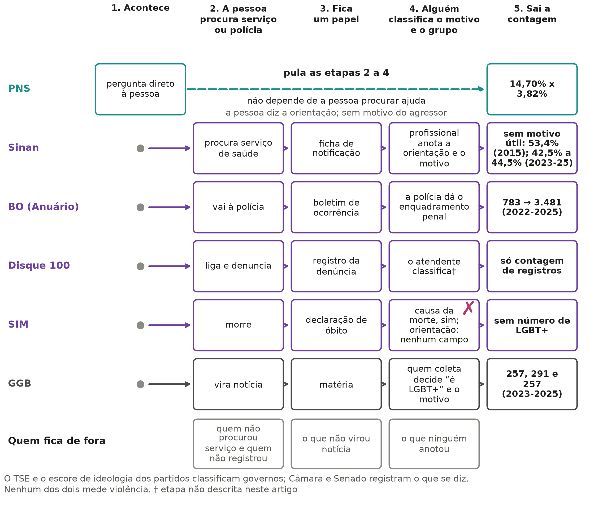
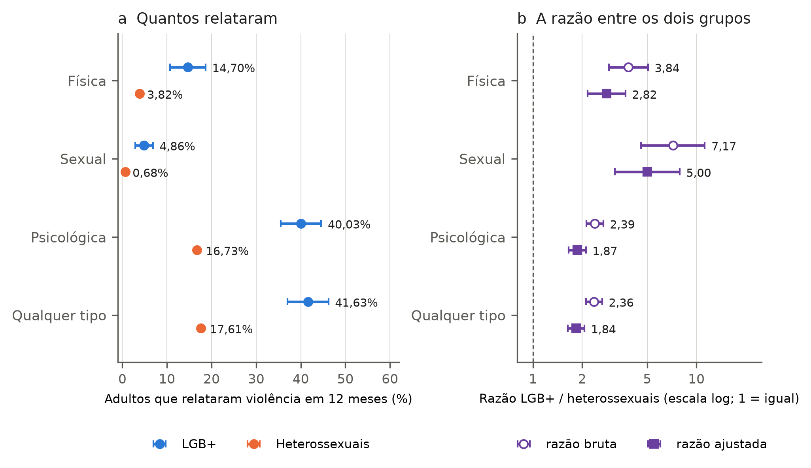
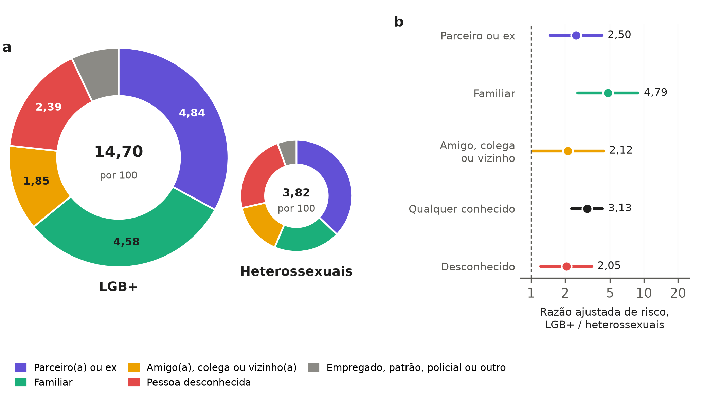
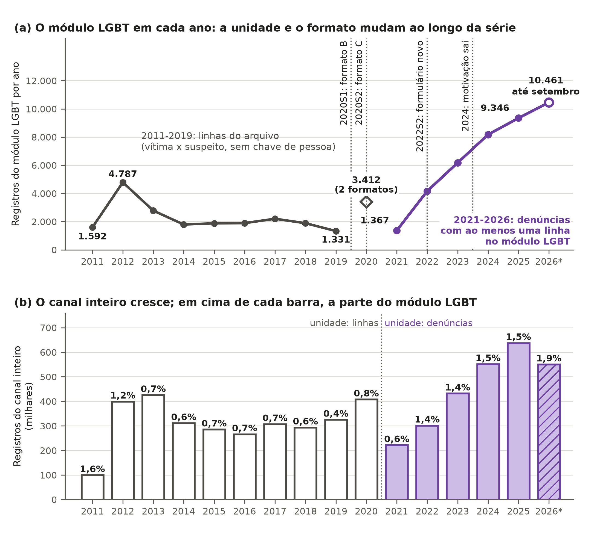
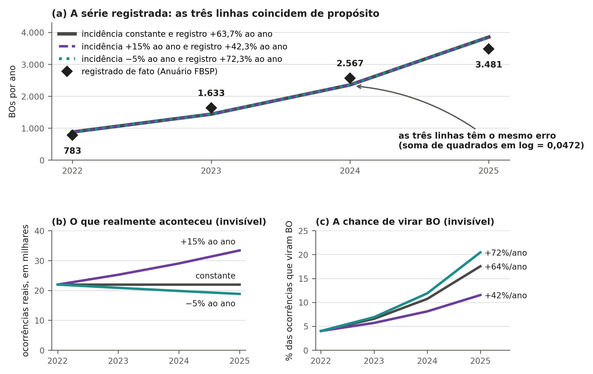
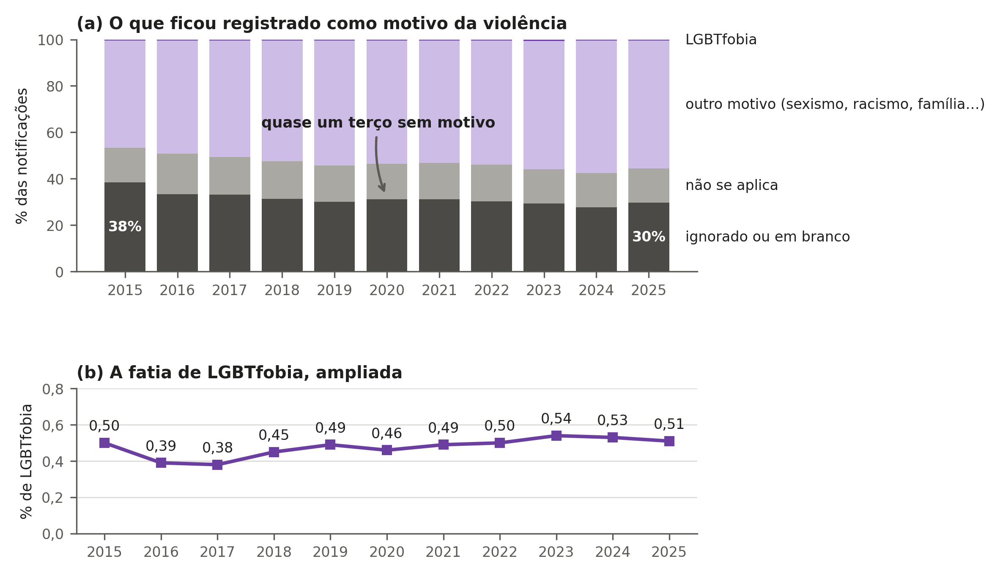
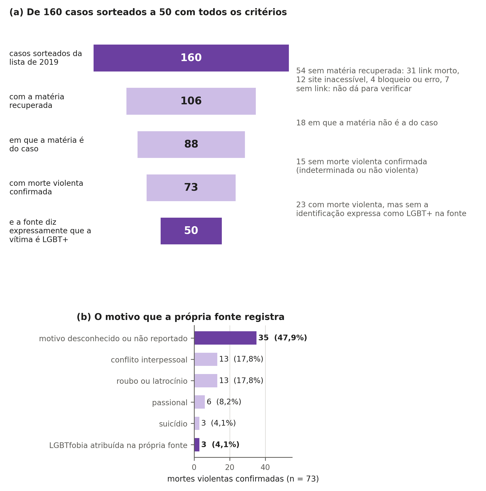
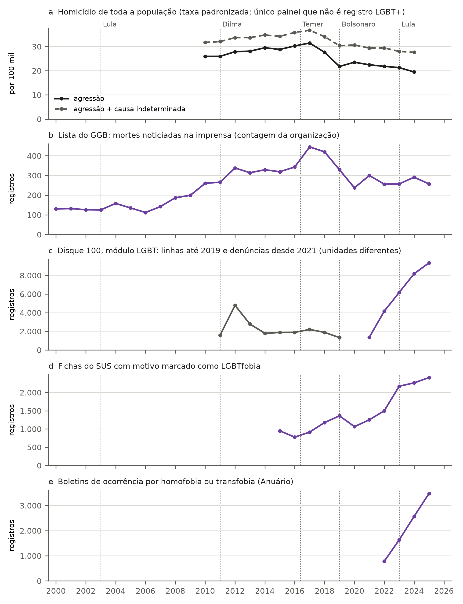

# Mortalidade e violência contra pessoas LGBT+ no Brasil: o que os dados públicos permitem afirmar

*Uma auditoria de fontes e indicadores de 2010 a 2026*

Carlos Ulisses Flores — Codex Hash Research Laboratory — ORCID 0000-0002-6034-7765

## Resumo

O debate sobre violência contra lésbicas, gays, bissexuais, travestis e transexuais (LGBT+) opõe duas frases prontas: a de que o país é o que mais mata e a de que os números são inventados. Na Pesquisa Nacional de Saúde (PNS) de 2019 (Instituto Brasileiro de Geografia e Estatística [IBGE], 2022a), 14,70% dos adultos lésbicas, gays, bissexuais ou de outra orientação não heterossexual (LGB+) relataram violência física, contra 3,82% dos heterossexuais. A razão ajustada é 2,82 (intervalo de 95%, 2,16 a 3,68). Na violência sexual, foram 4,86% contra 0,68%. Repetir essa amostra daria 80% de poder só para aumento relativo de 60,7% ou mais na violência física. Boletins de homofobia e transfobia subiram de 783 a 3.481 (Fórum Brasileiro de Segurança Pública [FBSP], 2026). A série mede registro e cabe tanto em mais violência quanto em mais denúncia. Sem orientação sexual e identidade de gênero na declaração de óbito, inexiste taxa nacional de mortalidade LGBT+ (Ministério da Saúde, 2022). Na Inglaterra e no País de Gales, Censo e óbitos indicam mortalidade LGB+ 1,31 vez a heterossexual (intervalo de 95%, 1,28 a 1,33; Office for National Statistics [ONS], 2026a), sem medir homicídio. De 160 casos sorteados da lista do Grupo Gay da Bahia (GGB, 2020), 50 foram confirmados em notícia sobre o próprio caso. A lista não é taxa nem total, e caso não verificado não é inventado. Medir tendência pede pesquisa repetida; contar mortes pede o dado no óbito ou um vínculo entre cadastros.

**Palavras-chave:** violência; LGBT+; mortalidade; subnotificação; estatísticas públicas; direitos humanos.

## Abstract

Brazilian debate on violence against lesbian, gay, bisexual, and transgender (LGBT+) people opposes two stock phrases: that the country kills the most, and that the numbers are invented. In the 2019 National Health Survey (PNS; Instituto Brasileiro de Geografia e Estatística [IBGE], 2022a), 14.70% of lesbian, gay, bisexual, or other non-heterosexual (LGB+) adults reported physical violence, against 3.82% of heterosexuals. The adjusted ratio is 2.82 (95% interval, 2.16 to 3.68). For sexual violence, rates were 4.86% against 0.68%. Repeating this sample would give 80% power only for a relative increase of 60.7% or more in physical violence. Police reports of homophobia and transphobia rose from 783 to 3,481 (Fórum Brasileiro de Segurança Pública [FBSP], 2026). The series measures recording and fits both more violence and more reporting. Without sexual orientation and gender identity on death certificates, no national LGBT+ mortality rate exists (Ministério da Saúde, 2022). In England and Wales, linked Census and deaths show LGB+ mortality at 1.31 times the heterosexual rate (95% interval, 1.28 to 1.33; Office for National Statistics [ONS], 2026a), without measuring homicide. Of 160 cases sampled from the Grupo Gay da Bahia (GGB, 2020) list, 50 were confirmed in news reports on the case itself. The list is neither rate nor total, and unverified cases are not invented. Measuring trends requires a repeated survey; counting deaths requires the field on the death certificate or a registry linkage.

**Keywords:** violence; LGBT+; mortality; underreporting; public statistics; human rights.

## 1. Introdução

O debate sobre violência contra lésbicas, gays, bissexuais, travestis e transexuais (LGBT+) no Brasil opõe duas frases. Um lado diz que o país é o que mais mata e que o ódio subiu. O outro lado diz que os números são inventados. Na Pesquisa Nacional de Saúde (PNS) de 2019, adultos lésbicas, gays, bissexuais ou de outra orientação não heterossexual (LGB+) relataram mais agressões que heterossexuais (Instituto Brasileiro de Geografia e Estatística [IBGE], 2022a; Vasconcelos et al., 2023). Aqui usamos LGB+ para fontes só de orientação sexual, como a PNS (IBGE, 2022b), e LGBT+ quando há pessoas trans.

Separar o que os dados provam do que não mostram importa para pessoas e políticas públicas. Sem bons dados, ninguém sabe medir o perigo real no dia a dia. Gestores também não sabem onde focar a proteção nem se uma lei reduziu agressões. Campbell (1979) mostrou que um indicador usado para decidir e cobrar pode mudar por causa do próprio uso: a taxa de crime registrada, por exemplo, varia com o esforço de registro sem que o crime varie. Por isso, nossa pergunta tem duas partes de igual peso: o que os dados públicos mostram e o que não mostram. A mesma régua vale para toda frase em uso, venha da militância ou da negação.

Para não ler descrição como prova de causa, este estudo divide a análise em quatro níveis. Dizer que alguém morreu por ser LGBT+ mistura intenção do agressor, percepção da vítima e efeito do preconceito. Um atributo que não se pode manipular não é causa no sentido experimental (Holland, 1986), e Greiner e Rubin (2011) deslocam a pergunta para a percepção do atributo por quem decide. O primeiro nível mede a ocorrência: quantas pessoas sofrem violência ou morrem em proporção ao grupo. O segundo nível vê se a diferença segue, mas a diferença que sobra depois de descontar idade, cor, instrução e região não é a parcela causada pela discriminação (VanderWeele & Robinson, 2014). O terceiro nível descreve o contexto da agressão: quem agrediu a vítima e onde ocorreu. O quarto nível busca o motivo e pergunta se houve preconceito, dado quase sempre fora das bases do país.

O estudo responde a três perguntas centrais sobre a violência no país. A primeira pergunta é se pessoas LGB+ relatam mais violência, o que medimos na PNS (IBGE, 2022a; Apêndice C). A segunda pergunta é se dá para contar mortes de pessoas LGBT+ no Brasil. Hoje a declaração de óbito omite orientação sexual e identidade de gênero (Ministério da Saúde, 2022). Contrastamos essa lacuna com o vínculo entre Censo e óbitos na Inglaterra e no País de Gales (ONS, 2026a; Zachry et al., 2025). Além disso, auditamos uma amostra da lista do Grupo Gay da Bahia (GGB, 2020). A terceira pergunta é se registro que cresce é violência que cresce. Testamos isso nos boletins policiais (FBSP, 2026), no Disque 100 (Ministério dos Direitos Humanos e da Cidadania [MDHC], 2026) e nas fichas de saúde (Departamento de Informação e Informática do Sistema Único de Saúde [DATASUS], 2026b).

Como o debate liga as mortes a governos e ideologias, também olhamos para governos, Congresso e história. No país, seguimos as taxas gerais de homicídio por mandato federal e estadual (DATASUS, 2026a; Tribunal Superior Eleitoral [TSE], 2026). Isso descreve cada período, mas não prova causa de partido. A busca de atos dos seis mandatos federais recentes, feita com 60 consultas iguais, fica no Apêndice H, porque mede atos noticiados, e não crimes. Por fim, também olhamos para a perseguição a homossexuais em regimes opostos e para estatísticas sem fonte no Congresso (Câmara dos Deputados, 2026; Senado Federal, 2026).

O resto do artigo tem cinco seções. A seção 2 traz as fontes em linguagem comum, os quatro níveis, a conta que separa o ocorrido do registrado e os critérios de checagem. A seção 3 abre com o quadro de afirmações e traz os achados sobre violência relatada, registros, mortes, lista do GGB, homicídios por governo e atos estatais. A seção 4 discute os achados diante de outros países e responde a três objeções. A seção 5 reúne os limites comuns do estudo. A seção 6 traz as quatro conclusões, o que mudaria cada resposta e a pesquisa necessária.

## 2. Como se lê um número destes

### 2.1. As fontes, em linguagem comum

As fontes deste estudo são públicas, mas nenhuma explica sozinha a violência contra pessoas lésbicas, gays, bissexuais, travestis e transexuais (LGBT+). A Tabela 1 reúne as dez bases usadas e separa o que cada uma conta do que deixa de fora. Ao lê-la, convém notar a diferença entre ouvir pessoas em casa e somar só os casos com registro. A pesquisa domiciliar alcança quem nunca registrou queixa, mas não identifica pessoas trans (Instituto Brasileiro de Geografia e Estatística [IBGE], 2022b, p. 7). Já a declaração de óbito não traz orientação sexual nem identidade de gênero (Ministério da Saúde, 2022, p. 10). O que falta na fonte é limite, nunca suposição.

**Tabela 1**

*Fontes de dado: o que contam e o que não dizem*

| Fonte | O que conta | O que não diz | Onde o artigo usa |
|---|---|---|---|
| Pesquisa Nacional de Saúde 2019 (PNS), do IBGE | Violência sofrida em 12 meses relatada por 88.531 adultos sorteados em domicílios | Homicídio, identidade de gênero (pessoas trans), motivo do agressor e tendência no tempo | Seção 3.1 |
| Sistema de Informações sobre Mortalidade (SIM), do Ministério da Saúde | Declarações de óbito do país, com causa, sexo, raça ou cor, idade e município | Orientação sexual, identidade de gênero e motivação do crime, ausentes do formulário | Seções 3.3, 3.5 e 3.6 |
| Sistema de Informação de Agravos de Notificação (Sinan), do Ministério da Saúde | Fichas de violência atendida em serviços de saúde, de 2015 a 2025 | Quem não procurou atendimento, total da violência e motivo em quase metade das fichas | Seção 3.2 |
| Boletins policiais no Anuário do Fórum Brasileiro de Segurança Pública (FBSP) | Registros policiais estaduais de racismo por homofobia ou transfobia | Violência total ocorrida, motivação judicialmente provada e comparação direta entre estados | Seção 3.2 |
| Relatórios anuais do Grupo Gay da Bahia (GGB) | Mortes violentas de pessoas LGBT+ noticiadas na imprensa, incluindo suicídio e latrocínio | Taxa populacional, cobertura real, motivação comprovada e lista nominal de 2023 a 2025 | Seção 3.5 |
| Dossiês da Associação Nacional de Travestis e Transexuais (ANTRA) | Mortes de pessoas trans noticiadas na imprensa (até 2016, repete o GGB) | Taxa populacional, cobertura das notícias e lista nominal aberta para auditoria | Seções 3.5 e 3.7 |
| Atlas da Violência, do Instituto de Pesquisa Econômica Aplicada (IPEA) e FBSP | Séries e estimativas de homicídio no Brasil calculadas a partir do SIM | Orientação sexual e identidade de gênero das vítimas, por herdar o limite do SIM | Seção 3.6 |
| Disque Direitos Humanos (Disque 100), em dados abertos federais | Denúncias registradas em 23 arquivos públicos, de 2011 a setembro de 2026 | Fatos confirmados, vítimas únicas (sem chave individual) e série contínua sem quebras | Seção 3.2 |
| Tribunal Superior Eleitoral (TSE) e escore ideológico dos partidos | Partido de cada governador eleito e nota ideológica de 0 a 10 | Políticas efetivamente executadas no estado ou qualquer medida direta de violência | Seção 3.6 |
| Dados abertos da Câmara dos Deputados e do Senado Federal | Pronunciamentos parlamentares em plenário: 258.011 falas de 2015 a outubro de 2026 | Veracidade das frases ditas em plenário ou qualquer taxa real de violência | Seção 3.7 |

*Nota.* Nas fichas de saúde, a violência comunitária ou fora da família contra homens de 20 a 59 anos só é notificada em condição de vulnerabilidade, entre elas pertencer à população LGBT. Adaptado das fontes listadas na tabela e de Ministério da Saúde (2024, p. 1222).

### 2.2. Quatro níveis de pergunta

Este estudo separa quatro níveis de pergunta para que um número não responda ao que não mede. O primeiro nível mede a ocorrência bruta do agravo em cada grupo (IBGE, 2022a). Na pesquisa domiciliar, 14,70% dos adultos lésbicas, gays, bissexuais ou de outra orientação não heterossexual (LGB+) relataram violência física nos 12 meses anteriores à entrevista, contra 3,82% dos heterossexuais. O segundo nível testa se a diferença fica após descontar idade, sexo, cor, instrução, região e moradia urbana ou rural. Mesmo com esse desconto, a violência física é 2,82 vezes maior no grupo LGB+ (intervalo de confiança de 95% [IC95%], 2,16 a 3,68; reanálise no Apêndice C). O ajuste mostra que a diferença persiste depois de descontadas as características medidas, mas não mede preconceito direto (VanderWeele & Robinson, 2014). O terceiro nível olha o contexto do fato, como o vínculo com o agressor e o local. Entre as vítimas de violência física, a fatia de agressor familiar não difere de forma firme entre os grupos (razão 1,62; IC95%, 0,96 a 2,72; reanálise no Apêndice C). Já o risco de relatar agressão e apontar um familiar como agressor, medido na população, é maior no grupo LGB+ (seção 3.1). O quarto nível trata do motivo do crime, que mistura intenção do agressor, percepção da vítima e efeito do preconceito no risco (Greiner & Rubin, 2011; Holland, 1986). Na amostra do Grupo Gay da Bahia (GGB), as notícias apontaram ódio em só 3 das 74 mortes violentas confirmadas (GGB, 2020).

Separar esses quatro níveis permite usar a mesma régua nos dois lados do debate público. Dizer que o Brasil é o país que mais mata pessoas LGBT+ exige comparar mortes entre países, em taxa ou em total, com contagens equivalentes. A busca deste estudo só achou comparações de mortes noticiadas de pessoas trans, sem cobertura comum entre países. No Parlamento, só 1 de 49 falas com essa frase citou fonte primária (Câmara dos Deputados, 2026; Senado Federal, 2026; Apêndice J). Quando o outro lado diz que as listas ativistas são inventadas, vale a mesma checagem. Dos 160 casos sorteados da lista de 2019, em 50 a notícia do próprio caso confirma morte violenta de pessoa LGBT+ (GGB, 2020; Apêndice F). Nesses casos, isso contraria a ideia de lista inventada. Nos demais, a notícia não foi achada ou não confirma as duas coisas, e o caso fica sem verificação. Como é uma lista montada com notícias, sem denominador, ela também não é taxa nem total.

### 2.3. Ocorrido e registrado

Uma conta simples resume a distância entre o fato real e o dado oficial.

*R* = *I* × *p* (1)

Nela, *R* é o total de casos em boletins, fichas de saúde, denúncias ou notícias. O termo *I* é a incidência real, isto é, as agressões ou mortes que de fato ocorreram. Já *p* mede a parte registrada, ou seja, a fração dos casos que entra na conta final. Como vemos só o produto *R*, a série sozinha não separa a violência (*I*) do registro (*p*). A conta supõe que *R* e *I* contem a mesma unidade, como pessoas ou episódios; repetições e mudanças de classificação também alteram o registro. Os boletins de homofobia e transfobia, por exemplo, foram de 783 em 2022 para 3.481 em 2025 (Fórum Brasileiro de Segurança Pública [FBSP], 2026). Na Seção 3.2, essa mesma curva cabe em violência parada, subindo 15% ao ano ou caindo 5% ao ano. Além disso, usar o registro como meta muda o próprio esforço do órgão para registrar (Campbell, 1979). A Figura 1 mostra esse filtro por fonte.

**Figura 1**

*Caminho do dado, do fato à contagem publicada*

*Nota.* O esquema mostra onde se perdem casos do fato ao dado (R = I × p; adaptado da Tabela 1).

### 2.4. Como conferir que nada foi alterado

Para evitar escolhas de ocasião, as regras de busca e análise foram gravadas antes de ver os resultados. Quando a pesquisa pediu regras novas, elas entraram em adendos com data, sem mudar o texto inicial (Apêndice B). Cada protocolo recebeu uma impressão digital do arquivo, que muda toda se uma só vírgula for trocada. Essa marca prova que o texto segue igual, mas não prova sozinha a data sem carimbo de tempo externo. Por isso, o artigo serve como resumo legível, enquanto a prova completa fica aberta no repositório público do projeto. Nesse acervo, programas abertos reproduzem os números, tabelas e figuras das seções seguintes a partir dos arquivos derivados das bases oficiais. A partir do microdado bruto, a reprodução completa foi feita para a PNS de 2019; para o SIM e o Sinan, os agregados vêm de programas guardados no acervo, sem nova execução do bruto (Apêndice M). A exceção é a ligação entre cada caso da lista do GGB e sua notícia, que exige a lista nominal, guardada por privacidade. No GitHub, onde o código fica na rede, uma verificação automática refaz as contas e acusa qualquer divergência.

### 2.5. Busca de literatura e estatística

A busca consultou sete bases (PubMed, Crossref, OpenAlex, SciELO, Europe PMC, LILACS e Dialnet), além de buscadores gerais e de sítios oficiais de estatística. A coleta foi de 10 a 25 de outubro de 2026, e as fontes registradas estão em 11 idiomas (Apêndice B). Na pesquisa domiciliar, a regressão de Poisson com peso amostral testa a diferença após descontar o perfil (Apêndice C). Nas séries de registro, a Equação 1 é aplicada com três trajetórias que se ajustam igualmente aos dados (Apêndice D). Nos óbitos, a padronização por idade e a decomposição de Kitagawa (1955) comparam as mortes sem distorção etária (Apêndice E). Nas listas de notícias, o sorteio com intervalo de Wilson mede a fração de casos confirmados. Já a captura-recaptura estima totais sob hipóteses sobre a dependência entre as fontes (Feldman et al., 2017; Lum et al., 2013; Apêndice F). Entre governos e homicídios, modelos de painel com efeitos fixos duplos descrevem se trocas de partido acompanham variações nas mortes, sem atribuir causa. Esse estimador pode pesar mal as comparações quando o efeito muda no tempo (Goodman-Bacon, 2021), e por isso a análise traz outros testes. Estudos de eventos e testes de permutação completam essa análise (Apêndice G). A concordância de Cohen e o teste exato de Fisher avaliam a classificação de discursos (Apêndice J). Por fim, o cálculo de poder dimensiona pesquisas futuras (Apêndice K).

### 2.6. O papel dos modelos de linguagem

Modelos de linguagem apoiaram a busca, o código, o rascunho, a revisão e a dupla leitura de discursos (Apêndices J e M). A redação desta versão também foi feita por modelos de linguagem, o Gemini 4 Argon nas seções 1 e 2 e o Claude Opus 5.5 nas demais. A reescrita seguiu regras escritas que proíbem número ou citação fora do material conferido, e um programa conferiu cada número e cada citação antes da revisão do autor. Depois, três modelos (GPT-6 Astra, Gemini 4 Argon e Grok 4.7) revisaram o artigo inteiro, sem ver os pareceres uns dos outros na primeira rodada; pareceres e respostas estão no repositório. Nenhum modelo inventou observação nem estimativa numérica. Modelos participaram, porém, da codificação dos discursos e da conferência dos 160 casos do GGB, com um segundo codificador de outra família em parte dos casos (seção 5). Na conferência do GGB, 23 casos tiveram dupla codificação, com 21 pares válidos nas variáveis abaixo. A concordância foi alta para a condição LGBT+ da vítima (κ = 0,91) e moderada para a confirmação de morte violenta (κ = 0,46; Apêndice F). Nos 6 casos com desacordo, um terceiro codificador de outra família, cego aos dois primeiros, desempatou as leituras. Só um caso mudou: as mortes violentas confirmadas passaram de 73 para 74, e os 50 casos verificáveis não mudaram (Apêndice F). Todo número vem de programas rodados nas bases públicas ou de documentos salvos no acervo do estudo. Cada citação foi conferida na fonte, assim como cada página e rótulo de discurso; as obras lidas só pelo resumo estão marcadas no texto. Modelos de famílias distintas revisaram o texto, mas a checagem nas fontes, o método e a autoria cabem só ao autor.

## 3. O que os dados permitem dizer

Esta seção percorre a distância entre o fato violento, o registro que ele deixa e o que esse registro permite concluir. Ela segue dois eixos. O primeiro é o que se consegue medir da violência sofrida por pessoas LGBT+. O segundo é até onde cada fonte permite ir: atribuir motivo, contar mortes ou ver tendência. A Tabela 2 resume as frases do debate público, o que os dados mostram sobre cada uma e o que não mostram. A primeira linha responde à pergunta que motivou o estudo: nenhuma das fontes públicas examinadas permite estimar quantos casos de violência motivada por LGBTfobia ocorrem, nem comparar esses casos no tempo e entre grupos. Há registros de motivo que se podem contar, mas nenhum atende a esse critério. As seções 3.1 a 3.5 mostram o que cada fonte mede no lugar disso, e cada uma termina com o que se conclui e o que fica indeterminado.

**Tabela 2**

*Frases do debate, o que os dados mostram e o que não mostram*

| Nº | Frase do debate | O que os dados mostram | O que não mostram | Seção |
|---|---|---|---|---|
| 1 | Existe no Brasil um indicador confiável de violência motivada por LGBTfobia | Nenhuma das fontes públicas examinadas permite estimar quantos casos motivados ocorrem nem comparar esses casos no tempo e entre grupos | Não diz se o motivo é raro ou frequente | 3.1 a 3.5 |
| 2 | Adultos lésbicas, gays, bissexuais ou de outra orientação não heterossexual relatam mais violência física que heterossexuais | Adultos LGB+ relatam violência física bem mais: 14,70% contra 3,82% em 12 meses, razão ajustada 2,82 | A razão global não identifica o tipo de agressor nem o motivo; o agressor apontado é analisado à parte | 3.1 |
| 3 | Também relatam mais violência sexual e psicológica | Também relatam mais violência sexual (4,86% contra 0,68%) e psicológica (40,03% contra 16,73%) | Não mede motivo; não identifica pessoas trans | 3.1 |
| 4 | A violência física contra pessoas LGB+ vem sobretudo de desconhecidos | A maioria das vítimas, nos dois grupos, aponta um conhecido como agressor (81,4% das LGB+); o risco por desconhecido também é maior para LGB+ | Não diz o motivo nem a orientação do agressor | 3.1 |
| 5 | A família agride mais pessoas LGB+ | Na população, pessoas LGB+ apontam familiar como agressor mais vezes (razão ajustada 4,79); entre vítimas, a fatia da família não difere de forma firme | Não diz por quê: a PNS não pergunta o motivo | 3.1 |
| 6 | A diferença na violência física se explica pelo perfil das pessoas (idade, estado civil, modo de entrevista e outros fatores medidos) | A diferença persiste em ajustes separados: por sexo, idade, cor, instrução, região e situação urbana ou rural, 2,82; somando estado civil, 2,65; cônjuge no domicílio, 2,64; ou modo de entrevista, 2,68 | O que sobra não mede discriminação nem modo de vida | 3.1 |
| 7 | Dá para saber se a violência contra LGB+ está subindo | Há uma única edição da PNS (2019); uma nova rodada teria 80% de poder só para aumento relativo de 60,7% ou mais | Não diz que a violência está estável | 3.1 |
| 8 | A PNS 2019 descreve pessoas trans | A PNS não perguntou identidade de gênero e não identifica pessoas trans | Não diz nada sobre pessoas trans | 3.1 |
| 9 | Gays sofrem mais violência, segundo as denúncias | As denúncias medem quem procurou o canal; não há chave de pessoa e a unidade muda duas vezes em 2020 | Não diz que gays sofrem menos | 3.2 |
| 10 | As denúncias LGBT ao Disque 100 cresceram muito | As denúncias com linha LGBT foram de 1.367 (2021) a 9.346 (2025), enquanto o canal inteiro cresceu 2,9 vezes | Não diz que a violência cresceu | 3.2 |
| 11 | Os boletins de homofobia e transfobia explodiram, logo a violência explodiu | Os boletins foram de 783 (2022) para 3.481 (2025), e a mesma série cabe em violência parada, subindo ou caindo | Não diz que a violência ficou parada | 3.2 |
| 12 | As fichas do SUS medem a violência LGBTfóbica | O motivo fica sem informação útil em 42,5% a 44,5% das fichas de 2023 a 2025, e a LGBTfobia aparece em 0,4% a 0,5% | Não diz que a violência LGBTfóbica é rara | 3.2 |
| 13 | Pessoas LGBT+ morrem mais no Brasil | A declaração de óbito não tem orientação sexual nem identidade de gênero, e por isso não existe taxa nacional | Não diz que morrem na mesma proporção | 3.3 |
| 14 | Quando o atestado registra o atributo, o Brasil mede a desigualdade letal | Onde o atestado registra raça e sexo, a desigualdade aparece: 51,7 contra 2,6 mortes por agressão por 100 mil | Não mede orientação nem identidade de gênero; não mostra que criar o campo basta | 3.3 |
| 15 | Pessoas LGB+ morrem mais fora do Brasil | Na Inglaterra e no País de Gales, quem se declarou LGB+ no Censo teve mortalidade geral 31% maior (razão 1,31) | Não é homicídio, vale só onde o Censo foi ligado aos óbitos e não vale para o Brasil | 3.4 |
| 16 | Minorias sexuais vivem 12 anos menos onde há preconceito | O número vem de um estudo retratado; onde há conta oficial, a diferença aos 20 anos é de cerca de 1 ano | Não diz que a mortalidade é igual | 3.4 |
| 17 | Os números do Grupo Gay da Bahia são inventados | Em 50 dos 160 casos sorteados de 2019, a notícia sustentava morte violenta e vítima LGBT+; 74 de 88 notícias do próprio caso confirmam morte violenta | Não diz que a lista está completa | 3.5 |
| 18 | A lista do GGB mede quantas pessoas LGBT+ são assassinadas por preconceito | A lista atribui ódio, pela própria fonte, em 3 de 74 mortes violentas, e é contagem de notícias sem denominador | Não diz que o preconceito é raro | 3.5 |
| 19 | Listas de ONGs que concordam se confirmam mutuamente | De 2013 a 2018, 72% a 94% dos registros brasileiros do TDoR citavam o próprio GGB como fonte | Não diz que as listas estão erradas | 3.5 |
| 20 | Os crimes contra pessoas LGBT+ subiram (ou caíram) no governo X | Nenhuma série separa violência de registro: as séries LGBT+ sobem e descem também com mudanças de canal, formulário e cobertura de notícias | Não diz que a violência ficou igual | 3.6 |
| 21 | A taxa de homicídio caiu (ou subiu) no governo X | A taxa geral de homicídio subiu com Dilma e caiu com Temer, Bolsonaro e Lula até 2024; a queda começou em 2018, e o registro piorou | Não diz que o governo causou a mudança | 3.6 |
| 22 | Governo de direita (ou de esquerda) muda os homicídios | As análises não acharam associação entre o partido do governador e o homicídio geral (de −12,3% a +12,4%) | Não prova que o governo é irrelevante | 3.6 |
| 23 | Perseguição estatal a homossexuais é coisa de um lado ideológico | Ditaduras de direita, regimes comunistas, um governo religioso e uma democracia perseguiram homossexuais com leis do Estado | Não ordena regimes por gravidade | 3.7 |
| 24 | O Brasil é o país que mais mata LGBT+ | A busca só achou comparações de mortes noticiadas de pessoas trans, sem cobertura comum entre países; no Parlamento, 1 de 49 falas com essa frase cita fonte primária | Não diz que o Brasil mata pouco | 3.7 |
| 25 | Pessoas trans vivem em média 35 anos | Não foi localizado cálculo de expectativa de vida de pessoas trans no Brasil; o número que circula vem de citações sem cálculo, e a idade de quem foi assassinado não é expectativa de vida | Não diz que pessoas trans vivem tanto quanto as demais | 3.7 |

*Nota.* Cada linha resume o que as fontes examinadas mostram; a justificativa, os intervalos e as fontes estão na seção indicada. A busca sobre atos do governo federal está no Apêndice H. Dados das fontes citadas nas seções 3.1 a 3.7.

### 3.1. Violência relatada

A pesquisa domiciliar mostra que adultos LGB+ relatam muito mais violência que heterossexuais. Na Pesquisa Nacional de Saúde (PNS) de 2019, 14,70% dos adultos LGB+ relataram violência física nos 12 meses anteriores (intervalo de 95%, 10,72 a 18,67), contra 3,82% dos heterossexuais (IBGE, 2022a). É cerca de uma pessoa em cada sete, contra uma em cada 26. Violência física, aqui, inclui tapa, empurrão, soco ou chute, tentativa ou ato de estrangulamento, asfixia ou queimadura, e ameaça ou ferimento com arma ou objeto. A amostra tem 1.554 adultos LGB+ entrevistados. A reanálise do microdado reproduz as prevalências publicadas por Vasconcelos et al. (2023) sem divergência. As razões deste artigo, porém, são razões de prevalência, e não as razões de chance publicadas naquele trabalho. Sem ajuste, a razão é 3,84. Ela também é informada porque instrução, região e moradia podem estar no caminho entre orientação e violência, e não só antes dele. Descontados sexo, idade, cor, instrução, região e moradia urbana ou rural, a violência física segue 2,82 vezes maior no grupo LGB+ (intervalo de 95%, 2,16 a 3,68; Apêndice C). O ajuste usa os 85.913 adultos que declararam orientação heterossexual ou LGB+; outros 849 não souberam responder e 1.769 recusaram. Por faixa de idade, a razão bruta fica acima de 1 de 18 a 29 anos (2,93) e de 30 a 44 anos (2,27). Entre 45 e 59 anos, a razão de 1,61 tem intervalo que inclui a igualdade (0,79 a 3,31). Com 60 anos ou mais, ela é de 5,80, com intervalo muito largo (1,93 a 17,36) e só 88 entrevistados LGB+. As faixas têm precisão desigual, e o estudo não testa se a razão muda com a idade.

O mesmo padrão aparece nos outros tipos de violência. A violência sexual atingiu 4,86% dos adultos LGB+ e 0,68% dos heterossexuais. Depois do ajuste, a razão é 5,00 (intervalo de 95%, 3,17 a 7,89). A violência psicológica, que inclui grito, xingamento e humilhação, atingiu 40,03% contra 16,73%, com razão ajustada de 1,87 (intervalo de 95%, 1,66 a 2,11). Ao menos um tipo de violência foi relatado por 41,63% dos adultos LGB+ e 17,61% dos heterossexuais, com razão ajustada de 1,84 (intervalo de 95%, 1,64 a 2,07). A Figura 2 mostra as prevalências e o tamanho das razões antes e depois do ajuste.

**Figura 2**

*Violência relatada em 12 meses por adultos LGB+ e heterossexuais*

*Nota.* No painel a, cada ponto é a prevalência em 12 meses, com intervalo de 95% (azul, LGB+; laranja, heterossexuais). No painel b, o círculo vazado é a razão bruta e o quadrado cheio, a ajustada; a linha em 1 marca igualdade. Dados do IBGE (2022a); reanálise no Apêndice C.

Esses números medem quanto cada grupo relata sofrer, e não por que sofre. O módulo de violência da pesquisa pergunta quem agrediu e onde, mas não pergunta o motivo nem a orientação sexual de quem agrediu (IBGE, 2022a). Por isso, a diferença não mostra que heterossexuais agrediram pessoas LGB+ por preconceito. Ela também não exclui essa hipótese, porque o dado simplesmente não chega ao motivo. A leitura da diferença como motivo aparece até na literatura. Szwarcwald et al. (2025) falam, no título, de vitimização motivada pela orientação sexual, mas o resumo descreve uma associação entre orientação declarada e violência, com o mesmo microdado. Esse artigo foi lido apenas pelo resumo, porque o texto integral não estava acessível.

Quando se olha quem agrediu, a imagem do ataque de rua por um desconhecido não descreve o caso típico. Entre as vítimas de violência física, 81,4% das pessoas LGB+ apontaram alguém conhecido como agressor (IBGE, 2022a; Apêndice C). Entre as vítimas heterossexuais, foram 72,6%. A pesquisa pede uma única resposta sobre quem agrediu, mesmo de quem sofreu mais de uma agressão. Conhecido, aqui, é parceiro ou ex, familiar, amigo, colega, vizinho, empregado, patrão ou chefe. Já a diferença entre os grupos nessas fatias agregadas não é firme, porque a amostra tem só 179 vítimas LGB+. Isso vale para a fatia de desconhecidos, de 16,3% contra 23,0%, e para a da família, de 31,2% contra 19,2%. A Figura 3 mostra duas leituras do mesmo dado: a fatia entre as vítimas e o risco na população.

**Figura 3**

*Quem agrediu: risco por tipo de agressor entre adultos LGB+ e heterossexuais*

*Nota.* No painel a, a área de cada anel é proporcional à fração de adultos agredidos fisicamente em 12 meses (14,70 e 3,82 por 100), e cada fatia é o risco por tipo de agressor. O painel a mostra riscos sem ajuste; a fatia cinza reúne empregado, patrão ou chefe, policial e outro. No painel b, com só as categorias em que a razão ajustada foi estimada, cada ponto é a razão de risco LGB+/heterossexual ajustada pelo mesmo perfil da razão 2,82, com intervalo de 95%; a linha em 1 marca igualdade. Dados do IBGE (2022a); reanálise no Apêndice C.

A fatia entre as vítimas não é o risco de cada pessoa. O risco de relatar violência física e apontar certo tipo de agressor é a prevalência vezes a fatia desse agressor. Como o grupo LGB+ tem quase quatro vezes mais vítimas por habitante, uma fatia menor ainda pode significar mais gente agredida. É o que acontece com desconhecidos, apontados por 2,39 adultos LGB+ e 0,88 heterossexuais em cada 100. A razão bruta é 2,72 e, com o mesmo ajuste da razão 2,82, fica em 2,05 (intervalo de 95%, 1,22 a 3,45). Por pessoa conhecida, são 11,97 contra 2,78 adultos em cada 100, com razão bruta de 4,31 e ajustada de 3,13 (intervalo de 95%, 2,28 a 4,29). Para agressão por policial, a razão não difere de forma firme e tem intervalo muito largo. Entre as categorias agregadas, só a diferença na fatia de policial tem intervalo que exclui o zero, menor entre as vítimas LGB+, mas ela se apoia em 5 vítimas LGB+ na amostra. Nas subcategorias, a fatia de cônjuge ou companheiro atual também é menor entre as vítimas LGB+, de 5,05% contra 20,21% (Apêndice C). Essas razões por tipo de agressor vêm de análise feita depois de ver os resultados. A pesquisa registra um só agressor por vítima, o do episódio mais grave, e por isso subestima o risco de cada tipo quando a mesma pessoa sofreu agressões de mais de uma origem no ano. Com a presença de cônjuge ou companheiro no domicílio somada ao ajuste, a razão por familiar fica em 4,31 (intervalo de 95%, 2,33 a 7,99). Como com o estado civil, só a razão por amigo, colega ou vizinho deixa de ser firme (Apêndice C). A razão ajustada não foi estimada onde havia menos de 10 vítimas LGB+, critério também definido depois de ver os dados. Os intervalos são nominais, sem correção para o número de comparações. A Tabela 3 traz a fatia e o risco de cada tipo de agressor.

**Tabela 3**

*Agressor apontado pelas vítimas de violência física em 12 meses: fatia entre as vítimas e risco na população*

| Agressor | Fatia, heterossexuais (%) | Fatia, LGB+ (%) | Risco por 100, heterossexuais | Risco por 100, LGB+ | Razão bruta (IC 95%) | Razão ajustada (IC 95%) |
|---|---|---|---|---|---|---|
| Parceiro(a) ou ex | 37,1 | 32,9 | 1,42 | 4,84 | 3,41 (2,01 a 5,79) | 2,50 (1,48 a 4,25) |
| Familiar | 19,2 | 31,2 | 0,74 | 4,58 | 6,22 (3,26 a 11,90) | 4,79 (2,58 a 8,90) |
| Amigo(a), colega ou vizinho(a) | 15,2 | 12,6 | 0,58 | 1,85 | 3,20 (1,59 a 6,42) | 2,12 (1,02 a 4,39) |
| Empregado, patrão ou chefe | 1,1 | 4,7 | 0,04 | 0,70 | 16,52 (3,78 a 72,23) | — |
| Qualquer pessoa conhecida (subtotal) | 72,6 | 81,4 | 2,78 | 11,97 | 4,31 (3,10 a 5,99) | 3,13 (2,28 a 4,29) |
| Pessoa desconhecida | 23,0 | 16,3 | 0,88 | 2,39 | 2,72 (1,63 a 4,53) | 2,05 (1,22 a 3,45) |
| Policial | 2,2 | 0,6 | 0,08 | 0,09 | 1,07 (0,35 a 3,25) | — |
| Outro | 2,2 | 1,7 | 0,08 | 0,24 | 2,93 (1,01 a 8,51) | — |

*Nota.* Adultos de 18 anos ou mais; cada vítima aponta um agressor na pergunta da pesquisa. As fatias exclusivas somam 100% em cada grupo; a linha de subtotal não entra nessa soma. O risco é a fatia vezes a prevalência (14,70 e 3,82 por 100). A razão ajustada usa o mesmo ajuste da razão 2,82 (sexo, idade, cor, instrução, região e moradia urbana ou rural); onde há poucos casos, não foi estimada. Entre as categorias da tabela, só a diferença na fatia de policial tem intervalo que exclui o zero, menor no grupo LGB+ e apoiada em 5 vítimas LGB+; nas subcategorias, a de cônjuge ou companheiro atual também é menor no grupo LGB+ (5,05% contra 20,21%). Os intervalos são nominais, sem correção para o número de comparações. As razões brutas de "empregado, patrão ou chefe" e de "outro" se apoiam em 5 vítimas LGB+ cada, e a de "outro" tem limite inferior de 1,01. Análise feita depois de ver os resultados. A pesquisa não pergunta o motivo nem a orientação sexual do agressor. Dados do IBGE (2022a); reanálise com o desenho amostral no Apêndice C.

Pessoas LGB+, portanto, apontam familiares como agressores com mais frequência quando se mede o risco na população, com duas ressalvas. Na população, 4,58 adultos LGB+ em cada 100 apontaram um familiar como agressor no último ano, contra 0,74 heterossexuais. A razão bruta é 6,22, e a ajustada é 4,79 (intervalo de 95%, 2,58 a 8,90). Com o estado civil também no ajuste, fica em 4,43 (intervalo de 95%, 2,38 a 8,26). Entre as vítimas, a fatia da família não difere de forma firme entre os grupos (razão 1,62; intervalo de 95%, 0,96 a 2,72). Além disso, a pesquisa não diz por que o familiar agrediu, e atribuir esses casos a preconceito seria afirmar o que o dado não mede. O domicílio como local aparece em 44,1% dos casos LGB+ e em 55,2% dos heterossexuais, mas essa diferença também não é firme.

A diferença persiste depois do ajuste pelas características medidas, inclusive o estado civil. Essa análise foi feita depois de ver os resultados e deve ser lida como sensibilidade. O estado civil importa porque 84,9% dos adultos LGB+ se declaram solteiros, contra 40,8% dos heterossexuais (IBGE, 2022a). Estado civil declarado, porém, não é o mesmo que morar junto: 29,49% dos adultos LGB+ moram com cônjuge ou companheiro, contra 62,39% dos heterossexuais. Solteiros relatam mais violência nos dois grupos. Mesmo entre solteiros, porém, a violência física atinge 15,99% dos LGB+ e 5,43% dos heterossexuais. Com o estado civil no ajuste, a razão passa de 2,82 para 2,65 (intervalo de 95%, 2,04 a 3,46; Apêndice C). O resultado quase não muda quando se usa a presença de cônjuge no domicílio, com razão de 2,64. Com o estado civil, só a razão por amigo, colega ou vizinho deixa de ser firme. A diferença também persiste quando se considera quem preencheu o módulo de violência. A fatia que se declara LGB+ é de 3,51% quando o próprio morador preenche e de 1,38% quando o entrevistador preenche. Mesmo assim, a razão bruta é parecida nos dois modos, 3,21 e 3,84, e a ajustada com o modo fica em 2,68 (intervalo de 95%, 2,05 a 3,49). Esse ajuste compara os grupos dentro de cada modo e não corrige quem deixou de se declarar LGB+, efeito que não foi estimado. A razão que sobra depois de qualquer ajuste não mede discriminação nem modo de vida, porque o dado não separa as duas explicações (VanderWeele & Robinson, 2014).

Os dados também não dizem se essa violência está subindo ou caindo. A PNS de 2019 é uma edição única, e tendência exige a mesma pergunta repetida no tempo. Com o tamanho dessa amostra, uma nova rodada independente detectaria, com 80% de poder e teste bilateral a 5%, só aumentos relativos de 60,7% ou mais na violência física. Para quedas, o limiar é outro e não foi calculado aqui (Apêndice K). Por fim, a pesquisa não identifica pessoas trans, porque não coletou identidade de gênero (IBGE, 2022b, p. 7).

Em síntese, a seção testou o que a pesquisa domiciliar permite dizer sobre a violência contra adultos LGB+. O resultado é uma diferença grande e persistente de violência relatada, com a maioria das vítimas apontando conhecidos como agressores. Ficam indeterminados o motivo das agressões, a tendência no tempo e a situação de pessoas trans.

### 3.2. Denúncias, boletins e fichas

As denúncias ao Disque Direitos Humanos (Disque 100) cresceram muito, mas medem o uso do canal, e não a violência. Contadas as denúncias com ao menos uma linha no módulo LGBT, a série passou de 1.367 em 2021 para 9.346 em 2025 (Ministério dos Direitos Humanos e da Cidadania [MDHC], 2026). É uma alta de 6,8 vezes, enquanto o canal inteiro cresceu 2,9 vezes. A fatia LGBT ficou entre 1,4% e 1,5% das denúncias de 2022 a 2025. Houve, portanto, mais denúncias, o que não quer dizer mais violência. A conta também depende da regra. Desde o segundo semestre de 2022, o grupo pode variar dentro da mesma denúncia, e exigir que todas as linhas sejam do módulo LGBT reduz 2025 a 39 denúncias (MDHC, 2026; Apêndice D). A Figura 4 mostra as duas séries e as mudanças de formato do arquivo.

**Figura 4**

*Denúncias do módulo LGBT e do canal inteiro do Disque 100*

*Nota.* No painel a, a linha cinza conta linhas do módulo LGBT até 2019, e a roxa, denúncias a partir de 2021; as verticais pontilhadas marcam mudanças de formato. No painel b, cada barra é o canal inteiro, com a fatia LGBT acima. Dados do MDHC (2026).

Pelas denúncias, também não dá para saber se gays sofrem mais violência que outros grupos. Os 23 arquivos abertos, de 2011 a setembro de 2026, vêm em três formatos e nenhum traz chave que identifique a pessoa (MDHC, 2026). A unidade de contagem muda duas vezes em 2020. Até 2019, cada linha do arquivo cruza uma vítima e um suspeito de um atendimento. No primeiro semestre de 2020, conta-se o par de vítima e suspeito e, a partir do segundo, a denúncia. Em 2024, a categoria de motivação por orientação ou identidade deixou o formulário, o que não é ausência de motivação. Quem denuncia, além disso, não é amostra da população.

Os boletins de ocorrência por homofobia ou transfobia subiram de 783 em 2022 para 3.481 em 2025, alta de 4,4 vezes (FBSP, 2026). Isso não permite dizer que a violência explodiu. Esses boletins usam o enquadramento de racismo adotado depois que o Supremo Tribunal Federal (STF) julgou a omissão do Legislativo em criminalizar a homofobia e a transfobia (STF, 2019). A série reúne registros das secretarias estaduais compilados por uma organização da sociedade civil. Silva et al. (2026), que descrevem a mesma série de 2021 a 2025, também escrevem que esses dados não permitem atribuir todo o crescimento ao aumento da incidência. O próprio Anuário revisa a série: o ano de 2023 tinha 2.090 boletins na edição de 2024 e 1.633 na edição seguinte. A Equação 1 da seção 2.3 mostra o problema, porque três histórias diferentes produzem a mesma série. Em cada história, a taxa da violência foi fixada, e a do registro é a que melhor se ajusta aos quatro anos, e não a taxa entre a primeira e a última contagem. Na primeira, a violência fica parada e o registro sobe 63,7% ao ano. Na segunda, a violência sobe 15% ao ano e o registro, 42,3%. Na terceira, a violência cai 5% ao ano e o registro sobe 72,3% (Apêndice D). As três trajetórias produzem a mesma curva ajustada, com o mesmo erro, embora nenhuma passe exatamente por todos os pontos. A Figura 5 mostra que as três linhas coincidem entre si e acompanham os boletins. Só um dado de fora do registro separa essas histórias, como uma pesquisa de vitimização repetida.

**Figura 5**

*Três trajetórias de violência e de registro que produzem a mesma série de boletins*

*Nota.* No painel a, os losangos são os boletins registrados, e as linhas, o que cada trajetória prevê. Nos painéis b e c, a violência e a propensão de registro que cada trajetória supõe. Dados do FBSP (2026); simulação no Apêndice D.

As fichas de violência dos serviços de saúde também não medem a violência LGBTfóbica. O Sistema de Informação de Agravos de Notificação (Sinan) reúne essas fichas (Departamento de Informação e Informática do Sistema Único de Saúde [DATASUS], 2026b). Nas fichas de 2015 não marcadas como violência autoprovocada, o campo do motivo ficou sem informação útil em 53,4%. A conta soma o motivo ignorado, em branco ou marcado como não se aplica. De 2023 a 2025, essa falta de informação ficou entre 42,5% e 44,5%. A LGBTfobia aparece como motivo em 0,4% a 0,5% das notificações. Com quase metade dos motivos sem informação, esse número não mede a incidência. A regra de notificação também difere por grupo. O Guia de Vigilância em Saúde dispensa a notificação da violência comunitária contra homens de 20 a 59 anos, "exceto nas condições de vulnerabilidade", entre elas pertencer à população LGBT (Ministério da Saúde, 2024, p. 1222). Só essa regra já pode aumentar a presença de pessoas LGBT+ nas fichas. A série também acompanha a rede que notifica. Para pessoas trans, Marinho Neto et al. (2024) mostram que as notificações caíram de 2015 a 2022, enquanto o número de municípios que notificam cresceu 45,8%. Ler essa série como tendência da violência é, por isso, arriscado, conclusão que é deste artigo, e não dos autores. A Figura 6 mostra a composição do campo do motivo ano a ano.

**Figura 6**

*Motivo da violência nas fichas de notificação, 2015 a 2025*

*Nota.* Cada coluna do painel a soma 100% das fichas de violência não marcadas como autoprovocada do ano; o cinza-escuro é o motivo ignorado ou em branco. O painel b amplia a LGBTfobia. Dados do DATASUS (2026b).

Em síntese, a seção testou se denúncias, boletins e fichas medem a violência contra pessoas LGBT+. O resultado é que as três séries crescem, mas cada uma mede também quem procura o serviço, quem registra e como classifica. Fica indeterminado quanto do crescimento é violência e quanto é registro.

### 3.3. Mortes no Brasil

Não dá para saber se pessoas LGBT+ morrem mais no Brasil, porque o atestado de óbito não registra orientação sexual nem identidade de gênero. O formulário da declaração de óbito tem 59 variáveis em 9 blocos, e nenhuma trata desses atributos (Ministério da Saúde, 2022, p. 10). Os arquivos de microdados do Sistema de Informações sobre Mortalidade (SIM) de 2023 e 2024 também não têm essas variáveis (DATASUS, 2026a). Sem o campo, não existe numerador para uma taxa. O problema não é só brasileiro. Nos Estados Unidos, 84,5% dos óbitos do sistema nacional de registro de mortes violentas têm a orientação sexual ausente ou desconhecida (K. A. Clark & Blosnich, 2024).

Estudos que ligam cadastros diferentes não preenchem essa lacuna. Luis et al. (2026) parearam notificações de violência contra pessoas trans com os óbitos do SIM e acharam 563 mortes por causas violentas. Essas mortes são 42,5% dos óbitos pareados, e não das notificações. O estudo descreve pessoas trans já notificadas por violência, sem denominador da população, e usou dados de identificação que não são abertos. Por isso, ele não produz taxa nem razão entre pessoas trans e cisgênero.

Boa parte do limite está no campo do atestado, e não no sistema de registro. Quando o atestado traz o atributo, a desigualdade letal aparece com clareza, e esse é o controle positivo do argumento. Na média de 2022 a 2024, a taxa de mortes por agressão padronizada por idade foi de 51,7 por 100 mil entre homens negros (DATASUS, 2026a; IBGE, 2026). Entre mulheres não negras, foi de 2,6 por 100 mil, 19,9 vezes menos (Apêndice E). Esse contraste junta sexo e raça: a razão entre homens e mulheres é de 10,8, e entre negros e não negros, de 2,56. As populações de 2023 e 2024 foram projetadas a partir do Censo de 2022. Isso mostra que o sistema mede a desigualdade quando a variável está preenchida. Não mostra que bastaria criar o campo: nos Estados Unidos, o campo existe e segue vazio ou desconhecido na maior parte dos óbitos desse sistema.

Em síntese, a seção testou se dá para contar mortes de pessoas LGBT+ no Brasil. O resultado é que o atestado não tem o campo, embora o sistema meça desigualdade quando o campo existe. Fica indeterminado se pessoas LGBT+ morrem mais no país.

### 3.4. Mortes fora do Brasil

Fora do Brasil, o dado mais claro sobre a mortalidade de pessoas LGB+ vem da Inglaterra e do País de Gales. Lá, o escritório nacional de estatística ligou as respostas do Censo de 2021 aos óbitos registrados de março de 2021 a novembro de 2024 (ONS, 2026a). A análise inclui todas as pessoas de 16 anos ou mais que responderam por si mesmas à pergunta de orientação sexual, tanto LGB+ quanto heterossexuais. Essas pessoas somam 59,0% da população dessa idade, e quem não respondeu por si pode ter saúde diferente de quem respondeu. Já padronizada por idade, a mortalidade por todas as causas foi 31% maior no grupo LGB+ (razão 1,31; intervalo de 95%, 1,28 a 1,33).

O próprio escritório chama essa conta de descritiva (ONS, 2026a). Ela não diz que a orientação causa a morte, não trata de homicídio e não descreve o Brasil. No mesmo desenho, a taxa padronizada de suicídio, que inclui mortes de intenção indeterminada, foi de 50,3 contra 23,1 por 100 mil entre março de 2021 e dezembro de 2023, cerca de 2,2 vezes (ONS, 2025). Os demais números do escritório estão no Apêndice E.

Pela regra escrita antes da análise, que só admitia artigos de periódicos do primeiro quartil, a frase "pessoas LGB+ morrem mais fora do Brasil" ficava parcial. Uma regra complementar, definida depois de achados estudos recentes e por isso não prospectiva, admitiu o dado oficial por vinculação de registros. Com ela, a frase se confirma, com ressalva (Apêndices B e E). O excesso aparece com clareza onde o Censo foi ligado aos óbitos. Esse resultado, porém, não vale sozinho para outros países nem para outros desenhos de estudo. A evidência anterior varia conforme a causa de morte, a população e o período. Pessoas trans formam outro caso, porque os estudos as identificam por diagnóstico hospitalar ou mudança legal de gênero, como na Dinamarca (Erlangsen et al., 2023). A Tabela 4 mostra como o excesso muda de um estudo para outro e que nenhum mede homicídio por orientação sexual na população.

**Tabela 4**

*Mortalidade fora do Brasil em estudos com população definida*

| Estudo | População | Desfecho | Medida e tipo (intervalo de 95%) |
|---|---|---|---|
| ONS (2026a) | 16 anos ou mais; Inglaterra e País de Gales | Todas as causas | Razão de taxas padronizadas por idade: 1,31 (1,28 a 1,33) |
| Zachry et al. (2025) | Revisão de 43 estudos; vários países | Várias causas | Contagem de estudos, não medida de efeito: 14 sustentam; 28 em parte; 1 não |
| Frisch e Brønnum-Hansen (2009) | Homens em casamento com pessoa do mesmo sexo; Dinamarca | Todas as causas | Razão de mortalidade padronizada: 2,25 (2,01 a 2,50) em 1989 a 1995; 1,33 (1,04 a 1,68) depois de 1995 |
| Cochran e Mays (2015) | Parceiro do mesmo sexo; Estados Unidos | Todas as causas, homens | Razão de riscos: 1,04 (0,82 a 1,31) |
| Erlangsen et al. (2023) | Pessoas trans em registro; Dinamarca | Todas as causas; suicídio | Razão ajustada de taxas: 2,0 (1,7 a 2,4); 3,5 (2,0 a 6,3) |
| Dinno (2017) | Pessoas trans; Estados Unidos | Homicídio | Taxa por 100 mil, sob cenários: 3,66 a 110 |

*Nota.* As medidas não se comparam entre si. Em Dinno (2017), a faixa de taxas reúne cenários de prevalência e de subcontagem; à parte, 8 de 12 cenários de razão de risco entre pessoas trans e cisgênero ficam abaixo de 1. Dados dos estudos citados na primeira coluna.

Nenhuma linha da Tabela 4 é uma taxa nacional de homicídio por orientação sexual. O escritório inglês não publica essa razão para o conjunto da população (ONS, 2026a). Para pessoas trans nos Estados Unidos, a maior parte dos cenários de razão de risco de homicídio fica abaixo da igualdade (Dinno, 2017).

A ressalva permanece porque os estudos não dizem a mesma coisa. A revisão de Zachry et al. (2025) não chega a uma razão única, porque cada estudo define a população de um modo. Segundo essa revisão, nenhum governo registra orientação sexual e identidade de gênero de forma padronizada no óbito. Na Dinamarca, o excesso de mortes entre homens casados com homens caiu depois de 1995 (Frisch & Brønnum-Hansen, 2009). A queda coincide com o tratamento que passou a controlar a aids, mas o estudo não traz a causa da morte. No inquérito dos Estados Unidos, o intervalo dos homens inclui a igualdade (Cochran & Mays, 2015). Coortes mais estreitas apontam no mesmo sentido e não mudam essa conclusão. Entre enfermeiras norte-americanas, as lésbicas e bissexuais morreram mais cedo (McKetta et al., 2024). Três coortes de pessoas trans identificadas por registro, na Austrália, em Taiwan e na Suécia, também acham excesso de mortalidade geral (K. D. Clark et al., 2026; Hsu et al., 2025; Saxby et al., 2026). Em Taiwan, porém, o excesso some na comparação entre irmãos, salvo para suicídio. Essas coortes são descritas no Apêndice E.

A frase de que minorias sexuais vivem 12 anos menos onde há preconceito não se sustenta nos dados. O número vem de um estudo retratado por erro de codificação (Hatzenbuehler et al., 2014). Corrigido o erro, a associação com a mortalidade some na amostra completa (Hatzenbuehler et al., 2020). Ela aparece só entre quem teve parceiro do mesmo sexo no último ano, com razão de risco de 1,95 (intervalo de 95%, 1,14 a 3,31). A reanálise não estima anos de vida perdidos. Números também mudam quando passam de um texto a outro. McKetta et al. (2026) escrevem que pessoas LGB nos Estados Unidos têm o dobro de chance de morrer por suicídio e citam Zachry et al. (2025). Essa revisão, porém, não traz razão combinada, e o único valor próximo do dobro é a taxa bruta de uma coorte de veteranos. Onde existe conta oficial, a diferença de expectativa de vida aos 20 anos é de cerca de 1,2 ano para homens (ONS, 2026b). Para mulheres, na mesma conta, é de 0,9 ano. Trata-se de estatística experimental, sem teste formal de significância, que segundo o próprio escritório tende a superestimar a expectativa de vida (ONS, 2026b).

Em síntese, a seção testou o que os estudos de outros países permitem dizer sobre mortalidade. O resultado é um excesso de mortalidade geral na Inglaterra e no País de Gales e em coortes mais estreitas, que não é homicídio nem vale para o Brasil. Fica indeterminado o homicídio por orientação sexual em qualquer população estudada.

### 3.5. A lista do GGB

A lista do Grupo Gay da Bahia não é uma taxa nacional de homicídio. A organização monta a série com notícias, alertas de busca e correspondência, sem conferência sistemática em inquérito, instituto médico-legal ou processo (GGB, 2026). O critério de inclusão é largo e abrange suicídio, latrocínio e a morte de profissional do sexo trans no trabalho. A organização diz também que muitos casos não chegam à lista. Ela estima a população LGBT+ em mais de 10%, contra 1,89% de adultos LGB+ na PNS (GGB, 2026; IBGE, 2022a).

O artigo que mais usa a série também não é uma auditoria externa. Mendes e Silva (2020) trabalham com dados cedidos pelo GGB e revistos com um técnico da organização. Isso não valida a lista por uma fonte independente.

Nos casos que se podem verificar, a conferência de 2019 contradiz a ideia de que os números são inventados. Ela sorteou 160 casos do único ano com lista nominal e com a fonte de cada caso (GGB, 2020). Das 106 notícias recuperadas, 88 eram a do próprio caso. Em 74 deles, a notícia confirma morte violenta, ou 84,1% dessas notícias. Em 50 dos casos sorteados, a notícia confirma morte violenta de pessoa LGBT+, o que dá 31,3% (intervalo de 95%, 24,6% a 38,8%). Esse intervalo mede só a incerteza do sorteio, e não o erro de classificação dos casos (Apêndice F). Nas outras 24 mortes violentas confirmadas, a notícia não traz a condição LGBT+ da vítima. Em 40 dos 50, a correspondência é estrita, com o nome da vítima. Caso sem notícia achada não é caso inventado, mas caso que hoje não se consegue verificar. De 2023 a 2025, a organização não publicou lista nominal, e esses totais não podem ser auditados do mesmo modo (GGB, 2026). A recontagem dos rótulos é pública (Apêndice F), mas ligar cada caso à fonte exige a lista nominal, que não é distribuída por privacidade.

A Figura 7 mostra quantos dos 160 casos passaram por cada etapa e por que os demais saíram.

**Figura 7**

*Verificação dos 160 casos sorteados da lista de 2019*

*Nota.* No primeiro painel, cada barra é uma etapa; no segundo, o motivo é o registrado pela notícia, pela polícia ou pela família. Dados do GGB (2020); a conferência está no Apêndice F.

A lista também não mede quantas pessoas LGBT+ são mortas por preconceito. Das 74 mortes violentas confirmadas, a própria fonte atribui 3 ao preconceito contra pessoas LGBT+, e em 36 o motivo é desconhecido. A falta de menção ao motivo não prova que não houve preconceito. Roubo, vínculo íntimo e preconceito podem, além disso, conviver no mesmo caso. A lista inclui ainda heterossexuais, que eram 6 em 2024 (GGB, 2026). Por isso, ela não serve como taxa nem como total do país. Listas de casos documentados descrevem vítimas, e não risco, também em outros países. Halliwell et al. (2025) reúnem 229 mortes violentas documentadas de mulheres trans nos Estados Unidos e declaram que a amostra não representa o país.

Uma checagem crítica feita fora da organização também acha poucos casos com motivo documentado. A Liga Humanista Secular do Brasil refez caso a caso a lista de 2016 e publicou a planilha, com a fonte de cada caso (Vieira et al., 2019). Dos 347 casos, a planilha marca indício de preconceito em 31, ou 8,9%, e deixa 159 como inconclusivos, ou 45,8%. O título da página diz que as estatísticas são falsas e conta como erro tanto os casos sem indício quanto os inconclusivos. Caso inconclusivo, porém, não é caso sem preconceito. Quase todos os casos foram lidos por um só revisor, sem medida de concordância: só 3 tiveram dois, e 14 não têm revisor registrado. Um dos autores já publicava críticas à lista. Assim, a checagem também não mede o motivo nem mostra que o número real seja baixo. As demais críticas à lista que a busca encontrou saem em colunas de jornal e não trazem base própria. A busca não encontrou artigo revisado por pares de autor crítico à lista, e por que isso ocorre não foi medido (Apêndice F).

O que a lista permite é uma conta de ordem de grandeza. O Apêndice F calcula quantas mortes por agressão seriam esperadas se adultos LGB+ tivessem o mesmo risco de pessoas do mesmo sexo, raça e idade. A contagem publicada fica abaixo desse esperado, e mais ainda quando o risco suposto sobe. A razão indica escala, e não cobertura real, porque o risco de morte de pessoas LGB+ não foi medido. A lista mistura ainda menores, pessoas trans e heterossexuais, e a PNS não identifica pessoas trans (IBGE, 2022b). Juntar duas listas de notícias, como também se faz no Apêndice F, não produz o total nacional.

Listas de organizações que repetem o mesmo total não se confirmam uma à outra. De 2013 a 2018, os registros brasileiros do Dia da Memória Trans (Transgender Day of Remembrance [TDoR]) citavam o próprio GGB como fonte em 72% a 94% dos casos (Apêndice F). Em 2019, essa citação caiu para 0,7% dos registros. A ANTRA informa que, até 2016, sua contagem de pessoas trans era a do GGB (Benevides, 2026). Nesses anos, a concordância entre as listas era repetição da mesma coleta.

Em síntese, a seção testou o que a lista do GGB mede. O resultado é que, nos casos verificáveis de 2019, a lista se apoia em notícias reais, mas não é taxa, total nem medida de motivo. Fica indeterminado quantas mortes ficam fora da lista e quantas foram motivadas por preconceito.

### 3.6. Violência e registros por governo

A pergunta que o debate faz a cada governo é se os crimes contra pessoas LGBT+ subiram ou caíram. Os dados disponíveis não respondem a ela. A PNS, única fonte que ouve a população, teve uma edição só, em 2019, e o atestado de óbito não registra orientação sexual nem identidade de gênero (seções 3.1 e 3.3). Todas as séries LGBT+ que atravessam governos são registros. A Figura 8 reúne as quatro que existem, ao lado do homicídio de toda a população, com as posses presidenciais marcadas.

**Figura 8**

*Homicídio geral e registros de violência contra pessoas LGBT+ por período de governo federal*

*Nota.* O painel a é a taxa de mortes por agressão padronizada por idade, por 100 mil, com e sem as mortes de causa indeterminada. Os painéis b a e são contagens de registro: a lista do GGB, o Disque 100, as fichas do SUS com motivo marcado como LGBTfobia e os boletins de homofobia ou transfobia. No Disque 100, contam-se linhas até 2019 e, a partir de 2021, denúncias com ao menos uma linha no módulo LGBT; 2020 mistura formatos e fica fora. As linhas tracejadas marcam as posses. Dados do DATASUS (2026a, 2026b), IBGE (2026), GGB (2020, 2026), MDHC (2026) e FBSP (2026); séries anuais no Apêndice G.

Cada série conta uma coisa diferente e muda por razões próprias. A lista do GGB depende de quantas mortes viram notícia e de quem as recolhe. O Disque 100 muda de unidade em 2020 e de formulário em 2022. As fichas do SUS crescem junto com a rede que notifica, e os boletins só começam em 2022, depois que o STF enquadrou a homofobia e a transfobia na lei de racismo. Pela Equação 1, nenhuma delas separa a violência do registro. Por isso, não dá para saber se os crimes contra pessoas LGBT+ subiram ou caíram em algum governo.

O que se mede por governo é o homicídio de toda a população, e mesmo ele vale como descrição do período, e nunca como causa. A comparação usa o último ano antes da posse e o último ano completo de cada mandato (DATASUS, 2026a; IBGE, 2026). A taxa padronizada subiu 11,1% no governo Dilma Rousseff, de 2010 a 2015, e caiu 4,2% no governo Michel Temer, de 2015 a 2018. O ano de 2016, dividido entre os dois, entra no período de Temer. A taxa caiu 21,0% no governo Jair Bolsonaro, de 2018 a 2022. Nos dois primeiros anos do terceiro governo Luiz Inácio Lula da Silva, de 2022 a 2024, recuou 10,6% (Apêndice G).

Dois fatos impedem ler a queda recente como efeito da troca de presidente. O primeiro é a piora do registro. Entre as mortes por agressão e as de intenção indeterminada, a fatia das indeterminadas subiu de 18,0% em 2018 para 30,1% em 2024 (DATASUS, 2026a). O Atlas da Violência também aponta que parte da queda registrada pode vir dessa piora (Instituto de Pesquisa Econômica Aplicada [IPEA] & FBSP, 2025). Somadas as causas indeterminadas às agressões, a queda vai a 13,7% no governo Bolsonaro e a 6,1% no governo Lula. Com a mesma soma, a variação passa a +7,9% no governo Dilma e a −0,4% no governo Temer (Apêndice G). O segundo fato é o tempo da queda. A mudança de nível estimada em 2019 é de −17,0% (intervalo de 95%, −29,5% a −2,4%). A queda aparece antes da posse nos próprios valores: a taxa padronizada caiu de 31,47 em 2017 para 27,61 em 2018. Um teste de sensibilidade, com toda a série e as quebras deslocadas um ano para trás, dá −21,8% em 2018 (intervalo de 95%, −37,4% a −2,4%), o que mostra que a estimativa depende da data escolhida. A queda nacional começou antes da posse e depois se misturou à pandemia, às disputas entre facções e à piora do registro (IPEA & FBSP, 2025).

Nos estados, as análises não acharam associação entre o partido do governador e o homicídio geral. O painel de 2012 a 2024 cruza as mortes de cada estado com o partido do governador eleito (Tribunal Superior Eleitoral [TSE], 2026). O modelo usa o logaritmo da taxa, com efeitos fixos de estado e de ano, e o intervalo vem de um bootstrap wild por estado, com inversão do teste, adequado aos 27 grupos (Apêndice G). A posição ideológica de cada partido vem da escala de Bolognesi et al. (2023), com os dados de Bolognesi et al. (2025). Nessa escala, cerca de cinco pontos separam o Partido dos Trabalhadores (PT) do Partido Liberal. Essa distância vem acompanhada de uma variação de −12,3% a +12,4% na taxa de homicídio (intervalo de 95%), e o resultado se repete com outra escala de ideologia (Zucco & Power, 2023). Nas 67 trocas de partido nos estados, a taxa relativa recuou em 36 casos e subiu nos demais (DATASUS, 2026a; TSE, 2026). O teste tem pouco poder e não prova que o governo estadual seja irrelevante.

Em síntese, a seção testou se é possível dizer que a violência contra pessoas LGBT+ subiu ou caiu num governo. O resultado é que só o homicídio geral tem série populacional, e ela descreve períodos sem atribuir causa. Para pessoas LGBT+, a resposta fica indeterminada até existir uma pesquisa repetida ou o campo no óbito.

### 3.7. Parlamento e história

A busca por atos do governo federal a favor ou contra pessoas LGBT+, de 2003 a 2026, está no Apêndice H. Ela mede atos noticiados, e não crimes, e por isso não responde à pergunta da seção anterior.

Na história comparada, perseguir homossexuais não foi marca de um só lado ideológico. Ditaduras de direita, regimes comunistas, um governo religioso e uma democracia perseguiram homossexuais com leis e órgãos do Estado (Apêndice I). A Alemanha nazista fez cerca de 100 mil prisões pelo parágrafo 175 do Código Penal e mandou milhares de homens a campos de concentração (United States Holocaust Memorial Museum [USHMM], 2021). A Alemanha Ocidental, já democrática, manteve o mesmo artigo e somou cerca de 64 mil condenações (Deutscher Bundestag, 2017). Na União Soviética, de 1946 a 1991, houve mais de 38 mil condenações judiciais pelo artigo que punia relações entre homens (Kondakov, 2022; Valodzin, 2020). A série conta condenações, e não pessoas, e Valodzin (2020) estima que cerca de metade envolvia estupro ou menores. Casos da Espanha franquista e da Chechênia estão no Apêndice I (España, 2022; Fernández Turuelo, 2024; Tribunal Europeu dos Direitos Humanos, 2023). A Tabela 5 reúne seis regimes de tipos diferentes e o que o Estado fez em cada um.

**Tabela 5**

*Perseguição estatal a homossexuais em seis regimes de tipos distintos*

| Regime e período | O que o Estado fez | Fonte |
|---|---|---|
| Alemanha nazista, 1933 a 1945 | Prisão pelo parágrafo 175 (cerca de 100 mil) e envio de 5 mil a 15 mil homens a campos de concentração | USHMM (2021) |
| Alemanha Ocidental (democracia), 1949 a 1994 | Manutenção do parágrafo 175, com cerca de 64 mil condenações penais | Deutscher Bundestag (2017) |
| União Soviética, 1946 a 1991 (lei desde 1934) | Condenação penal de relações entre homens (mais de 38 mil condenações judiciais de 1946 a 1991, cerca de metade por estupro ou envolvendo menores, sem contar o Gulag) | Kondakov (2022); Valodzin (2020) |
| Cuba, 1965 a 1968 | Internamento em Unidades Militares de Ajuda à Produção, sem medida de quantos internados eram homossexuais | Comisión Interamericana de Derechos Humanos [CIDH] (1983); Tahbaz (2013) |
| Brasil, ditadura militar, 1964 a 1985 | Demissões (15 diplomatas cassados em 1969, 7 por "prática de homossexualismo"), censura e rondas policiais, sem política formal de extermínio | Comissão Nacional da Verdade [CNV] (2014) |
| Irã, desde 1979 | Pena de morte prevista em lei para relações sexuais entre homens | Islamic Penal Code of the Islamic Republic of Iran, Books I and II (2013, art. 234) |

*Nota.* Casos históricos ilustrativos; as contagens medem unidades distintas (prisões, condenações, internamentos gerais e demissões) e não permitem ordenar os regimes. Dados das fontes da última coluna; tabela completa no Apêndice I.

A frase de que o Brasil é o país que mais mata pessoas LGBT+ não tem base de comparação. A busca só achou comparações entre países de mortes noticiadas de pessoas trans, e a posição do Brasil muda conforme se use o total ou a taxa por população (Apêndice F). Nenhuma delas tem cobertura e definições comuns que meçam o total real ou o risco de morte de pessoas LGBT+, e a contagem brasileira é uma lista de notícias. O estudo verificou como essa frase circula no Parlamento de 2015 a outubro de 2026 (Câmara dos Deputados, 2026; Senado Federal, 2026). Nos 258.011 discursos baixados da Câmara e do Senado, 49 falas afirmam ou repetem esse suposto recorde mundial (Apêndice J). A coleta tem falhas de cobertura nas duas Casas, descritas no mesmo apêndice. Só uma delas cita fonte primária, como documento oficial ou estudo com autor e ano, e nenhuma pela codificação original. Na fonte citada, a concordância entre os dois codificadores foi de κ = 0,66, com intervalo de 0,31 a 0,93, que inclui valores abaixo do limiar de 0,60 fixado antes. Para saber se a falta de fonte era própria desse tema, sorteou-se uma linha de base de 60 discursos com outros números. Nos 38 que afirmavam uma estatística, só 2 citavam fonte primária localizável (Apêndice J). Como essa linha de base foi codificada por outro codificador, a comparação é indicativa. Com o segundo codificador nos dois grupos, 1 de 50 contra 2 de 38, a diferença segue indistinguível do acaso (p = 0,58). Ainda assim, ela sugere que afirmar número sem fonte é comum no plenário.

A frase de que pessoas trans vivem em média 35 anos no Brasil não vem de um cálculo de expectativa de vida. No Congresso, 11 discursos atribuem a essa população uma vida média mais curta, entre 27 e 36 anos, e nenhum cita fonte primária (Apêndice J). O valor de 35 anos é o que a ANTRA divulga. No dossiê de 2019, a organização escreve que não há estudos sistemáticos sobre a expectativa de vida dessa população e atribui o número a Antunes (2013, como citado em Benevides & Nogueira, 2020, p. 32). Mais adiante, o mesmo dossiê atribui o número a uma reportagem da Agência Brasil (Martins, 2018, como citado em Benevides & Nogueira, 2020, p. 77). O que o dossiê calcula é outra medida, a idade média das vítimas de assassinato, de 29,7 anos em 2019 (Benevides & Nogueira, 2020, p. 30). A idade de quem foi assassinado não é expectativa de vida, porque deixa de fora quem não foi morto. No dossiê mais recente, os 35 anos voltam sem a ressalva (Benevides, 2026).

Em síntese, a seção testou de onde vêm duas frases que circulam no debate e se a perseguição estatal a homossexuais pertence a um só lado. O resultado é que as duas frases não têm fonte primária de comparação, e que regimes de rótulos opostos perseguiram homossexuais. O que fica indeterminado é a frequência real das mortes de pessoas trans, que nenhuma fonte pública mede.

## 4. Discussão

### 4.1. O que isto significa

O fato mais firme que os dados brasileiros sustentam é a diferença na violência não letal. Adultos LGB+ relatam violência física bem mais que heterossexuais, e a razão segue em 2,82 depois de descontado o perfil (seção 3.1). A prevalência vem de um instituto oficial, sem intermediário, e se reproduz no microdado público (Vasconcelos et al., 2023); a razão ajustada é desta reanálise. O estudo acrescenta duas coisas a ele. A primeira é quem agrediu: 81,4% das vítimas LGB+ de violência física apontaram alguém conhecido como agressor, como parceiro, ex, familiar ou colega. A segunda é o risco por tipo de agressor, maior para pessoas LGB+ na maior parte das categorias estimadas. Em análise feita depois de ver os resultados, o excesso persiste no ajuste quando o agressor apontado é parceiro ou ex, familiar ou desconhecido, também com o estado civil no modelo. Para amigo, colega ou vizinho, ele só aparece sem o estado civil.

Esse retrato muda o foco do debate. A maioria das vítimas LGB+ aponta uma pessoa conhecida como agressor, como acontece com todos, mas o risco é bem maior. Políticas pensadas só para o ataque de rua por desconhecido não alcançam o agressor apontado pela maior parte das vítimas, que é um conhecido. Um estudo de notificações de violência contra pessoas trans no Brasil aponta na mesma direção. Segundo o resumo, a maioria dos agressores registrados era homem, muitas vezes com vínculo afetivo com a vítima (Marinho Neto et al., 2024). Esse estudo descreve notificações, e não a população.

O segundo fato firme é negativo. Não existe, nas bases públicas brasileiras, numerador de mortes com denominador compatível para pessoas LGBT+. Por isso, nenhuma taxa, tendência ou classificação internacional de homicídio dessa população se sustenta (seções 3.3 a 3.5). O terceiro fato responde à pergunta que motivou o estudo. Não há indicador confiável de violência motivada por LGBTfobia: há registros de motivo que se podem contar, mas nenhum permite estimar quantos casos ocorrem nem comparar esses casos no tempo e entre grupos. O motivo do agressor, o viés percebido pela vítima e o efeito causal da discriminação são perguntas diferentes (Greiner & Rubin, 2011). O estudo não estima quanto da violência se deve à LGBTfobia, e isso não nega casos documentados nem efeitos da discriminação.

As séries de registro ilustram o alerta de Campbell (1979). O esforço que amplia a cobertura de um registro pode, ao mesmo tempo, impedir a comparação ao longo do tempo. A literatura internacional encontra o mesmo obstáculo, porque mudanças de política alteram o registro de crimes de ódio sem que se separe violência de registro (Levy & Levy, 2017; Pettis et al., 2022). Há ainda um risco de leitura. Em um experimento nos Estados Unidos, mais habilidade numérica aumentou a polarização: entre os mais hábeis, a diferença de acerto entre quem concordava e quem discordava politicamente da resposta certa foi maior (Kahan et al., 2017). Estender esse achado a números de violência é analogia deste artigo. Se vale, vale para os dois lados do debate e justifica publicar sempre a fonte contrária e o intervalo.

### 4.2. Como outros países medem

Os países que separam violência de registro fazem isso com uma pesquisa de vitimização paralela ao registro policial. Na Inglaterra e no País de Gales, a pesquisa estima, na média de três anos, 176.000 incidentes de ódio por ano, dos quais 44% chegam à polícia (Home Office, 2025). Já o registro policial conta crimes, e não incidentes estimados: no ano encerrado em março de 2025, somou 137.550 crimes de ódio de todos os motivos, 18.702 deles por orientação sexual. Na Nova Zelândia, a pesquisa de vitimização mede 38% de adultos LGBTQ+ vítimas de ao menos um crime, contra 28% na média (Ministry of Justice, 2025). Na União Europeia, a pesquisa pela internet com mais de 100 mil pessoas LGBTIQ, sem amostra probabilística, mede de 13% a 14% de respondentes atacados em cinco anos (European Union Agency for Fundamental Rights [FRA], 2024).

O registro policial existe em muitos países, mas registra mal o motivo. No Canadá, a polícia registrou 4.882 crimes de ódio em 2024, com cobertura acima de 99% (Statistics Canada, 2026). Em 46 Estados da Organização para a Segurança e Cooperação na Europa, há dado oficial de crime de ódio enviado ao escritório de direitos humanos da organização (Office for Democratic Institutions and Human Rights [ODIHR], 2025). Na Alemanha, porém, só 17,6% dos relatórios policiais auditados explicitam o motivo (Henningsmeier et al., 2025, p. 99). Lá, a pesquisa nacional da polícia criminal federal mede taxa de denúncia de 2,6% para violência por orientação sexual (Bundeskriminalamt, 2026).

O Brasil difere nas duas pontas. Não tem pesquisa regular de vitimização, e a PNS de 2019 mediu orientação sexual uma única vez, sem identidade de gênero (IBGE, 2022b). Em contrapartida, tem na ficha de saúde um campo obrigatório de motivo, que não foi achado em nenhum outro país do inventário de fontes oficiais (Apêndice L). A fragilidade desse campo é a completude, e não a existência. Para pessoas trans, a medida internacional mais ampla é de violência ao longo da vida. Numa revisão de 94 estudos, nove permitiram estimar que 64,23% dos adultos trans e de gênero diverso sofreram violência física ou sexual na vida (intervalo de 95%, 47,38% a 78,17%; McLellan et al., 2026).

### 4.3. Três objeções

A primeira objeção diz que a falta de registro oficial é descaso e que uma contagem civil imperfeita é melhor que nenhuma. D'Ignazio et al. (2022) documentam esse papel nos contradados de feminicídio. O argumento sustenta a existência da contagem e a necessidade de dado oficial. Ele não sustenta, porém, as frases de taxa e de classificação construídas sobre ela. Tratada como total, a contagem do GGB fica abaixo das mortes por agressão esperadas para adultos com o mesmo sexo, raça e idade (seção 3.5). Essa conta de escala não escolhe entre subcontagem e risco menor (Apêndice F). A incompatibilidade vem de outro lugar: a lista registra casos achados sobretudo em notícias, com cobertura desconhecida, e inclui menores e heterossexuais, além de pessoas trans que a PNS não identifica; esses universos não foram harmonizados com o denominador.

A segunda objeção vem em duas versões opostas. Uma diz que, se a maioria das agressões vem de conhecidos, então não é LGBTfobia. A outra diz que, se a família agride mais, então é rejeição por preconceito. Nenhuma das duas decorre dos dados. Agressor conhecido não exclui preconceito, e agressor desconhecido não o prova. A pesquisa não pergunta o motivo. O risco é maior para pessoas LGB+ em quase todo tipo de agressor estimado, e o excesso persiste no ajuste para parceiro ou ex, familiar e desconhecido, também com o estado civil (seção 3.1). Para amigo, colega ou vizinho, ele só aparece sem o estado civil. O que se pode afirmar é a diferença de risco e o vínculo com quem agrediu, não a razão da agressão.

A terceira objeção diz que contagens de organizações militantes têm incentivo para crescer e, por isso, a violência desproporcional seria inventada. O argumento sustenta que a contagem não é taxa nem crime de ódio comprovado. Ele não sustenta a ausência de violência desproporcional, porque a pesquisa oficial, reanalisada aqui, dá a razão de 2,82. Na lista de 2019, as duplicatas foram de 0,3%, o que não indica fabricação, embora o teste não alcance os anos de 2023 a 2025 (seção 3.5).

Este estudo também não mede alegações falsas de LGBTfobia. Nenhuma medida nacional foi localizada, e o que existe para outras populações está no Apêndice L.

## 5. Limitações

A primeira limitação é a medida de violência. Ela é autorrelato de adultos, classificados pela orientação sexual declarada numa única edição da PNS. A pesquisa não identifica pessoas trans, não inclui menores, não pergunta o motivo e não permite tendência (IBGE, 2022b). A orientação declarada pode ser subestimada onde há estigma. O modo de preenchimento também pesa: a fatia LGB+ é de 3,51% quando o próprio morador preenche o módulo e de 1,38% quando o entrevistador o faz (IBGE, 2022a). A razão de violência, porém, é parecida nos dois modos (seção 3.1), embora quem preenche sozinho possa diferir de quem responde ao entrevistador. A PNS conta pessoas vitimadas, e não o número de episódios, e a pergunta sobre quem agrediu admite uma única resposta. Outra explicação que o dado não separa é que um grupo deixe de relatar certos agressores mais que o outro.

A segunda limitação é o tamanho da amostra de vítimas. São só 179 vítimas LGB+ de violência física, e por isso as fatias por tipo de agressor têm intervalos largos. Nas categorias agregadas, só a diferença na fatia de policial tem intervalo que exclui o zero, com 5 vítimas LGB+, e a diferença é pequena. Nas subcategorias, a fatia de cônjuge ou companheiro atual também é menor no grupo LGB+, de 5,05% contra 20,21%. Os intervalos não têm correção para o número de comparações. A análise do risco por tipo de agressor e os ajustes por estado civil e por modo de preenchimento foram feitos depois de ver os resultados, durante a revisão deste texto. Eles devem ser lidos como análises exploratórias, e não como testes planejados.

A terceira limitação é a causalidade. Nenhuma razão ajustada mede discriminação, porque o ajuste não separa preconceito de outras diferenças de vida entre os grupos (VanderWeele & Robinson, 2014). As análises de governo descrevem o que aconteceu e não atribuem causa. As trocas de governo coincidem com a pandemia, a política de armas, as facções e a piora do registro de óbitos (IPEA & FBSP, 2025). Uma leitura causal do painel de estados exigiria tendências paralelas entre os estados, que não podem ser provadas, e por isso o painel só descreve associação.

A quarta limitação é o alcance das fontes estrangeiras e da literatura. Os estudos de mortalidade fora do Brasil valem para as populações e os períodos em que foram feitos, e não estimam o Brasil. A identificação de pessoas trans por registro seleciona quem chegou ao hospital ou ao cartório. Szwarcwald et al. (2025) foram lidos só pelo resumo, porque o texto integral não estava acessível. Parte da literatura de mortalidade também ficou sem texto integral por meio legítimo, e nenhum desses trabalhos decide uma conclusão do quadro (Apêndice B).

A quinta limitação é a codificação feita com apoio de modelos de linguagem. O segundo codificador dos discursos era de outra família de modelo e não viu os rótulos. Na frase sobre o país que mais mata, ele concordou com o primeiro, com κ de postura de 0,73 (intervalo de 95%, 0,46 a 0,92) e κ de fonte de 0,66 (0,31 a 0,93). Na frase sobre governos que matam ou perseguem, ficou abaixo do limiar de 0,60, e esses percentuais ficaram como indicativos, por regra escrita antes (Apêndice J). A busca de atos de governo, no Apêndice H, teve um codificador e consultas iguais por período, o que não garante igual cobertura da imprensa em cada época, e a sensibilidade dessa busca não foi medida.

A sexta limitação é a prova de anterioridade e o acesso a dados. A impressão digital dos protocolos prova que o texto não mudou, mas não prova sozinha a data, porque não há carimbo de tempo externo. Os microdados brutos não são redistribuídos, e as listas nominais de vítimas ficam fora por privacidade. Por isso, a ligação entre cada caso do GGB e sua fonte não pode ser refeita por terceiros (GGB, 2020).

## 6. Conclusão e próximos passos

As fontes examinadas sustentam desigualdade de violência não letal relatada por adultos LGB+, inclusive na análise exploratória pelo vínculo com o agressor. Elas não permitem, porém, transformar essa desigualdade em medida de motivação LGBTfóbica, nem reunir os registros numa taxa nacional comparável de mortes de pessoas LGBT+. A contribuição do estudo é mostrar e testar essas fronteiras, e indicar que informação permitiria ultrapassá-las.

Quatro conclusões resumem o estudo. A primeira é que adultos LGB+ relatam violência física bem mais que heterossexuais. A maioria das vítimas aponta pessoa conhecida como agressor. Em análise feita depois de ver os resultados, o risco ajustado é maior para pessoas LGB+ quando o agressor apontado é parceiro ou ex, familiar ou desconhecido, também com o estado civil no ajuste (seção 3.1). Para amigo, colega ou vizinho, ele só aparece sem o estado civil. A segunda é que os dados públicos não permitem estimar taxa, excesso ou tendência de mortes de pessoas LGBT+ no Brasil, em nenhum dos dois sentidos, porque o óbito não registra orientação sexual nem identidade de gênero (seção 3.3). Casos documentados existem, mas não formam uma taxa. A terceira é que não existe indicador confiável de violência motivada por LGBTfobia. As séries de denúncias, boletins e fichas medem o registro, e a Equação 1 mostra por que elas não separam violência de registro (seção 3.2). A quarta é que não dá para dizer se os crimes contra pessoas LGBT+ subiram ou caíram em algum governo; por governo, só o homicídio de toda a população tem série, e ela descreve períodos sem atribuir causa (seção 3.6).

Três mudanças mudariam essas respostas. Para a violência não letal, seria preciso uma pesquisa de vitimização repetida, com perguntas de orientação sexual, identidade de gênero e motivo percebido pela vítima. Para as mortes, seria preciso registrar orientação e identidade no óbito, ou ligar o óbito a uma fonte que as registre e tenha denominador. No Rio de Janeiro, a ligação probabilística entre fichas do Sinan e óbitos já mostrou acurácia de 93,3%, sem produzir taxa de mortalidade LGBT+ (Rafael et al., 2024). Para o motivo, os padrões internacionais separam o motivo do contexto do crime (United Nations Office on Drugs and Crime [UNODC], 2015). Eles também pedem indicadores de viés documentados em cada registro (ODIHR, 2014).

A pesquisa de vitimização tem custo conhecido. A Tabela 6 compara três desenhos, todos com o efeito de desenho medido na PNS de 2019. Os custos são cenários calculados a partir de documentos públicos, e não orçamentos (Ministério da Justiça e Segurança Pública & IBGE, 2021; Ministério da Saúde & IBGE, 2023). Um módulo anual na Pesquisa Nacional por Amostra de Domicílios Contínua (PNAD Contínua) detectaria, com 80% de poder, aumento relativo de 31,7% na violência física, ao custo de referência de R$ 6,85 milhões por ciclo. A rodada dedicada da Tabela 6 supõe 114.278 adultos, mais que a amostra de 2019, e por isso detecta aumento de 50,7%, e não de 60,7%.

**Tabela 6**

*Capacidade e custo de um ciclo de três desenhos de pesquisa de vitimização (R$ de 2026)*

| Desenho | Adultos | LGB+ | Aumento relativo detectável (física / qualquer) | Custo de referência |
|---|---|---|---|---|
| Módulo anual na PNAD Contínua | 275.573 | 5.212 | 31,7% / 12,2% | R$ 6,85 milhões |
| Rodada dedicada semelhante à PNS | 114.278 | 2.161 | 50,7% / 19,0% | R$ 29,0 milhões |
| Painel ou pesquisa probabilística pela internet | 114.278 | 2.161 | 50,7% / 19,0% | R$ 42,0 milhões |

*Nota.* Aumento relativo detectável com 80% de poder, teste bilateral a 5% e rodadas independentes. O efeito de desenho é o medido na PNS de 2019 para cada desfecho, maior na violência física que em qualquer violência, e é igual nos três desenhos por falta de medida própria. O número de adultos LGB+ é hipótese de planejamento, com a prevalência de 1,89% da PNS. Entre todos os adultos de cada modo da PNS, a fração que se declarou LGB+ foi de 1,35% com entrevistador e de 3,26% com autopreenchimento. Com essas frações, o módulo na PNAD Contínua detectaria aumento de 37,9% ou de 23,8% na violência física (Tabela K2). A diferença entre os modos pode vir de quem respondeu em cada um, e o modo de preenchimento é escolha a testar num estudo-piloto. Num painel que entrevista as mesmas pessoas, a correlação entre rodadas pode reduzir a variação detectável, efeito não calculado aqui. Custos marginais ao financiador, sem a folha permanente do instituto. O custo do painel pela internet não tem preço público brasileiro. Ele é a referência de um contrato britânico (Gambling Commission, 2025), convertida pelo câmbio de 20 de outubro de 2026 (Banco Central do Brasil, 2026); as faixas completas de cenários estão no Apêndice K. Dados de Ministério da Justiça e Segurança Pública e IBGE (2021), Ministério da Saúde e IBGE (2023) e IBGE (2026).

Alguns passos dependem só de dados que já estão a caminho. A Pesquisa Nacional de Demografia e Saúde de 2023 perguntou orientação sexual e identidade de gênero em 133 mil domicílios e ainda não publicou os resultados (IBGE, 2023). Se as perguntas de violência e o universo forem comparáveis aos da PNS, ela permitirá uma segunda medida, além da primeira para pessoas trans. Outros passos dependem de mandato institucional, como ligar óbitos, fichas e boletins com chave protegida, o que permitiria estimar totais com três listas, sob hipóteses explícitas sobre a dependência entre elas (Lum et al., 2013). Enquanto isso não existir, a resposta honesta sobre mortes e motivo é que o país ainda não mede o que o debate afirma.

## Disponibilidade de dados e código

Os dados derivados, o código, os protocolos com suas impressões digitais e o material dos Apêndices B a M estão no repositório público do estudo, versão 1.0.0 (Flores, 2026). A ligação entre cada caso do GGB e sua notícia é a exceção, porque exige a lista nominal. O identificador permanente do depósito será atribuído na publicação dessa versão. Os microdados oficiais não são redistribuídos, mas os scripts do repositório os baixam das fontes e conferem cada arquivo. As listas nominais de vítimas não são distribuídas, por privacidade.

## Referências

Asal, V., Sommer, U., & Harwood, P. G. (2013). Original sin: A cross-national study of the legality of homosexual acts. *Comparative Political Studies*, *46*(3), 320–351. https://doi.org/10.1177/0010414012453693

Banco Central do Brasil. (2026). *Cotações de fechamento PTAX: libra esterlina, 20 de outubro de 2026* [Conjunto de dados]. https://olinda.bcb.gov.br/olinda/servico/PTAX/versao/v1/odata/

Benevides, B. G. (2026). *Dossiê: Assassinatos e violências contra travestis e transexuais brasileiras em 2025*. Associação Nacional de Travestis e Transexuais. https://antrabrasil.org/wp-content/uploads/2026/01/dossie-antra-2026.pdf

Benevides, B. G., & Nogueira, S. N. B. (Orgs.). (2020). *Dossiê dos assassinatos e da violência contra travestis e transexuais brasileiras em 2019*. Expressão Popular; Associação Nacional de Travestis e Transexuais; Instituto Brasileiro Trans de Educação. https://antrabrasil.files.wordpress.com/2020/01/dossic3aa-dos-assassinatos-e-da-violc3aancia-contra-pessoas-trans-em-2019.pdf

Big data, 331 deaths. (2019, 22 de novembro). *The Boston Globe*. https://www.bostonglobe.com/2019/11/22/opinion/big-data-331-deaths/

Bolognesi, B., Codato, A., Ribeiro, E., & Silva, B. F. (2025). *Database on the ideological classification of all Brazilian political parties (2018-2022)* [Conjunto de dados]. Harvard Dataverse. https://doi.org/10.7910/DVN/MFIXKW

Bolognesi, B., Ribeiro, E., & Codato, A. (2023). Uma nova classificação ideológica dos partidos políticos brasileiros. *Dados*, *66*(2), Artigo e20210164. https://doi.org/10.1590/dados.2023.66.2.303

Brasil. (2026). *Lei nº 15.380, de 6 de abril de 2026: Altera a Lei nº 11.340, de 7 de agosto de 2006 (Lei Maria da Penha), quanto à audiência de retratação*. Presidência da República. https://www.planalto.gov.br/ccivil_03/_ato2023-2026/2026/lei/l15380.htm

Bundeskriminalamt. (2026). *Sicherheit und Kriminalität in Deutschland (SKiD) 2024: Ergebnisbericht*. https://skid.bka.de/assets/files/SKiD2024_Ergebnisbericht.pdf

Câmara dos Deputados. (2026). *Dados abertos da Câmara dos Deputados: API, versão 2* [Interface de dados abertos; discursos em plenário de 2015 a outubro de 2026]. Recuperado em 22 de outubro de 2026, de https://dadosabertos.camara.leg.br/api/v2

Campbell, D. T. (1979). Assessing the impact of planned social change. *Evaluation and Program Planning*, *2*(1), 67–90. Reimpresso em *Journal of MultiDisciplinary Evaluation*, *7*(15), 3–43, 2011. https://doi.org/10.56645/jmde.v7i15.297

Cerqueira, D., & Coelho, D. S. C. (2017). *Democracia racial e homicídios de jovens negros na cidade partida* (Texto para Discussão nº 2267). Instituto de Pesquisa Econômica Aplicada. https://www.ipea.gov.br/portal/images/stories/PDFs/TDs/td_2267.pdf

Clark, K. A., & Blosnich, J. R. (2024). Limitations of sexual orientation and gender identity information as reported in the National Violent Death Reporting System. *LGBT Health*, *11*(3), 173–177. https://doi.org/10.1089/lgbt.2022.0297

Clark, K. D., White, R. A., Jackson, S. S., Skalkidou, A., Frisell, T., & Papadopoulos, F. C. (2026). Nationwide estimates of all-cause and cause-specific mortality among individuals with gender dysphoria in Sweden, 2001-2023: A register-based cohort study. *eClinicalMedicine*, *98*, Artigo 104088. https://doi.org/10.1016/j.eclinm.2026.104088

Cochran, S. D., & Mays, V. M. (2015). Mortality risks among persons reporting same-sex sexual partners: Evidence from the 2008 General Social Survey-National Death Index data set. *American Journal of Public Health*, *105*(2), 358–364. https://doi.org/10.2105/ajph.2014.301974

Comisión Interamericana de Derechos Humanos. (1983). *Informe sobre la situación de los derechos humanos en Cuba* (OEA/Ser.L/V/II.61, Doc. 29 rev. 1). Comisión Interamericana de Derechos Humanos, Organización de los Estados Americanos. https://www.cidh.oas.org/countryrep/Cuba83sp/capitulo10.htm

Comissão Nacional da Verdade. (2014). *Relatório: Volume II, textos temáticos* (Texto 7, Ditadura e homossexualidades). https://web.archive.org/web/20181011151123/http://cnv.memoriasreveladas.gov.br/images/pdf/relatorio/volume_2_digital.pdf

Departamento de Informação e Informática do Sistema Único de Saúde. (2026a). *Sistema de Informações sobre Mortalidade (SIM): Microdados de óbitos por residência, 2010 a 2024* [Conjunto de dados]. Departamento de Informática do Sistema Único de Saúde, Ministério da Saúde. Recuperado em 22 de outubro de 2026, de https://ftp.datasus.gov.br/dissemin/publicos/SIM/CID10/DORES/DOBR2024.dbc

Departamento de Informação e Informática do Sistema Único de Saúde. (2026b). *Sistema de Informação de Agravos de Notificação (Sinan): Microdados de violência interpessoal e autoprovocada, 2015 a 2025* [Conjunto de dados]. Departamento de Informática do Sistema Único de Saúde, Ministério da Saúde. Recuperado em 11 de outubro de 2026, de https://datasus.saude.gov.br/transferencia-de-arquivos/

Deutscher Bundestag. (2017). *Entwurf eines Gesetzes zur strafrechtlichen Rehabilitierung der nach dem 8. Mai 1945 wegen einvernehmlicher homosexueller Handlungen verurteilten Personen und zur Änderung des Einkommensteuergesetzes* (Drucksache 18/12038). https://dserver.bundestag.de/btd/18/120/1812038.pdf

D'Ignazio, C., Cruxên, I., Suárez Val, H., Martinez Cuba, A., García-Montes, M., Fumega, S., Suresh, H., & So, W. (2022). Feminicide and counterdata production: Activist efforts to monitor and challenge gender-related violence. *Patterns*, *3*(7), Artigo 100530. https://doi.org/10.1016/j.patter.2022.100530

Dinno, A. (2017). Homicide rates of transgender individuals in the United States: 2010-2014. *American Journal of Public Health*, *107*(9), 1441–1447. https://doi.org/10.2105/ajph.2017.303878

Encarnación, O. G. (2014). Gay rights: Why democracy matters. *Journal of Democracy*, *25*(3), 90–104. https://doi.org/10.1353/jod.2014.0044

Erlangsen, A., Jacobsen, A. L., Ranning, A., Delamare, A. L., Nordentoft, M., & Frisch, M. (2023). Transgender identity and suicide attempts and mortality in Denmark. *JAMA*, *329*(24), 2145–2153. https://doi.org/10.1001/jama.2023.8627

España. (1970). *Ley 16/1970, de 4 de agosto, sobre peligrosidad y rehabilitación social*. Boletín Oficial del Estado. https://www.boe.es/buscar/doc.php?id=BOE-A-1970-854

España. (1979). *Ley 77/1978, de 26 de diciembre, de modificación de la Ley de Peligrosidad y Rehabilitación Social y de su Reglamento*. Boletín Oficial del Estado, 10, 658-659. https://www.boe.es/buscar/doc.php?id=BOE-A-1979-700

España. (2022). *Ley 20/2022, de 19 de octubre, de Memoria Democrática*. Boletín Oficial del Estado. https://www.boe.es/buscar/act.php?id=BOE-A-2022-17099

European Union Agency for Fundamental Rights. (2024). *LGBTIQ equality at a crossroads: Progress and challenges*. https://fra.europa.eu/en/publication/2024/lgbtiq-equality-crossroads-progress-and-challenges

Feldman, J. M., Gruskin, S., Coull, B. A., & Krieger, N. (2017). Quantifying underreporting of law-enforcement-related deaths in United States vital statistics and news-media-based data sources: A capture-recapture analysis. *PLOS Medicine*, *14*(10), Artigo e1002399. https://doi.org/10.1371/journal.pmed.1002399

Ferguson, C. E., & Malouff, J. M. (2016). Assessing police classifications of sexual assault reports: A meta-analysis of false reporting rates. *Archives of Sexual Behavior*, *45*(5), 1185–1193. https://doi.org/10.1007/s10508-015-0666-2

Fernández Turuelo, M. (2024). Homosexuales inductores del delito: Peligrosidad social y protección de la comunidad en el Valladolid tardofranquista (1971-1972). *Revista Historia Autónoma*, *24*, 111–132. https://doi.org/10.15366/rha2024.24.006

Flores, C. U. (2026). *Dados de replicação, código e material complementar para: Mortalidade e violência contra pessoas LGBT+ no Brasil: O que os dados públicos permitem afirmar* (Versão 1.0.0) [Conjunto de dados e software]. Codex Hash Research Laboratory. https://github.com/ulissesflores/lgbt-indicador-violencia

Fórum Brasileiro de Segurança Pública. (2026). *Anuário Brasileiro de Segurança Pública 2026*. https://forumseguranca.org.br/wp-content/uploads/2026/07/anuario-2026.pdf

Frisch, M., & Brønnum-Hansen, H. (2009). Mortality among men and women in same-sex marriage: A national cohort study of 8333 Danes. *American Journal of Public Health*, *99*(1), 133–137. https://doi.org/10.2105/ajph.2008.133801

Gambling Commission. (2025, 4 de novembro). *Gambling Survey for Great Britain* [Aviso de contrato adjudicado, referência 25-017]. Contracts Finder. https://www.contractsfinder.service.gov.uk/Notice/380ef02e-39ac-4210-8d17-375ec5697b11

Goodman-Bacon, A. (2021). Difference-in-differences with variation in treatment timing. *Journal of Econometrics*, *225*(2), 254–277. https://doi.org/10.1016/j.jeconom.2021.03.014

Greiner, D. J., & Rubin, D. B. (2011). Causal effects of perceived immutable characteristics. *Review of Economics and Statistics*, *93*(3), 775–785. https://doi.org/10.1162/rest_a_00110

Grupo Gay da Bahia. (2020). *Mortes violentas de LGBT+ no Brasil, 2019: Relatório do Grupo Gay da Bahia*. https://grupogaydabahia.com.br/wp-content/uploads/bsk-pdf-manager/2024/02/relatorio-2019.pdf

Grupo Gay da Bahia. (2026). *Release: Observatório de mortes violentas de LGBT+ no Brasil, 2025*. https://grupogaydabahia.com.br/wp-content/uploads/2026/01/RELEASE-Mortes-Violentas-de-LGBT%5EM%5EJ-2025-GGB.pdf

Halliwell, P., Blumenthal, J., Kennedy, R., Lahn, L., & Smith, L. R. (2025). Characterizing the prevalence and perpetrators of documented fatal violence against Black transgender women in the United States (2013-2021). *Violence Against Women*, *31*(14), 3756–3779. https://doi.org/10.1177/10778012241289425

Hatzenbuehler, M. L., Bellatorre, A., Lee, Y., Finch, B. K., Muennig, P., & Fiscella, K. (2014). Structural stigma and all-cause mortality in sexual minority populations [Artigo retratado]. *Social Science & Medicine*, *103*, 33–41. https://doi.org/10.1016/j.socscimed.2013.06.005

Hatzenbuehler, M. L., Rutherford, C., McKetta, S., Prins, S. J., & Keyes, K. M. (2020). Structural stigma and all-cause mortality among sexual minorities: Differences by sexual behavior? *Social Science & Medicine*, *244*, Artigo 112463. https://doi.org/10.1016/j.socscimed.2019.112463

Henningsmeier, I., Dreißigacker, A., Witthuhn, J., Bartsch, T., & Meier, B.-D. (2025). *Strafrechtliche Verfolgung von Vorurteilskriminalität*. Nomos. https://doi.org/10.5771/9783748963455

Holland, P. W. (1986). Statistics and causal inference. *Journal of the American Statistical Association*, *81*(396), 945–960. https://doi.org/10.1080/01621459.1986.10478354

Home Office. (2025). *Hate crime, England and Wales, year ending March 2025*. UK Government. https://www.gov.uk/government/statistics/hate-crime-england-and-wales-year-ending-march-2025/hate-crime-england-and-wales-year-ending-march-2025

Hsu, C.-W., Chen, Y.-C. B., Wang, L.-J., Chen, M.-H., Yang, Y.-H., Liang, C.-S., Chen, P.-Y., & Lai, E. C.-C. (2025). Mortality among transgender persons: A Taiwan matched-population and sibling-comparison cohort study. *The Lancet Regional Health: Western Pacific*, *64*, Artigo 101715. https://doi.org/10.1016/j.lanwpc.2025.101715

Human Rights Watch. (2017). *"They have long arms and they can find me": Anti-gay purge by local authorities in Russia's Chechen Republic*. https://backend.hrw.org/sites/default/files/report_pdf/chechnya0517_web.pdf

ILGA World. (2020). *State-sponsored homophobia 2020: Global legislation overview update*. International Lesbian, Gay, Bisexual, Trans and Intersex Association. https://ilga.org/downloads/ILGA_World_State_Sponsored_Homophobia_report_global_legislation_overview_update_December_2020.pdf

Instituto Brasileiro de Geografia e Estatística. (2022a). *Pesquisa Nacional de Saúde 2019: Microdados* (Versão de 25 de maio de 2022) [Conjunto de dados]. https://ftp.ibge.gov.br/PNS/2019/Microdados/Dados/PNS_2019_20220525.zip

Instituto Brasileiro de Geografia e Estatística. (2022b). *Pesquisa Nacional de Saúde 2019: Orientação sexual autoidentificada da população adulta*. https://biblioteca.ibge.gov.br/visualizacao/livros/liv101934.pdf

Instituto Brasileiro de Geografia e Estatística. (2023). *Lançamento da Pesquisa Nacional de Demografia e Saúde 2023* [Apresentação]. https://agenciadenoticias.ibge.gov.br/media/com_mediaibge/arquivos/db450d396a021e9bebabb1b436dcd7f8.pdf

Instituto Brasileiro de Geografia e Estatística. (2026). *Sistema IBGE de Recuperação Automática (SIDRA): Tabelas 9514, 6579, 7307, 1737 e 9606* [Interface de dados]. Recuperado em 21 de outubro de 2026, de https://apisidra.ibge.gov.br/values/t/9514/n3/all/v/93/p/2022

Instituto de Pesquisa Econômica Aplicada & Fórum Brasileiro de Segurança Pública. (2025). *Atlas da Violência 2025*. Instituto de Pesquisa Econômica Aplicada e Fórum Brasileiro de Segurança Pública. https://repositorio.ipea.gov.br/handle/11058/17165

Islamic Penal Code of the Islamic Republic of Iran, Books I and II (2013) (Iran Human Rights Documentation Center, Trad., 2014). https://iranhrdc.org/english-translation-of-books-i-ii-of-the-new-islamic-penal-code/

Kahan, D. M., Peters, E., Dawson, E. C., & Slovic, P. (2017). Motivated numeracy and enlightened self-government. *Behavioural Public Policy*, *1*(1), 54–86. https://doi.org/10.1017/bpp.2016.2

Kitagawa, E. M. (1955). Components of a difference between two rates. *Journal of the American Statistical Association*, *50*(272), 1168–1194. https://doi.org/10.1080/01621459.1955.10501299

Kondakov, A. S. (2022). *Violent affections: Queer sexuality, techniques of power, and law in Russia*. UCL Press. https://doi.org/10.14324/111.9781800082939

Levy, B. L., & Levy, D. L. (2017). When love meets hate: The relationship between state policies on gay and lesbian rights and hate crime incidence. *Social Science Research*, *61*, 142–159. https://doi.org/10.1016/j.ssresearch.2016.06.008

Luis, M. A., Mota, J. C., D'Oliveira, C. A. F. B., Vasconcelos, C. H., Silva, R. P., Dantas Junior, A. B., Regina, F. L., Lima, C. M., Sá, N. B., & Cardoso, L. O. (2026). Fatores associados à mortalidade de pessoas trans por causas violentas: Estudo transversal, Brasil, 2014-2022. *Epidemiologia e Serviços de Saúde*, *35*, Artigo e20240748. https://doi.org/10.1590/S2237-96222026v35e20240748.pt

Lum, K., Price, M. E., & Banks, D. (2013). Applications of multiple systems estimation in human rights research. *The American Statistician*, *67*(4), 191–200. https://doi.org/10.1080/00031305.2013.821093

Marinho Neto, K. R. E., Tomazelli, J., & Girianelli, V. R. (2024). Temporal trend and characteristics of notifications of self-inflicted and interpersonal violence in the transgender population in Brazilian municipalities, 2015-2022. *Epidemiologia e Serviços de Saúde*, *33*(spe1), Artigo e2024296. https://doi.org/10.1590/s2237-96222024v33e2024296.especial.en

McKetta, S., Hoatson, T., Hughes, L. D., Everett, B. G., Haneuse, S., Austin, S. B., Hughes, T. L., & Charlton, B. M. (2024). Disparities in mortality by sexual orientation in a large, prospective cohort of female nurses. *JAMA*, *331*(19), 1638–1645. https://doi.org/10.1001/jama.2024.4459

McKetta, S., Hughes, L. D., Anderson, A. M., Barzilay, R., Rahman, B., & Clark, K. A. (2026). Sexual orientation-related differences in alcohol use and suicide death. *JAMA Network Open*, *9*(1), Artigo e2554680. https://doi.org/10.1001/jamanetworkopen.2025.54680

McLellan, C., Yeh, P. T., Kennedy, C. E., Barré-Quick, M., Rich, A. J., Poteat, T., & Cooney, E. E. (2026). Global burden of violence against transgender and gender-diverse adults: A systematic review and meta-analysis. *JAMA Network Open*, *9*(1), Artigo e2552953. https://doi.org/10.1001/jamanetworkopen.2025.52953

Mendes, W. G., & Silva, C. M. F. P. (2020). Homicídios da população de lésbicas, gays, bissexuais, travestis, transexuais ou transgêneros (LGBT) no Brasil: Uma análise espacial. *Ciência & Saúde Coletiva*, *25*(5), 1709–1722. https://doi.org/10.1590/1413-81232020255.33672019

Ministério da Cidadania. (2019). *Portaria nº 1.576, de 20 de agosto de 2019*. Diário Oficial da União, seção 1, p. 30. https://www.in.gov.br/web/dou/-/portaria-n-1.576-de-20-de-agosto-de-2019-211680778

Ministério da Justiça e Segurança Pública & Instituto Brasileiro de Geografia e Estatística. (2021). *Termo de Execução Descentralizada nº 02/2021: Plano de trabalho. Aspectos da vitimização e da segurança (módulos da Pesquisa Nacional por Amostra de Domicílios Contínua)*. Instituto Brasileiro de Geografia e Estatística. https://www.ibge.gov.br/np_download/novoportal/documentos_institucionais/Termo_de_Execucao_Descentralizada_02_2021_MJ_IBGE_Plano_de_Trabalho.pdf

Ministério da Saúde. (2022). *Declaração de Óbito: Manual de instruções para preenchimento*. Secretaria de Vigilância em Saúde. https://www.gov.br/saude/pt-br/centrais-de-conteudo/publicacoes/svsa/vigilancia/declaracao-de-obito-manual-de-instrucoes-para-preenchimento.pdf

Ministério da Saúde. (2024). *Guia de Vigilância em Saúde* (6ª ed. rev., Vol. 3). Secretaria de Vigilância em Saúde e Ambiente. https://www.gov.br/saude/pt-br/centrais-de-conteudo/publicacoes/svsa/vigilancia/guia-de-vigilancia-em-saude-volume-3-6a-edicao

Ministério da Saúde & Instituto Brasileiro de Geografia e Estatística. (2023). *Plano de trabalho do Termo de Execução Descentralizada nº 119/2023: Pesquisa Nacional de Saúde 2024* [Minuta]. Instituto Brasileiro de Geografia e Estatística. https://www.ibge.gov.br/np_download/novoportal/documentos_institucionais/ted/Plano_de_Trabalho_TED_119_2023_PNS.pdf

Ministério dos Direitos Humanos e da Cidadania. (2026). *Dados abertos do Disque Direitos Humanos (Disque 100): Microdados de 2011 a 2026* [Conjunto de dados]. Recuperado em 24 de outubro de 2026, de https://www.gov.br/mdh/pt-br/acesso-a-informacao/dados-abertos/disque100

Ministry of Justice. (2025). *New Zealand Crime and Victims Survey: Key results, cycle 8 (2025)*. New Zealand Government. https://www.justice.govt.nz/assets/Documents/Publications/NZCVS-2025-Key-Results-Cycle-8.pdf

Office for Democratic Institutions and Human Rights. (2014). *Hate crime data-collection and monitoring mechanisms: A practical guide*. https://www.osce.org/files/f/documents/3/a/124533.pdf

Office for Democratic Institutions and Human Rights. (2025). *2024 hate crime data findings*. https://hatecrime.osce.org/sites/default/files/2025-11/2024%20Hate%20Crime%20Data%20Findings_FINAL_0.pdf

Office for National Statistics. (2025). *Self-harm and suicide by sexual orientation, England and Wales: March 2021 to December 2023* [Boletim estatístico]. https://www.ons.gov.uk/peoplepopulationandcommunity/healthandsocialcare/mentalhealth/bulletins/selfharmandsuicidebysexualorientationenglandandwales/march2021todecember2023

Office for National Statistics. (2026a). *All-cause and cause-specific mortality by sexual orientation, England and Wales: March 2021 to November 2024* [Boletim estatístico e conjunto de dados]. https://www.ons.gov.uk/peoplepopulationandcommunity/healthandsocialcare/healthinequalities/bulletins/allcauseandcausespecificmortalitybysexualorientationenglandandwales/march2021tonovember2024

Office for National Statistics. (2026b). *Life expectancy by sexual orientation, England and Wales: March 2021 to March 2024* [Boletim estatístico; estatística experimental]. https://www.ons.gov.uk/peoplepopulationandcommunity/healthandsocialcare/healthandlifeexpectancies/bulletins/lifeexpectancybysexualorientationenglandandwales/march2021tomarch2024

Organization for Security and Co-operation in Europe. (2018). *Report under the Moscow Mechanism on alleged human rights violations and impunity in the Chechen Republic of the Russian Federation* (Relator W. Benedek). https://www.osce.org/files/Moscow%20Mechanism%20Document_ENG.pdf

OutRight Action International. (2015, 24 de agosto). *First-ever UN Security Council briefing on violence against LGBTI people focuses on ISIS*. https://outrightinternational.org/press-release/first-ever-un-security-council-briefing-violence-against-lgbti-people-focus-isis-0

Pettis, R. W., Valencia, Z., & Williams, B. J. (2022). Pride and prejudice: Same-sex marriage legalization announcements and hate crimes. *The Journal of Law and Economics*, *65*(4), 811–835. https://doi.org/10.1086/721700

Rafael, R. M. R., Silva, K. P., Santos, H. G. S., Depret, D. G., Caravaca-Morera, J. A., & Breda, K. M. L. (2024). Accuracy, potential, and limitations of probabilistic record linkage in identifying deaths by gender identity and sexual orientation in the state of Rio de Janeiro, Brazil. *BMC Public Health*, *24*(1), Artigo 1475. https://doi.org/10.1186/s12889-024-19002-x

Reynolds, A. (2013). Representation and rights: The impact of LGBT legislators in comparative perspective. *American Political Science Review*, *107*(2), 259–274. https://doi.org/10.1017/S0003055413000051

Saxby, K., Bailey, S., Petrie, D., & Nolan, B. J. (2026). All-cause and cause-specific mortality among transgender and gender diverse people: A nationwide cohort study in Australia. *The Lancet Regional Health: Western Pacific*, *67*, Artigo 101813. https://doi.org/10.1016/j.lanwpc.2026.101813

Senado Federal. (2026). *Dados abertos do Senado Federal: Serviços de pronunciamentos em plenário* [Interface de dados abertos]. Recuperado em 22 de outubro de 2026, de https://legis.senado.leg.br/dadosabertos

Siegel, S., & Wang, Y. A. (2018). Broken rainbows: The partisan politics of marriage equality in Europe. *European Politics and Society*, *19*(4), 377–395. https://doi.org/10.1080/23745118.2018.1429195

Silva, M. B. D., Magalhães, P. H., Carvalho, M. V., Reis, S. H. C. C., Mendes, E. T. B., Leite, A. C. C. B., Dables, J. K. O., & Magalhães, C. R. (2026). Registros de injúria racial, racismo e racismo por homofobia ou transfobia no Brasil: Evolução temporal e desigualdades territoriais, 2021-2025. *Revista DCS*, *23*(94), Artigo e6713. https://doi.org/10.54899/dcs.v23i94.6713

Silva, R. P., & Pazin-Filho, A. (2026). Desigualdades raciais e regionais nos homicídios no Brasil: Uma análise geoestatística e de escore de propensão. *Ciência & Saúde Coletiva*, *31*(1), Artigo e00252024. https://doi.org/10.1590/1413-81232026311.00252024

Sleath, E., & Smith, L. L. (2017). Understanding the factors that predict victim retraction in police reported allegations of intimate partner violence. *Psychology of Violence*, *7*(1), 140–149. https://doi.org/10.1037/vio0000035

Statistics Canada. (2026). *Police-reported hate crime in Canada, 2024* [The Daily, 30 de março de 2026]. https://www150.statcan.gc.ca/n1/daily-quotidien/260330/dq260330a-eng.pdf

Supremo Tribunal Federal. (2019). *Ação Direta de Inconstitucionalidade por Omissão 26/DF* (Relator: Min. Celso de Mello; Plenário, acórdão de 13 de junho de 2019; inteiro teor, 566 p.). https://portal.stf.jus.br/processos/downloadPeca.asp?id=15344606459&ext=.pdf

Szulc, L. (2016). *Operation Hyacinth and Poland's pink files*. LSE Research Online. https://researchonline.lse.ac.uk/id/eprint/86934

Szulc, L. (2018, 22 de abril). Was homosexuality illegal in communist Europe? *Public Seminar*. https://publicseminar.org/2018/04/was-homosexuality-illegal-in-communist-europe/

Szwarcwald, C. L., Souza Júnior, P. R. B., Almeida, W. S., & Castilho, E. A. (2025). Sexual orientation-motivated violent victimizations in Brazil: Using representative data from the 2019 National Health Survey. *Journal of Interpersonal Violence*, *40*(23-24), 5377–5401. https://doi.org/10.1177/08862605241303957

Tahbaz, J. (2013). Demystifying las UMAP: The politics of sugar, gender, and religion in 1960s Cuba. *Delaware Review of Latin American Studies*, *14*(2). https://www1.udel.edu/LAS/Vol14-2Tahbaz.html

Tribunal Europeu dos Direitos Humanos. (2023). *Lapunov v. Russia* (Petição nº 28834/19, acórdão de 12 de setembro de 2023). Conselho da Europa. https://hudoc.echr.coe.int/app/conversion/pdf/?library=ECHR&id=001-226449&filename=CASE%20OF%20LAPUNOV%20v.%20RUSSIA.pdf

Tribunal Superior Eleitoral. (2026). *Repositório de dados eleitorais: Consulta de candidatos, 2010, 2014, 2018 e 2022* [Conjunto de dados]. Recuperado em 21 de outubro de 2026, de https://cdn.tse.jus.br/estatistica/sead/odsele/consulta_cand/consulta_cand_2022.zip

United Nations Assistance Mission for Iraq & Office of the United Nations High Commissioner for Human Rights. (2015). *Report on the protection of civilians in the armed conflict in Iraq: 11 December 2014 - 30 April 2015*. http://www.ohchr.org/Documents/Countries/IQ/UNAMI_OHCHR_4th_POCReport-11Dec2014-30April2015.pdf

United Nations Office on Drugs and Crime. (2015). *International Classification of Crime for Statistical Purposes (ICCS), version 1.0*. https://www.unodc.org/documents/data-and-analysis/statistics/crime/ICCS/ICCS_English_2016_web.pdf

United States Holocaust Memorial Museum. (2021). Persecution of homosexuals in the Third Reich. Em *Holocaust Encyclopedia*. https://encyclopedia.ushmm.org/content/en/article/persecution-of-homosexuals-in-the-third-reich

Valodzin, U. (2020). *Criminal prosecution of homosexuals in the Soviet Union (1946-1991): Numbers and discourses* (EUI Working Paper HEC 2020/02). European University Institute. https://cadmus.eui.eu/server/api/core/bitstreams/ac4b5322-0c04-5bc4-b9eb-2978414ac243/content

VanderWeele, T. J., & Robinson, W. R. (2014). On the causal interpretation of race in regressions adjusting for confounding and mediating variables. *Epidemiology*, *25*(4), 473–484. https://doi.org/10.1097/ede.0000000000000105

Vasconcelos, N. M., Alves, F. T. A., Andrade, G. N., Pinto, I. V., Soares Filho, A. M., Pereira, C. A., & Malta, D. C. (2023). Violence against LGB+ people in Brazil: Analysis of the 2019 National Survey of Health. *Revista Brasileira de Epidemiologia*, *26*(Supl. 1), Artigo e230005. https://doi.org/10.1590/1980-549720230005.supl.1

Vieira, E., Mano, C., Reynaldo, D., Agape, D., & Bigaran, V. (2019, 1º de maio). *Principais estatísticas brasileiras de morte por homofobia são falsas, conclui checagem independente*. Liga Humanista Secular do Brasil. https://lihs.org.br/sociedade/homofobia/

Zachry, C. E., O'Brien, R. P., Clark, K. A., Ding, M. L., & Blosnich, J. R. (2025). Mortality among sexual and gender minority populations: A systematic review. *PLOS ONE*, *20*(2), Artigo e0307688. https://doi.org/10.1371/journal.pone.0307688

Zucco, C., & Power, T. (2023). *Replication data for: The ideology of Brazilian parties and presidents: A research note on coalitional presidentialism under stress* [Conjunto de dados]. Harvard Dataverse. https://doi.org/10.7910/DVN/6KVTUV

## Apêndice A — Glossário

**Tabela A1**

*Termos técnicos e siglas usados no artigo*

| Termo | Significado no artigo |
|---|---|
| κ de Cohen | concordância entre dois codificadores descontado o acaso (1 = perfeita; 0 = acaso) |
| Bootstrap wild-cluster | reamostragem adequada a poucos grupos (aqui, 27 unidades da federação), usada para o p-valor e, por inversão do teste, para o intervalo |
| Bootstrap | reamostragem dos próprios dados, repetida milhares de vezes, para medir a incerteza de uma estimativa |
| Captura-recaptura | estimativa do total a partir da sobreposição de duas ou mais listas; o estimador usado é o de Chapman |
| Causa indeterminada | óbito cuja intenção (agressão, acidente ou suicídio) não foi definida (CID-10 Y10-Y34) |
| Efeito de desenho | quanto a amostragem por conglomerados e os pesos aumentam a variância em relação a uma amostra aleatória simples |
| Efeito mínimo detectável | menor efeito que uma análise detectaria com 80% de probabilidade; efeitos menores têm probabilidade de detecção abaixo de 80%; não se confunde com o intervalo de confiança, que reúne os valores compatíveis com os dados |
| Efeitos fixos duplos | regressão que compara cada estado com ele mesmo no tempo e com os demais no mesmo ano (efeitos fixos de unidade e de ano) |
| GGB | Grupo Gay da Bahia, associação da sociedade civil de ativismo LGBT+ que conta mortes noticiadas de pessoas LGBT+ |
| Identificabilidade | possibilidade de separar duas causas, aqui violência e registro, a partir do dado observado |
| Intervalo de confiança de 95% (IC95%) | faixa de valores compatíveis com os dados, dado o erro de amostragem |
| LGB+ e LGBT+ | LGB+: lésbicas, gays, bissexuais e outras orientações não heterossexuais, quando a fonte mede só orientação; LGBT+: inclui pessoas trans |
| OpenAlex e TGEU | OpenAlex: base bibliográfica aberta; TGEU: Transgender Europe, organização que mantém lista de mortes de pessoas trans |
| Padronização por idade | cálculo da taxa como se os grupos tivessem a mesma distribuição de idades, para compará-los |
| PNS | Pesquisa Nacional de Saúde, levantamento domiciliar por amostra do IBGE; a edição de 2019 perguntou orientação sexual, e não identidade de gênero |
| Pré-registro | regras de análise escritas e seladas antes de ver os resultados; mudanças posteriores vão em adendo datado |
| Propensão de registro | parcela da violência ocorrida que chega a ser registrada |
| Razão de prevalências | quantas vezes a proporção de pessoas atingidas num grupo é maior que no outro |
| SHA-256 | impressão digital de um arquivo, de 64 caracteres, que muda inteira se uma vírgula muda; verifica o conteúdo, e não a data em que foi escrito |
| SIM | Sistema de Informações sobre Mortalidade, registro nacional de óbitos do Ministério da Saúde, alimentado pela declaração de óbito |
| Sinan | Sistema de Informação de Agravos de Notificação; aqui, a ficha de violência preenchida pelo serviço de saúde que atende a vítima |
| Teste exato de Fisher | teste de diferença entre duas proporções adequado a números pequenos |

*Nota.* Fonte: elaboração do autor.
