# Apêndices B a M — Mortalidade e violência contra pessoas LGBT+ no Brasil

## Apêndice B — Protocolo: períodos cobertos, pré-registros, regras e desvios

Os Apêndices B a M reúnem o detalhe a que o artigo remete. Eles herdam o texto da versão 0.4.4, recortado e renumerado, com as correções já aplicadas ao corpo, e acrescentam as análises novas desta versão. Figuras e tabelas são numeradas por apêndice (por exemplo, Tabela C1). As obras citadas estão na lista única de referências do artigo.

**Tabela B1**

*Seções da versão 0.4.4 citadas nestes apêndices e o apêndice onde estão agora*

| Seção na v0.4.4 | Título | Onde está |
|---|---|---|
| 2.2 | Busca bibliográfica e regras de evidência | Apêndice B |
| 2.3 | Hipóteses, desfechos e métodos | Apêndice B |
| 2.4 | Pré-registros e desvios | Apêndice B |
| 2.5 | Métodos estatísticos | Apêndice B |
| 3.1 | Vitimização não letal entre adultos LGB+ e heterossexuais | Apêndice C |
| 3.2 | Mortalidade por orientação sexual e identidade de gênero | Apêndice E |
| 3.3 | Mortes por agressão segundo sexo e raça: o nível medido quando o registro contém o atributo | Apêndice E |
| 3.4 | A contagem do Grupo Gay da Bahia: verificabilidade, dependência entre listas e escala | Apêndice F |
| 3.5 | Registros administrativos: fichas de saúde, boletins de ocorrência e denúncias | Apêndice D |
| 3.6 | Ideologia do governador e homicídios: painel de estados e estudo de eventos | Apêndice G |
| 3.7 | Exposição: o que a taxa de homicídio fez quando o governo mudou | Apêndice G |
| 3.8 | Atos de governo contra pessoas LGBT+ no Brasil, 2003 a 2026 | Apêndice H |
| 3.9 | Violência de Estado contra homossexuais em regimes de tipos distintos | Apêndice I |
| 3.10 | Circulação das afirmações no Parlamento e na imprensa | Apêndice J |
| 3.11 | Falsas alegações e retratação | Apêndice L |
| 3.12 | Sistemas de medida em outros países | Apêndice L |
| 3.13 | Poder estatístico e dimensionamento de um levantamento de vitimização | Apêndice K |
| 6 | Reprodutibilidade | Apêndice M |

*Nota.* As remissões do texto herdado foram atualizadas para as seções e os apêndices desta versão; a tabela fica para quem procura uma seção pelo número antigo.

### Busca bibliográfica e regras de evidência

A busca bibliográfica consultou sete bases (PubMed, Crossref, OpenAlex, SciELO, Europe PMC, LILACS e Dialnet), além de buscadores gerais e de sítios oficiais de estatística, de 10 a 25 de outubro de 2026; cada fonte foi registrada com identificador, idioma, tipo, endereço e data de acesso, e as fontes registradas estão em 11 idiomas (este estudo). Três regras governam o que entra como evidência. A primeira, fixada no pré-registro, admite no veredito sobre mortalidade apenas artigo de periódico do primeiro quartil (Q1, os 25% mais bem classificados da área no SCImago Journal Rank, no triênio 2023 a 2025, conferido em tabela local) cujo texto integral tenha sido lido; periódico sem quartil conferido aparece com aviso e não decide. O corte é critério de elegibilidade, não prova de validade. A segunda regra exige que toda afirmação de ausência seja escrita como "não localizado no espaço enumerado de busca", com o espaço declarado, porque ausência num espaço de busca não equivale a inexistência; quando há controle positivo, isto é, uma consulta que deveria encontrar algo e encontrou, ele é registrado. A terceira fixa um vocabulário único de veredito para as afirmações de qualquer sentido: "sustentada", "parcial", "contrariada pela evidência num dado nível", "não sustentada pelo que foi medido" e "não testável"; a palavra "falso" não é usada para afirmação sobre motivação ou mortalidade.

Uma regra complementar de elegibilidade foi definida em 24 de outubro de 2026, depois de identificados estudos recentes de mortalidade que a regra original não admitia; por isso ela não é prospectiva. Pela regra complementar, resultados oficiais obtidos por vinculação de registros, como os do Escritório Nacional de Estatística do Reino Unido (Office for National Statistics, ONS; ONS, 2026a), entram na categoria de documento oficial lido, sem quartil, e o quartil Q1 dos periódicos JAMA e JAMA Network Open foi conferido em páginas do SCImago salvas com impressão digital SHA-256, obtidas por serviço de extração de páginas e não por navegador. O quartil é informação bibliométrica, e a avaliação substantiva de cada estudo considera desenho, identificação, mensuração e aplicabilidade. O Apêndice E apresenta o veredito sob as duas regras, para que o efeito da ampliação fique visível.

### Hipóteses, desfechos e métodos

A Tabela B2 liga cada hipótese ao desfecho medido, à fonte, ao método e à seção em que o resultado aparece. As hipóteses sobre motivação do agressor (nível N4) não têm desfecho estimável com as fontes consultadas, e por isso aparecem como limite de cada resultado, e não como hipótese própria.

**Tabela B2**

*Hipóteses, desfechos, fontes, métodos e onde está o resultado*

| Hipótese | Desfecho ou variável | Fonte | Método | Onde está |
|---|---|---|---|---|
| 1. Vitimização não letal maior entre adultos LGB+ | prevalência de violência física, sexual, psicológica e qualquer em 12 meses; agressor e local | PNS 2019 (IBGE, 2022a) | prevalências com desenho complexo; razão de prevalências bruta e ajustada | seção 3.1; Apêndice C |
| 2. Mortalidade maior entre pessoas LGB+ ou trans | campos de orientação e identidade no óbito; razões de mortalidade em estudos de população definida; taxas padronizadas por sexo e raça como controle positivo | SIM (DATASUS, 2026a); ONS (2025, 2026a, 2026b); periódicos | leitura do arquivo e do formulário; síntese por causa, população e estimador; padronização por idade | seções 3.3 e 3.4; Apêndice E |
| 3. Contagem do GGB como taxa ou total, ou como invenção | fração verificável, motivo atribuído, duplicatas, dependência entre listas, razão entre contagem e mortes esperadas | GGB (2020, 2026); SIM; PNS | amostra aleatória de 160 casos; captura-recaptura; padronização indireta sob hipóteses | seção 3.5; Apêndice F |
| 4. Crescimento dos registros como crescimento da violência | série de boletins de ocorrência; completude do campo de motivo; série do Disque 100 | FBSP (2026); DATASUS (2026b); MDHC (2026) | modelo de identificabilidade; descrição de completude e de quebras | seção 3.2; Apêndice D |
| 5. Ideologia do governo associada ao homicídio | log da taxa de homicídio registrada por estado e ano; taxa nacional por mandato | SIM; TSE; escore de ideologia | efeitos fixos duplos; estudo de eventos; exposição descritiva por governo | seção 3.6; Apêndice G |
| 6. Perseguição de pessoas LGBT+ por agentes do Estado | episódios por tipo de ato de governo, 2003 a 2026; perseguição documentada em outros regimes | imprensa e documentos oficiais; relatórios de órgãos internacionais | busca simétrica pré-registrada; leitura de documentos primários | seção 3.7; Apêndices H e I |
| 7. Circulação de "o país que mais mata" sem fonte primária | proporção de falas com fonte primária | Câmara dos Deputados (2026); Senado Federal (2026) | contagem por dicionário; amostra codificada; segundo codificador; teste exato de Fisher | seção 3.7; Apêndice J |

*Nota.* Os resultados de contexto estão no Apêndice L (alegações falsas e retratação; sistemas de medida de outros países) e no Apêndice K e na seção 6 (poder estatístico de um levantamento de vitimização). Fonte: elaboração do autor.

### Pré-registros e desvios

O SHA-256 é a impressão digital de um arquivo: um código de 64 caracteres calculado de todo o conteúdo, que muda inteiro se uma única vírgula muda. Ele verifica que um texto é o mesmo que foi registrado; a anterioridade, isto é, que o texto foi escrito antes da análise, depende de evidência temporal independente, e, sem carimbo de tempo externo, as horas da Tabela B3 são declaração do protocolo do autor. Pré-registro, aqui, é o texto das regras de análise escrito a priori, isto é, antes de qualquer classificação ou script que lesse o desfecho, e selado por SHA-256; o que mudou depois foi registrado em adendos datados, sem reescrever o texto original. Oito componentes da análise foram pré-registrados (Tabela B3). Onde a especificação foi escolhida depois de ver resultados, o fato é dito no parágrafo do resultado, e a Tabela B4 lista os desvios. Os tipos de ato de governo são designados por nome no texto, porque os dois documentos que os definem usam numerações diferentes (Tabela B4).

**Tabela B3**

*Pré-registros e critérios congelados: hora declarada (UTC) e impressão digital do texto original*

| Componente | Gravado em | SHA-256 (16 primeiros dígitos) | O que fixa |
|---|---|---|---|
| Mortalidade por orientação sexual | 2026-10-22T21:19:32Z | a17cf2f7d994ccf4 | só periódico do primeiro quartil com texto integral lido decide o veredito |
| Governos e perseguição | 2026-10-22T21:29:37Z | dc231b3f9cf016ed | tipos de ato de governo, níveis de gravidade e espaço de busca |
| Mídia e discurso | 2026-10-22T21:37:13Z | 1d1856c0286acb4c | as quatro frases que circulam, dicionário de busca e sorteio |
| Busca simétrica de atos de governo, Cuba e segundo codificador | 2026-10-23T19:43:24Z | b11fc8f95f872985 | 6 governantes x 10 consultas; concordância entre codificadores abaixo de 0,60 torna o resultado indicativo |
| Reanálises da revisão adversarial | 2026-10-23T19:46:07Z | c3113104e6932d93 | leitura do estudo de eventos, falsificação, intervalo direto, contagem do GGB |
| Troca de presidente | 2026-10-24T20:06:38Z | f48b1ee4172ea087 | interação entre a ideologia do governador e a do presidente; série nacional com placebo |
| Intervalo do painel por inversão do teste (forma da análise) | 2026-10-24T20:38:08Z | c6f07e2c0391c117 | grade, reamostragem e regra de leitura do intervalo invertido |
| Exposição por governo | 2026-10-24T20:43:46Z | 83c4ef0f7e73bce2 | mandatos, janelas, referência de acaso e grupos |

*Nota.* Os textos integrais e as impressões digitais completas estão no repositório (Apêndice M). Fonte: este estudo.

### Métodos estatísticos

A PNS de 2019 foi analisada com o desenho amostral complexo (574 estratos, 8.027 unidades primárias de amostragem e peso calibrado), com intervalos de confiança de 95% (IC95%), isto é, a faixa de valores compatíveis com os dados dado o erro de amostragem, calculados por linearização de Taylor e conferidos por jackknife de unidade primária (IBGE, 2022a). A razão de prevalências, que diz quantas vezes a proporção de vítimas num grupo é maior que no outro, foi ajustada por sexo, faixa etária, cor, instrução, região e situação urbana ou rural numa regressão de Poisson ponderada com variância robusta de desenho; a disparidade ajustada é condicional a essas covariáveis e não é parcela atribuível a discriminação (VanderWeele & Robinson, 2014). A parcela de LGB+ entre as vítimas foi estimada como razão de totais ponderados. O efeito de desenho, que mede quanto a amostragem por conglomerados e os pesos aumentam a variância em relação a uma amostra aleatória simples, foi medido por desfecho e por bootstrap de unidades primárias, com 500 réplicas (este estudo).

O painel de governadores compara cada estado com ele mesmo ao longo do tempo e com os demais estados no mesmo ano, por meio de efeitos fixos de unidade da federação e de ano (efeitos fixos duplos). A variável explicada é o logaritmo da taxa de óbito por agressão por 100 mil habitantes do grupo, em 351 combinações de estado e ano de 2012 a 2024 (DATASUS, 2026a), e a variável explicativa é o escore de ideologia do partido do governador (Bolognesi et al., 2023). O erro-padrão é agrupado por estado, e o p-valor vem de um bootstrap wild-cluster, reamostragem adequada a poucos grupos (27 unidades da federação). Os intervalos descrevem a associação sob o modelo, que supõe tendências paralelas e efeito constante no tempo, e são reportados por três métodos: o intervalo normal (estimativa mais ou menos 1,96 erro-padrão), o intervalo obtido por inversão do teste wild-cluster, cuja forma foi pré-registrada (Tabela B3), e o intervalo com a distribuição t de 26 graus de liberdade. A decomposição de Goodman-Bacon (2021), formulada para tratamento binário com adoção escalonada, não se aplica literalmente a um regressor contínuo e reversível; calculou-se, como diagnóstico descritivo, a fração de observações com resíduo de ideologia negativo. Um estudo de eventos empilhado, em janela de três anos antes a três anos depois de cada troca, foi lido com regras escritas antes. A variação percentual para uma troca de 5 pontos de ideologia usa a conversão exata 100·[exp(5*b*) − 1] sobre os limites do intervalo.

A exposição por governo compara a taxa nacional padronizada por idade no último ano inteiro antes de cada mandato com a do último ano inteiro dentro dele, com intervalo que mede só a incerteza de contagem (Poisson); nos estados, compara a variação da taxa do estado com a do Brasil entre os três anos anteriores e os três posteriores a cada uma das 67 trocas de partido do governador, contra uma referência de acaso formada pelos estados sem troca no mesmo ano, com 9.999 reamostragens pareadas por ano (DATASUS, 2026a; TSE, 2026). A análise da troca de presidente estima, no mesmo painel, a interação entre os escores de ideologia do governador e do presidente, porque o efeito do presidente em si é absorvido pelo efeito fixo de ano, e, na série nacional de 2010 a 2024, a mudança de nível a cada troca, comparada com o mesmo modelo com as quebras deslocadas um ano para trás (este estudo).

A identificabilidade da série policial, isto é, a possibilidade de separar violência e registro a partir do dado observado, foi examinada com um modelo em que o número registrado no ano *t*, *R*~t~, segue distribuição de Poisson de média *I*~t~·*p*~t~, com incidência *I*~t~ = *I*~0~(1 + *g*)^*t*^ e propensão de registro *p*~t~ = *p*~0~(1 + *h*)^*t*^, limitada a 1 (FBSP, 2026). A validação do GGB usou amostra aleatória simples de 160 dos 329 casos de 2019 (semente 20261021), com intervalo de Wilson para proporções, e captura-recaptura, que estima o total pela sobreposição de duas listas, pelo estimador de Chapman entre a lista do GGB e a do Transgender Day of Remembrance (TDoR), seguindo o desenho de Feldman et al. (2017) e com o mesmo pressuposto frágil de independência entre as listas (Lum et al., 2013). O teste de escala da contagem do GGB calcula a razão C = N/(E₀·RR), em que N é a contagem, E₀ são as mortes por agressão esperadas se adultos LGB+ tivessem o mesmo risco que pessoas de mesmo sexo, raça e faixa etária, e RR é o risco relativo suposto (GGB, 2026; DATASUS, 2026a). A concordância entre codificadores foi medida pelo κ de Cohen, que desconta a concordância esperada por acaso, com intervalo por bootstrap, e diferenças de proporção com n pequeno usam o teste exato de Fisher. As taxas de óbito por sexo e raça foram padronizadas por idade, com a população de 2022 como padrão e 17 faixas, e a diferença bruta foi decomposta em efeito da composição etária e efeito das taxas pelo método de Kitagawa (1955): com *c*~a~ a fração da população do grupo na faixa etária *a* e *r*~a~ a taxa na faixa, a diferença entre dois grupos é a soma, nas faixas, de (*r*~1a~ − *r*~2a~)(*c*~1a~ + *c*~2a~)/2, efeito das taxas, e de (*c*~1a~ − *c*~2a~)(*r*~1a~ + *r*~2a~)/2, efeito da composição (DATASUS, 2026a; IBGE, 2026).

### Desvios em relação aos pré-registros

Os desvios foram registrados em adendos datados, sem reescrever o texto de nenhum pré-registro; o SHA-256 de cada texto original confere com o gravado (Tabela B3; este estudo).

**Tabela B4**

*Desvios em relação aos pré-registros e efeito declarado de cada um*

| Componente | Desvio | Efeito declarado |
|---|---|---|
| Mídia | dicionário de busca revisto depois de ver a primeira contagem do Parlamento | só reduz contagens (mantém de 21% a 61% das contagens do dicionário original, que ficam preservadas) |
| Mídia | agregador de notícias no lugar da série prevista, inacessível por recusa do servidor (HTTP 429) | a contagem da imprensa passa a número mínimo, sem série, só por título |
| Mídia | primeira coleta na enciclopédia descartada, com os arquivos brutos dessa coleta apagados durante a coleta automatizada | números dessa coleta não usados |
| Mídia | amostra do Parlamento sorteada sobre o dicionário revisto; recodificação de 20 itens não cega | amostra do dicionário original mantida à parte, fora das estatísticas |
| Mídia | regra literal do livro de códigos (1 de 49) adotada como análise principal; regra aplicada pelo codificador original (0 de 49) como sensibilidade | as duas codificações publicadas com teste exato de Fisher (p = 0,58 e p = 0,19); nada recodificado |
| Governos (busca simétrica) | regra de leitura ampliada em adendo depois de ver o primeiro grupo de resultados | aplicada igualmente aos seis mandatos |
| Governos (busca simétrica) | duas leituras secundárias fora do número fixo de consultas, uma para cada lado da escala de ideologia, escolhidas pelo autor | entram só no texto, e não na Tabela H1 |
| Governos (busca simétrica) | Cuba decidida por rota fora das consultas (índice da Comissão Interamericana em arquivo da web) | ressalvas do informe registradas no Apêndice I |
| Governos | duas numerações de tipos de ato: no pré-registro de governos, o tipo 4 é ação de proteção; nos critérios da busca simétrica, que regeram a busca, é ato administrativo hostil | o texto usa só os nomes; nenhuma classificação muda |
| Mortalidade | regra complementar de elegibilidade, definida depois de conhecidos os estudos que ela admite | análise sob a regra original preservada ("parcial"); com a regra complementar, "sustentada em populações definidas" fora do Brasil |
| Reanálise | primeiro hash dos critérios gerado antes de duas linhas de transparência | nenhum script rodou antes do hash vigente |
| Reanálise | premissa de que a raça ignorada seria mais frequente entre as mortes de intenção indeterminada não confirmada (4,1% e 3,7%) | sem efeito nos vereditos |
| Reanálise | a premissa dos critérios de que a razão da contagem do GGB ficaria entre a do numerador B e a do A não vale, porque B é cenário de subtração, e não limite inferior | critérios intactos; nota datada no repositório; cenários pelas marginais publicadas na Tabela F2 |
| Painel | especificação principal escolhida depois de ver as variantes | todas as variantes dão o mesmo resultado |
| Painel | intervalo por inversão do teste wild-cluster acrescentado, com forma pré-registrada, depois de conhecido o intervalo com distribuição t de 26 graus de liberdade | intervalo normal mantido; os três métodos publicados lado a lado (Tabela G1) |
| Exposição por governo | observação posterior ao cálculo: a referência dos estados sem troca é pequena e não neutra | declarada em adendo e no Apêndice G; p tratado como anticonservador |
| Troca de presidente | a leitura de reclassificação ou acaso para a célula de mulheres negras em 2019 é posterior à regra | rotulada como interpretação, e não como mecanismo |

*Nota.* Fonte: adendos datados dos pré-registros, no repositório (este estudo).

## Apêndice C — Reanálise da PNS 2019: prevalências, razões, quem agrediu, ajustes e coabitação

### Vitimização não letal entre adultos LGB+ e heterossexuais

A reanálise dos microdados da PNS de 2019 reproduz as seis prevalências da Tabela 2 de Vasconcelos et al. (2023) com divergência zero na tolerância de 0,05 ponto percentual (IBGE, 2022a; este estudo). Entre adultos, a violência física em 12 meses atinge 14,70% dos LGB+ (IC95% 10,72 a 18,67) e 3,82% dos heterossexuais (3,57 a 4,08), isto é, cerca de 1 em cada 7 contra cerca de 1 em cada 26 (Figura C1). A violência sexual atinge 4,86% contra 0,68%, e qualquer violência, 41,63% contra 17,61% (Figura C2). Sem descontar nada, a razão de prevalências é 3,84 (IC95% 2,92 a 5,06) para violência física, 7,17 (4,57 a 11,26) para sexual e 2,36 (2,11 a 2,65) para qualquer violência; descontadas as covariáveis, 2,82 (2,16 a 3,68), 5,00 (3,17 a 7,89) e 1,84 (1,64 a 2,07). A amostra observada tem 1.554 adultos LGB+ entrevistados (796 homens e 758 mulheres); pelo peso calibrado, correspondem a cerca de 3,01 milhões de adultos e a cerca de 442 mil vítimas de violência física em 12 meses (IC95% de aproximadamente mais ou menos 132 mil). As estimativas completas e por subgrupo estão nas Tabelas C1 a C5.

**Figura C1**

*Proporção de adultos que sofreram violência física em 12 meses, LGB+ e heterossexuais, Brasil, 2019*

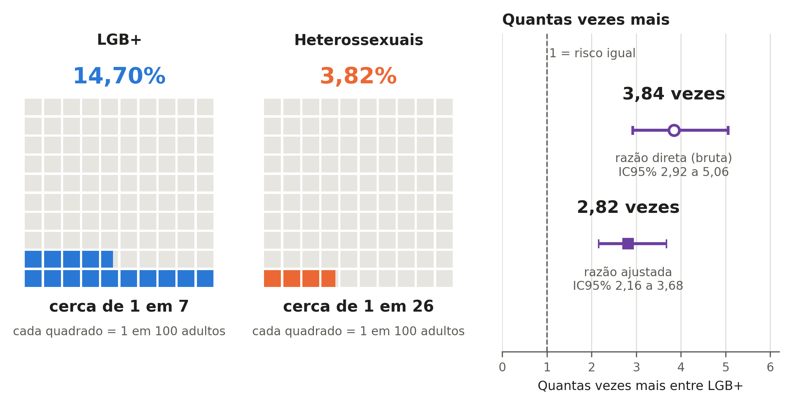

*Nota.* Cada quadriculado tem 100 quadrados; os coloridos indicam quantos adultos em cada 100 sofreram violência física nos últimos 12 meses (azul, LGB+; laranja, heterossexuais): 14,70% e 3,82%. À direita, a razão de prevalências, em que 1 indica igualdade: o círculo vazado é a razão bruta, de 3,84, e o quadrado cheio, a razão ajustada por sexo, idade, cor, instrução, região e situação urbana ou rural, de 2,82 (IC95% 2,16 a 3,68). Fonte: IBGE (2022a), microdados da PNS 2019; cálculo do autor (este estudo).

**Figura C2**

*Razão de prevalências de violência física, sexual e qualquer violência, LGB+ em relação a heterossexuais, bruta e ajustada*

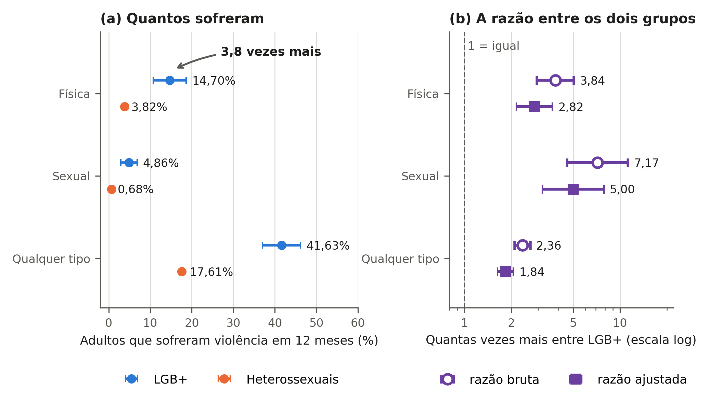

*Nota.* No painel (a), cada ponto é a prevalência de violência em 12 meses no grupo (azul, adultos LGB+; laranja, heterossexuais), com IC95%. No painel (b), a razão de prevalências entre os grupos, em escala logarítmica: o círculo vazado é a razão bruta, e o quadrado cheio, a ajustada; a linha tracejada em 1 marca igualdade entre os grupos. Fonte: IBGE (2022a); cálculo do autor (este estudo).

A composição etária não explica sozinha a disparidade. Embora 57% dos adultos LGB+ tenham de 18 a 29 anos, a razão para violência física fica acima de 1 nas faixas de 18 a 29 anos (2,93; IC95% 2,08 a 4,13), de 30 a 44 (2,27; 1,37 a 3,76) e de 60 anos ou mais (5,80; 1,93 a 17,36, com 88 entrevistados LGB+ e intervalo largo); o intervalo inclui 1 apenas na faixa de 45 a 59 anos (1,61; 0,79 a 3,31) (Tabela C2). No nível de contexto, entre as 179 vítimas LGB+ de violência física, o agressor foi parceiro ou ex-parceiro em 32,9% dos casos (heterossexuais, 37,1%), familiar em 31,2% (19,2%; razão de 1,62, IC95% 0,96 a 2,72) e pessoa desconhecida em 16,3% (23,0%), e o local foi o domicílio em 44,1% (55,2%) (Tabela C4).

Os resultados referem-se a adultos classificados pelas respostas de orientação sexual de uma única edição da PNS. A pesquisa não identifica separadamente pessoas trans, não inclui menores nem homicídio, não pergunta a motivação do agressor e não permite tendência (IBGE, 2022b). Por isso sustenta a disparidade de vitimização (níveis N1 e N2), mas não sustenta que a violência seja motivada pela orientação (N4), nem que o grupo morra mais, nem taxa de homicídio. Szwarcwald et al. (2025) tratam do mesmo tema na PNS de 2019; o artigo foi lido apenas pelo título e pelo resumo, e nenhum número dele é usado.

### Tabelas complementares de resultados

As tabelas deste apêndice são copiadas por script dos arquivos do repositório, sem número digitado; só a vírgula decimal e os rótulos de categoria mudam. A Tabela F1 usa o rótulo "B" para o cenário de subtração do numerador da contagem do GGB, e a Tabela J1 reproduz a amostra de discurso com a regra aplicada pelo codificador original, cuja comparação com a regra literal do livro de códigos está na Tabela J2 (este estudo).

<!-- apendice-a:inicio -->

**Tabela C1**

*Violência em 12 meses por orientação sexual, adultos, PNS 2019*

| desfecho | heterossexual | LGB+ | homossexual | bissexual | RP LGB+/heterossexuais [IC] | diferença LGB+ − heterossexuais (p.p.) |
|---|---|---|---|---|---|---|
| física | 3,82% [3,57; 4,08] | 14,70% [10,72; 18,67] | 12,85% [8,33; 17,38] | 18,27% [10,59; 25,96] | 3,84 [2,92; 5,06] | +10,9 [+6,9; +14,8] |
| sexual | 0,68% [0,55; 0,80] | 4,86% [2,87; 6,84] | 2,85% [0,85; 4,85] | 8,58% [4,29; 12,88] | 7,17 [4,57; 11,26] | +4,2 [+2,2; +6,2] |
| psicológica | 16,73% [16,20; 17,26] | 40,03% [35,48; 44,58] | 35,24% [29,89; 40,58] | 48,66% [40,49; 56,82] | 2,39 [2,12; 2,69] | +23,3 [+18,7; +27,9] |
| qualquer | 17,61% [17,08; 18,15] | 41,63% [37,06; 46,20] | 37,21% [31,77; 42,64] | 49,78% [41,67; 57,89] | 2,36 [2,11; 2,65] | +24,0 [+19,4; +28,6] |

*Nota.* Valores copiados sem alteração do arquivo dados/pns/seguro_pns2019.md do repositório, com vírgula decimal. Fonte: este estudo.

**Tabela C2**

*Violência física em 12 meses, LGB+ e heterossexuais, por subgrupo*

| subgrupo | n LGB+ | heterossexuais | LGB+ | RP [IC95%] | diferença p.p. |
|---|---|---|---|---|---|
| Homens | 796 | 3,71% [3,38; 4,04] | 13,45% [7,95; 18,95] | 3,62 [2,39; 5,50] | +9,7 |
| Mulheres | 758 | 3,92% [3,53; 4,32] | 15,84% [10,20; 21,47] | 4,04 [2,81; 5,80] | +11,9 |
| Negros (pretos+pardos) | 916 | 4,58% [4,24; 4,92] | 18,48% [12,26; 24,70] | 4,03 [2,87; 5,67] | +13,9 |
| Não negros | 637 | 2,90% [2,56; 3,23] | 9,81% [6,05; 13,57] | 3,39 [2,27; 5,05] | +6,9 |
| Idade 18-29 | 697 | 6,66% [5,97; 7,35] | 19,54% [13,19; 25,90] | 2,93 [2,08; 4,13] | +12,9 |
| Idade 30-44 | 506 | 4,28% [3,81; 4,74] | 9,69% [4,94; 14,44] | 2,27 [1,37; 3,76] | +5,4 |
| Idade 45-59 | 263 | 3,02% [2,61; 3,43] | 4,87% [1,42; 8,32] | 1,61 [0,79; 3,31] | +1,9 |
| Idade 60+ | 88 | 1,49% [1,23; 1,75] | 8,63% [0,00; 17,96] | 5,80 [1,93; 17,36] | +7,1 |
| Instrução baixa | 188 | 3,63% [3,24; 4,02] | 26,04% [13,68; 38,40] | 7,18 [4,42; 11,64] | +22,4 |
| Instrução média | 669 | 4,41% [4,02; 4,79] | 18,13% [11,43; 24,83] | 4,11 [2,84; 5,96] | +13,7 |
| Instrução alta | 697 | 2,93% [2,40; 3,47] | 7,58% [4,46; 10,70] | 2,58 [1,64; 4,06] | +4,6 |
| Região Norte | 256 | 4,17% [3,67; 4,68] | 15,18% [6,76; 23,61] | 3,64 [2,06; 6,41] | +11,0 |
| Região Nordeste | 458 | 4,25% [3,84; 4,66] | 14,27% [8,15; 20,39] | 3,36 [2,17; 5,21] | +10,0 |
| Região Sudeste | 403 | 3,55% [3,07; 4,04] | 16,87% [9,54; 24,20] | 4,75 [3,04; 7,42] | +13,3 |
| Região Sul | 232 | 3,65% [3,11; 4,19] | 11,66% [5,84; 17,48] | 3,19 [1,89; 5,40] | +8,0 |
| Região Centro-Oeste | 205 | 3,89% [3,27; 4,50] | 7,13% [3,21; 11,05] | 1,83 [1,04; 3,24] | +3,2 |
| Urbano | 1427 | 3,96% [3,67; 4,25] | 14,07% [9,99; 18,15] | 3,55 [2,64; 4,77] | +10,1 |
| Rural | 127 | 2,97% [2,57; 3,37] | 23,86% [7,20; 40,51] | 8,02 [4,01; 16,05] | +20,9 |

*Nota.* Valores copiados sem alteração do arquivo dados/pns/seguro_pns2019.md do repositório, com vírgula decimal. Negros são pretos e pardos (códigos 2 e 4 da variável C009, cor ou raça) e não negros são brancos, amarelos e indígenas (códigos 1, 3 e 5), pela regra de dados/pns/seguro_pns2019.py; 1 adulto LGB+ tem cor ou raça ignorada (código 9) e não entra em nenhuma das duas linhas, por isso 916 + 637 = 1.553 dos 1.554. Nas regressões, porém, o indicador de negros vale zero para a cor ou raça ignorada, que fica na categoria de referência com os não negros. Sem os adultos de cor ou raça ignorada (8 heterossexuais e 1 LGB+), as razões ajustadas mudam no máximo 0,02 (Tabela C12). Fonte: este estudo.

**Tabela C3**

*Razão de prevalências ajustada por sexo, idade, cor, instrução, região e situação urbana ou rural*

| desfecho | RP bruta | RP ajustada [IC95%] |
|---|---|---|
| física | 3,84 | 2,82 [2,16; 3,68] |
| sexual | 7,17 | 5,00 [3,17; 7,89] |
| psicológica | 2,39 | 1,87 [1,66; 2,11] |
| qualquer | 2,36 | 1,84 [1,64; 2,07] |

*Nota.* Valores copiados sem alteração do arquivo dados/pns/seguro_pns2019.md do repositório, com vírgula decimal. Fonte: este estudo.

**Tabela C4**

*Quem agrediu e onde, entre vítimas de violência física (nível de contexto, não letal)*

| categoria | heterossexuais | LGB+ |
|---|---|---|
| Quem agrediu (V018) | n heterossexuais = 3.112 | n LGB+ = 179 |
| Cônjuge/companheiro(a) | 20,21% [16,29; 24,12] | 5,05% [1,25; 8,85] |
| Ex-cônjuge/ex-companheiro(a) | 12,63% [10,65; 14,61] | 16,17% [2,63; 29,72] |
| Parceiro(a)/namorado(a)/ex | 4,26% [3,27; 5,26] | 11,70% [3,95; 19,45] |
| Pai/mãe/padrasto/madrasta | 3,70% [2,38; 5,02] | 13,01% [3,73; 22,28] |
| Filho(a)/enteado(a) | 2,81% [2,00; 3,63] | nenhum caso (intervalo não estimável) |
| Irmão(ã) | 4,71% [3,57; 5,85] | 15,90% [0,23; 31,56] |
| Outro parente | 8,02% [6,28; 9,77] | 2,27% [0,00; 5,12] |
| Amigo(a)/colega/vizinho(a) | 15,15% [12,77; 17,54] | 12,60% [4,25; 20,96] |
| Empregado(a) | 0,38% [0,13; 0,62] | 0,61% [0,00; 1,57] |
| Patrão/chefe | 0,73% [0,27; 1,18] | 4,13% [0,00; 10,63] |
| Pessoa desconhecida | 23,02% [20,28; 25,77] | 16,29% [8,06; 24,52] |
| Policial | 2,19% [1,32; 3,07] | 0,61% [0,00; 1,26] |
| Outro | 2,18% [1,24; 3,12] | 1,67% [0,00; 3,33] |
| Onde (V019) | n heterossexuais = 3.112 | n LGB+ = 179 |
| Domicílio | 55,19% [51,79; 58,59] | 44,11% [29,05; 59,18] |
| Trabalho | 6,52% [5,11; 7,92] | 8,92% [1,03; 16,81] |
| Escola/faculdade | 1,42% [0,73; 2,11] | 2,10% [0,13; 4,07] |
| Bar/restaurante | 4,92% [3,72; 6,12] | 9,47% [1,89; 17,05] |
| Via pública/local público | 29,05% [26,08; 32,02] | 34,22% [19,68; 48,77] |
| Outro | 2,90% [1,77; 4,04] | 1,18% [0,00; 2,70] |

*Nota.* Valores copiados do arquivo dados/pns/seguro_pns2019.md do repositório, com vírgula decimal, exceto a célula sem nenhum caso, que lá aparece como 0,00% [0,00; 0,00]. Fonte: este estudo.

**Tabela C5**

*Parcela de LGB+ entre vítimas adultas de violência física, estimativa direta no microdado*

| base | corte | vítimas (n) | LGB+ (n) | % LGB+ | IC95% de desenho (Taylor) |
|---|---|---|---|---|---|
| (a) todos os adultos vítimas | total | 3440 | 179 | 6,70 | [4,80; 8,60] |
| (a) todos os adultos vítimas | 18-29 | 1123 | 106 | 12,54 | [8,23; 16,84] |
| (a) todos os adultos vítimas | 30-44 | 1229 | 52 | 3,73 | [1,83; 5,64] |
| (a) todos os adultos vítimas | 45+ | 1088 | 21 | 1,46 | [0,57; 2,35] |
| (a) todos os adultos vítimas | homens | 1572 | 81 | 6,40 | [3,64; 9,16] |
| (a) todos os adultos vítimas | mulheres | 1868 | 98 | 6,95 | [4,33; 9,58] |
| (b) só heterossexuais ou LGB+ (mesmo recorte de orientação do Sinan) | total | 3291 | 179 | 7,12 | [5,11; 9,13] |
| (b) só heterossexuais ou LGB+ (mesmo recorte de orientação do Sinan) | 18-29 | 1047 | 106 | 13,82 | [9,15; 18,50] |
| (b) só heterossexuais ou LGB+ (mesmo recorte de orientação do Sinan) | 30-44 | 1194 | 52 | 3,85 | [1,89; 5,82] |
| (b) só heterossexuais ou LGB+ (mesmo recorte de orientação do Sinan) | 45+ | 1050 | 21 | 1,52 | [0,59; 2,45] |
| (b) só heterossexuais ou LGB+ (mesmo recorte de orientação do Sinan) | homens | 1505 | 81 | 6,87 | [3,92; 9,81] |
| (b) só heterossexuais ou LGB+ (mesmo recorte de orientação do Sinan) | mulheres | 1786 | 98 | 7,34 | [4,58; 10,09] |

*Nota.* Valores copiados sem alteração do arquivo dados/pns/c05_razao_direta.csv do repositório, com vírgula decimal. A coluna % LGB+ é a razão de totais ponderados pelo peso do desenho amostral; as colunas de n são contagens da amostra, sem ponderação, e a razão entre elas não reproduz o percentual. Fonte: este estudo.

### Quem agrediu e risco por tipo de agressor

As análises desta seção foram feitas depois de ver os resultados, com o script `dados/pns/agressor_risco_pns2019.py`. 
Desenho complexo; intervalos de 95%. A PNS não pergunta o motivo nem a orientação sexual do agressor. Vítimas de violência física em 12 meses: 3.112 heterossexuais e 179 LGB+ (n da amostra).

As seis fatias publicadas em dados/pns/seguro_pns2019.md são reproduzidas sem divergência na tolerância de 0,01 ponto percentual.

#### 1. Entre as vítimas de violência física: quem agrediu (fatia, %)

**Tabela C6**

*Quem agrediu, entre as vítimas de violência física (fatia, %)*

| Agressor | Heterossexuais | LGB+ | Diferença LGB+ − heterossexuais (p.p.) | A diferença é firme? |
|---|---|---|---|---|
| Parceiro(a) ou ex | 37,10 (33,23 a 40,97) | 32,92 (18,42 a 47,43) | -4,2 (-19,1 a +10,8) | não (o intervalo inclui zero) |
| Familiar | 19,25 (16,79 a 21,70) | 31,17 (15,38 a 46,96) | +11,9 (-4,0 a +27,8) | não (o intervalo inclui zero) |
| Amigo(a), colega ou vizinho(a) | 15,15 (12,77 a 17,54) | 12,60 (4,25 a 20,96) | -2,5 (-11,2 a +6,1) | não (o intervalo inclui zero) |
| Empregado(a), patrão ou chefe | 1,10 (0,59 a 1,61) | 4,74 (0,00 a 11,31) | +3,6 (-3,0 a +10,2) | não (o intervalo inclui zero) |
| Pessoa conhecida (todos acima) | 72,60 (69,66 a 75,55) | 81,43 (72,85 a 90,02) | +8,8 (-0,2 a +17,8) | não (o intervalo inclui zero) |
| Pessoa desconhecida | 23,02 (20,28 a 25,77) | 16,29 (8,06 a 24,52) | -6,7 (-15,4 a +1,9) | não (o intervalo inclui zero) |
| Policial | 2,19 (1,32 a 3,07) | 0,61 (0,00 a 1,26) | -1,6 (-2,7 a -0,5) | sim |
| Outro | 2,18 (1,24 a 3,12) | 1,67 (0,00 a 3,33) | -0,5 (-2,4 a +1,4) | não (o intervalo inclui zero) |

*Nota.* "Firme" aqui é o intervalo nominal de 95% que exclui o zero, sem correção para o número de comparações; a categoria policial se apoia em 5 vítimas LGB+ na amostra. Fonte: IBGE (2022a), microdados da PNS 2019; cálculo do autor (este estudo).

#### 2. Risco na população: adultos agredidos fisicamente em 12 meses por cada tipo de agressor (por 100 adultos)

**Tabela C7**

*Adultos agredidos fisicamente em 12 meses, por tipo de agressor (por 100 adultos)*

| Agressor | Heterossexuais | LGB+ | Razão LGB+/heterossexuais |
|---|---|---|---|
| Parceiro(a) ou ex | 1,42 (1,23 a 1,61) | 4,84 (2,34 a 7,34) | 3,41 (2,01 a 5,79) |
| Familiar | 0,74 (0,63 a 0,84) | 4,58 (1,64 a 7,52) | 6,22 (3,26 a 11,90) |
| Amigo(a), colega ou vizinho(a) | 0,58 (0,48 a 0,68) | 1,85 (0,60 a 3,11) | 3,20 (1,59 a 6,42) |
| Empregado(a), patrão ou chefe | 0,04 (0,02 a 0,06) | 0,70 (0,00 a 1,67) | 16,52 (3,78 a 72,23) |
| Pessoa conhecida (todos acima) | 2,78 (2,55 a 3,01) | 11,97 (8,09 a 15,85) | 4,31 (3,10 a 5,99) |
| Pessoa desconhecida | 0,88 (0,77 a 0,99) | 2,39 (1,21 a 3,57) | 2,72 (1,63 a 4,53) |
| Policial | 0,08 (0,05 a 0,12) | 0,09 (0,00 a 0,18) | 1,07 (0,35 a 3,25) |
| Outro | 0,08 (0,05 a 0,12) | 0,24 (0,01 a 0,48) | 2,93 (1,01 a 8,51) |

*Nota.* Fonte: IBGE (2022a), microdados da PNS 2019; cálculo do autor (este estudo).

#### 3. Razão de prevalências ajustada de violência física, sem e com estado civil

**Tabela C8**

*Razão de prevalências ajustada de violência física, sem e com estado civil*

| Ajuste | Razão LGB+/heterossexuais | n |
|---|---|---|
| sexo, idade, cor, instrução, região, urbano/rural | 2,82 (2,16 a 3,68) | 85913 |
| o mesmo + estado civil (casado, separado, viúvo, solteiro) | 2,65 (2,04 a 3,46) | 85913 |
| o mesmo + cônjuge ou companheiro(a) mora no domicílio | 2,64 (2,02 a 3,44) | 85913 |

*Nota.* Fonte: IBGE (2022a), microdados da PNS 2019; cálculo do autor (este estudo).

**Tabela C9**

*Prevalência de violência física por estado civil*

| Estado civil | Heterossexuais | LGB+ | n LGB+ |
|---|---|---|---|
| casado | 2,48 (2,09 a 2,88) | 7,23 (2,15 a 12,31) | 165 |
| separado | 4,66 (3,82 a 5,50) | 9,41 (1,86 a 16,96) | 74 |
| viúvo | 2,23 (1,55 a 2,91) | nenhum caso (intervalo não estimável) | 15 |
| solteiro | 5,43 (5,00 a 5,85) | 15,99 (11,43 a 20,56) | 1300 |

*Nota.* Fonte: IBGE (2022a), microdados da PNS 2019; cálculo do autor (este estudo).

Solteiros entre os adultos: heterossexuais 40,79%, LGB+ 84,91%.

Leitura: a razão que sobra depois de qualquer ajuste não é parcela causada por discriminação nem por 'estilo de vida'; os dados não separam as duas explicações (VanderWeele & Robinson, 2014).

#### 4. Razão de risco ajustada por tipo de agressor

Desfecho: ter sofrido violência física em 12 meses e ter apontado esse tipo de agressor em V018 (uma resposta por pessoa). Colunas ajustadas: a primeira com o mesmo ajuste do 2,82; a segunda com o estado civil somado; a terceira com o cônjuge ou companheiro(a) no domicílio somado. O n é o mesmo nas três.

**Tabela C10**

*Razão de risco ajustada por tipo de agressor*

| Agressor | Bruta | Ajustada (sexo, idade, cor, instrução, região, urbano/rural) | Ajustada + estado civil | Ajustada + cônjuge no domicílio | n |
|---|---|---|---|---|---|
| Parceiro(a) ou ex | 3,41 (2,01 a 5,79) | 2,50 (1,48 a 4,25) | 2,42 (1,43 a 4,10) | 2,42 (1,44 a 4,07) | 85913 |
| Familiar | 6,22 (3,26 a 11,90) | 4,79 (2,58 a 8,90) | 4,43 (2,38 a 8,26) | 4,31 (2,33 a 7,99) | 85913 |
| Amigo(a), colega ou vizinho(a) | 3,20 (1,59 a 6,42) | 2,12 (1,02 a 4,39) | 1,87 (0,90 a 3,89) | 1,85 (0,89 a 3,83) | 85913 |
| Pessoa conhecida (todos acima) | 4,31 (3,10 a 5,99) | 3,13 (2,28 a 4,29) | 2,93 (2,14 a 4,01) | 2,91 (2,13 a 3,98) | 85913 |
| Pessoa desconhecida | 2,72 (1,63 a 4,53) | 2,05 (1,22 a 3,45) | 1,93 (1,14 a 3,27) | 1,91 (1,12 a 3,26) | 85913 |

*Nota.* Fonte: IBGE (2022a), microdados da PNS 2019; cálculo do autor (este estudo).

#### 5. Quem preencheu o módulo de violência (V00101) e fluxo da amostra

- próprio morador: n = 21.669; LGB+ entre quem declarou orientação heterossexual ou LGB+ = 3,51%; violência física LGB+ 16,74 (10,48 a 22,99), heterossexuais 5,21 (4,53 a 5,88); razão bruta 3,21 (2,18 a 4,74); n LGB+ = 677
- entrevistador: n = 66.862; LGB+ entre quem declarou orientação heterossexual ou LGB+ = 1,38%; violência física LGB+ 12,75 (7,74 a 17,76), heterossexuais 3,32 (3,08 a 3,56); razão bruta 3,84 (2,58 a 5,73); n LGB+ = 877
- Razão ajustada com o modo de preenchimento no ajuste: 2,68 (2,05 a 3,49); n = 85913

Fluxo: 88.531 adultos responderam o módulo V; 85.913 declararam orientação heterossexual ou LGB+ (fora: não sabe 849, recusou 1.769, sem resposta 0); n analítico do ajuste = 85.913 (com faixa, instrução e região conhecidas).

#### 6. Vítimas na amostra (não ponderado) por tipo de agressor

Critério de omissão do ajuste por tipo de agressor: menos de 10 vítimas LGB+ na categoria.

**Tabela C11**

*Vítimas de violência física na amostra (não ponderado), por tipo de agressor*

| Agressor | Vítimas heterossexuais | Vítimas LGB+ |
|---|---|---|
| Parceiro(a) ou ex | 1163 | 69 |
| Familiar | 606 | 33 |
| Amigo(a), colega ou vizinho(a) | 452 | 23 |
| Empregado(a), patrão ou chefe | 39 | 5 |
| Pessoa conhecida (todos acima) | 2260 | 130 |
| Pessoa desconhecida | 726 | 39 |
| Policial | 66 | 5 |
| Outro | 60 | 5 |

*Nota.* Fonte: IBGE (2022a), microdados da PNS 2019; cálculo do autor (este estudo).

#### 7. Mora com cônjuge ou companheiro(a) no domicílio (C01001), por grupo e estado civil (ponderado)

- heterossexuais: moram com cônjuge 62,39% (61,73 a 63,05); entre os de estado civil solteiro, 41,36% (40,35 a 42,37); n com resposta = 84.359
- LGB+: moram com cônjuge 29,49% (25,40 a 33,57); entre os de estado civil solteiro, 21,38% (17,47 a 25,29); n com resposta = 1.554

#### 8. Razões ajustadas sem os adultos de cor ou raça ignorada

No ajuste do artigo, quem tem cor ou raça ignorada (C009 = 9) entra na categoria de referência, com os não negros: 8 heterossexuais e 1 LGB+ na amostra. Aqui eles saem do ajuste.

**Tabela C12**

*Razões de prevalências ajustadas com e sem os adultos de cor ou raça ignorada*

| Desfecho | Ajustada (como no artigo) | Ajustada sem cor ou raça ignorada | n sem cor ignorada |
|---|---|---|---|
| Violência física | 2,82 (2,16 a 3,68) | 2,82 (2,16 a 3,68) | 85904 |
| Violência sexual | 5,00 (3,17 a 7,89) | 5,02 (3,18 a 7,92) | 85904 |
| Violência psicológica | 1,87 (1,66 a 2,11) | 1,87 (1,66 a 2,11) | 85904 |
| Qualquer violência | 1,84 (1,64 a 2,07) | 1,84 (1,64 a 2,07) | 85904 |
| Violência física por parceiro(a) ou ex | 2,50 (1,48 a 4,25) | 2,50 (1,48 a 4,25) | 85904 |
| Violência física por familiar | 4,79 (2,58 a 8,90) | 4,79 (2,58 a 8,90) | 85904 |
| Violência física por amigo(a), colega ou vizinho(a) | 2,12 (1,02 a 4,39) | 2,12 (1,02 a 4,39) | 85904 |
| Violência física por pessoa conhecida (todos acima) | 3,13 (2,28 a 4,29) | 3,13 (2,28 a 4,29) | 85904 |
| Violência física por pessoa desconhecida | 2,05 (1,22 a 3,45) | 2,05 (1,22 a 3,45) | 85904 |

*Nota.* Fonte: IBGE (2022a), microdados da PNS 2019; cálculo do autor (este estudo).

Leitura: a diferença entre as duas colunas é o peso da regra de codificação da cor ou raça ignorada nas razões ajustadas.

## Apêndice D — Registros administrativos: fichas do SUS, boletins, Disque 100 e trajetórias

### Registros administrativos: fichas de saúde, boletins de ocorrência e denúncias

Nas fichas de violência dos serviços de saúde, entre 197.779 notificações de violência física interpessoal de adultos em 2023 e 202.416 em 2024, a orientação sexual veio preenchida com valor utilizável em 75,7%, e entre essas homossexuais e bissexuais somam 4,12% e 4,08% (DATASUS, 2026b). Na PNS, entre as vítimas adultas de violência física que declararam orientação heterossexual ou LGB+, a parcela LGB+ ponderada pelo desenho amostral é 7,1% (IC95% de desenho 5,1 a 9,1), com Taylor e jackknife concordantes; na amostra não ponderada, são 179 de 3.291 vítimas, razão que não reproduz o percentual ponderado (IBGE, 2022a; Tabela C5). As duas parcelas ficam acima dos 1,89% que LGB+ representam na população adulta, mas descrevem universos diferentes, e uma não valida nem invalida a outra (Figura D1): a PNS descreve pessoas vitimadas, tenham ou não procurado serviço, e o Sinan descreve notificações, sujeitas a atendimento, preenchimento, possível repetição da mesma pessoa e a uma regra de elegibilidade que não é igual para todos. O Guia de Vigilância em Saúde exclui da notificação a violência comunitária ou extrafamiliar contra homens de 20 a 59 anos, "exceto nas condições de vulnerabilidade", entre elas a população LGBT, e manda notificar violências homofóbicas em todas as idades (Ministério da Saúde, 2024, p. 1222); essa regra pode, sozinha, sobre-representar pessoas LGBT+ nas fichas, antes de qualquer diferença de atendimento. A parcela da PNS tem gradiente etário forte: 13,8% entre 18 e 29 anos, 3,9% entre 30 e 44 e 1,5% acima de 45.

**Figura D1**

*Parcela de LGB+ entre vítimas adultas de violência física no levantamento domiciliar e nas fichas dos serviços de saúde, e na população adulta*

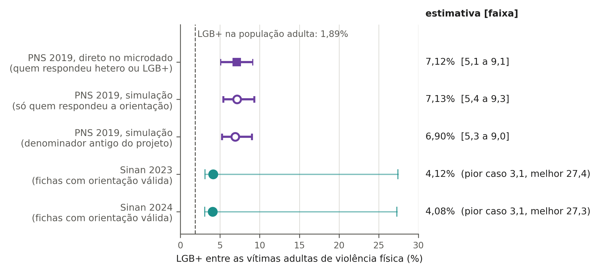

*Nota.* Cada linha é a parcela de LGB+ entre vítimas adultas de violência física num universo diferente: pessoas vitimadas, tenham ou não procurado serviço, na PNS, e notificações elegíveis pela regra de notificação, no Sinan; a linha tracejada marca a parcela de LGB+ na população adulta. As duas parcelas ficam acima da linha tracejada e diferem em magnitude; no Sinan, a barra fina mostra a faixa possível quando as fichas sem orientação registrada são alocadas no pior e no melhor caso. Como os universos e as regras de entrada diferem, uma linha não valida nem contradiz a outra. Fonte: IBGE (2022a) e DATASUS (2026b); cálculo do autor (este estudo).

O campo 55 da ficha, que registra o motivo da violência como relatado, ficou sem informação útil, somando motivo ignorado, em branco e "não se aplica", em 53,4% das fichas não marcadas como violência autoprovocada em 2015 e em 42,5% a 44,5% de 2023 a 2025; a parcela "não se aplica" ficou estável em cerca de 15%, e a LGBTfobia aparece como motivo em 0,4% a 0,5% das notificações (Figura D2; DATASUS, 2026b). Nas mesmas fichas, o motivo ignorado ou em branco variou, em 2023, de 11,0% em Roraima a 54,2% em Mato Grosso do Sul. O Sinan permite descrever as notificações e suas mudanças; inferir vitimização populacional exige hipóteses adicionais sobre elegibilidade, atendimento e registro. Marinho Neto et al. (2024) documentam, para pessoas trans, uma cobertura municipal de notificação que sobe enquanto a série de notificações cai; a leitura de que isso impede tratar a série como tendência de violência é deste artigo, e não dos autores.

**Figura D2**

*Composição do campo de motivo da violência nas fichas de notificação, Sinan, 2015 a 2025*

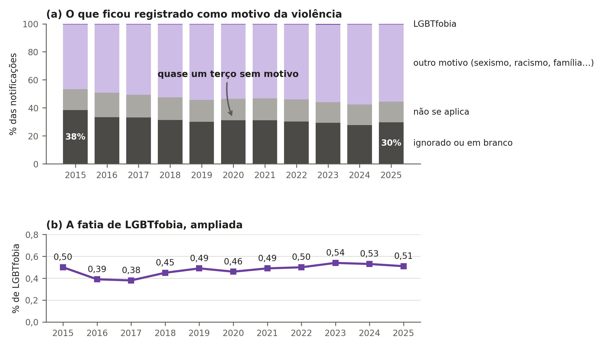

*Nota.* Cada coluna do painel (a) soma 100% das notificações do ano não marcadas como violência autoprovocada; o cinza-escuro é o campo de motivo ignorado ou em branco, e a LGBTfobia, ampliada no painel (b), mal aparece. Como o motivo fica sem informação útil em 42,5% a 53,4% das fichas, conforme o ano, e o preenchimento varia entre os anos, o número de casos registrados como LGBTfobia não mede a incidência. Em 2025, motivo ignorado ou em branco em 30% das fichas, 44,5% somando "não se aplica"; LGBTfobia em cerca de 0,5%. Fonte: DATASUS (2026b); cálculo do autor (este estudo).

Não há evidência de concordância líquida entre saúde e polícia por estado (Figura D3). A correlação de Spearman entre as contagens por estado das notificações de LGBTfobia no Sinan e dos boletins de ocorrência no Anuário vai de 0,53 a 0,74 conforme o ano e diminui quando se controla o tamanho do estado: a correlação parcial fica entre 0,14 e 0,32, com intervalo de 95% que inclui zero em todos os anos (juntando os anos, 0,20; -0,13 a 0,50; de 22 a 23 estados por ano) (DATASUS, 2026b; FBSP, 2026).

**Figura D3**

*Notificações de LGBTfobia no Sinan e boletins de ocorrência por estado, correlação bruta e parcial*

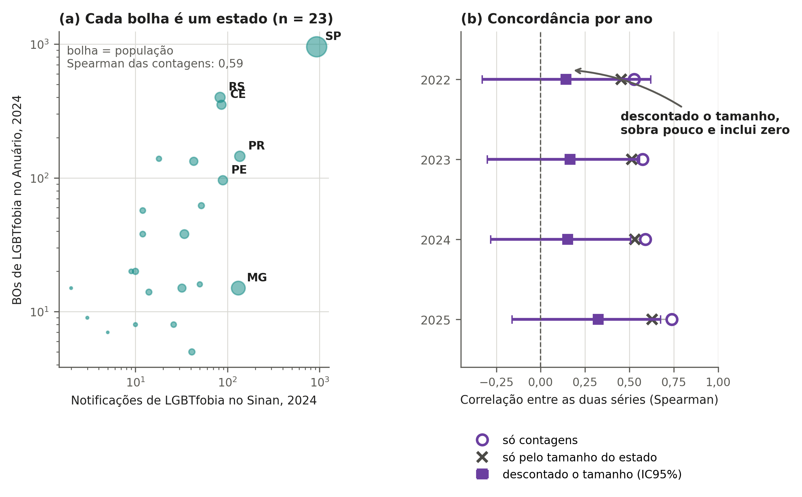

*Nota.* No painel (a), cada bolha é um estado: os mais populosos têm mais registros nas duas fontes, e as contagens sobem juntas. No painel (b), por ano, o círculo vazado é a correlação de Spearman bruta, o x é a correlação esperada só pelo tamanho do estado, e o quadrado cheio, a correlação parcial depois de descontado o tamanho, entre 0,14 e 0,32, com faixa que inclui zero em todos os anos. Fonte: DATASUS (2026b) e FBSP (2026); cálculo do autor (este estudo).

O Anuário registra 783, 1.633, 2.567 e 3.481 boletins de ocorrência de "racismo por homofobia ou transfobia" de 2022 a 2025, alta de 4,4 vezes; são registros das secretarias estaduais compilados por uma organização da sociedade civil, e não foi localizada série oficial nacional equivalente (FBSP, 2026). Cada ano vem da edição mais recente do Anuário, que revisa a própria série: 2023 tinha 2.090 boletins na edição de 2024 e 1.633 na de 2025, que marca o ano como atualização das informações publicadas, e 2024 tinha 2.480 na edição de 2025 e 2.567 na de 2026 (este estudo). O número que chega à estatística é a violência que existe multiplicada pela parcela dela que alguém registra; se as duas crescem ao mesmo tempo, o resultado sobe, e nada no número diz qual delas subiu. Sob o modelo da Equação 1 do artigo, enquanto *p*~t~ < 1, a série registrada esperada é *I*~0~·*p*~0~·[(1 + *g*)(1 + *h*)]^*t*^: mantido o crescimento registrado, cada crescimento g da incidência corresponde a um crescimento h da propensão de registro, e um g maior exige um h menor; o teto *p*~t~ = 1 só restringe a projeção depois que a propensão satura, o que nos cenários ajustados ocorre depois de 2025 (Figura D4). O próprio Anuário descreve os números recebidos como "baixos demais", com "variações anormais de um ano a outro" (FBSP, 2026). A demonstração tem cinco passos:

1. O registrado é a incidência vezes a propensão de registrar: R = I × p (Equação 1, seção 2.3 do artigo).
2. Se a incidência cresce g ao ano e a propensão h ao ano, o registrado cresce (1+g)(1+h) ao ano.
3. A série de 783, 1.633, 2.567 e 3.481 boletins (2022 a 2025) é ajustada com o mesmo erro (soma de quadrados em log de 0,0472) por três histórias: incidência parada e registro crescendo 63,7% ao ano (1,00 × 1,637); incidência crescendo 15% e registro 42,3% (1,15 × 1,423 ≈ 1,636); incidência caindo 5% e registro crescendo 72,3% (0,95 × 1,723 ≈ 1,637) (este estudo).
4. O produto é praticamente o mesmo, e a série observada também; o resultado não muda para *p*~0~ de 0,02 a 0,15 (Figura D4).
5. Só um dado externo ao registro fixa p e separa as histórias: levantamento de vitimização, segunda lista para captura-recaptura ou auditoria de completude (seção 6 do artigo; Apêndice K).

O resultado é estrutural, e não da simulação (Figura D4): sem restrição externa sobre a propensão de registro, a série isolada é compatível tanto com a frase "a LGBTfobia disparou" quanto com a frase "é só registro" e não distingue as duas.

**Figura D4**

*Três trajetórias de incidência e de propensão de registro que produzem a mesma série de boletins de ocorrência por homofobia ou transfobia, 2022 a 2025*

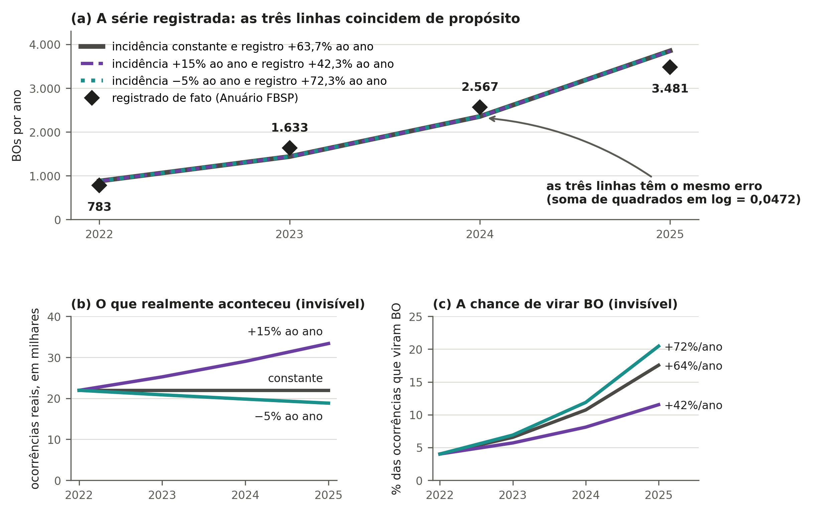

*Nota.* No painel (a), os losangos são os boletins registrados, e as três linhas, o que cada trajetória prevê: as linhas coincidem. Nos painéis (b) e (c), o que cada trajetória supõe: violência estável, subindo 15% ao ano ou caindo 5% ao ano, compensada por propensão de registro crescente. As três reproduzem a mesma série observada, de 783 (2022) a 3.481 (2025); sem medida externa, os dados não permitem escolher entre elas. Fonte: FBSP (2026); simulação do autor (este estudo).

O Disque 100 publica o registro das denúncias em 23 arquivos abertos, de 2011 a setembro de 2026 (MDHC, 2026). Os arquivos têm três formatos, e nenhum traz chave que identifique a pessoa: o total de vítimas únicas não é calculável em nenhum ano, e o que se conta é registro, uma linha do arquivo até 2019 e uma denúncia a partir de 2021 (2020 mistura as duas unidades), o que impede também uma taxa, porque falta o denominador de pessoas e quem denuncia não é amostra da população. O módulo LGBT do canal soma de 1.331 a 4.787 linhas por ano de 2011 a 2019 e, de 2021 a 2025, de 1.367 a 9.346 denúncias com ao menos uma linha no módulo, de 1,4% a 1,5% das denúncias do canal de 2022 a 2025; em 2026 são 10.461 até setembro, 1,9% do canal (Figura D5). Exigir que todas as linhas da denúncia sejam do módulo LGBT reduz 2025 de 9.346 para 39 denúncias. O canal inteiro quase triplicou no mesmo período, de 222 mil para 638 mil denúncias, e a série tem quatro quebras: o primeiro e o segundo semestres de 2020, o segundo semestre de 2022, quando um formulário novo passa a permitir que o grupo varie dentro da mesma denúncia, e 2024, quando a categoria de motivação por orientação ou identidade deixa de existir no formulário, o que não é ausência de motivação. Mais denúncias, portanto, não significam mais violência: a série não separa violência de divulgação, de canais novos e de mudança de formulário, e é mais um registro cuja propensão de registro nenhuma fonte mede.

**Figura D5**

*Denúncias do módulo LGBT e do canal inteiro do Disque 100, 2011 a setembro de 2026*

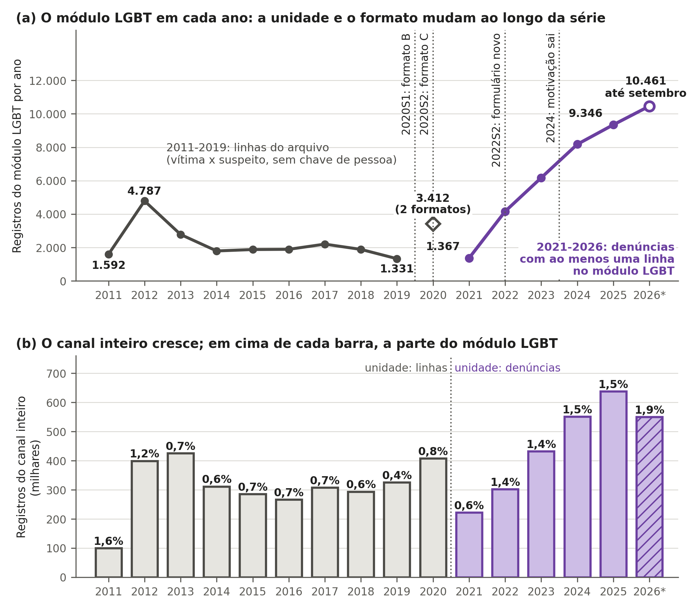

*Nota.* No painel (a), a linha cinza é o número de linhas do módulo LGBT nos arquivos de 2011 a 2019 (cada linha é um par de vítima e suspeito num atendimento, e não uma pessoa); a linha roxa, de 2021 em diante, conta denúncias com ao menos uma linha do módulo; o losango é 2020, que mistura dois formatos. As linhas verticais pontilhadas marcam mudanças de formato do arquivo ou do formulário, entre as quais a série não é contínua. No painel (b), cada barra é o canal inteiro, na mesma unidade do painel (a), e o número acima, a parcela do módulo LGBT. De 2021 a 2025, o módulo LGBT foi de 1.367 a 9.346 denúncias (6,8 vezes) e o canal inteiro, de 222 mil a 638 mil (2,9 vezes); 2026 vai até setembro. Mais denúncias não indicam mais violência. Fonte: MDHC (2026); contagem do autor (este estudo).

## Apêndice E — Mortalidade: evidência internacional, controle positivo por sexo e raça, Kitagawa

### Mortalidade por orientação sexual e identidade de gênero

No Brasil, a pergunta não é testável com dado público. O formulário da declaração de óbito tem 59 variáveis em 9 blocos, segundo o manual oficial de preenchimento, e nenhuma registra orientação sexual ou identidade de gênero (Ministério da Saúde, 2022, p. 10); o cabeçalho dos arquivos de microdados do SIM de 2023 e 2024 também não tem variável de orientação ou de identidade, verificação feita no próprio arquivo (DATASUS, 2026a). Rafael et al. (2024) registram o mesmo limite e mostram que a vinculação probabilística entre as fichas do Sinan e os óbitos do SIM no Rio de Janeiro tem acurácia de 93,3%, sem gerar taxa populacional. A vinculação nacional publicada tem o mesmo limite: Luis et al. (2026) parearam as notificações de violência contra pessoas trans do Sinan (36.452 casos de 2014 a 2022, reorganizados em registros individuais) com o SIM e encontraram 1.325 óbitos, dos quais 563 (42,5% dos óbitos pareados, e não das notificações) por causas violentas, categoria que reúne homicídio, suicídio e intenção indeterminada. A população do estudo é a de pessoas trans já notificadas por violência, e não há denominador; o estudo descreve fatores associados ao óbito violento dentro desse grupo, e não uma taxa nem uma razão entre pessoas trans e cisgênero. O pareamento usou nome, nome da mãe e data de nascimento, obtidos pelos autores por solicitação com termo de confidencialidade, e por isso não é reproduzível com dado aberto. Fora do Brasil, K. A. Clark e Blosnich (2024) mostram que 84,5% dos óbitos do sistema norte-americano de registro de mortes violentas têm orientação sexual ausente ou desconhecida.

Fora do Brasil, os dados publicados entre 2023 e 2026 sustentam excesso de mortalidade por todas as causas em populações bem definidas (Tabela E1 e Figura E1). O ONS ligou o Censo de 2021 aos registros de óbito da Inglaterra e do País de Gales: entre 21 de março de 2021 e 30 de novembro de 2024, entre 28.659.465 pessoas de 16 anos ou mais que responderam elas mesmas à pergunta de orientação (59,0% das pessoas de 16 anos ou mais do Censo; o Censo foi vinculado ao cadastro do serviço nacional de saúde em 94,6% e os óbitos em 90,2%, com pesos de pós-estratificação para a perda de vinculação), a taxa de mortalidade por todas as causas padronizada por idade foi de 982,8 por 100 mil no grupo LGB+ e de 752,6 por 100 mil entre heterossexuais, razão de 1,31 (IC95% 1,28 a 1,33); para gays e lésbicas a razão foi 1,31 (1,28 a 1,35), para bissexuais 1,33 (1,28 a 1,38) e, só entre homens gays, 1,23 (1,20 a 1,27) (ONS, 2026a). As taxas são do período inteiro, e não anuais; a padronização usa a distribuição etária do grupo LGB+, mais jovem, de modo que a taxa dos heterossexuais é a que eles teriam com a idade dos LGB+; e o próprio ONS escreve que a análise é descritiva e não permite dizer se a orientação é fator causal (ONS, 2026a). No mesmo desenho, a taxa de suicídio padronizada, que inclui óbitos de intenção indeterminada, foi de 50,3 contra 23,1 por 100 mil entre março de 2021 e dezembro de 2023, cerca de 2,2 vezes (ONS, 2025). A expectativa de vida aos 20 anos, estimativa experimental sem teste formal de significância, foi 1,2 ano menor para homens LGB+ (59,4 contra 60,7) e 0,9 ano menor para mulheres LGB+ (63,0 contra 64,0), diferenças calculadas sobre valores não arredondados, em estimativas experimentais que, segundo o próprio ONS, tendem a superestimar a expectativa de vida (ONS, 2026b).

**Tabela E1**

*Mortalidade e violência por orientação sexual ou identidade de gênero, evidência brasileira e internacional publicada de 2023 a 2026: população, desfecho, medida e resultado de cada estudo*

| Estudo | População e país | Desfecho | Medida | Resultado | Tipo de fonte |
|---|---|---|---|---|---|
| ONS (2026a) | 16 anos ou mais, Censo 2021 ligado a óbitos; Inglaterra e País de Gales | todas | razão de taxas padronizadas LGB+/heterossexuais | 1,31 (1,28 a 1,33) | documento oficial |
| ONS (2025) | mesma base, 2021 a 2023 | suicídio (com intenção indeterminada) | taxas padronizadas por 100 mil | 50,3 e 23,1 | documento oficial |
| ONS (2026b) | mesma base, 2021 a 2024 | todas | expectativa de vida aos 20 anos | -1,2 ano (homens); -0,9 ano (mulheres) | documento oficial; estatística experimental |
| McKetta et al. (2024) | enfermeiras, Estados Unidos | todas | fator de aceleração (menor que 1 = morte mais cedo) | 0,74 (0,64 a 0,84) | periódico Q1 |
| Erlangsen et al. (2023) | pessoas trans identificadas por registro, Dinamarca | todas; suicídio | razão ajustada de taxas | 2,0 (1,7 a 2,4); 3,5 (2,0 a 6,3) | periódico Q1 |
| Zachry et al. (2025) | revisão de 43 estudos, vários países | várias | contagem de estudos | 14 sustentam, 28 em parte, 1 não | periódico Q1 |
| Luis et al. (2026) | pessoas trans notificadas no Sinan e pareadas ao SIM, Brasil | óbito por causas violentas | proporção entre óbitos pareados | 563 de 1.325 (42,5%); sem denominador | periódico, quartil não conferido |
| McLellan et al. (2026) | adultos trans e de gênero diverso, meta-análise de 94 estudos, vários países | violência física ou sexual ao longo da vida, não letal; homicídio | prevalência combinada | 64,23% (47,38% a 78,17%; 9 estudos); sem estudo de homicídio identificado | periódico Q1 |

*Nota.* As medidas são diferentes e não se somam nem se comparam num eixo único de risco. Nenhuma linha estima homicídio por orientação sexual, e a linha de McLellan et al. (2026) mede violência não letal. O quartil Q1 de McKetta et al. (2024), de Erlangsen et al. (2023) e de McLellan et al. (2026) foi conferido pela regra complementar do Apêndice B; o de Zachry et al. (2025), pela regra original. Fonte: estudos citados na primeira coluna.

**Figura E1**

*Mortalidade e violência contra pessoas LGB+ e trans, evidência brasileira e internacional publicada de 2023 a 2026, por estudo e medida*

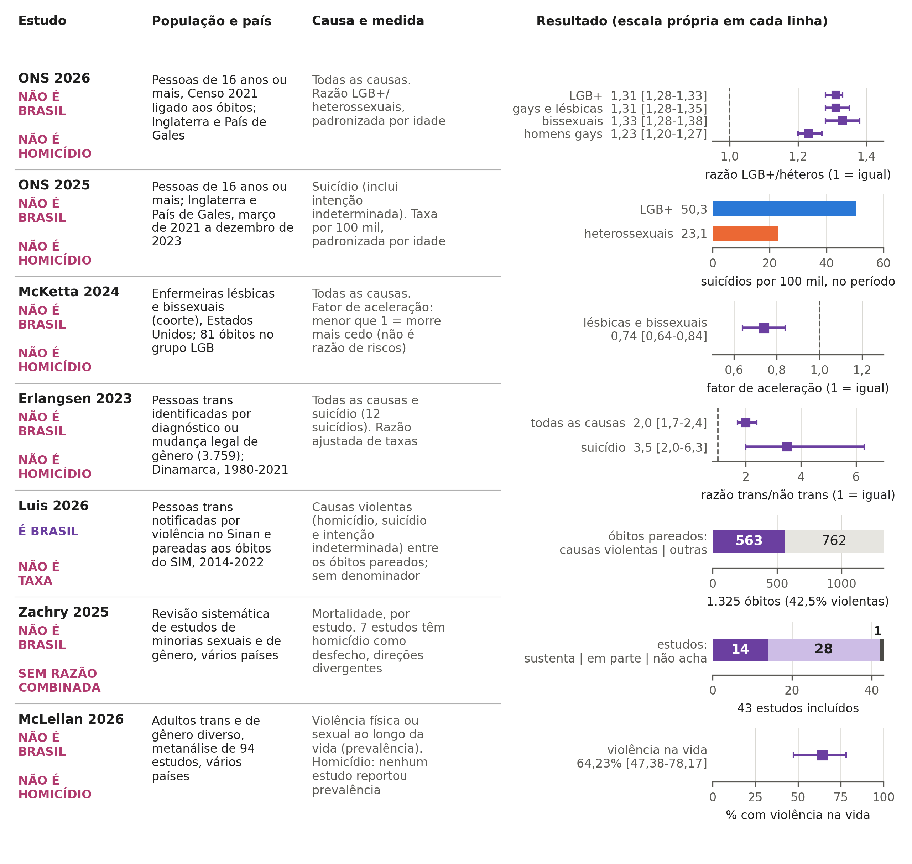

*Nota.* Cada linha é um estudo, e cada painel tem escala própria, porque as medidas (razão de taxas, taxa por 100 mil, fator de aceleração, contagem de estudos e prevalência) são diferentes e não formam um único risco. Os rótulos da primeira coluna indicam o que o estudo não é: não é Brasil, não é homicídio, não é taxa ou não tem razão combinada. Só o estudo de Luis et al. (2026) é brasileiro, e ele não traz taxa, por falta de denominador. Fonte: ONS (2025, 2026a, 2026b), McKetta et al. (2024), Erlangsen et al. (2023), Luis et al. (2026), Zachry et al. (2025) e McLellan et al. (2026).

Duas coortes em periódico do primeiro quartil apontam no mesmo sentido em populações mais estreitas. Entre 90.833 enfermeiras norte-americanas nascidas de 1945 a 1964, as lésbicas e bissexuais morreram mais cedo, com fator de aceleração ajustado de 0,74 (0,64 a 0,84), medida de antecipação do tempo até o óbito que não é razão de riscos nem percentual de expectativa de vida, sobre 81 óbitos no grupo em 27 anos (McKetta et al., 2024). Na Dinamarca, 3.759 pessoas trans identificadas por diagnóstico hospitalar ou mudança legal de gênero tiveram razão ajustada de 2,0 (1,7 a 2,4) para mortalidade por todas as causas e de 3,5 (2,0 a 6,3) para suicídio, esta sobre 12 suicídios, entre 1980 e 2021; a identificação administrativa seleciona a parcela da população trans que chegou ao hospital ou ao cartório (Erlangsen et al., 2023). Três coortes recentes de pessoas trans identificadas por registro, na Austrália (Saxby et al., 2026), em Taiwan (Hsu et al., 2025) e na Suécia (K. D. Clark et al., 2026), lidas no texto disponível em HTML, também encontram excesso de mortalidade geral, que em Taiwan desaparece na comparação entre irmãos, salvo para suicídio; os periódicos não tiveram o quartil conferido, e as três ficam fora do veredito. A revisão sistemática de Zachry et al. (2025), lida em texto integral, conclui que nenhum governo coleta orientação sexual e identidade de gênero em processo padronizado no óbito e que a heterogeneidade das definições impede uma razão combinada; dos 43 estudos incluídos, 14 sustentam mortalidade maior em minorias sexuais e de gênero, 28 a sustentam em parte, por exemplo para uma causa e não para outra, e 1 não encontra excesso, e a síntese dos autores é que os achados, embora mistos, sugerem mortalidade elevada.

Para homicídio, que é a forma em que a pergunta circula no Brasil, nenhuma das fontes lidas produz razão populacional por orientação sexual, resultado de busca enumerada e não afirmação de inexistência. O ONS não publica taxa de homicídio por orientação; o homicídio aparece só na tabela de causas principais, nos estratos em que está entre as dez primeiras, e o grupo LGB+ aparece nela apenas entre mulheres de 16 a 24 anos, com 5 óbitos, em contagens arredondadas a múltiplos de cinco (ONS, 2026a). A meta-análise de McLellan et al. (2026), com 94 estudos publicados em 137 artigos, estima prevalência de violência física ou sexual ao longo da vida de 64,23% (9 estudos; 47,38% a 78,17%) entre adultos trans e de gênero diverso, mas não identificou estudo que reportasse prevalência de homicídio; a errata publicada em abril de 2026 trocou rótulos de uma figura e repôs uma figura do suplemento, sem alterar as estimativas citadas. Dos estudos da revisão de Zachry et al. (2025), 7 têm homicídio como desfecho, com direções divergentes. Listas de casos documentados descrevem vítimas, e não risco: Halliwell et al. (2025) reúnem 229 mortes violentas documentadas de mulheres trans nos Estados Unidos entre 2013 e 2021, 78,6% delas negras, a partir de bases de organizações e da imprensa, e declaram que a amostra não é nacionalmente representativa. Para homicídio de pessoas trans, Dinno (2017) obtém taxas de 3,66 a 110 por 100 mil conforme a prevalência suposta e a subcontagem, mas 8 de 12 cenários de razão de risco entre pessoas trans e cisgênero ficam abaixo de 1, com numerador predominantemente de mídia; são cenários de um mesmo estudo, e não estudos independentes.

A evidência anterior a 2023 varia por causa, população e período. Entre homens em casamento do mesmo sexo na Dinamarca, a razão de mortalidade padronizada por todas as causas foi 2,25 (2,01 a 2,50) de 1989 a 1995 e 1,33 (1,04 a 1,68) depois de 1995, com indicador de casamento que cobre de 1% a 6% dos homens gays, e o excesso de óbitos caiu de 9,63 para 1,53 por 1.000 pessoas-ano, queda que coincide no tempo com a terapia antirretroviral, sem causa de morte no estudo (Frisch & Brønnum-Hansen, 2009). No General Social Survey, a razão de riscos foi 1,04 (0,82 a 1,31) para homens, 6,28 (1,45 a 27,22) para suicídio entre mulheres com parceira e 1,29 (0,47 a 3,51) para HIV, com intervalo que inclui 1 (Cochran & Mays, 2015). Citações também se transformam no caminho: McKetta et al. (2026) escrevem que pessoas LGB nos Estados Unidos têm o dobro de chance de morrer por suicídio e citam Zachry et al. (2025), mas a revisão não traz razão combinada, e o único valor de 2,18 vezes sobre suicídio nela é a taxa bruta de uma coorte de veteranos (82,5 contra 37,7 por 100 mil pessoas-ano). A afirmação de que minorias sexuais em comunidades com alto nível de preconceito vivem 12 anos menos vem de um artigo retratado (Hatzenbuehler et al., 2014); refeita a codificação, a associação com mortalidade desaparece na amostra completa e aparece só entre quem teve parceiro do mesmo sexo no último ano (razão de risco 1,95; IC95% 1,14 a 3,31; Hatzenbuehler et al., 2020), e a medida adequada de expectativa de vida, onde existe, mostra diferenças da ordem de um ano aos 20 anos (ONS, 2026b).

O veredito depende da regra de elegibilidade só fora do Brasil. Sob a regra original do pré-registro, a evidência mundial é Zachry et al. (2025), Frisch e Brønnum-Hansen (2009), Cochran e Mays (2015) e Dinno (2017), e a afirmação de que pessoas LGB+ morrem mais que heterossexuais é "parcial" para mortalidade por todas as causas: a revisão é mista, embora sugira excesso, e os estudos antigos variam por causa e período. Com a regra complementar, que admite o dado oficial por vinculação e o quartil conferido nas páginas do SCImago, a afirmação passa a "sustentada" para mortalidade por todas as causas em populações definidas: pessoas que se declararam LGB+ no Censo da Inglaterra e do País de Gales (ONS, 2026a), uma coorte de enfermeiras lésbicas e bissexuais nos Estados Unidos (McKetta et al., 2024) e pessoas trans identificadas em registros na Dinamarca (Erlangsen et al., 2023), com estimadores diferentes e sem identificação causal; o ONS sozinho já sustenta a mudança. Sob as duas regras, a afirmação não é sustentada como frase universal, não tem razão populacional para homicídio em nenhuma fonte lida e não é testável no Brasil.

### Mortes por agressão segundo sexo e raça: o nível medido quando o registro contém o atributo

Quando o registro de óbito contém o atributo, o nível N1 é medido; o resultado funciona como controle positivo do argumento da seção 3.3 do artigo, porque mostra que o limite para pessoas LGBT+ é a ausência do campo, e não do sistema (DATASUS, 2026a). Na média de 2022 a 2024, a taxa de óbito por agressão padronizada por idade vai de 2,6 por 100 mil entre mulheres não negras a 51,7 entre homens negros (Tabela E2 e Figura E2); a razão entre homens e mulheres é 10,8, e a razão entre negros e não negros é 2,56 (de 2,42 a 2,60 conforme a alocação dos óbitos com raça ignorada). A decomposição de Kitagawa (1955) atribui de 89% a 99% da diferença bruta às taxas por idade, e não à composição etária. A ordem das taxas é a mesma em todos os anos de 2012 a 2024 (Tabela E3); os denominadores de 2023 e 2024 foram extrapolados do Censo 2022 por interpolação geométrica (IBGE, 2026), o que afeta os níveis, e a sensibilidade a denominadores alternativos não foi testada. Para raça, a disparidade residual condicional aparece nos dois estudos lidos, ambos sem controle de renda e nenhum em periódico do primeiro quartil: no Rio de Janeiro de 2010, negros têm 23,5% mais chances de homicídio (Cerqueira & Coelho, 2017), e no Brasil de 2022 a razão de chances entre óbitos vai de 1,49 a 2,29, medida entre os que morreram e não risco populacional (Silva & Pazin-Filho, 2026).

**Tabela E2**

*Taxa de óbito por agressão (CID-10 X85-Y09) padronizada por idade, por sexo e raça, Brasil, média de 2022 a 2024, por 100 mil*

| Grupo | Taxa padronizada | Razão em relação a mulheres não negras |
|---|---|---|
| Mulheres não negras | 2,6 | 1,0 |
| Mulheres negras | 4,3 | 1,7 |
| Homens não negros | 20,0 | 7,7 |
| Homens negros | 51,7 | 19,9 |

*Nota.* Padrão: população do Brasil em 2022; denominadores de 2023 e 2024 extrapolados. Comparação descritiva de razões marginais, e não medida de importância causal. Fonte: DATASUS (2026a) e IBGE (2026); cálculo do autor (este estudo).

**Figura E2**

*Taxa de óbito por agressão padronizada por idade, por sexo e raça, Brasil, média de 2022 a 2024*

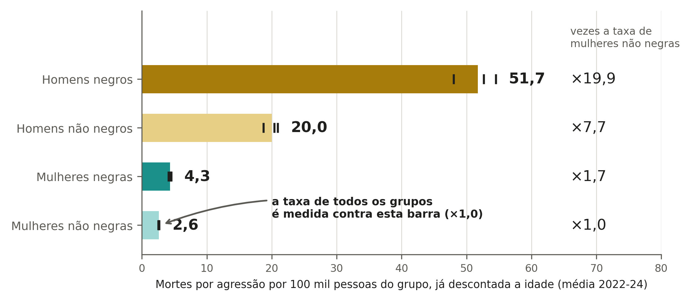

*Nota.* Cada barra é a média de 2022 a 2024, e cada traço vertical, um dos três anos. A coluna da direita expressa a taxa de cada grupo como múltiplo da taxa das mulheres não negras, tomada como referência: a taxa de homens negros é 19,9 vezes a de mulheres não negras. Populações de 2023 e 2024 estimadas a partir do Censo 2022. Fonte: DATASUS (2026a) e IBGE (2026); cálculo do autor (este estudo).

**Tabela E3**

*Taxa de óbito por agressão padronizada por idade, por ano, por 100 mil*

| grupo | 2012 | 2016 | 2020 | 2022 | 2023 | 2024 |
|---|---|---|---|---|---|---|
| Brasil | 27,9 [27,6; 28,1] (bruta 29,3) | 30,3 [30,0; 30,5] (bruta 31,3) | 23,5 [23,3; 23,7] (bruta 23,8) | 21,8 [21,6; 22,0] (bruta 21,8) | 21,3 [21,1; 21,5] (bruta 21,2) | 19,5 [19,3; 19,7] (bruta 19,3) |
| Homens | 51,9 [51,5; 52,4] (bruta 55,0) | 56,8 [56,4; 57,3] (bruta 59,3) | 44,1 [43,6; 44,5] (bruta 45,0) | 40,7 [40,3; 41,1] (bruta 41,1) | 39,6 [39,2; 40,0] (bruta 39,8) | 36,2 [35,9; 36,6] (bruta 36,2) |
| Mulheres | 4,7 [4,6; 4,8] (bruta 4,8) | 4,6 [4,4; 4,7] (bruta 4,6) | 3,7 [3,6; 3,8] (bruta 3,7) | 3,6 [3,5; 3,8] (bruta 3,6) | 3,7 [3,6; 3,8] (bruta 3,7) | 3,4 [3,3; 3,5] (bruta 3,4) |
| Negros | 38,0 [37,6; 38,3] (bruta 41,2) | 41,4 [41,1; 41,8] (bruta 44,4) | 32,3 [32,0; 32,6] (bruta 34,0) | 29,3 [29,0; 29,6] (bruta 30,5) | 28,5 [28,2; 28,8] (bruta 29,5) | 25,9 [25,7; 26,2] (bruta 26,7) |
| Não negros | 16,5 [16,2; 16,8] (bruta 16,7) | 16,6 [16,3; 16,8] (bruta 16,5) | 11,8 [11,6; 12,0] (bruta 11,5) | 11,4 [11,2; 11,6] (bruta 11,0) | 11,1 [10,9; 11,3] (bruta 10,6) | 10,2 [10,0; 10,4] (bruta 9,7) |
| Homens negros | 70,0 [69,3; 70,7] (bruta 76,4) | 77,2 [76,4; 77,9] (bruta 83,2) | 60,2 [59,5; 60,8] (bruta 63,8) | 54,5 [53,9; 55,1] (bruta 57,2) | 52,7 [52,1; 53,2] (bruta 55,0) | 48,0 [47,5; 48,6] (bruta 49,9) |
| Homens não negros | 30,8 [30,3; 31,3] (bruta 31,2) | 31,1 [30,5; 31,6] (bruta 31,0) | 21,8 [21,4; 22,3] (bruta 21,4) | 20,9 [20,5; 21,3] (bruta 20,2) | 20,4 [19,9; 20,8] (bruta 19,6) | 18,7 [18,3; 19,1] (bruta 17,9) |
| Mulheres negras | 5,9 [5,7; 6,1] (bruta 6,2) | 5,8 [5,6; 6,0] (bruta 5,9) | 4,6 [4,4; 4,8] (bruta 4,7) | 4,4 [4,2; 4,5] (bruta 4,5) | 4,5 [4,3; 4,7] (bruta 4,6) | 4,1 [3,9; 4,3] (bruta 4,2) |
| Mulheres não negras | 3,4 [3,2; 3,6] (bruta 3,4) | 3,2 [3,1; 3,4] (bruta 3,2) | 2,6 [2,4; 2,7] (bruta 2,5) | 2,7 [2,5; 2,8] (bruta 2,6) | 2,6 [2,5; 2,8] (bruta 2,5) | 2,5 [2,4; 2,7] (bruta 2,4) |

*Nota.* Valores copiados sem alteração do arquivo dados/sim/asr_brasil.md do repositório, com vírgula decimal. Fonte: este estudo.

**Tabela E4**

*Razões padronizadas e alocação da raça ignorada, 2022-2024*

| razão | valor | observação |
|---|---|---|
| homens / mulheres (padronizado) | 10,8 | taxas 38,8 e 3,6 por 100 mil |
| negros / não negros (padronizado, raça ignorada redistribuída) | 2,56 | taxas 27,9 e 10,9 |
| negros / não negros: cenário (raça ignorada descartada) | 2,56 |  |
| negros / não negros: extremo A (toda raça ignorada → negros) | 2,60 | cota máxima possível a favor de negros mais expostos |
| negros / não negros: extremo B (toda raça ignorada → não negros) | 2,42 | cota mínima |
| Homens negros / Mulheres não negras (padronizado) | 19,9 | taxas 51,7 e 2,6 |
| Homens não negros / Mulheres não negras (padronizado) | 7,7 | taxas 20,0 e 2,6 |
| Mulheres negras / Mulheres não negras (padronizado) | 1,7 | taxas 4,3 e 2,6 |
| Homens negros / Homens não negros (padronizado) | 2,6 | taxas 51,7 e 20,0 |

*Nota.* Valores copiados sem alteração do arquivo dados/sim/asr_brasil.md do repositório, com vírgula decimal. Fonte: este estudo.

## Apêndice F — Lista do GGB: verificabilidade, escala, numeradores e dependência entre listas

### A contagem do Grupo Gay da Bahia: verificabilidade, dependência entre listas e escala

O GGB é associação da sociedade civil de ativismo LGBT+; sua série de mortes vem de notícias de jornal e de internet, alertas de busca e correspondência, sem verificação sistemática em inquérito, instituto médico-legal ou processo, com critério de inclusão declaradamente largo (suicídio, latrocínio e toda profissional do sexo trans morta "na pista" entram na contagem) e com população LGBT+ estimada pela própria organização em "mais de 10%", contra 1,89% de adultos LGB+ na PNS (GGB, 2026; IBGE, 2022a). A organização declara subnotificação; critério largo e subnotificação coexistem, de modo que nenhum dos dois vieses é exclusivo. Mendes e Silva (2020), o artigo que mais usa a série, trabalham com dados cedidos pelo GGB e revistos com técnico do GGB, o que não configura validação independente.

A validação de 2019, único ano com lista nominal e fonte por caso nos relatórios anuais (GGB, 2020), seguiu os 160 casos sorteados por etapas (Figura F1). Em 106 a matéria jornalística foi recuperada, e em 54 não, por link morto, sítio inacessível, bloqueio ou falta de link; 88 tinham a matéria do próprio caso; 74 tinham morte violenta confirmada, e, dos 14 restantes, 12 tinham causa não informada ou circunstância aberta e 2 eram atropelamentos sem indício de intenção, fora do critério que o próprio GGB declara; e 50 das 74 identificavam expressamente a vítima como LGBT+. Os 50 casos (31,3%; intervalo de Wilson de 24,6 a 38,8) são a fração verificável hoje, que não delimita o total nem por baixo nem por cima; 10 deles têm correspondência apenas parcial, por cidade, data e perfil, porque a matéria não traz o nome da vítima, e com correspondência estrita a fração é de 40 em 160 (25,0%) (este estudo). Condicionada a que a fonte seja a matéria do caso (88 de 160), a fração verificável é 56,8% (46,4 a 66,7), e a morte violenta é confirmada em 84,1% (74 de 88). Entre as 74 mortes violentas confirmadas, a própria fonte atribui o crime à LGBTfobia em 3 (4,1%; 1,4 a 11,3) e deixa o motivo desconhecido em 36 (48,6%); ausência de menção ao motivo não equivale a ausência de viés, e roubo, vínculo íntimo e LGBTfobia podem coexistir. A duplicata é de 1 par provável em 329 casos (0,3%), o que não sustenta a hipótese de fabricação. A recontagem dos rótulos é pública; a ligação entre caso e fonte não é reproduzível com o repositório, porque exige a lista nominal, não distribuída por privacidade (este estudo). As contagens de 2023 a 2025 (257, 291 e 257) não têm lista nominal publicada e não são auditáveis (GGB, 2026).

**Figura F1**

*Etapas da verificação dos 160 casos sorteados da lista do Grupo Gay da Bahia de 2019*

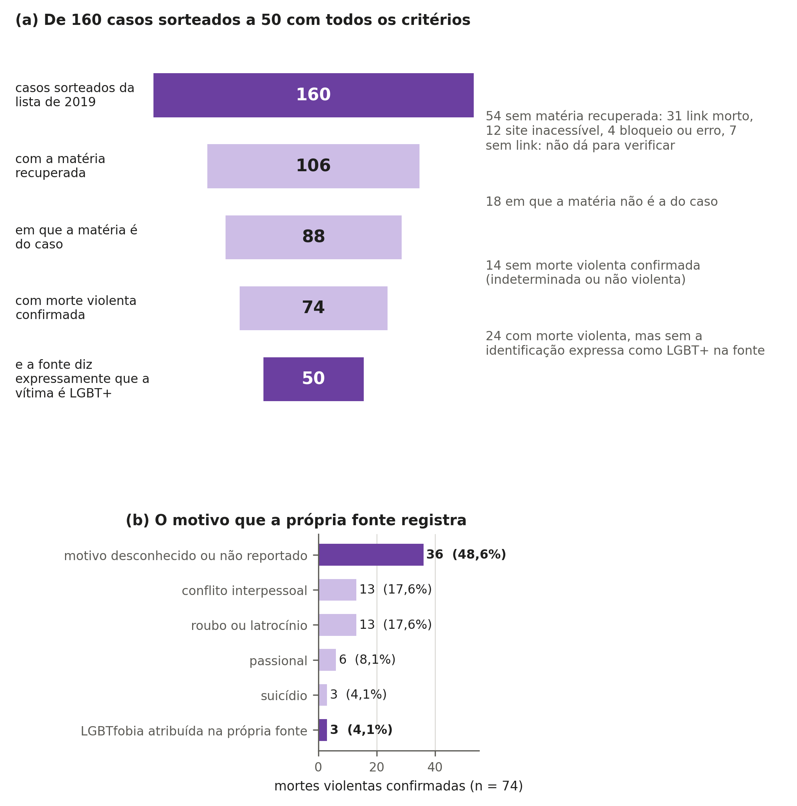

*Nota.* No painel (a), cada barra é o número de casos que passou por uma etapa de conferência, e o texto à direita descreve os que saíram; caso sem matéria recuperada ou fora do critério é caso não verificável, e não caso inventado. Ao fim, 50 casos (31,3%) são verificáveis nos critérios do artigo, 40 deles com correspondência estrita. No painel (b), entre as 74 mortes violentas confirmadas, o motivo registrado pela própria fonte (matéria, polícia ou família), e não pelo codificador; a LGBTfobia aparece em 3. Nenhum caso é identificado. Fonte: GGB (2020); verificação do autor (este estudo).

A captura-recaptura só é estimável para pessoas trans em 2019: o total estimado de Chapman é 186 (175 a 198), e, sob as hipóteses do estimador, os 118 casos trans do GGB correspondem a cerca de 63% (60% a 68% pelo intervalo do total) do noticiário sobre mortes de pessoas trans daquele ano (Feldman et al., 2017). A regra de pareamento entre as listas pesa mais que o intervalo: com pareamento estrito, só por endereço da matéria ou por dois termos do nome, o total sobe para 221 e a parcela do GGB cai para 53%, e entre os seis cenários calculados o total vai de 151 a 221 e a parcela, de 53% a 69% (este estudo). O intervalo estatístico não representa toda a incerteza: as duas listas são de mídia, a dependência positiva entre elas tende a subestimar o total, e listas desse tipo só dão limite inferior do total real quando o pareamento é perfeito e a captura é homogênea, hipótese que em geral não se sustenta (Lum et al., 2013). As séries de mídia não são independentes antes de 2019: o texto dos registros do TDoR cita o GGB em 72% a 94% dos casos de 2013 a 2018 (0,7% em 2019), e a própria ANTRA declara, no dossiê de 2017, que até 2016 a contagem de pessoas trans era a do GGB (Benevides, 2026; este estudo). A concordância entre GGB, ANTRA e TDoR nesse período repete a mesma coleta. Contra o SIM, não se detecta co-variação das variações anuais (r = 0,20; IC95% -0,37 a 0,60; 24 anos; bootstrap com 20.000 réplicas), embora de 2017 a 2024 as séries caiam juntas (GGB -34,6%, SIM -37,3%, ANTRA -31,8%) (DATASUS, 2026a).

Por estado, em 2019, a contagem do GGB por milhão de habitantes cresce com a taxa geral de homicídio: num modelo de Poisson que inclui também o acesso à internet, cada desvio-padrão a mais de homicídio corresponde a 1,33 vez a contagem (IC95% 1,13 a 1,57), e a associação com a internet fica imprecisa, com intervalo que inclui 1 (0,98; 0,83 a 1,16); a correlação negativa entre internet e contagem (ρ = -0,43) deixa de se sustentar quando o homicídio entra no modelo, em que a associação com a internet fica imprecisa (Figura F2; IBGE, 2026; GGB, 2020). É associação entre 27 estados num único ano, e não causa: o padrão é compatível com uma contagem que acompanha a violência em geral, e não sustenta nem a leitura de que a contagem reflete o acesso à internet nem a de que mede uma taxa própria de violência contra pessoas LGBT+.

**Figura F2**

*Contagem do Grupo Gay da Bahia por milhão de habitantes e taxa de homicídio, por estado, 2019*

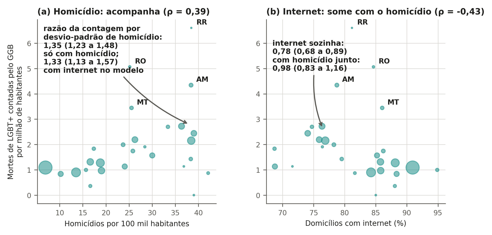

*Nota.* Cada bolha é um estado, com área proporcional à população. No painel (a), estados com taxa de homicídio maior têm contagem maior: 1,33 vez por desvio-padrão de homicídio (IC95% 1,13 a 1,57). No painel (b), a proporção de domicílios com internet associa-se a contagem menor quando entra sozinha no modelo, mas a associação fica imprecisa (0,98; 0,83 a 1,16) quando o homicídio entra junto. Associação entre 27 estados, e não causa; 2019 é o único ano com dado por estado no repositório. Fonte: GGB (2020), DATASUS (2026a) e IBGE (2026); cálculo do autor (este estudo).

O teste de escala responde a uma pergunta delimitada: se adultos LGB+ tivessem o mesmo risco de morrer por agressão que as demais pessoas de mesmo sexo, raça e faixa etária, quantas mortes seriam esperadas, e quanto a contagem do GGB representaria delas (Figura F3). O cálculo segue cinco passos:

1. Adultos LGB+ em 2023 são estimados em 1,89% dos adultos projetados, ou 3.025.764 pessoas (IBGE, 2022a; IBGE, 2026).
2. Em cada célula de sexo, raça e faixa etária, a taxa de morte por agressão dos adultos da célula (DATASUS, 2026a) é multiplicada pelo número de adultos LGB+ estimados nela pela composição da PNS de 2019; a soma dá 1.122 mortes esperadas em 2023 e 1.013 em 2024 sob risco igual ao dos pares.
3. A razão entre as mortes declaradas e as esperadas é 257/1.122 = 22,9% em 2023 e 291/1.013 = 28,7% em 2024 (GGB, 2026).
4. Com numeradores alternativos, o numerador A (homicídios mais latrocínios: 221 em 2023 e 269 em 2024) e o numerador B, cenário que subtrai do A todas as pessoas trans da tabela de identidade (94 e 167), a razão fica entre 8,4% e 19,7% em 2023 e entre 16,5% e 26,6% em 2024.
5. Se o risco fosse 2,82 vezes o dos pares, o esperado de 2023 subiria para 3.165, e, nos dois anos, a razão não passaria de 10,2% (Tabela F1).

O numerador B não é limite inferior, porque o GGB inclui heterossexuais (6 em 2024), não cruza causa com identidade e inclui menores. Pelas marginais publicadas, as pessoas cisgênero LGB dentro do numerador A ficam entre 100 e 118 em 2023 (razão de 8,9% a 10,5%) e entre 164 e 168 em 2024 (16,2% a 16,6%); por exemplo, 269 menos 99 pessoas trans e 6 heterossexuais dá 164, abaixo dos 167 do numerador B (Tabela F2). Na causa agressão, com a prevalência de 1,89% e somados os anos de 2023 e 2024 e os cenários, a razão sob risco igual vai de 8,2% (2023, descontando também a faixa etária até 18 anos; Tabela F2) a 28,7% (total declarado de 2024), e sob risco 2,82 a 3,84 vezes maior não passa de 10,2% (Tabela F1); somando a causa indeterminada ou com a prevalência de 1,96%, as razões ficam menores (Tabela F1). Essas razões não estimam cobertura real, porque o risco de morte de pessoas LGB+ não foi medido, e a razão de prevalências da violência não letal não fixa o risco de morte. A conta pode ser invertida: a contagem igualaria 100% do esperado só se o risco de adultos LGB+ fosse de 0,08 a 0,29 vez o dos pares, conforme o ano e o numerador (RR* = N/E₀, conta de hipótese e não estimativa; Figura F4).

**Figura F3**

*Razão entre a contagem do Grupo Gay da Bahia e as mortes por agressão esperadas, por ano, numerador e risco suposto*

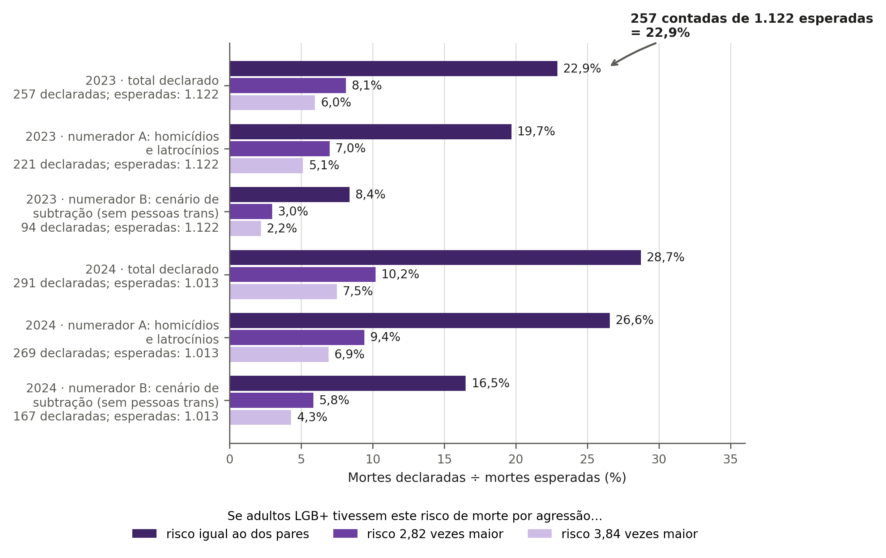

*Nota.* Cada grupo de três barras compara a contagem do GGB com as mortes por agressão esperadas se adultos LGB+ morressem por agressão no mesmo ritmo que pessoas do mesmo sexo, raça e idade (risco igual) ou 2,82 e 3,84 vezes mais. Barra curta indica contagem distante das mortes esperadas. A razão mede escala e não conta mortes de pessoas LGB+; nos cenários exibidos, chega a 28,7% e não estima a cobertura real; o numerador B é um cenário de subtração, e não limite inferior. Fonte: GGB (2026), DATASUS (2026a), IBGE (2022a, 2026); cálculo do autor (este estudo).

**Figura F4**

*Risco relativo que faria a contagem do Grupo Gay da Bahia igualar as mortes esperadas*

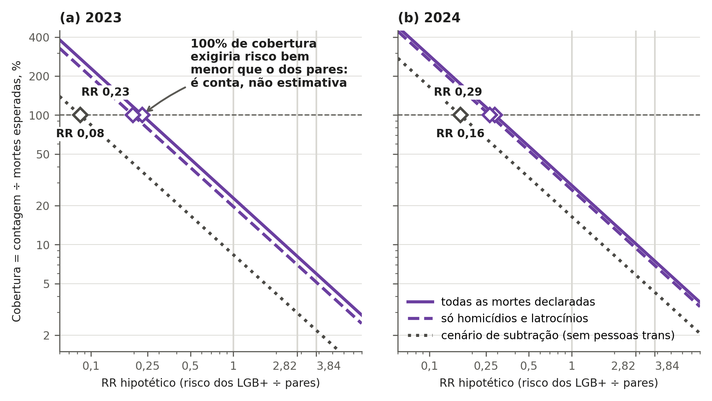

*Nota.* Quanto maior o risco relativo suposto para adultos LGB+, mais mortes seriam esperadas e menor a cobertura da contagem; no eixo vertical, 100% indica contagem igual às mortes esperadas. Cada losango marca o risco relativo em que a cobertura chegaria a 100%: com o total declarado, de 0,23 a 0,29 vez o risco dos pares; no cenário de subtração, 0,08 e 0,16. É conta de hipótese, feita de trás para a frente para mostrar a escala, e não estimativa do risco, que não foi medido; as linhas verticais claras marcam os riscos 1, 2,82 e 3,84. Fonte: GGB (2026), DATASUS (2026a), IBGE (2022a, 2026); cálculo do autor (este estudo).

A razão não pode ser lida como estimativa de mortes de LGB+, porque o numerador inclui menores, fora do denominador adulto, heterossexuais incluídos pelo GGB e pessoas trans, que a PNS de 2019 não identifica: as pessoas trans que declararam orientação LGB estão no denominador, sem identificação (IBGE, 2022b). A razão é inversamente proporcional à prevalência suposta: com 3% ela cai para 14% e 18% sob risco igual, e com 1,35%, a fração LGB+ entre todos os adultos entrevistados por outra pessoa (Tabelas 6 e K2; 1,38% entre quem declarou orientação heterossexual ou LGB+, seção 3.1 do artigo), o maior valor da tabela subiria a cerca de 40% (28,7% × 1,89/1,35). Três bases de população LGB+ adulta aparecem no artigo, todas com a mesma prevalência de 1,89% e por isso coerentes: cerca de 3,01 milhões pelo peso calibrado da PNS de 2019 (Apêndice C), 3.025.764 sobre os adultos projetados para 2023 e 2,92 milhões sobre os 154,3 milhões de adultos do Censo 2022 (IBGE, 2026). Pelo mesmo motivo, a "taxa" de 8,8 e 10,0 por 100 mil, obtida dividindo a contagem do GGB por 2,92 milhões de adultos LGB+, 2,4 a 3 vezes menor que a taxa adulta geral (26,4 e 24,2), não indica que pessoas LGB+ morrem menos: indica que numerador de mídia e denominador populacional são incompatíveis.

**Tabela F1**

*Razão entre a contagem do Grupo Gay da Bahia e as mortes esperadas, por ano, numerador, prevalência e risco suposto*

| desfecho | ano | prevalência | numerador | n | esperado (RR 1) | razão RR 1 | RR 2,82 | RR 3,84 | ano sem SIM (proxy) |
|---|---|---|---|---|---|---|---|---|---|
| agressão | 2023 | 1,89% | total declarado | 257 | 1122,2 | 22,9% | 8,1% | 6,0% | não |
| agressão | 2023 | 1,89% | A: homicídio + latrocínio | 221 | 1122,2 | 19,7% | 7,0% | 5,1% | não |
| agressão | 2023 | 1,89% | B: cenário de subtração (A sem pessoas trans) | 94 | 1122,2 | 8,4% | 3,0% | 2,2% | não |
| agressão | 2023 | 1,96% | total declarado | 257 | 1161,8 | 22,1% | 7,8% | 5,8% | não |
| agressão | 2023 | 1,96% | A: homicídio + latrocínio | 221 | 1161,8 | 19,0% | 6,7% | 5,0% | não |
| agressão | 2023 | 1,96% | B: cenário de subtração (A sem pessoas trans) | 94 | 1161,8 | 8,1% | 2,9% | 2,1% | não |
| agressão | 2024 | 1,89% | total declarado | 291 | 1012,7 | 28,7% | 10,2% | 7,5% | não |
| agressão | 2024 | 1,89% | A: homicídio + latrocínio | 269 | 1012,7 | 26,6% | 9,4% | 6,9% | não |
| agressão | 2024 | 1,89% | B: cenário de subtração (A sem pessoas trans) | 167 | 1012,7 | 16,5% | 5,8% | 4,3% | não |
| agressão | 2024 | 1,96% | total declarado | 291 | 1048,4 | 27,8% | 9,8% | 7,2% | não |
| agressão | 2024 | 1,96% | A: homicídio + latrocínio | 269 | 1048,4 | 25,7% | 9,1% | 6,7% | não |
| agressão | 2024 | 1,96% | B: cenário de subtração (A sem pessoas trans) | 167 | 1048,4 | 15,9% | 5,6% | 4,1% | não |
| agressão | 2025 | 1,89% | total declarado | 257 | 1014,8 | 25,3% | 9,0% | 6,6% | sim |
| agressão | 2025 | 1,89% | A: homicídio + latrocínio | 221 | 1014,8 | 21,8% | 7,7% | 5,7% | sim |
| agressão | 2025 | 1,89% | B: cenário de subtração (A sem pessoas trans) | 154 | 1014,8 | 15,2% | 5,4% | 4,0% | sim |
| agressão | 2025 | 1,96% | total declarado | 257 | 1050,6 | 24,5% | 8,7% | 6,4% | sim |
| agressão | 2025 | 1,96% | A: homicídio + latrocínio | 221 | 1050,6 | 21,0% | 7,5% | 5,5% | sim |
| agressão | 2025 | 1,96% | B: cenário de subtração (A sem pessoas trans) | 154 | 1050,6 | 14,7% | 5,2% | 3,8% | sim |
| agressão + indeterminada | 2023 | 1,89% | total declarado | 257 | 1297,6 | 19,8% | 7,0% | 5,2% | não |
| agressão + indeterminada | 2023 | 1,89% | A: homicídio + latrocínio | 221 | 1297,6 | 17,0% | 6,0% | 4,4% | não |
| agressão + indeterminada | 2023 | 1,89% | B: cenário de subtração (A sem pessoas trans) | 94 | 1297,6 | 7,2% | 2,6% | 1,9% | não |
| agressão + indeterminada | 2023 | 1,96% | total declarado | 257 | 1343,3 | 19,1% | 6,8% | 5,0% | não |
| agressão + indeterminada | 2023 | 1,96% | A: homicídio + latrocínio | 221 | 1343,3 | 16,5% | 5,8% | 4,3% | não |
| agressão + indeterminada | 2023 | 1,96% | B: cenário de subtração (A sem pessoas trans) | 94 | 1343,3 | 7,0% | 2,5% | 1,8% | não |
| agressão + indeterminada | 2024 | 1,89% | total declarado | 291 | 1245,0 | 23,4% | 8,3% | 6,1% | não |
| agressão + indeterminada | 2024 | 1,89% | A: homicídio + latrocínio | 269 | 1245,0 | 21,6% | 7,7% | 5,6% | não |
| agressão + indeterminada | 2024 | 1,89% | B: cenário de subtração (A sem pessoas trans) | 167 | 1245,0 | 13,4% | 4,8% | 3,5% | não |
| agressão + indeterminada | 2024 | 1,96% | total declarado | 291 | 1288,9 | 22,6% | 8,0% | 5,9% | não |
| agressão + indeterminada | 2024 | 1,96% | A: homicídio + latrocínio | 269 | 1288,9 | 20,9% | 7,4% | 5,4% | não |
| agressão + indeterminada | 2024 | 1,96% | B: cenário de subtração (A sem pessoas trans) | 167 | 1288,9 | 13,0% | 4,6% | 3,4% | não |
| agressão + indeterminada | 2025 | 1,89% | total declarado | 257 | 1248,5 | 20,6% | 7,3% | 5,4% | sim |
| agressão + indeterminada | 2025 | 1,89% | A: homicídio + latrocínio | 221 | 1248,5 | 17,7% | 6,3% | 4,6% | sim |
| agressão + indeterminada | 2025 | 1,89% | B: cenário de subtração (A sem pessoas trans) | 154 | 1248,5 | 12,3% | 4,4% | 3,2% | sim |
| agressão + indeterminada | 2025 | 1,96% | total declarado | 257 | 1292,6 | 19,9% | 7,1% | 5,2% | sim |
| agressão + indeterminada | 2025 | 1,96% | A: homicídio + latrocínio | 221 | 1292,6 | 17,1% | 6,1% | 4,5% | sim |
| agressão + indeterminada | 2025 | 1,96% | B: cenário de subtração (A sem pessoas trans) | 154 | 1292,6 | 11,9% | 4,2% | 3,1% | sim |

*Nota.* Valores copiados sem alteração do arquivo dados/ggb/c08_numeradores.csv do repositório, com vírgula decimal. Fonte: este estudo.

**Tabela F2**

*Numerador da contagem do Grupo Gay da Bahia: cenários compatíveis com as marginais publicadas*

| ano | cenário | n | esperado (RR 1) | razão RR 1 |
|---|---|---|---|---|
| 2023 | A: homicídio + latrocínio (inclui pessoas trans e heterossexuais) | 221 | 1122,2 | 19,7% |
| 2023 | B: cenário de subtração (A menos todas as pessoas trans da tabela publicada) | 94 | 1122,2 | 8,4% |
| 2023 | cis LGB dentro de A: mínimo compatível com as marginais | 100 | 1122,2 | 8,9% |
| 2023 | cis LGB dentro de A: máximo compatível com as marginais | 118 | 1122,2 | 10,5% |
| 2023 | mínimo compatível menos toda a faixa etária até 18 anos da divulgação (cenário de idade; idade não informada fica) | 92 | 1122,2 | 8,2% |
| 2024 | A: homicídio + latrocínio (inclui pessoas trans e heterossexuais) | 269 | 1012,7 | 26,6% |
| 2024 | B: cenário de subtração (A menos todas as pessoas trans da tabela publicada) | 167 | 1012,7 | 16,5% |
| 2024 | contraexemplo: 269 - 99 trans (102 - 3 suicidas) - 6 heterossexuais | 164 | 1012,7 | 16,2% |
| 2024 | cis LGB dentro de A: mínimo compatível com as marginais | 164 | 1012,7 | 16,2% |
| 2024 | cis LGB dentro de A: máximo compatível com as marginais | 168 | 1012,7 | 16,6% |
| 2024 | mínimo compatível menos toda a faixa etária até 18 anos da divulgação (cenário de idade; idade não informada fica) | 148 | 1012,7 | 14,6% |

*Nota.* Valores copiados sem alteração do arquivo dados/ggb/c08_cenarios_marginais.csv do repositório, com vírgula decimal. Fonte: este estudo.

### Concordância na conferência dos 160 casos de 2019

A conferência dos 160 casos sorteados foi codificada por um modelo de linguagem (Claude Sonnet 5.5), com um segundo codificador cego de outra família (Gemini 3.8 Flash) em 23 casos, pelo mesmo livro de códigos e com os nomes das vítimas mascarados. A Tabela F3 traz a concordância por variável (arquivo `research-2026-10-21-rodada3/F3-ggb/dados/kappa.json` do repositório).

**Tabela F3**

*Concordância entre os dois codificadores na conferência de 2019 (23 casos com dupla codificação)*

| Variável | Pares válidos | Concordância | κ de Cohen |
|---|---|---|---|
| Correspondência entre notícia e caso | 23 | 91,3% | 0,64 |
| Morte violenta confirmada | 21 | 90,5% | 0,46 |
| Tipo de morte | 21 | 85,7% | 0,73 |
| Condição LGBT+ da vítima | 21 | 95,2% | 0,91 |
| Base da identificação LGBT+ | 21 | 95,2% | 0,92 |
| Motivo | 21 | 90,5% | 0,85 |
| Desfecho | 21 | 95,2% | 0,92 |

*Nota.* A confirmação de morte violenta é o item mais frágil: os 2 desacordos nessa variável são casos de pessoa encontrada morta sem causa informada (um codificador marcou causa indeterminada; o outro, morte violenta); somadas as variáveis, 6 casos tiveram alguma divergência. O intervalo de Wilson dos 50 de 160 mede só a incerteza do sorteio, e não o erro de classificação; ele não aplica a correção para população finita (160 de 329 casos), que o estreitaria para 26,3% a 36,6% se a inferência ficar restrita à lista de 2019. Os 23 casos são os que tinham fonte recuperada entre 32 sorteados de antemão para a dupla codificação. Os 6 casos com desacordo foram relidos por um terceiro codificador cego, de outra família de modelo (GPT-6 Astra), com a matéria inteira e sem ver os códigos dos dois primeiros. O código final é o de dois dos três, conferido pelo autor (arquivo `research-2026-10-21-rodada3/F3-ggb/dados/adjudicacao.json` do repositório). Só um caso muda as contagens: a pessoa encontrada morta em casa, que a polícia investiga como assassinato, passa de causa indeterminada a homicídio, e as mortes violentas confirmadas vão de 73 para 74. Os 50 casos verificáveis não mudam, e a concordância da tabela continua sendo a dos dois primeiros codificadores.

### Checagens críticas da lista e busca por contrapontos

A busca procurou, em português, inglês e espanhol, estudos, bases ou contagens de autores críticos ao movimento LGBT+ que contestassem a lista do GGB, o dossiê da ANTRA, o Disque 100, o Atlas da Violência ou a frase de que o Brasil é o país que mais mata pessoas LGBT+. As bases foram a web aberta, OpenAlex, Crossref, SciELO e a Biblioteca Digital Brasileira de Teses e Dissertações. A matriz de buscas, o registro de cada fonte e a conferência dos identificadores estão em `research-2026-10-30-contraponto/` no repositório.

A única contra-base com dados abertos é a checagem da lista de 2016 publicada pela Liga Humanista Secular do Brasil (Vieira et al., 2019). Os autores procuraram cada nome e local, recuperaram as notícias e classificaram cada caso quanto ao motivo, com o critério "houve motivação homofóbica se há indícios de motivação homofóbica". A planilha pública, retabulada por este estudo, dá a Tabela F4.

**Tabela F4**

*Classificação do motivo na checagem da lista de 2016 (347 casos)*

| Classificação | Casos | % de 347 |
|---|---|---|
| Com indício de preconceito ("Sim") | 31 | 8,9% |
| Sem indício ("Não") | 127 | 36,6% |
| Inconclusivo | 159 | 45,8% |
| Não localizado | 23 | 6,6% |
| Morte no exterior | 6 | 1,7% |
| Duplicado | 1 | 0,3% |

*Nota.* Retabulação da coluna `Motivacao_Homof` da planilha pública dos autores, baixada em 2026-10-30 (SHA-256 `0dc25783bfc422ec635826009fbdfbda4efc41ecd7dca0fa05fc469a9179d5ad`). A cópia não é distribuída porque traz nomes de vítimas e de acusados; o repositório guarda o endereço, o SHA-256 e a tabulação.

Limites da checagem:

- Quase todos os casos têm um só revisor; 3 dos 347 têm dois, 14 não têm revisor registrado, e não há medida de concordância.
- A página dos autores conta como erro a soma de "não" e "inconclusivo" no recorte de 258 homicídios (227, ou 88%, contra 31, ou 12,0%, com indício). Na planilha inteira, de 347 casos com suicídios e casos não localizados, as duas categorias somam 286 (82,4%), contra 31 (8,9%) com indício. Inconclusivo não é ausência de preconceito, de modo que 8,9% e 12,0% são pisos sob o critério dos autores, e não estimativas da fração verdadeira.
- Um dos autores já publicava críticas à lista, e outros dois fundaram uma agência de dossiês. Esses antecedentes são possíveis fontes de viés intelectual e merecem ser declarados; não há vínculo documentado dos autores com a produção da lista, ao contrário do que ocorre com Mendes e Silva (2020), que trabalharam com dados revistos com um técnico do GGB.
- Não foi encontrada resposta do GGB à checagem.

**Revisões anteriores e posteriores.** Um autor individual revisou a lista de 2013 num PDF autopublicado de 2016 (313 mortes, 9 classificadas por ele como crime homofóbico), sem planilha. Os números de 2017 ("6%") e do dossiê do lesbocídio ("2 de 126") que circulam na imprensa não têm versão primária localizada e não foram usados. As demais críticas encontradas saem em colunas de jornal, entre 2019 e 2023, e não trazem base própria. As checagens jornalísticas da frase "país que mais mata" a classificaram como impossível de provar, insustentável ou imprecisa, e nenhuma como falsa. As comparações entre países que a busca achou são todas de mortes noticiadas de pessoas trans, a partir da contagem do Trans Murder Monitoring, da organização Transgender Europe, que, segundo a reprodução de seus limites na imprensa, declara não conseguir estimar o número real ("Big Data, 331 Deaths", 2019); nelas o Brasil lidera em número absoluto, mas não na taxa por população estimada, e nenhuma tem cobertura e definições comuns entre países.

A busca não encontrou artigo revisado por pares de autor crítico ao movimento sobre essas estatísticas, nem crítica desse lado ao Disque 100 ou ao Atlas da Violência. Fora do Brasil, também não encontrou fonte desse lado com dado próprio auditável sobre violência ou mortalidade de pessoas LGBT+; a crítica de método mais forte vem de autores de fora desse campo (por exemplo, Dinno, 2017). Por que falta essa produção no Brasil não foi medido: não há levantamento da posição política de docentes brasileiros, e as explicações possíveis (atuação pelo Parlamento e pela mídia, falta de infraestrutura de pesquisa, ou ausência de produção sobre o tema fora do ativismo) não foram testadas.

## Apêndice G — Governos e homicídio: painel de governadores, exposição federal e séries por governo

### Ideologia do governador e homicídios: painel de estados e estudo de eventos

O painel estima associações entre o escore de ideologia do partido do governador e os homicídios gerais registrados; nenhum dos seus desfechos identifica pessoas LGBT+, e um efeito específico sobre esse grupo poderia não aparecer na taxa agregada (DATASUS, 2026a). Nas 351 combinações de estado e ano, nenhum dos 72 coeficientes estimados (cinco variantes contínuas do escore e uma binária, seis desfechos e duas versões de partido) se distingue de zero (este estudo), e na especificação principal o p do bootstrap wild-cluster fica entre 0,66 e 0,97 (Tabela G3). Numa troca de governador do Partido dos Trabalhadores (PT, escore 2,97) para o Democratas ou o Partido Liberal (cerca de 8), isto é, de 5 pontos na escala de Bolognesi et al. (2023), e mantidos os efeitos de estado e de ano do modelo (ceteris paribus), o intervalo normal vai de -10,8% a +13,1% na taxa total, de -10,1% a +10,5% entre mulheres, de -16,3% a +11,3% entre negros e de -16,2% a +20,4% para mortes por arma de fogo (Tabela G1 e Figura G1). Pela inversão do teste wild-cluster, que respeita os 27 estados, as faixas ficam em -12,3% a +12,4% (total), -12,3% a +10,5% (mulheres), -18,2% a +9,9% (negros) e -19,5% a +19,7% (arma de fogo); com a distribuição t de 26 graus de liberdade, -11,3% a +13,7% no total. Todas contêm zero. O resultado é ausência de evidência de associação grande entre o partido do governador e a taxa registrada, nos dois sentidos; não demonstra ausência de efeito: as faixas reúnem os valores compatíveis com os dados sob o modelo, e associações dentro delas não se distinguem de zero com estes dados. A especificação principal, partido de eleição no TSE e escore por período, foi escolhida depois de ver as variantes, e todas dão o mesmo resultado (TSE, 2026; Bolognesi et al., 2025).

**Tabela G1**

*Painel de governadores: variação da taxa de homicídio registrada associada a uma troca de 5 pontos de ideologia, por três métodos de intervalo (%)*

| Grupo | Normal (estimativa ± 1,96 erro-padrão) | Inversão do bootstrap wild-cluster | t com 26 graus de liberdade | p wild |
|---|---|---|---|---|
| Total | -10,8 a +13,1 | -12,3 a +12,4 | -11,3 a +13,7 | 0,94 |
| Homens | -11,3 a +13,4 | -12,9 a +12,8 | -11,9 a +14,0 | 0,97 |
| Mulheres | -10,1 a +10,5 | -12,3 a +10,5 | -10,5 a +11,0 | 0,95 |
| Negros | -16,3 a +11,3 | -18,2 a +9,9 | -16,9 a +12,1 | 0,66 |
| Não negros | -16,1 a +17,3 | -18,2 a +17,0 | -16,8 a +18,3 | 0,91 |
| Arma de fogo | -16,2 a +20,4 | -19,5 a +19,7 | -16,9 a +21,4 | 0,97 |

*Nota.* 351 combinações de estado e ano, 2012 a 2024; 9.999 reamostragens, semente 20261024. As faixas variam por desfecho, e a das mulheres é mais estreita que a do total. Fonte: DATASUS (2026a), TSE (2026) e Bolognesi et al. (2023); cálculo do autor (este estudo).

**Figura G1**

*Associação entre a ideologia do governador e a taxa de homicídio registrada, por grupo: o que o painel consegue descartar*

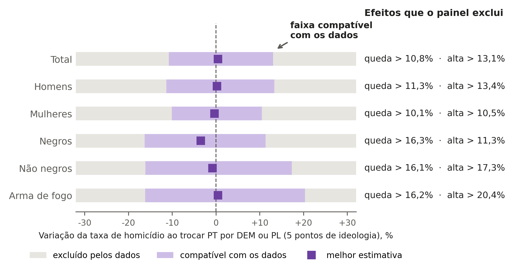

*Nota.* A barra clara é o intervalo de associações compatíveis com os dados, de uma queda a uma alta, e o cinza, o que o painel exclui. Como todos os intervalos incluem zero, o resultado é ausência de associação detectável, e não ausência de associação: associações pequenas, dentro da faixa clara, continuam compatíveis com os dados. A figura desenha o intervalo normal (total: -10,8% a +13,1%); pela inversão do bootstrap wild-cluster, -12,3% a +12,4% (Tabela G1). Fonte: DATASUS (2026a), TSE (2026) e Bolognesi et al. (2023); cálculo do autor (este estudo).

Dois testes delimitam essa leitura. O teste de falsificação soma a causa indeterminada (Y10-Y34) às agressões: nenhum grupo se distingue de zero (total: troca de 5 pontos entre -9,1% e +14,0%), e não se detecta associação da parcela de indeterminadas, 13,4% da soma de agressões e mortes de intenção indeterminada, com a ideologia (+0,15 ponto percentual por ponto de escore; IC95% -0,57 a +0,86; p wild 0,68); a faixa de viés de reclassificação que daí se calcula, de -4,9% a +3,4%, é condicionada à fórmula e à composição adotadas e não limita todo viés de classificação (Tabela G3). Os resíduos de ideologia são negativos em 46,2% das observações, e as inclinações estimadas só com as observações de resíduo positivo e só com as de resíduo negativo não diferem de zero; isso descreve a residualização e não demonstra ausência de efeitos heterogêneos (Goodman-Bacon, 2021; Figura G2).

**Figura G2**

*Taxa de homicídio e ideologia do governador depois de descontadas as diferenças fixas entre estados e entre anos*

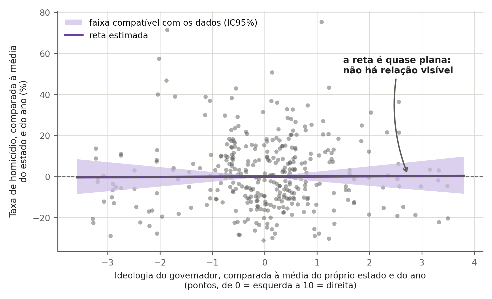

*Nota.* Cada ponto é um estado num ano (351 combinações). O eixo horizontal indica quanto o governador estava mais à direita ou à esquerda que o habitual para aquele estado, e o vertical, quanto a taxa de homicídio estava acima ou abaixo do habitual. A nuvem não tem direção (inclinação de 0,0009 por ponto de ideologia), e a faixa clara, que admite retas inclinadas para os dois lados, indica que o painel não distingue a inclinação de zero. Fonte: DATASUS (2026a), TSE (2026) e Bolognesi et al. (2023); cálculo do autor (este estudo).

O estudo de eventos empilhado, que compara estados que trocaram de governador com estados que não trocaram, é inconclusivo (Figura G3 e Tabela G5). Depois de trocas nos dois sentidos, a taxa registrada cai em relação aos controles: -20% nos deslocamentos do escore para a direita (IC95% -30% a -8%; 9 eventos) e -19% nos deslocamentos para a esquerda (-31% a -4%; 10 eventos). Deslocamento é qualquer troca de partido que mova o escore, inclusive entre partidos do mesmo bloco; a troca entre blocos está na Tabela G7. As antecipações, isto é, a diferença já existente antes da troca, são distinguíveis de zero em duas das quatro especificações (p = 0,009 e p = 0,028), e o mesmo sinal nos dois sentidos não aponta para efeito de ideologia. Com 10 estados distintos de controle em cada direção (15 e 16 estados no conjunto de cada análise), o desenho não separa seleção dos controles, tendência prévia e efeito de qualquer troca de governo. A literatura internacional encontra o mesmo obstáculo de registro em outra escala: nos Estados Unidos, o anúncio da legalização do casamento entre pessoas do mesmo sexo associa-se a uma queda de cerca de 30% nos crimes de ódio anti-LGBT registrados por condado e trimestre, que se dissipa em cerca de um ano e deixa de ser significativa com tendências estaduais (Pettis et al., 2022), e o reconhecimento de uniões aumenta a incidência registrada sem que os autores consigam decidir entre mais violência e mais registro (Levy & Levy, 2017). No Brasil, a diferença entre homicídios estimados e registrados passou de 1,8 para 2,6 por 100 mil depois de 2018, o que indica que parte da queda registrada pode vir da piora do registro, parte essa não quantificada (IPEA & FBSP, 2025).

**Figura G3**

*Painel de governadores com e sem a causa indeterminada (a) e estudo de eventos empilhado por sentido da troca (b)*

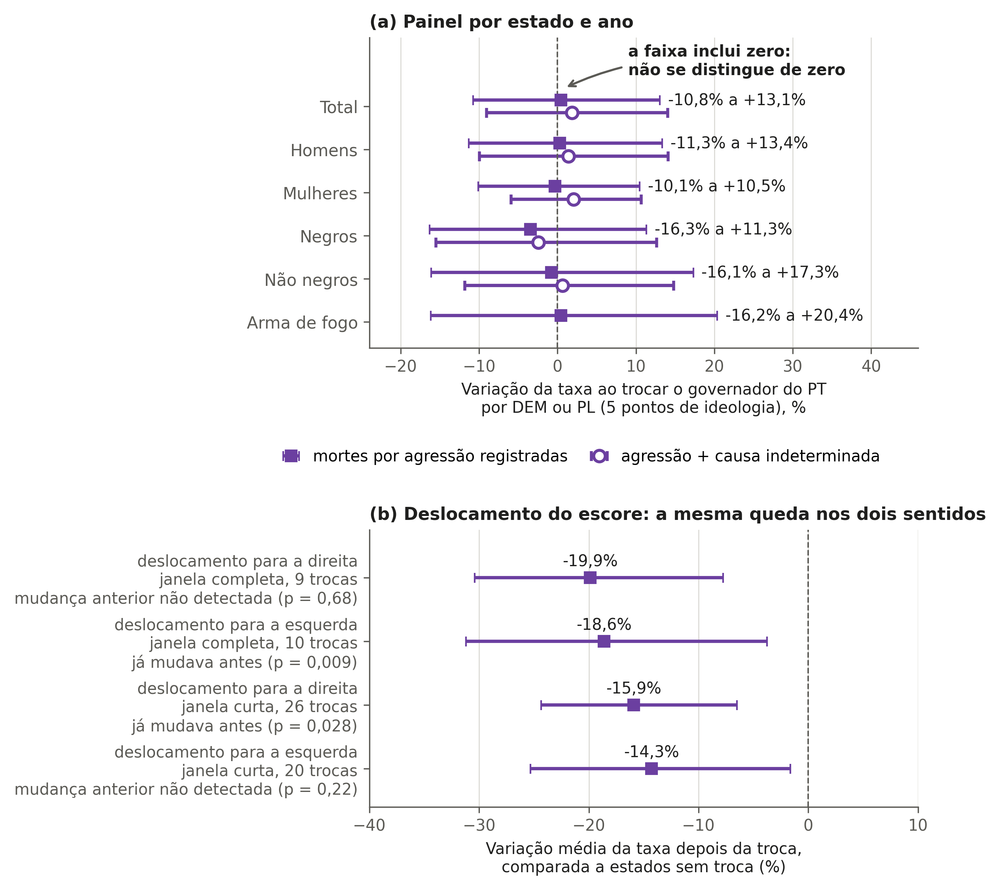

*Nota.* No painel (a), cada ponto é a estimativa, e a barra, o intervalo compatível com os dados, com e sem a causa indeterminada; intervalo que passa por zero indica associação não distinguível de zero (são os intervalos normais da Figura G1). No painel (b), a taxa nos anos antes e depois de cada troca, por sentido da troca: depois da troca, a taxa registrada caiu nos dois sentidos, e em duas das quatro análises a taxa já mudava antes da troca, o que impede ler a queda como efeito do governador. Fonte: DATASUS (2026a) e TSE (2026); cálculo do autor (este estudo).

### Exposição: o que a taxa de homicídio fez quando o governo mudou

Esta seção descreve o que a taxa de homicídio registrada fez quando o governo mudou; atribuir a mudança ao governo não é possível com este desenho e não é feito. As regras foram fixadas em pré-registro antes de qualquer script ler os desfechos (Tabela B3), e os desfechos são homicídios gerais registrados no SIM, que não registra orientação sexual, identidade de gênero nem motivação (DATASUS, 2026a).

No plano federal, a Tabela G2 e a Figura G4 comparam a taxa nacional padronizada por idade no último ano inteiro antes de cada mandato com a do último ano inteiro dentro dele. A taxa de agressão subiu 11,1% no governo Dilma Rousseff (2010 a 2015), caiu 4,2% no governo Michel Temer (2015 a 2018), 21,0% no governo Jair Bolsonaro (2018 a 2022) e 10,6% nos dois primeiros anos do terceiro governo Luiz Inácio Lula da Silva (2022 a 2024, mandato em curso). Os intervalos medem só a incerteza de contagem, e não tendência nem causa. Entre as mortes por agressão e as de intenção indeterminada, a parcela das indeterminadas subiu de 18,0% em 2018 para 25,9% em 2022 e 30,1% em 2024, e por isso a queda medida somando agressão e causa indeterminada é sempre menor (-13,7% no governo Bolsonaro). A tendência dos três anos anteriores à posse entra como contexto descritivo, e não como contrafactual: a taxa vinha subindo 3,4% antes do governo Temer, caindo 4,2% antes do governo Bolsonaro e estável (+0,2%) antes do terceiro governo Lula. O governo Lula de 2007 a 2010 não aparece, porque a série do SIM usada começa em 2010, ano do Censo que ancora os denominadores por sexo, cor e idade, interpolados até o Censo de 2022. Os grupos de sexo e cor e as mortes por arma de fogo estão na Tabela G6; no governo Bolsonaro, por exemplo, a taxa de mulheres negras caiu 22,4% em agressão e 6,1% somando a causa indeterminada.

**Tabela G2**

*Taxa nacional de homicídio registrado (agressão, padronizada por idade, por 100 mil) no início e no fim de cada governo federal*

| Governo | Anos comparados | Taxa | Variação [intervalo de contagem] | Somando causa indeterminada | Três anos antes da posse (contexto) |
|---|---|---|---|---|---|
| Dilma Rousseff | 2010 a 2015 | 25,93 a 28,81 | +11,1% [+9,8; +12,5] | +7,9% | não disponível |
| Michel Temer | 2015 a 2018 | 28,81 a 27,61 | -4,2% [-5,3; -3,0] | -0,4% | +3,4% |
| Jair Bolsonaro | 2018 a 2022 | 27,61 a 21,81 | -21,0% [-22,0; -20,0] | -13,7% | -4,2% |
| Luiz Inácio Lula da Silva (em curso, 2 de 4 anos) | 2022 a 2024 | 21,81 a 19,50 | -10,6% [-11,8; -9,4] | -6,1% | +0,2% |

*Nota.* O ano de 2016 foi dividido entre os governos Dilma Rousseff (até 11 de maio) e Michel Temer; denominadores de 2023 e 2024 extrapolados do Censo 2022. Exposição do que ocorreu em cada governo, sem atribuição de causa. Fonte: DATASUS (2026a) e IBGE (2026); cálculo do autor (este estudo).

**Figura G4**

*Taxa nacional de homicídio registrado padronizada por idade, 2010 a 2024, por governo federal*

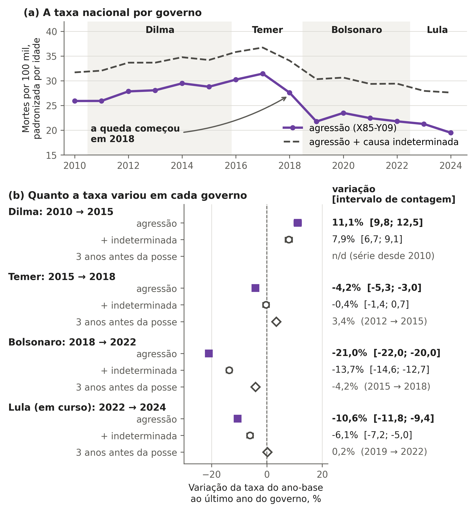

*Nota.* No painel (a), cada faixa alternada, cinza ou branca, é um governo, e a linha, a taxa por 100 mil. No painel (b), o quadrado é a variação da taxa entre o ano anterior à posse e o último ano inteiro do governo; o círculo vazado faz a mesma conta somando as mortes de causa indeterminada; o losango mostra a tendência dos três anos anteriores à posse, como contexto. Queda de 21,0% entre 2018 e 2022 (13,7% somando a causa indeterminada), iniciada em 2018. A figura descreve o que ocorreu durante cada governo e não atribui causa; o óbito não registra orientação sexual. Fonte: DATASUS (2026a) e IBGE (2026); cálculo do autor (este estudo).

Na série nacional de 2010 a 2024, a taxa tem queda de nível estimada de 17,0% em 2019 (IC95% -29,5% a -2,4%), mas o mesmo modelo com as três quebras deslocadas um ano para trás, ajustado à série inteira, dá -21,8% em 2018 (-37,4% a -2,4%): a estimativa depende da data escolhida, e a queda já aparece nos valores observados, de 31,47 em 2017 para 27,61 em 2018; por isso não pode ser atribuída à troca presidencial (Figura G5 e Tabela G8). Em 2016 a variação foi de +2,6% (-9,1% a +15,9%), e em 2023, de -3,9% (-17,1% a +11,3%); com 15 pontos e autocorrelação não tratada no erro clássico, os efeitos mínimos detectáveis ficam entre ±15% e ±25%. Somando a causa indeterminada, a queda de 2019 é de 9,6%. No painel de estados, a interação entre os escores de ideologia do governador e do presidente não foi distinguível de zero (β = -0,00214; p wild = 0,459). Para o contraste especificado no protocolo, governador 5 pontos mais à direita e presidente passando do PT para o Partido Social Liberal (PSL), o intervalo normal de 95% corresponde a -18,3% a +9,6%, e com a distribuição t de 26 graus de liberdade, a -18,9% a +10,4%; o efeito mínimo detectável com 80% de poder, isto é, o menor efeito que a análise veria com 80% de probabilidade, é -18,9% ou +23,3% (Figura G6 e Tabela G9). A distância ideológica entre governador e presidente (de -5,4% a +11,1%) e o governador do mesmo partido do presidente (de -9,8% a +12,5%) são operacionalizações distintas, apresentadas separadamente. O efeito nacional da Presidência é absorvido pelos efeitos fixos de ano no painel, e na série nacional as três trocas ficam confundidas com a queda iniciada em 2018, a pandemia de COVID-19, a política de armas, as facções e a piora do registro de óbitos (IPEA & FBSP, 2025). Não detectar associação na interação especificada não demonstra que a Presidência não importa. Pela regra pré-registrada, 1 das 36 células da série por grupo coincide com a troca: mulheres negras em 2019, -19,7% (-30,2% a -7,6%), padrão que fica impreciso, com intervalo que inclui zero, ao incluir a causa indeterminada (-6,1%; -15,3% a +4,1%); com 36 testes, até cerca de 1,8 células com intervalo que exclui zero seriam esperadas por acaso se nenhum efeito existisse, e a regra, que exige também placebo não detectável, espera menos que isso, e a leitura de reclassificação ou acaso é interpretação posterior, e não mecanismo demonstrado.

**Figura G5**

*Mudança de nível da taxa nacional de homicídio a cada troca de presidente e com as quebras deslocadas um ano para trás, 2010 a 2024*

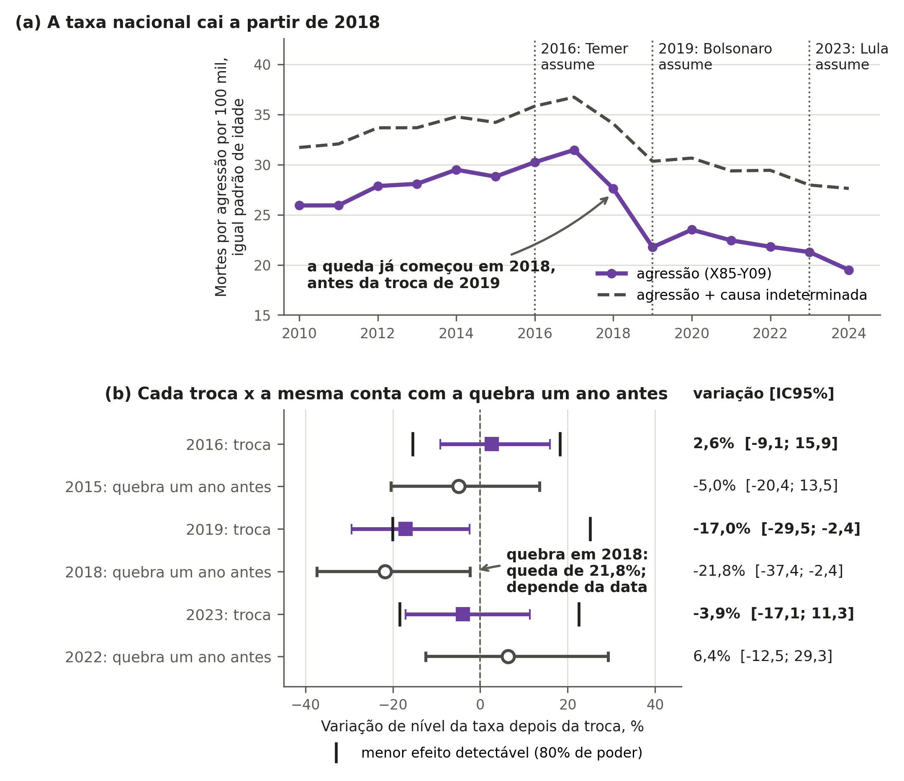

*Nota.* No painel (a), a linha é a taxa por 100 mil, e as linhas pontilhadas marcam as trocas de presidente. No painel (b), o quadrado é a mudança de nível estimada depois de cada troca, e o círculo vazado, a mesma conta com as quebras deslocadas um ano para trás e a série inteira (teste de sensibilidade à data, chamado de placebo no código); queda semelhante mostra que a estimativa depende da data, e não localiza sozinha a queda antes da troca. Os traços verticais marcam o menor efeito detectável. A queda de 2019 é distinguível de zero (-17,0%; IC95% -29,5% a -2,4%; p = 0,030), mas o teste com as quebras deslocadas para 2018 também dá queda (-21,8%; -37,4% a -2,4%), o que mostra dependência da data, e a queda já aparece nos valores observados de 2017 e 2018; por isso não pode ser atribuída à troca; as mudanças de 2016 e 2023 não se distinguem de zero, com poder baixo. Fonte: DATASUS (2026a); cálculo do autor (este estudo).

**Figura G6**

*Interação entre a ideologia do governador e a do presidente: estimativas e efeito mínimo detectável*

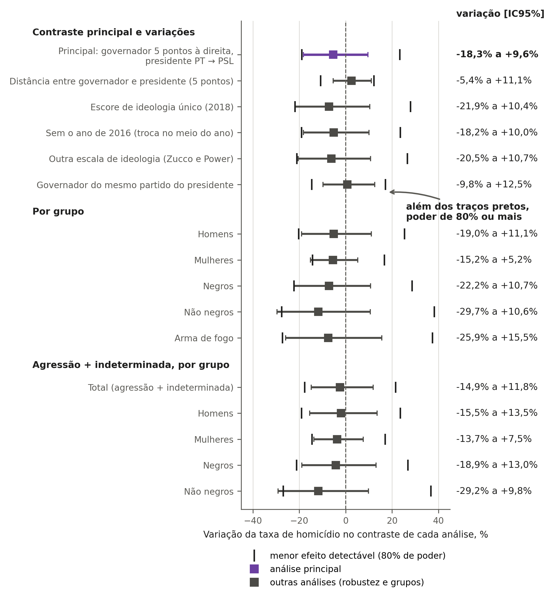

*Nota.* Cada quadrado é a estimativa, e a barra, o intervalo compatível com os dados; todos os intervalos passam por zero (principal: -18,3% a +9,6%). Os traços verticais marcam o efeito mínimo detectável, o menor efeito que a análise detectaria com 80% de probabilidade (-18,9% e +23,3% na análise principal); efeitos menores têm probabilidade de detecção abaixo de 80%, e a barra, e não o traço, indica os valores compatíveis com os dados. O efeito do presidente em si é absorvido pelo efeito de ano, e o resultado não indica que o presidente não importe. Fonte: DATASUS (2026a), TSE (2026) e Bolognesi et al. (2023); cálculo do autor (este estudo).

Nos estados, nas 67 trocas de partido do governador entre 2013 e 2024, a variação da taxa do estado menos a variação nacional, entre os três anos anteriores e os três posteriores, subiu em 31 trocas e caiu em 36 (mediana -0,7%; quartis -9,4% e +12,1%) (Figura G7 e Tabela G7). As janelas ficam dentro de 2012 a 2024, com ao menos um ano de cada lado: 47 das 67 trocas têm três anos antes e três depois, e nas 20 trocas de 2013, 2014, 2023 e 2024 a janela é mais curta. Nos estados sem troca no mesmo ano, a mediana de referência ficou entre +0,8% e +7,8% (95%), com p = 0,016 (0,073 com a correção de Holm para os seis grupos). A referência usa a mesma janela de cada troca; só com as 47 janelas completas, a taxa relativa subiu em 20 trocas e caiu em 27 (mediana -0,8%; referência entre +0,8% e +11,0%, 95%; p = 0,008). Somando a causa indeterminada, a diferença deixa de se distinguir da referência: 34 trocas subiram e 33 caíram, mediana +0,5%, p = 0,54. Da esquerda para a direita, a taxa relativa subiu em 8 de 12 trocas (mediana +9,5%, p = 0,36), e da direita para a esquerda, em 5 de 8 (mediana +3,5%, p = 0,74); nos dois sentidos, o resultado não se distingue do que ocorre nos estados que não trocaram de governo no mesmo ano. A referência é formada por poucos estados (de 3 a 15 por ano; em 2018 e 2019, 9 estados, 7 deles do Nordeste) e não é neutra, de modo que uma diferença pode ser de região, e o p, que mede só o sorteio dentro desse grupo fixo, é anticonservador; esse limite foi observado depois do cálculo e registrado em adendo datado do pré-registro (Apêndice B). Trocas sobrepostas do mesmo estado não são independentes (DATASUS, 2026a; TSE, 2026).

**Figura G7**

*Variação da taxa de homicídio do estado relativa à do Brasil nas 67 trocas de partido do governador, 2013 a 2024*

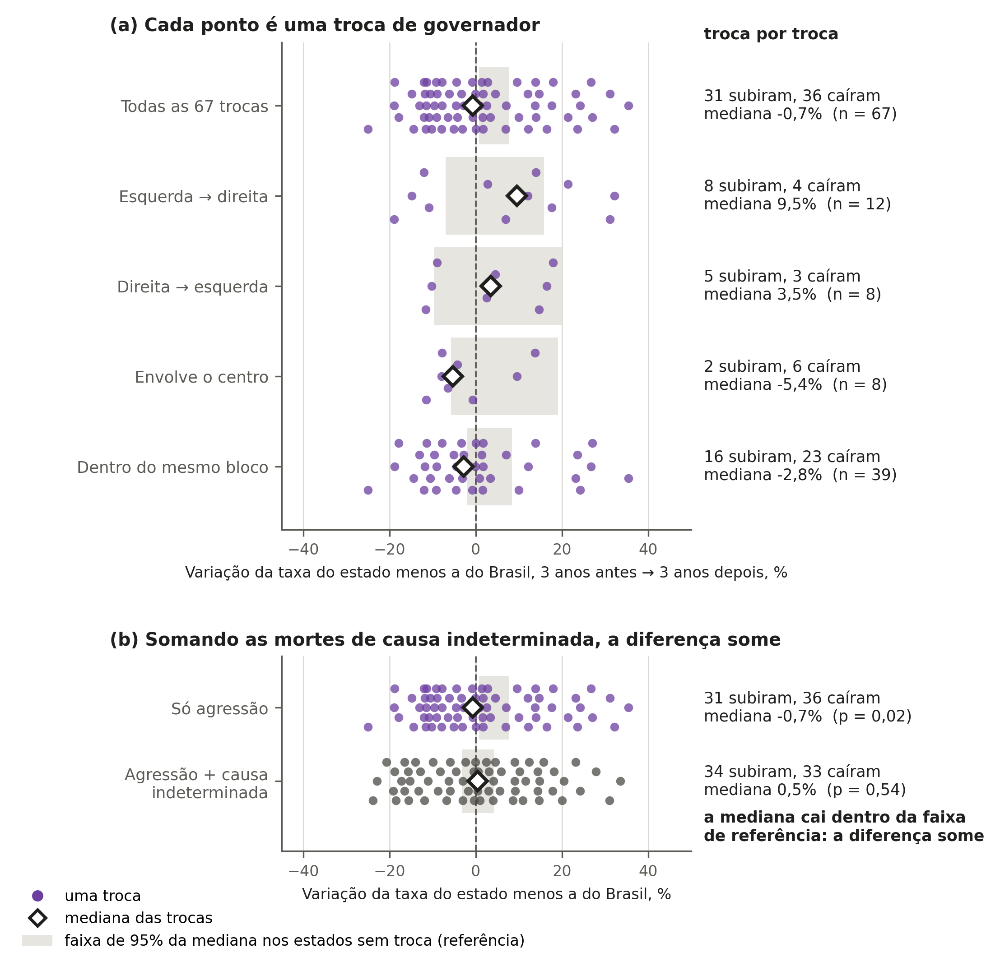

*Nota.* Cada ponto é uma troca de governador e indica se a taxa do estado, relativa à do Brasil, ficou mais alta (à direita) ou mais baixa (à esquerda) depois dela; o losango é a mediana das trocas, e a faixa cinza, o intervalo em que a mediana cairia por acaso nos estados sem troca no mesmo ano. A taxa relativa subiu em 31 trocas e caiu em 36 (mediana -0,7%); no painel (b), somando a causa indeterminada, a mediana passa a +0,5% (34 subiram, 33 caíram) e entra na faixa de referência. A referência é formada por poucos estados (3 a 15 por ano), não neutros. Exposição, e não prova de causa. Fonte: DATASUS (2026a) e TSE (2026); cálculo do autor (este estudo).

**Tabela G3**

*Painel de governadores (efeitos fixos duplos) e teste de falsificação com a causa indeterminada*

| grupo | desfecho | b por ponto | IC95% | troca de 5 pontos (%) | p wild |
|---|---|---|---|---|---|
| total | log taxa registrada (X85-Y09) | 0,0009 | [-0,0228; 0,0246] | -10,8 a 13,1 | 0,94 |
| homens | log taxa registrada (X85-Y09) | 0,0005 | [-0,0240; 0,0251] | -11,3 a 13,4 | 0,97 |
| mulheres | log taxa registrada (X85-Y09) | -0,0007 | [-0,0213; 0,0199] | -10,1 a 10,5 | 0,95 |
| negros | log taxa registrada (X85-Y09) | -0,0070 | [-0,0356; 0,0215] | -16,3 a 11,3 | 0,66 |
| não negros | log taxa registrada (X85-Y09) | -0,0016 | [-0,0352; 0,0320] | -16,1 a 17,3 | 0,91 |
| arma de fogo | log taxa registrada (X85-Y09) | 0,0009 | [-0,0353; 0,0371] | -16,2 a 20,4 | 0,97 |
| total | log taxa agressão + indeterminada | 0,0036 | [-0,0190; 0,0263] | -9,1 a 14,0 | 0,77 |
| total | parcela indeterminada (p.p. por ponto) | 0,1451 | [-0,5742; 0,8645] | n/a | 0,68 |
| homens | log taxa agressão + indeterminada | 0,0027 | [-0,0209; 0,0264] | -9,9 a 14,1 | 0,83 |
| homens | parcela indeterminada (p.p. por ponto) | 0,1323 | [-0,5356; 0,8001] | n/a | 0,69 |
| mulheres | log taxa agressão + indeterminada | 0,0040 | [-0,0122; 0,0203] | -5,9 a 10,7 | 0,64 |
| mulheres | parcela indeterminada (p.p. por ponto) | 0,1418 | [-0,9092; 1,1928] | n/a | 0,78 |
| negros | log taxa agressão + indeterminada | -0,0050 | [-0,0337; 0,0238] | -15,5 a 12,6 | 0,78 |
| negros | parcela indeterminada (p.p. por ponto) | 0,1189 | [-0,6291; 0,8669] | n/a | 0,76 |
| não negros | log taxa agressão + indeterminada | 0,0012 | [-0,0252; 0,0277] | -11,9 a 14,8 | 0,92 |
| não negros | parcela indeterminada (p.p. por ponto) | 0,0758 | [-0,8716; 1,0231] | n/a | 0,87 |

*Nota.* Valores copiados sem alteração do arquivo dados/painel/c02_indet_resultados.csv do repositório, com vírgula decimal. Fonte: este estudo.

**Tabela G4**

*Painel de governadores: troca de 5 pontos por três métodos de intervalo*

| grupo | b (EP) | normal (%) | wild invertido (%) | t26 (%) | p(0) da grade | p wild (bootstrap) |
|---|---|---|---|---|---|---|
| total | 0,00090 (0,01208) | -10,8 a +13,1 | -12,3 a +12,4 | -11,3 a +13,7 | 0,945 | 0,943 |
| homens | 0,00052 (0,01253) | -11,3 a +13,4 | -12,9 a +12,8 | -11,9 a +14,0 | 0,968 | 0,970 |
| mulheres | -0,00067 (0,01052) | -10,1 a +10,5 | -12,3 a +10,5 | -10,5 a +11,0 | 0,946 | 0,951 |
| negros | -0,00705 (0,01456) | -16,3 a +11,3 | -18,2 a +9,9 | -16,9 a +12,1 | 0,659 | 0,661 |
| não negros | -0,00160 (0,01712) | -16,1 a +17,3 | -18,2 a +17,0 | -16,8 a +18,3 | 0,920 | 0,911 |
| arma de fogo | 0,00087 (0,01846) | -16,2 a +20,4 | -19,5 a +19,7 | -16,9 a +21,4 | 0,963 | 0,970 |

*Nota.* Valores copiados sem alteração do arquivo dados/painel/r6_ic_wild_invertido.csv do repositório, com vírgula decimal. Fonte: este estudo.

**Tabela G5**

*Estudo de eventos empilhado, painel principal, quatro desfechos*

| desenho | direção | desfecho | eventos | grupos (estados) | média pós (%) [IC95%] | p antecipações | p pós |
|---|---|---|---|---|---|---|---|
| estrito | deslocamento para a direita | total | 9 | 15 | -19,9 [-30,4; -7,8] | 0,685 | 0,055 |
| estrito | deslocamento para a direita | mulheres | 9 | 15 | -19,5 [-29,0; -8,7] | 0,209 | 0,026 |
| estrito | deslocamento para a direita | negros | 9 | 15 | -24,7 [-35,1; -12,6] | 0,719 | 0,011 |
| estrito | deslocamento para a direita | arma de fogo | 9 | 15 | -28,6 [-42,6; -11,1] | 0,715 | 0,061 |
| estrito | deslocamento para a esquerda | total | 10 | 16 | -18,6 [-31,2; -3,7] | 0,009 | 0,142 |
| estrito | deslocamento para a esquerda | mulheres | 10 | 16 | -20,4 [-34,2; -3,6] | 0,062 | 0,002 |
| estrito | deslocamento para a esquerda | negros | 10 | 16 | -18,7 [-33,1; -1,2] | 0,003 | 0,272 |
| estrito | deslocamento para a esquerda | arma de fogo | 10 | 16 | -25,5 [-39,4; -8,5] | 0,002 | 0,064 |
| truncado | deslocamento para a direita | total | 26 | 27 | -15,9 [-24,4; -6,5] | 0,028 | 0,031 |
| truncado | deslocamento para a direita | mulheres | 26 | 27 | -9,9 [-17,2; -2,0] | 0,573 | 0,073 |
| truncado | deslocamento para a direita | negros | 26 | 27 | -18,7 [-27,5; -8,8] | 0,057 | 0,017 |
| truncado | deslocamento para a direita | arma de fogo | 26 | 27 | -23,9 [-35,7; -9,9] | 0,041 | 0,034 |
| truncado | deslocamento para a esquerda | total | 20 | 27 | -14,3 [-25,3; -1,6] | 0,219 | 0,264 |
| truncado | deslocamento para a esquerda | mulheres | 20 | 27 | -16,2 [-27,4; -3,3] | 0,449 | 0,051 |
| truncado | deslocamento para a esquerda | negros | 20 | 27 | -14,3 [-28,3; 2,4] | 0,571 | 0,455 |
| truncado | deslocamento para a esquerda | arma de fogo | 20 | 27 | -19,7 [-33,0; -3,8] | 0,273 | 0,140 |

*Nota.* Valores copiados sem alteração do arquivo dados/painel/c03_event_pesos_resultados.csv do repositório, com vírgula decimal. Fonte: este estudo.

**Tabela G6**

*Exposição federal: taxa nacional padronizada por governo, por grupo e desfecho*

| governo | grupo | desfecho | anos | taxa | variação % [intervalo de contagem] | 3 anos antes (%) |
|---|---|---|---|---|---|---|
| Dilma Rousseff | Brasil | agressão | 2010 a 2015 | 25,93 a 28,81 | +11,1 [+9,8; +12,5] | n/d |
| Dilma Rousseff | Brasil | agressão + indeterminada | 2010 a 2015 | 31,72 a 34,22 | +7,9 [+6,7; +9,1] | n/d |
| Dilma Rousseff | Mulheres negras | agressão | 2010 a 2015 | 5,43 a 5,67 | +4,5 [-0,9; +10,1] | n/d |
| Dilma Rousseff | Mulheres negras | agressão + indeterminada | 2010 a 2015 | 7,88 a 8,32 | +5,6 [+0,9; +10,6] | n/d |
| Dilma Rousseff | Mulheres não negras | agressão | 2010 a 2015 | 3,44 a 3,34 | -2,9 [-9,3; +3,9] | n/d |
| Dilma Rousseff | Mulheres não negras | agressão + indeterminada | 2010 a 2015 | 6,53 a 5,82 | -10,8 [-15,2; -6,2] | n/d |
| Dilma Rousseff | Homens negros | agressão | 2010 a 2015 | 65,52 a 72,97 | +11,4 [+9,7; +13,0] | n/d |
| Dilma Rousseff | Homens negros | agressão + indeterminada | 2010 a 2015 | 75,49 a 82,96 | +9,9 [+8,4; +11,4] | n/d |
| Dilma Rousseff | Homens não negros | agressão | 2010 a 2015 | 29,12 a 30,26 | +3,9 [+1,4; +6,5] | n/d |
| Dilma Rousseff | Homens não negros | agressão + indeterminada | 2010 a 2015 | 36,85 a 36,76 | -0,3 [-2,4; +2,0] | n/d |
| Dilma Rousseff | Arma de fogo | agressão | 2010 a 2015 | 17,81 a 20,44 | +14,7 [+13,1; +16,4] | n/d |
| Michel Temer | Brasil | agressão | 2015 a 2018 | 28,81 a 27,61 | -4,2 [-5,3; -3,0] | +3,4 |
| Michel Temer | Brasil | agressão + indeterminada | 2015 a 2018 | 34,22 a 34,09 | -0,4 [-1,4; +0,7] | +1,6 |
| Michel Temer | Mulheres negras | agressão | 2015 a 2018 | 5,67 a 5,62 | -0,9 [-5,8; +4,2] | -3,8 |
| Michel Temer | Mulheres negras | agressão + indeterminada | 2015 a 2018 | 8,32 a 8,48 | +1,9 [-2,4; +6,3] | -3,6 |
| Michel Temer | Mulheres não negras | agressão | 2015 a 2018 | 3,34 a 2,95 | -11,8 [-17,9; -5,2] | -1,5 |
| Michel Temer | Mulheres não negras | agressão + indeterminada | 2015 a 2018 | 5,82 a 6,03 | +3,5 [-1,6; +8,9] | -7,7 |
| Michel Temer | Homens negros | agressão | 2015 a 2018 | 72,97 a 70,92 | -2,8 [-4,2; -1,4] | +4,2 |
| Michel Temer | Homens negros | agressão + indeterminada | 2015 a 2018 | 82,96 a 82,36 | -0,7 [-2,0; +0,6] | +3,3 |
| Michel Temer | Homens não negros | agressão | 2015 a 2018 | 30,26 a 26,10 | -13,8 [-15,9; -11,6] | -1,7 |
| Michel Temer | Homens não negros | agressão + indeterminada | 2015 a 2018 | 36,76 a 34,60 | -5,9 [-7,9; -3,7] | -3,6 |
| Michel Temer | Arma de fogo | agressão | 2015 a 2018 | 20,44 a 20,20 | -1,2 [-2,5; +0,2] | +5,1 |
| Jair Bolsonaro | Brasil | agressão | 2018 a 2022 | 27,61 a 21,81 | -21,0 [-22,0; -20,0] | -4,2 |
| Jair Bolsonaro | Brasil | agressão + indeterminada | 2018 a 2022 | 34,09 a 29,44 | -13,7 [-14,6; -12,7] | -0,4 |
| Jair Bolsonaro | Mulheres negras | agressão | 2018 a 2022 | 5,62 a 4,36 | -22,4 [-26,3; -18,2] | -0,9 |
| Jair Bolsonaro | Mulheres negras | agressão + indeterminada | 2018 a 2022 | 8,48 a 7,96 | -6,1 [-9,9; -2,1] | +1,9 |
| Jair Bolsonaro | Mulheres não negras | agressão | 2018 a 2022 | 2,95 a 2,68 | -8,9 [-15,7; -1,7] | -11,8 |
| Jair Bolsonaro | Mulheres não negras | agressão + indeterminada | 2018 a 2022 | 6,03 a 6,32 | +4,8 [-0,2; +10,1] | +3,5 |
| Jair Bolsonaro | Homens negros | agressão | 2018 a 2022 | 70,92 a 54,49 | -23,2 [-24,3; -22,0] | -2,8 |
| Jair Bolsonaro | Homens negros | agressão + indeterminada | 2018 a 2022 | 82,36 a 67,86 | -17,6 [-18,7; -16,5] | -0,7 |
| Jair Bolsonaro | Homens não negros | agressão | 2018 a 2022 | 26,10 a 20,91 | -19,9 [-22,1; -17,6] | -13,8 |
| Jair Bolsonaro | Homens não negros | agressão + indeterminada | 2018 a 2022 | 34,60 a 30,70 | -11,3 [-13,4; -9,2] | -5,9 |
| Jair Bolsonaro | Arma de fogo | agressão | 2018 a 2022 | 20,20 a 15,59 | -22,8 [-23,9; -21,6] | -1,2 |
| Luiz Inácio Lula da Silva | Brasil | agressão | 2022 a 2024 | 21,81 a 19,50 | -10,6 [-11,8; -9,4] | +0,2 |
| Luiz Inácio Lula da Silva | Brasil | agressão + indeterminada | 2022 a 2024 | 29,44 a 27,63 | -6,1 [-7,2; -5,0] | -3,0 |
| Luiz Inácio Lula da Silva | Mulheres negras | agressão | 2022 a 2024 | 4,36 a 4,11 | -5,7 [-10,8; -0,4] | -2,7 |
| Luiz Inácio Lula da Silva | Mulheres negras | agressão + indeterminada | 2022 a 2024 | 7,96 a 7,79 | -2,2 [-6,2; +1,9] | -1,3 |
| Luiz Inácio Lula da Silva | Mulheres não negras | agressão | 2022 a 2024 | 2,68 a 2,51 | -6,6 [-13,9; +1,3] | +3,5 |
| Luiz Inácio Lula da Silva | Mulheres não negras | agressão + indeterminada | 2022 a 2024 | 6,32 a 6,44 | +1,9 [-2,9; +6,9] | +4,4 |
| Luiz Inácio Lula da Silva | Homens negros | agressão | 2022 a 2024 | 54,49 a 48,03 | -11,9 [-13,3; -10,4] | -1,5 |
| Luiz Inácio Lula da Silva | Homens negros | agressão + indeterminada | 2022 a 2024 | 67,86 a 62,32 | -8,2 [-9,5; -6,8] | -5,6 |
| Luiz Inácio Lula da Silva | Homens não negros | agressão | 2022 a 2024 | 20,91 a 18,69 | -10,6 [-13,3; -7,8] | +0,8 |
| Luiz Inácio Lula da Silva | Homens não negros | agressão + indeterminada | 2022 a 2024 | 30,70 a 29,15 | -5,0 [-7,4; -2,7] | -1,7 |
| Luiz Inácio Lula da Silva | Arma de fogo | agressão | 2022 a 2024 | 15,59 a 13,46 | -13,7 [-15,0; -12,3] | +3,0 |

*Nota.* Valores copiados sem alteração do arquivo paper/figures/fontes/c10_e1_federal.csv do repositório, com vírgula decimal. Fonte: este estudo.

**Tabela G7**

*Exposição estadual: 67 trocas de governador, taxa do estado relativa ao Brasil, por direção e grupo*

| direção | grupo | trocas | subiu | caiu | mediana % [p25; p75] | referência 95% da mediana | p mediana | p Holm |
|---|---|---|---|---|---|---|---|---|
| todas | total | 67 | 31 | 36 | -0,7 [-9,4; +12,1] | +0,8 a +7,8 | 0,016 | 0,073 |
| todas | homens | 67 | 32 | 35 | -0,5 [-9,9; +12,4] | +0,4 a +6,9 | 0,034 | 0,073 |
| todas | mulheres | 67 | 35 | 32 | +0,4 [-8,3; +10,7] | -0,0 a +10,7 | 0,151 | 0,151 |
| todas | negros | 67 | 33 | 34 | -0,1 [-10,1; +12,3] | +1,4 a +8,8 | 0,018 | 0,073 |
| todas | não negros | 67 | 30 | 37 | -1,4 [-10,7; +9,6] | -0,9 a +9,2 | 0,013 | 0,073 |
| todas | arma de fogo | 67 | 28 | 39 | -1,9 [-12,9; +13,9] | -0,9 a +9,8 | 0,012 | 0,073 |
| todas | total, agressão + indeterminada | 67 | 34 | 33 | +0,5 [-10,6; +10,6] | -3,2 a +4,2 | 0,538 | n/a |
| sentido: para a direita | total | 38 | 17 | 21 | -0,4 [-10,3; +11,5] | -0,7 a +9,3 | 0,063 | 0,250 |
| sentido: para a direita | homens | 38 | 18 | 20 | -0,3 [-10,0; +10,7] | -1,4 a +9,3 | 0,100 | 0,299 |
| sentido: para a direita | mulheres | 38 | 20 | 18 | +0,3 [-8,4; +13,1] | -0,4 a +11,3 | 0,271 | 0,299 |
| sentido: para a direita | negros | 38 | 18 | 20 | -1,7 [-9,9; +9,8] | -1,3 a +9,2 | 0,048 | 0,241 |
| sentido: para a direita | não negros | 38 | 15 | 23 | -1,8 [-10,3; +5,6] | -3,0 a +9,7 | 0,101 | 0,299 |
| sentido: para a direita | arma de fogo | 38 | 14 | 24 | -2,9 [-13,1; +8,9] | -2,4 a +11,9 | 0,039 | 0,232 |
| sentido: para a direita | total, agressão + indeterminada | 38 | 17 | 21 | -0,4 [-11,8; +12,2] | -4,1 a +4,8 | 0,948 | n/a |
| sentido: para a esquerda | total | 29 | 14 | 15 | -0,8 [-9,0; +13,9] | -2,1 a +11,9 | 0,117 | 0,587 |
| sentido: para a esquerda | homens | 29 | 14 | 15 | -2,3 [-8,8; +14,2] | -3,2 a +12,5 | 0,089 | 0,532 |
| sentido: para a esquerda | mulheres | 29 | 15 | 14 | +2,6 [-7,8; +10,1] | -2,7 a +11,7 | 0,795 | 0,795 |
| sentido: para a esquerda | negros | 29 | 15 | 14 | +0,7 [-10,1; +17,7] | -2,4 a +12,0 | 0,119 | 0,587 |
| sentido: para a esquerda | não negros | 29 | 15 | 14 | +0,4 [-10,6; +11,4] | -0,9 a +11,3 | 0,284 | 0,596 |
| sentido: para a esquerda | arma de fogo | 29 | 14 | 15 | -0,0 [-11,8; +14,5] | -4,1 a +16,1 | 0,199 | 0,596 |
| sentido: para a esquerda | total, agressão + indeterminada | 29 | 17 | 12 | +0,9 [-10,0; +9,0] | -7,3 a +5,8 | 0,682 | n/a |
| bloco: esquerda para direita | total | 12 | 8 | 4 | +9,5 [-11,2; +18,5] | -7,0 a +15,9 | 0,363 | 1,000 |
| bloco: esquerda para direita | homens | 12 | 8 | 4 | +8,8 [-11,9; +17,3] | -6,3 a +16,6 | 0,422 | 1,000 |
| bloco: esquerda para direita | mulheres | 12 | 9 | 3 | +15,0 [-1,9; +17,6] | -3,7 a +16,4 | 0,107 | 0,642 |
| bloco: esquerda para direita | negros | 12 | 8 | 4 | +6,1 [-13,8; +14,5] | -4,2 a +15,2 | 0,632 | 1,000 |
| bloco: esquerda para direita | não negros | 12 | 6 | 6 | +2,3 [-13,8; +17,2] | -8,5 a +22,9 | 0,998 | 1,000 |
| bloco: esquerda para direita | arma de fogo | 12 | 8 | 4 | +11,8 [-16,7; +22,6] | -5,5 a +23,2 | 0,461 | 1,000 |
| bloco: esquerda para direita | total, agressão + indeterminada | 12 | 5 | 7 | -0,3 [-8,2; +14,7] | -7,1 a +10,2 | 0,904 | n/a |
| bloco: direita para esquerda | total | 8 | 5 | 3 | +3,5 [-9,3; +15,1] | -9,6 a +19,9 | 0,742 | 1,000 |
| bloco: direita para esquerda | homens | 8 | 5 | 3 | +3,0 [-9,3; +17,4] | -9,5 a +20,6 | 0,773 | 1,000 |
| bloco: direita para esquerda | mulheres | 8 | 6 | 2 | +10,0 [+0,2; +10,9] | -7,7 a +16,3 | 0,545 | 1,000 |
| bloco: direita para esquerda | negros | 8 | 4 | 4 | +0,6 [-10,6; +10,0] | -8,0 a +18,6 | 0,515 | 1,000 |
| bloco: direita para esquerda | não negros | 8 | 5 | 3 | +9,5 [-6,2; +22,6] | -8,1 a +32,8 | 0,498 | 1,000 |
| bloco: direita para esquerda | arma de fogo | 8 | 4 | 4 | +2,8 [-9,5; +16,4] | -11,6 a +26,7 | 0,783 | 1,000 |
| bloco: direita para esquerda | total, agressão + indeterminada | 8 | 5 | 3 | +2,5 [-6,2; +6,6] | -11,7 a +14,4 | 0,751 | n/a |
| bloco: envolve centro | total | 8 | 2 | 6 | -5,4 [-7,9; +1,9] | -5,8 a +19,1 | 0,058 | 0,208 |
| bloco: envolve centro | homens | 8 | 2 | 6 | -4,7 [-7,0; +2,1] | -6,6 a +19,7 | 0,105 | 0,208 |
| bloco: envolve centro | mulheres | 8 | 2 | 6 | -4,9 [-7,9; -1,8] | -1,8 a +17,5 | < 0,001 | 0,001 |
| bloco: envolve centro | negros | 8 | 3 | 5 | -5,1 [-8,5; +3,4] | -5,2 a +18,9 | 0,052 | 0,208 |
| bloco: envolve centro | não negros | 8 | 2 | 6 | -11,0 [-15,6; -4,7] | -7,1 a +37,8 | 0,023 | 0,115 |
| bloco: envolve centro | arma de fogo | 8 | 3 | 5 | -4,9 [-9,6; +3,3] | -7,6 a +26,7 | 0,086 | 0,208 |
| bloco: envolve centro | total, agressão + indeterminada | 8 | 4 | 4 | +0,9 [-10,5; +11,7] | -8,3 a +11,2 | 0,895 | n/a |
| bloco: mesmo bloco | total | 39 | 16 | 23 | -2,8 [-9,4; +5,2] | -2,1 a +8,4 | 0,028 | 0,142 |
| bloco: mesmo bloco | homens | 39 | 17 | 22 | -2,8 [-9,9; +6,8] | -1,9 a +8,0 | 0,047 | 0,189 |
| bloco: mesmo bloco | mulheres | 39 | 18 | 21 | -0,7 [-11,4; +6,2] | -3,6 a +9,9 | 0,155 | 0,189 |
| bloco: mesmo bloco | negros | 39 | 18 | 21 | -2,9 [-9,7; +14,3] | -2,4 a +9,2 | 0,021 | 0,128 |
| bloco: mesmo bloco | não negros | 39 | 17 | 22 | -1,4 [-7,1; +8,8] | -1,8 a +9,2 | 0,090 | 0,189 |
| bloco: mesmo bloco | arma de fogo | 39 | 13 | 26 | -3,2 [-13,1; +4,6] | -3,5 a +11,8 | 0,054 | 0,189 |
| bloco: mesmo bloco | total, agressão + indeterminada | 39 | 20 | 19 | +0,5 [-10,8; +10,0] | -7,4 a +4,8 | 0,490 | n/a |

*Nota.* Valores copiados sem alteração do arquivo paper/figures/fontes/c10_e2_resumo.csv do repositório, com vírgula decimal. Fonte: este estudo.

**Tabela G8**

*Troca de presidente: série nacional, mudança de nível em cada troca e teste com as quebras um ano antes (série inteira)*

| série | desfecho | troca | variação de nível [IC95%] | quebra um ano antes (ano) [IC95%] | leitura pré-registrada |
|---|---|---|---|---|---|
| Brasil | agressão | 2016 | +2,6% [-9,1; +15,9] | -5,0% (2015) [-20,4; +13,5] | não distinguível de zero |
| Brasil | agressão | 2019 | -17,0% [-29,5; -2,4] | -21,8% (2018) [-37,4; -2,4] | não atribuível à troca (a quebra um ano antes dá o mesmo sinal) |
| Brasil | agressão | 2023 | -3,9% [-17,1; +11,3] | +6,4% (2022) [-12,5; +29,3] | não distinguível de zero |
| Brasil | agressão + indeterminada | 2016 | +2,7% [-4,0; +9,8] | -3,5% (2015) [-10,5; +4,1] | não distinguível de zero |
| Brasil | agressão + indeterminada | 2019 | -9,6% [-17,3; -1,2] | -13,2% (2018) [-21,1; -4,5] | não atribuível à troca (a quebra um ano antes dá o mesmo sinal) |
| Brasil | agressão + indeterminada | 2023 | -3,4% [-11,0; +4,7] | +5,0% (2022) [-3,4; +14,1] | não distinguível de zero |
| Homens negros | agressão | 2016 | +3,9% [-9,1; +18,8] | -4,3% (2015) [-20,6; +15,3] | não distinguível de zero |
| Homens negros | agressão | 2019 | -17,9% [-31,4; -1,8] | -23,0% (2018) [-39,0; -2,8] | não atribuível à troca (a quebra um ano antes dá o mesmo sinal) |
| Homens negros | agressão | 2023 | -4,9% [-19,2; +11,9] | +4,6% (2022) [-14,8; +28,4] | não distinguível de zero |
| Homens negros | agressão + indeterminada | 2016 | +3,7% [-4,6; +12,8] | -2,9% (2015) [-11,2; +6,1] | não distinguível de zero |
| Homens negros | agressão + indeterminada | 2019 | -11,0% [-20,4; -0,4] | -15,9% (2018) [-24,7; -5,9] | não atribuível à troca (a quebra um ano antes dá o mesmo sinal) |
| Homens negros | agressão + indeterminada | 2023 | -3,6% [-13,0; +6,7] | +4,8% (2022) [-4,9; +15,6] | não distinguível de zero |
| Homens não negros | agressão | 2016 | +0,5% [-8,8; +10,8] | -5,0% (2015) [-19,1; +11,6] | não distinguível de zero |
| Homens não negros | agressão | 2019 | -13,4% [-24,0; -1,4] | -19,5% (2018) [-34,3; -1,5] | não atribuível à troca (a quebra um ano antes dá o mesmo sinal) |
| Homens não negros | agressão | 2023 | -2,2% [-13,1; +10,1] | +12,1% (2022) [-6,1; +33,9] | não distinguível de zero |
| Homens não negros | agressão + indeterminada | 2016 | +1,0% [-4,8; +7,1] | -4,2% (2015) [-10,4; +2,5] | não distinguível de zero |
| Homens não negros | agressão + indeterminada | 2019 | -6,4% [-13,4; +1,2] | -9,4% (2018) [-16,8; -1,5] | não distinguível de zero |
| Homens não negros | agressão + indeterminada | 2023 | -2,2% [-8,9; +5,0] | +7,2% (2022) [-0,5; +15,4] | não distinguível de zero |
| Mulheres negras | agressão | 2016 | -0,2% [-10,1; +10,8] | -6,9% (2015) [-22,1; +11,4] | não distinguível de zero |
| Mulheres negras | agressão | 2019 | -19,7% [-30,2; -7,6] | -16,6% (2018) [-33,4; +4,3] | coincide com a troca (descritivo; não causal) |
| Mulheres negras | agressão | 2023 | +2,5% [-9,8; +16,3] | +7,4% (2022) [-11,8; +30,8] | não distinguível de zero |
| Mulheres negras | agressão + indeterminada | 2016 | -0,6% [-8,0; +7,4] | -4,4% (2015) [-11,9; +3,7] | não distinguível de zero |
| Mulheres negras | agressão + indeterminada | 2019 | -6,1% [-15,3; +4,1] | -4,7% (2018) [-14,0; +5,6] | não distinguível de zero |
| Mulheres negras | agressão + indeterminada | 2023 | -3,0% [-11,7; +6,5] | +2,6% (2022) [-6,2; +12,3] | não distinguível de zero |
| Mulheres não negras | agressão | 2016 | -4,3% [-14,0; +6,4] | -7,5% (2015) [-16,8; +2,8] | não distinguível de zero |
| Mulheres não negras | agressão | 2019 | -11,5% [-23,2; +2,0] | -13,7% (2018) [-24,4; -1,4] | não distinguível de zero |
| Mulheres não negras | agressão | 2023 | -1,9% [-13,8; +11,5] | +12,1% (2022) [-0,1; +25,9] | não distinguível de zero |
| Mulheres não negras | agressão + indeterminada | 2016 | -0,6% [-5,5; +4,5] | -2,1% (2015) [-8,9; +5,1] | não distinguível de zero |
| Mulheres não negras | agressão + indeterminada | 2019 | -3,1% [-9,4; +3,6] | +4,9% (2018) [-4,1; +14,7] | não distinguível de zero |
| Mulheres não negras | agressão + indeterminada | 2023 | -5,2% [-10,8; +0,7] | +1,8% (2022) [-5,9; +10,1] | não distinguível de zero |
| Brasil | arma de fogo | 2016 | +4,1% [-10,0; +20,2] | -5,1% (2015) [-24,2; +18,8] | não distinguível de zero |
| Brasil | arma de fogo | 2019 | -21,7% [-35,4; -5,0] | -25,6% (2018) [-43,9; -1,4] | não atribuível à troca (a quebra um ano antes dá o mesmo sinal) |
| Brasil | arma de fogo | 2023 | -6,4% [-21,4; +11,6] | +6,9% (2022) [-16,4; +36,9] | não distinguível de zero |
| Brasil | parcela de indeterminadas (p.p.) | 2016 | -0,1 p.p. [-5,5; +5,3] | +1,2 p.p. (2015) [-7,5; +9,9] | não distinguível de zero |
| Brasil | parcela de indeterminadas (p.p.) | 2019 | +6,5 p.p. [-0,6; +13,7] | +8,3 p.p. (2018) [-2,6; +19,2] | não distinguível de zero |
| Brasil | parcela de indeterminadas (p.p.) | 2023 | +0,4 p.p. [-6,1; +6,9] | -1,0 p.p. (2022) [-10,6; +8,6] | não distinguível de zero |

*Nota.* Valores copiados sem alteração do arquivo paper/figures/fontes/c09_d1_resultados.csv do repositório, com vírgula decimal. Fonte: este estudo.

**Tabela G9**

*Troca de presidente: interação entre a ideologia do governador e a do presidente no painel*

| análise | grupo | desfecho | b [IC95%] | efeito no contraste [IC95%] | p wild | efeito mínimo detectável |
|---|---|---|---|---|---|---|
| principal | total | log da taxa registrada | -0,00214 [-0,00786; 0,00357] | -18,3% a +9,6% | 0,459 | -18,9% / +23,3% |
| S1: distância ideológica | total | log da taxa registrada | 0,00497 [-0,01108; 0,02101] | -5,4% a +11,1% | 0,526 | -10,8% / +12,1% |
| S2: por grupo | homens | log da taxa registrada | -0,00206 [-0,00822; 0,00410] | -19,0% a +11,1% | 0,493 | -20,2% / +25,4% |
| S2: por grupo | mulheres | log da taxa registrada | -0,00223 [-0,00642; 0,00197] | -15,2% a +5,2% | 0,289 | -14,3% / +16,6% |
| S2: por grupo | negros | log da taxa registrada | -0,00292 [-0,00979; 0,00395] | -22,2% a +10,7% | 0,404 | -22,3% / +28,7% |
| S2: por grupo | não negros | log da taxa registrada | -0,00489 [-0,01370; 0,00392] | -29,7% a +10,6% | 0,265 | -27,6% / +38,2% |
| S2: por grupo | arma de fogo | log da taxa registrada | -0,00303 [-0,01168; 0,00562] | -25,9% a +15,5% | 0,480 | -27,2% / +37,4% |
| S3: agressão + indeterminada | total | log da taxa de agressão + indeterminada | -0,00096 [-0,00626; 0,00434] | -14,9% a +11,8% | 0,714 | -17,7% / +21,5% |
| S3: agressão + indeterminada | homens | log da taxa de agressão + indeterminada | -0,00081 [-0,00656; 0,00495] | -15,5% a +13,5% | 0,780 | -19,0% / +23,5% |
| S3: agressão + indeterminada | mulheres | log da taxa de agressão + indeterminada | -0,00146 [-0,00575; 0,00282] | -13,7% a +7,5% | 0,481 | -14,5% / +17,0% |
| S3: agressão + indeterminada | negros | log da taxa de agressão + indeterminada | -0,00170 [-0,00817; 0,00477] | -18,9% a +13,0% | 0,597 | -21,1% / +26,8% |
| S3: agressão + indeterminada | não negros | log da taxa de agressão + indeterminada | -0,00490 [-0,01342; 0,00363] | -29,2% a +9,8% | 0,249 | -26,9% / +36,7% |
| S3: parcela de indeterminadas | total | parcela de indeterminadas (p.p.) | 0,08777 [-0,04236; 0,21790] | -1,1 p.p. a +5,6 p.p. | 0,182 | -4,8 p.p. / +4,8 p.p. |
| S3: parcela de indeterminadas | homens | parcela de indeterminadas (p.p.) | 0,09641 [-0,01829; 0,21110] | -0,5 p.p. a +5,4 p.p. | 0,097 | -4,2 p.p. / +4,2 p.p. |
| S3: parcela de indeterminadas | mulheres | parcela de indeterminadas (p.p.) | 0,04378 [-0,22332; 0,31087] | -5,7 p.p. a +8,0 p.p. | 0,752 | -9,8 p.p. / +9,8 p.p. |
| S3: parcela de indeterminadas | negros | parcela de indeterminadas (p.p.) | 0,09246 [-0,03162; 0,21654] | -0,8 p.p. a +5,6 p.p. | 0,141 | -4,6 p.p. / +4,6 p.p. |
| S3: parcela de indeterminadas | não negros | parcela de indeterminadas (p.p.) | 0,00206 [-0,17565; 0,17977] | -4,5 p.p. a +4,6 p.p. | 0,986 | -6,5 p.p. / +6,5 p.p. |
| S4: escore único de ideologia | total | log da taxa registrada | -0,00288 [-0,00960; 0,00384] | -21,9% a +10,4% | 0,396 | -21,9% / +28,0% |
| S5: sem o ano de 2016 | total | log da taxa registrada | -0,00205 [-0,00781; 0,00372] | -18,2% a +10,0% | 0,469 | -19,1% / +23,6% |
| S6: outra escala de ideologia (Zucco e Power) | total | log da taxa registrada | -0,04432 [-0,15908; 0,07045] | -20,5% a +10,7% | 0,450 | -21,0% / +26,6% |
| S7: mesmo partido do presidente | total | log da taxa registrada | 0,00738 [-0,10338; 0,11814] | -9,8% a +12,5% | 0,895 | -14,6% / +17,1% |

*Nota.* Valores copiados sem alteração do arquivo paper/figures/fontes/c09_d2_resultados.csv do repositório, com vírgula decimal. Fonte: este estudo.

### Séries por período de governo (Figura 8 do artigo)

A Figura 8 do artigo é gerada pelo script `dados/exposicao/fig_series_por_governo.py`. Os valores anuais desenhados vêm de `dados/sim/asr_brasil.csv`, `research-2026-10-21-rodada3/GGB-completo/series/painel_mortes_lgbt.csv`, `dados/disque100/saidas/d100_serie_anual.csv`, `dados/sinan/serie_campo55_uf_ano.csv` e `dados/anuario/anuario_lgbtfobia_uf_ano_v2.csv`. O total do GGB de 2022 é derivado do relatório de 2023.

## Apêndice H — Busca simétrica de atos do governo federal, 2003 a 2026

### Atos de governo contra pessoas LGBT+ no Brasil, 2003 a 2026

A busca simétrica aplicou o mesmo número de consultas, os mesmos descritores e a mesma regra de leitura aos seis mandatos presidenciais de 2003 a 2026: dez consultas por mandato, cinco descritores em português e em inglês, 60 no total, com 51 de 55 páginas úteis lidas (Tabela H1). Os critérios pré-registrados definem cinco tipos de ato: retórica hostil do próprio governante, quando a fala ridiculariza, desqualifica moralmente ou ataca homossexuais ou pessoas LGBT+ como pessoas ou grupo; omissão ou corte de política, como suspensão de programa, corte de verba ou silêncio documentado diante de fato que envolve pessoas LGBT+; ato administrativo hostil, isto é, decreto, portaria, veto, ordem ou censura que restringe direitos de pessoas LGBT+ ou as tem como alvo expresso; perseguição ou extermínio por agentes do Estado, como operação policial ou militar, prisão em massa, internação ou ordem de eliminação, com autoria estatal em fonte; e proteção ou ampliação de direitos (este estudo).

Perseguição ou extermínio de pessoas LGBT+ por agentes do Estado não foi localizado, no espaço de busca, em nenhum dos seis mandatos; as consultas usam o nome de cada presidente, e agentes estaduais ou locais, como as polícias, não foram inventariados. Omissão ou corte de política foi localizado em cinco dos seis mandatos, com 8 episódios, e proteção ou ampliação de direitos, em quatro, com 10 episódios. Retórica hostil do governante e ato administrativo hostil com alvo expresso tiveram um episódio cada, ambos em 2019: a fala de 25 de abril de 2019, relatada por jornalistas presentes e publicada pela imprensa, sem transcrição oficial localizada, e a ordem de suspender verba para filmes e roteiros com temática LGBT+, de agosto de 2019, noticiada depois de fala em transmissão ao vivo, classificada nas 60 consultas pela notícia, e não pelo instrumento normativo, lido depois (Ministério da Cidadania, 2019; Tabela H1). A regra de leitura pré-registrada, que exige episódio de hostilidade ou omissão em governos dos dois lados da escala de ideologia para concluir que a lista existe dos dois lados, é satisfeita pelos episódios de omissão ou corte.

**Tabela H1**

*Episódios localizados na busca simétrica de atos de governo, por mandato presidencial e tipo de ato, 2003 a 2026*

| Mandato | Consultas | Páginas úteis lidas / selecionadas | Páginas publicadas durante o mandato | Retórica hostil do governante | Omissão ou corte de política | Ato administrativo hostil | Perseguição ou extermínio | Proteção ou ampliação |
|---|---|---|---|---|---|---|---|---|
| Lula, 1º mandato (2003 a 2006) | 10 | 6/8 | 0/6 | 0 | 0 | 0 | 0 | 1 |
| Lula, 2º mandato (2007 a 2010) | 10 | 7/8 | 1/7 | 0 | 1 | 0 | 0 | 5 |
| Dilma Rousseff (2011 a 2016) | 10 | 10/10 | 6/10 | 0 | 2 | 0 | 0 | 3 |
| Michel Temer (2016 a 2018) | 10 | 8/9 | 6/8 | 0 | 2 | 0 | 0 | 0 |
| Jair Bolsonaro (2019 a 2022) | 10 | 10/10 | 7/10 | 1 | 2 | 1 | 0 | 0 |
| Lula, 3º mandato (2023 a 2026) | 10 | 10/10 | 3/10 | 0 | 1 | 0 | 0 | 1 |
| Total | 60 | 51/55 | 23/51 | 1 | 8 | 1 | 0 | 10 |

*Nota.* Retórica hostil de ministro ou aliado foi contada à parte, com zero episódios em todos os mandatos; as consultas foram desenhadas para o governante, e não para ministros, e esse zero é limite do espaço de busca, e não ausência de episódios. Dois episódios de classificação duvidosa como omissão (um no governo Temer e um no governo Bolsonaro) não entram na soma. A classificação dos episódios de retórica e de ato hostil vem da imprensa; o instrumento do ato de 2019 foi lido depois no Diário Oficial, e seu texto não menciona conteúdo LGBT (Ministério da Cidadania, 2019). A cobertura do buscador é desigual no tempo: só 1 das 13 páginas úteis sobre os dois primeiros mandatos de Lula foi publicada durante o mandato, e a ausência de hostilidade nesses anos é limite do espaço de busca, e não prova de equivalência. Fonte: busca pré-registrada (Tabela B3), com endereço, trecho e SHA-256 de cada episódio no repositório (este estudo).

### Leitura dos atos por período de governo

Os dados de 2003 a 2026 também não sustentam que governos federais tenham perseguido pessoas LGBT+. A busca usou as mesmas 60 consultas para os seis períodos de governo, e a leitura cobriu 51 páginas úteis (Tabela H1). Cada achado foi classificado como perseguição, ato oficial hostil, fala hostil do presidente, omissão ou corte de política, ou proteção. Não apareceu nenhum caso de perseguição policial, prisão em massa ou extermínio ordenado pelo governo federal. Como as consultas usaram o nome de cada presidente, ações das polícias estaduais e municipais ficaram de fora. Omissões ou cortes de política somaram 8 casos em 5 mandatos, metade em governos do PT e metade fora deles.

Também não se sustenta que a proteção do Executivo federal tenha sido igual entre os partidos. No espaço dessas 60 consultas, os 10 episódios classificados como proteção ou ampliação de direitos caíram todos nos 4 períodos de governo do PT (Tabela H1). A classificação teve um único codificador e é indicativa. A busca, porém, partiu do nome do presidente na imprensa, cuja cobertura digital difere entre as épocas, e por isso não mede o tamanho da diferença. No sentido oposto, a busca achou uma fala hostil do presidente e um ato oficial hostil, ambos em 2019. O ato é a Portaria nº 1.576, do Ministério da Cidadania, de 20 de agosto de 2019, lida no Diário Oficial depois da busca (Ministério da Cidadania, 2019). O texto suspende por 180 dias o edital inteiro de TVs públicas para recompor o comitê gestor e não menciona conteúdo LGBT. O caráter hostil vem das falas do presidente e da cobertura da imprensa, que noticiou também a ação do Ministério Público Federal e a decisão liminar que a acolheu (Tabela H1).

## Apêndice I — Regimes: tabela completa

### Violência de Estado contra homossexuais em regimes de tipos distintos

A mesma régua de gravidade se aplica a regimes de qualquer orientação política: o pré-registro de governos classifica como nível 3 a prisão, a internação ou o trabalho forçado documentados por órgão internacional, tribunal ou relatório oficial (este estudo). O nível mede o tipo de documento que registra o ato, e não a certeza do fato nem a originalidade da investigação. A forma da Hipótese 6 segundo a qual a perseguição seria própria de um só tipo de regime circula no Parlamento: das 33 falas da família F3 que afirmam perseguição, 10 a atribuem a regimes ou grupos estrangeiros (Apêndice J; este estudo). Documentos oficiais e pesquisa acadêmica registram perseguição estatal de homossexuais sob rótulos políticos opostos, inclusive em democracias, e os casos reunidos na Tabela I1 são ilustrativos, e não uma amostra do mundo. Na Alemanha nazista, houve cerca de 100 mil prisões e de 5 mil a 15 mil homens enviados a campos de concentração (United States Holocaust Memorial Museum, 2021); no território da antiga Alemanha Ocidental, já democrática, uma estimativa de cerca de 64 mil condenações entre 1949 e 1994 foi adotada em projeto de lei do governo federal (Deutscher Bundestag, 2017). Na ditadura militar brasileira (1964 a 1985), a Comissão Nacional da Verdade registra demissões, censura e operações policiais, como as rondas de 1980 no centro de São Paulo contra travestis, prostitutas e homossexuais; escreve que a ideologia do regime "continha claramente uma perspectiva homofóbica, que relacionava a homossexualidade às esquerdas e à subversão" e ressalva que "não houve uma política de Estado formalizada" de extermínio (Comissão Nacional da Verdade, 2014, pp. 301, 307). Na Espanha de Franco, a lei de periculosidade social de 1970 previa internamento para reeducação; os atos de homossexualidade foram retirados dessa lei em janeiro de 1979, e a perseguição foi reconhecida na lei de memória democrática de 2022 (España, 1970, 1979, 2022; Fernández Turuelo, 2024). Na União Soviética, que criminalizou as relações entre homens em 1934 (Kondakov, 2022), a estatística judicial compilada por Valodzin (2020) soma mais de 38 mil condenações de 1946 a 1991, sem os tribunais do Gulag; por estimativa aproximada do autor, cerca de metade dos casos envolvia coerção ou menores, e os anos de 1934 a 1945 não estão cobertos.

Em Cuba, as Unidades Militares de Ajuda à Produção teriam internado cerca de 35 mil pessoas entre 1965 e 1968, segundo estimativa de dois ex-agentes de inteligência citada por Tahbaz (2013), que adverte que os relatos de ex-internos não permitem conhecer a proporção de homossexuais no conjunto; nas fontes lidas, não há estimativa confiável do número de homossexuais internados. O informe da Comissão Interamericana de Direitos Humanos nomeia os homossexuais entre os condenados a essas unidades, o que corresponde ao nível 3, com as ressalvas de que o informe se apoia em fontes secundárias, dá para o fim das unidades uma data divergente da literatura e foi lido por cópia de arquivo da web (CIDH, 1983). No Irã, a pena de morte é prevista em lei, com execuções relatadas de forma esparsa (ILGA World, 2020); em 2015, as Nações Unidas documentaram, em Mosul, execuções de homens acusados de homossexualidade pelo Estado Islâmico, organização armada com controle territorial de fato (United Nations Assistance Mission for Iraq [UNAMI] & Office of the United Nations High Commissioner for Human Rights [OHCHR], 2015); e, na Chechênia, a Organization for Security and Co-operation in Europe (OSCE) concluiu haver "overwhelming evidence" de graves violações em 2017, com detenção e tortura reconhecidas também em caso julgado pelo Tribunal Europeu dos Direitos Humanos, e com mortes relatadas que a Human Rights Watch não pôde verificar de forma independente (OSCE, 2018; Human Rights Watch, 2017; Tribunal Europeu dos Direitos Humanos, 2023). Regimes de um mesmo campo divergiram: a Polônia comunista não criminalizava atos consensuais desde 1932, embora a Operação Hyacinth tenha reunido cerca de 11 mil fichas policiais entre 1985 e 1987 (Szulc, 2016, 2018).

**Tabela I1**

*Casos históricos selecionados de perseguição estatal por práticas homossexuais ou orientação sexual real ou presumida*

| Regime e período | Ato documentado | Contagem citada e o que ela conta | Fonte |
|---|---|---|---|
| Alemanha nazista, 1933 a 1945 | prisão e condenação pelo parágrafo 175 do Código Penal; campos de concentração | cerca de 100 mil prisões; cerca de 53,4 mil condenações; de 5 mil a 15 mil em campos | United States Holocaust Memorial Museum (2021) |
| Alemanha Ocidental (democracia), 1949 a 1994 | manutenção do parágrafo 175 | estimativa de cerca de 64 mil condenações (cerca de 50 mil até 1969), adotada em projeto de lei | Deutscher Bundestag (2017) |
| Espanha franquista e transição, 1954 a 1979 | "estado perigoso" e internamento para reeducação; atos de homossexualidade retirados da lei em janeiro de 1979 | sem estimativa nacional confiável; em Valladolid, 12 expedientes e 4 condenações em 1971 e 1972 | España (1970, 1979); Fernández Turuelo (2024) |
| Brasil, ditadura militar, 1964 a 1985 | demissões, censura, rondas policiais | sem estimativa confiável; 15 diplomatas cassados em 1969, 7 deles por "prática de homossexualismo" | Comissão Nacional da Verdade (2014) |
| União Soviética, 1946 a 1991 (lei desde 1934) | artigo 154-a, depois 121, do código penal da república russa, com pena de até cinco anos | mais de 38 mil condenações (estatística judicial, sem os tribunais do Gulag; cerca de metade por coerção ou menores, estimativa aproximada); 1934 a 1945 não coberto | Valodzin (2020) |
| Cuba, 1965 a 1968 | Unidades Militares de Ajuda à Produção, trabalho forçado | cerca de 35 mil internados no total (estimativa de terceiros); sem estimativa confiável do número de homossexuais | Tahbaz (2013); CIDH (1983) |
| Polônia comunista, 1985 a 1987 | registro policial (Operação Hyacinth) | cerca de 11 mil fichas | Szulc (2016) |
| Irã, desde 1979 | pena de morte prevista; execuções relatadas | sem estimativa confiável | ILGA World (2020) |
| Estado Islâmico, 2015 | execuções públicas em Mosul | dois episódios documentados pelas Nações Unidas; 30 mortes alegadas por "sodomia e outros crimes de moralidade", compiladas por organização não governamental | UNAMI e OHCHR (2015); OutRight Action International (2015) |
| Chechênia (Rússia), 2017 | detenção e tortura | aparentemente mais de 100 pessoas afetadas; mortes relatadas, que a Human Rights Watch não pôde verificar de forma independente | Human Rights Watch (2017); OSCE (2018) |

*Nota.* Levantamento ilustrativo, sem pretensão de exaustividade. As contagens têm unidades, coberturas e períodos distintos (prisões, condenações, internados, fichas, alegações) e não permitem ordenar regimes por intensidade da perseguição. "Sem estimativa confiável" indica que as fontes consultadas não estabelecem um total verificável; não significa ausência de vítimas, de registros ou de estudos. O Estado Islâmico é organização armada com controle territorial de fato. Fonte: elaboração do autor a partir das fontes da última coluna.

As fontes não permitem estimar mortos, ordenar regimes por número de vítimas nem concluir que a ideologia do governo seja irrelevante para a perseguição (Tabela I1). Os estudos transnacionais consultados, lidos pelo resumo, associam a criminalização da homossexualidade e os direitos legais à democracia, à religião, à origem jurídica e ao desenvolvimento (Asal et al., 2013; Encarnación, 2014); os que testam a ideologia do governo têm como desfecho direitos legais, e não perseguição, e obtêm resultados que dependem do desfecho e da medida (Reynolds, 2013; Siegel & Wang, 2018). Não foi localizado, no espaço de busca, estudo que use a posição do governo na escala esquerda-direita como preditor da perseguição estatal violenta. A evidência lida não sustenta que a perseguição estatal de homossexuais seja própria de um só tipo de regime, e a simetria do critério documental, com as mesmas colunas para todos os regimes, não equivale a simetria de resultados. As análises brasileiras deste artigo (seção 3.6 e Apêndices G e H) descrevem o que acompanha a mudança de governo, usam a escala de ideologia dos partidos como classificação e não como causa testada, e não identificam efeitos causais sobre a violência contra pessoas LGBT+.

## Apêndice J — Parlamento e imprensa: frequência das frases, fontes citadas, segundo codificador

### Circulação das afirmações no Parlamento e na imprensa

As quatro frases que circulam no debate foram tratadas como famílias de afirmação: F1, "gays ou pessoas LGBT morrem mais"; F2, "o Brasil é o país que mais mata"; F3, "o governo mata ou persegue"; e F4, "não existe violência específica ou o dado é inventado". O corpus mais abrangente é o Parlamento, com 219.562 discursos da Câmara e 38.449 do Senado, 258.011 falas de 2015 a outubro de 2026, baixadas das interfaces públicas de dados abertos das duas Casas, com até 5,1% da Câmara sem a última página e texto integral do Senado só para 375 candidatos (Câmara dos Deputados, 2026; Senado Federal, 2026). A amostra codificada tem 871 itens, 60 por família e universo, ou o censo quando havia menos de 60 (Tabela J1). O dicionário de busca pré-registrado inflava as contagens, porque, por exemplo, "trans" sem fronteira de palavra casava "transporte", e a versão revista, escrita depois de ver a primeira contagem e registrada como desvio (Apêndice B), reduziu as famílias de 23, 161, 692 e 4 para 14, 56, 148 e 2 falas; as contagens são o número de falas recuperadas, e não o total dito em plenário.

Nas 56 falas sobre "o país que mais mata", 49 afirmam ou relatam a frase (Figura J1). Três variáveis são distintas. Fonte nomeada, qualquer fonte mencionada, aparece em 8 de 49 falas, 7 delas de organização da sociedade civil e 1 oficial sem referência localizável. Fonte primária, documento oficial ou estudo com nome e ano localizáveis, aparece em 1 de 49 falas pela regra literal do livro de códigos, adotada como análise principal, e em 0 de 49 pela regra aplicada pelo codificador original, que tratou um relatório com título e ano como de organização (análise de sensibilidade). Fonte primária é, aqui, categoria documental do livro de códigos, definida pela origem do documento, e não medida de quão perto a fonte está do fato. Fonte capaz de sustentar a afirmação, isto é, que mede o que a fala afirma, por exemplo uma comparação internacional de incidência, não foi codificada (Tabela J2). As cadeias das citações de organização terminam em contagens declaradas de mídia. Das 14 falas da família F1, 13 tratam da expectativa de vida, e 11 dão de 27 a 36 anos para pessoas trans, e nenhuma cita fonte primária; o valor de 35 anos vem do dossiê da ANTRA de 2019, que diz não haver estudos sistemáticos sobre a expectativa de vida dessa população e atribui o número ora a Antunes (2013), ora a uma reportagem (Martins, 2018), como citados em Benevides e Nogueira (2020, pp. 32 e 77); o que o dossiê calcula é a idade média das vítimas, 29,7 anos; no dossiê mais recente, o número volta sem a ressalva (Benevides, 2026).

**Figura J1**

*Frequência das quatro frases em 258.011 falas da Câmara e do Senado (a) e proporção de falas com fonte primária (b), 2015 a 2026*

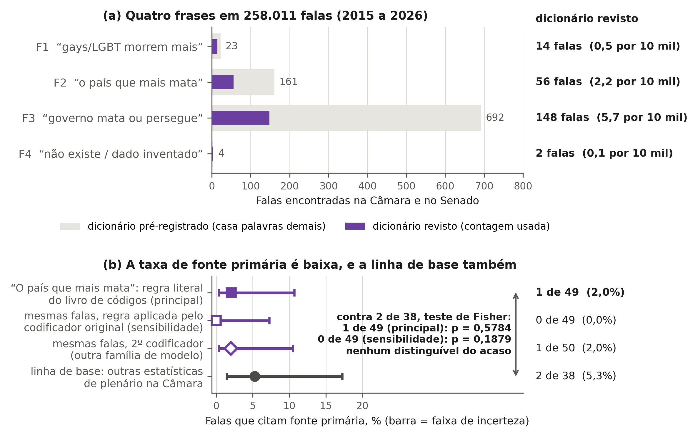

*Nota.* No painel (a), as barras mostram quantas falas contêm cada frase com o dicionário pré-registrado (barra clara) e com o dicionário revisto (barra escura, contagem usada; desvio declarado no Apêndice B). No painel (b), o ponto é a proporção de falas que citam documento oficial ou estudo com autor e ano, e a barra, o IC95% de Wilson. Pela regra literal do livro de códigos (análise principal), 1 de 49; pela regra aplicada pelo codificador original (sensibilidade), 0 de 49; linha de base, 2 de 38. Nenhuma diferença se distingue do acaso (teste exato de Fisher: p = 0,58 e p = 0,19). Fonte: Câmara dos Deputados (2026) e Senado Federal (2026); codificação do autor (este estudo).

O segundo codificador, de outra família de modelo e cego aos rótulos, concorda com o original na família F2 no Parlamento (κ de postura 0,73, IC95% 0,46 a 0,92; κ de fonte 0,66, 0,31 a 0,93) e, entre as 50 falas que ele classificou como afirmação, encontra 1 com fonte primária, o mesmo relatório que a regra literal classifica como primária. A linha de base não mostra diferença distinguível entre temas na falta de fonte: de 60 falas da Câmara sorteadas entre as que trazem estatística fora dos quatro temas, 22 ficaram fora do critério, e nas 38 com estatística afirmada, 2 (5%; intervalo de Wilson de 1,5% a 17%) citam fonte primária com nome e ano. A diferença para 1 de 49 (teste exato de Fisher, p = 0,58) e para 0 de 49 (p = 0,19) não se distingue do acaso, e com n pequeno isso não prova equivalência; só a comparação 1 de 50 contra 2 de 38 (p = 0,58) usa o mesmo codificador nos dois lados (Tabela J2). Na família F3, o κ de postura é 0,43, e, por regra escrita antes, os percentuais dessa família e os de fora do Parlamento (κ de fonte 0,47) são indicativos (Tabela B3). Na imprensa, só o título foi codificado, e a contagem do agregador de notícias é número mínimo sem série temporal; a série que serviria para tendência ficou inacessível por recusa persistente do servidor (resposta HTTP 429, excesso de pedidos), e um controle positivo vazio foi registrado como falha, e não como zero (este estudo).

**Tabela J1**

*Amostra codificada de discurso: quem afirma, quem rebate e quem cita fonte*

| família | universo | N | amostra | afirma+atribui | N estimado [IC95] | rebate | primária | cita GGB/ANTRA/TGEU/ONU |
|---|---|---|---|---|---|---|---|---|
| F1 | Parlamento | 14 | 14 (censo) | 14 | 14 | 0 | 0/14 | 0/14 |
| F1 | imprensa pt (título) | 145 | 60 | 2 | 5 [1-16] | 0 | 0/2 | 0/2 |
| F1 | imprensa mundo (título) | 691 | 60 | 5 | 58 [25-125] | 1 | 1/5 | 0/5 |
| F1 | OpenAlex | 5535 | 60 | 4 | 369 [145-881] | 0 | 4/4 (o próprio estudo) | 0/4 |
| F2 | Parlamento | 56 | 56 (censo) | 49 | 49 | 2 | 0/49 | 7/49 |
| F2 | imprensa pt (título) | 1005 | 60 | 13 | 218 [132-338] | 1 | 0/13 | 0/13 |
| F2 | imprensa mundo (título) | 164 | 60 | 8 | 22 [11-40] | 0 | 0/8 | 1/8 |
| F2 | OpenAlex | 270 | 60 | 11 | 50 [29-81] | 0 | 0/11 | 7/11 |
| F2 | Wikipédia | 9 | 9 (censo) | 9 | 9 | 0 | 0/9 | 0/9 |
| F3 | Parlamento | 148 | 60 | 33 | 81 [63-99] | 10 | 0/33 | 0/33 |
| F3 | imprensa pt (título) | 566 | 60 | 0 | 0 [0-34] | 0 | n/a | n/a |
| F3 | imprensa mundo (título) | 361 | 60 | 7 | 42 [21-80] | 0 | 0/7 | 0/7 |
| F3 | OpenAlex | 622 | 60 | 5 | 52 [22-112] | 0 | 1/5 | 0/5 |
| F3 | Wikipédia | 197 | 60 | 1 | 3 [1-17] | 1 | 0/1 | 0/1 |
| F4 | Parlamento | 2 | 2 (censo) | 2 | 2 | 0 | 0/2 | 0/2 |
| F4 | imprensa pt (título) | 140 | 60 | 3 | 7 [2-19] | 2 | 0/3 | 0/3 |
| F4 | OpenAlex / imprensa mundo | 369 / 10 | 60 / 10 | 0 / 0 | 0 [0-22] / 0 | 0 | n/a | n/a |

*Nota.* Valores copiados sem alteração do arquivo docs/laudos/MIDIA.md do repositório, com vírgula decimal. Fonte: este estudo.

**Tabela J2**

*Parlamento: fonte nomeada e fonte primária nas duas regras de codificação, com teste exato de Fisher*

| variável | codificação das falas F2 | F2 | linha de base | mesmo codificador | p (Fisher) |
|---|---|---|---|---|---|
| fonte primária | original, regra aplicada (relatório tratado como ONG) | 0/49 | 2/38 | não | 0,1879 |
| fonte primária | original, regra literal do livro de códigos (nome + ano) | 1/49 | 2/38 | não | 0,5784 |
| fonte primária | segundo codificador (modelo de outra família) | 1/50 | 2/38 | sim | 0,5758 |
| fonte nomeada (qualquer fonte) | original | 8/49 | 3/38 | não | 0,3350 |
| fonte nomeada (qualquer fonte) | segundo codificador (modelo de outra família) | 5/50 | 3/38 | sim | 1,0000 |

*Nota.* Valores copiados sem alteração do arquivo research-2026-10-21-rodada3/escrutinio/simetria/r7_parlamento_sensibilidade.csv do repositório, com vírgula decimal. Fonte: este estudo.

<!-- apendice-a:fim -->

## Apêndice K — Poder estatístico e dimensionamento de uma pesquisa de vitimização

### Poder estatístico e dimensionamento de um levantamento de vitimização

Para saber se a violência não letal contra pessoas LGB+ sobe ou desce, é preciso perguntar a uma amostra de adultos, repetidamente, se sofreram violência; um levantamento repetido de vitimização com pergunta de orientação sexual fornece essa restrição externa sobre o registro, ao passo que a mortalidade requer desenho próprio, com orientação identificada e denominador compatível (Home Office, 2025; ONS, 2026a). O efeito de desenho medido no microdado da PNS de 2019 para violência física entre LGB+ é 5,1 (bootstrap de 500 réplicas, 2,6 a 6,4), e o cálculo por amostragem aleatória simples subestima o tamanho necessário nessa proporção (IBGE, 2022a; este estudo). Com esse efeito, num teste de duas proporções com nível de significância de 5% bilateral e poder de 80%, detectar um aumento de 30% entre rodadas exige cerca de 5.787 adultos LGB+ por rodada, ou 305.955 adultos triados (5.786,3 LGB+ divididos pela prevalência não arredondada, de 1,8912%, com arredondamento único no fim); a PNS de 2019, com 88.531 adultos e 1.554 LGB+ entrevistados, teria 80% de poder só para aumento relativo de 60,7% ou mais na violência física (Figura K1). O cálculo combina a prevalência ponderada (1,89%) com o efeito de desenho da PNS; se a fração não ponderada de LGB+ da PNS (1,76% dos entrevistados) se repetir num desenho igual, o número de adultos a contatar sobe para cerca de 330 mil (329.644). Num desenho domiciliar sem informação prévia sobre quem mora em cada endereço, a sobreamostra não reduz esse número, porque encontrar os mesmos adultos LGB+ exige contatar os mesmos domicílios; cadastros auxiliares ou seleção dirigida de domicílios poderiam reduzi-lo, possibilidade não avaliada aqui.

**Figura K1**

*Aumento relativo detectável com 80% de poder na violência física contra adultos LGB+ entre duas rodadas, segundo o número de adultos triados*

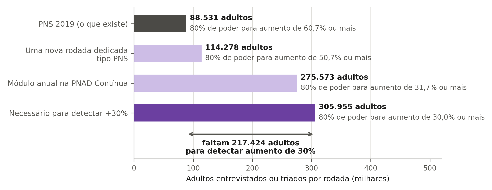

*Nota.* Cada barra é o número de adultos entrevistados em cada desenho, e o texto ao lado, o menor aumento relativo na violência física entre duas rodadas que esse tamanho detecta com 80% de poder. A PNS de 2019 detecta, com 80% de poder, aumentos de cerca de 61%; para detectar 30%, seriam necessários cerca de 306 mil adultos triados, porque só uma pequena fração dos adultos é LGB+ e a amostra é sorteada por conglomerados, com pesos desiguais. Fonte: IBGE (2022a); cálculo do autor (este estudo).

A Tabela K1 compara três desenhos. Todos supõem, por falta de medida própria, um efeito de desenho igual ao da PNS de 2019, suposição que, por hipótese não testada, superestima o tamanho necessário para o painel por endereços, e os custos são cenários calculados a partir de documentos públicos, e não orçamentos (Ministério da Justiça e Segurança Pública & IBGE, 2021; Ministério da Saúde & IBGE, 2023). O custo de referência do módulo anual na Pesquisa Nacional por Amostra de Domicílios Contínua (PNAD Contínua), R$ 6,85 milhões, vem do plano de trabalho oficial dos módulos de vitimização e segurança dessa pesquisa contratados em 2021 (valor total de R$ 3.596.904 para um trimestre de coleta): soma o custo de tecnologia da informação, pago uma vez, ao custo variável por domicílio visitado (diárias, combustível e passagens) multiplicado pelos 337,6 mil domicílios do desenho, com valores atualizados pelo Índice Nacional de Preços ao Consumidor Amplo (IPCA) até setembro de 2026 (Ministério da Justiça e Segurança Pública & IBGE, 2021; IBGE, 2026). A Pesquisa Nacional de Demografia e Saúde de 2023 perguntou orientação sexual e identidade de gênero em 133 mil domicílios (IBGE, 2023) e não havia publicado os resultados até 11 de outubro de 2026, data da última consulta.

**Tabela K1**

*Capacidade e custo de um ciclo de três desenhos de levantamento de vitimização (R$ de 2026; o painel pela internet é um contrato britânico convertido pelo câmbio de 20 de outubro de 2026)*

| Desenho | Adultos | LGB+ | Aumento relativo detectável com 80% de poder (física / qualquer) | Custo de referência |
|---|---|---|---|---|
| Módulo anual na PNAD Contínua | 275.573 | 5.212 | 31,7% / 12,2% | R$ 6,85 milhões |
| Rodada dedicada semelhante à PNS | 114.278 | 2.161 | 50,7% / 19,0% | R$ 29,0 milhões |
| Painel ou levantamento probabilístico pela internet | 114.278 | 2.161 | 50,7% / 19,0% | R$ 42,0 milhões |

*Nota.* Custos marginais ao financiador, sem a folha permanente do instituto. O custo de referência é o cenário com o precedente de preço mais próximo; as faixas (R$ 6,85 a 69,9, 25,3 a 32,7 e 42,0 a 89,1 milhões) acrescentam cenários mais caros: o teto do módulo supõe visita própria ao custo por domicílio da PNS, e o do painel, o preço por entrevista de um levantamento presencial estrangeiro. O valor de referência da rodada dedicada divide o valor global da minuta de plano de trabalho da PNS (R$ 22,29 milhões) pelo número de domicílios. Fonte: Ministério da Justiça e Segurança Pública e IBGE (2021), Ministério da Saúde e IBGE (2023), IBGE (2026), Gambling Commission (2025) e Banco Central do Brasil (2026); cálculo do autor (este estudo).

### A fração LGB+ de cada modo de preenchimento

A Tabela 6 do artigo usa a fração de adultos que se declarou LGB+ na PNS de 2019 inteira, 1,89%. Essa fração muda com quem preenche o módulo de violência. A Tabela K2 refaz a capacidade dos três desenhos com a fração de cada modo, calculada sobre todos os adultos do modo, inclusive quem não declarou orientação. O efeito de desenho, a prevalência de base e o custo de cada desenho ficam os da Tabela 6.

**Tabela K2**

*Capacidade de um ciclo dos três desenhos segundo a fração LGB+ de cada modo de preenchimento*

| Desenho | Fração LGB+ entre os adultos | LGB+ | Aumento relativo detectável (física / qualquer) |
|---|---|---|---|
| Módulo anual na PNAD Contínua | 1,89% (todos os modos) | 5.212 | 31,7% / 12,2% |
| Módulo anual na PNAD Contínua | 1,35% (com entrevistador) | 3.723 | 37,9% / 14,4% |
| Módulo anual na PNAD Contínua | 3,26% (com autopreenchimento) | 8.976 | 23,8% / 9,3% |
| Rodada dedicada semelhante à PNS | 1,89% (todos os modos) | 2.161 | 50,7% / 19,0% |
| Rodada dedicada semelhante à PNS | 1,35% (com entrevistador) | 1.544 | 60,9% / 22,5% |
| Rodada dedicada semelhante à PNS | 3,26% (com autopreenchimento) | 3.722 | 37,9% / 14,4% |
| Painel ou levantamento probabilístico pela internet | 1,89% (todos os modos) | 2.161 | 50,7% / 19,0% |
| Painel ou levantamento probabilístico pela internet | 3,26% (com autopreenchimento) | 3.722 | 37,9% / 14,4% |

*Nota.* Aumento relativo detectável com 80% de poder, teste bilateral a 5% e rodadas independentes. Entre quem declarou orientação heterossexual ou LGB+, as frações são de 1,38% com entrevistador e de 3,51% com autopreenchimento (Apêndice C); aqui o denominador são todos os adultos do modo, como na Tabela 6. A diferença entre os modos pode vir de quem respondeu em cada um, e não só do modo. Além do cenário de referência (1,89%), o painel pela internet aparece só com a fração de autopreenchimento, porque não tem entrevistador; o arquivo de origem traz também a linha do painel com entrevistador, cenário hipotético que a tabela não usa. Fonte: IBGE (2022a), microdados da PNS 2019; cálculo do autor (este estudo), arquivo research-2026-10-21-rodada3/F2-custos/opcoes_por_modo.csv do repositório.

## Apêndice L — Falsas alegações, retratação e sistemas de medida em outros países

### Falsas alegações e retratação

A literatura separa três fenômenos que o debate mistura: alegação provadamente falsa, alegação não substanciada e retratação. Para denúncias de agressão sexual de adultos à polícia, em outros países, a meta-análise de Ferguson e Malouff (2016) estima 5,2% de alegações provadamente falsas (IC95% 3,0 a 8,9) com definição estrita, a partir de estudos que vão de 2,0% a 13,7%, com heterogeneidade alta (I² próximo de 95%); a estimativa só se reproduz com o valor da tabela do próprio artigo para um dos estudos (13,7%), que diverge do texto (4,5%; Ferguson & Malouff, 2016, Tabela 1 e p. 1189). Retratação é comum: em violência por parceiro íntimo denunciada à polícia, 21,6% das vítimas retiraram formalmente a queixa e 26,7% se desengajaram do processo, e, nos casos com motivo registrado, o mais frequente foi a reconciliação (Sleath & Smith, 2017). Essas estimativas tratam de outras populações e procedimentos e não estimam alegações falsas de LGBTfobia no Brasil; nenhuma medida nacional dos três fenômenos foi localizada em PubMed, Crossref, buscas gerais em três idiomas e fontes oficiais. A Lei nº 15.380/2026 alterou a audiência de retratação da Lei Maria da Penha, quebra datada que qualquer série futura terá de modelar (Brasil, 2026).

### Sistemas de medida em outros países

Inglaterra e País de Gales e a Nova Zelândia medem a motivação percebida em levantamento probabilístico de vitimização. Na Inglaterra e no País de Gales, o levantamento estima 176.000 incidentes de ódio por ano, dos quais 44% chegam à polícia, enquanto o registro policial conta 137.550 crimes de ódio, 18.702 por orientação sexual e 3.809 por transfobia, no ano encerrado em março de 2025 (Home Office, 2025). No Canadá, a polícia registrou 4.882 crimes de ódio em 2024, 11,9 por 100 mil habitantes, com cobertura acima de 99% (Statistics Canada, 2026). Na Nova Zelândia, o levantamento de 8.008 entrevistas mede 38% de adultos LGBTQ+ vítimas de ao menos uma ofensa, contra 28% na média (Ministry of Justice, 2025). Na União Europeia, o levantamento sobre pessoas LGBTIQ da Agência da União Europeia para os Direitos Fundamentais, com 100.577 respondentes de uma amostra não probabilística pela internet, mede de 13% a 14% de respondentes atacados em cinco anos (FRA, 2024), e 46 Estados da Organização para a Segurança e Cooperação na Europa enviam ao seu escritório de direitos humanos dado oficial de crime de ódio (Office for Democratic Institutions and Human Rights [ODIHR], 2025). Onde se audita, o registro policial de motivação é frouxo: na Alemanha, só 17,6% dos relatórios policiais auditados explicitam o motivo, segundo estudo do instituto de criminologia da Baixa Saxônia publicado em livro (Henningsmeier et al., 2025, p. 99), e o levantamento nacional da polícia criminal federal mede taxa de denúncia de 2,6% para violência por orientação sexual (Bundeskriminalamt, 2026). O Brasil difere por não ter levantamento regular de vitimização nem pesquisa oficial dedicada à população LGBT+, porque a PNS de 2019 mediu orientação sexual uma única vez, num módulo de saúde e sem identidade de gênero (IBGE, 2022b). Em contrapartida, um campo obrigatório de motivação no registro de saúde como o do Sinan não foi localizado em nenhum outro país do inventário consultado, de 47 fontes oficiais das Américas, da Europa, da Ásia, da África e da Oceania, e sua fragilidade é a completude (DATASUS, 2026b; este estudo).

## Apêndice M — Reprodutibilidade e localização de cada resultado no repositório

### Reprodutibilidade

O repositório público é a referência primária deste estudo, e o artigo deriva dele (este estudo; https://github.com/ulissesflores/lgbt-indicador-violencia). O repositório reúne os dados derivados, o código, os pré-registros com suas impressões digitais, os relatórios da revisão adversarial e os testes que travam os números publicados. A integridade do conjunto é verificada por um selo de proveniência, uma cadeia de hashes calculada a partir do SHA-256 de cada arquivo distribuído do repositório, exceto o artigo, seu PDF e as ferramentas que o constroem, que muda se qualquer um desses arquivos mudar e que se confere com um único comando (Tabela M1). Os textos deste material herdam da versão 0.4.4 do repositório, cujo selo era d1d2e4d77e2be87486b635c230d2e88025b6ac87888682e89f4dcf87942b215b, calculado sobre 724 arquivos. O selo da versão atual muda a cada alteração dos arquivos selados; ele está em output/hash-chain.md e se confere com python3 -I make_provenance.py --verify. O PDF do artigo não integra o conjunto selado; sua impressão digital SHA-256 é publicada em arquivo próprio do repositório, de modo que o leitor pode conferir que o PDF lido é o derivado da versão analisada. O selo verifica que os arquivos são os mesmos; não verifica, sozinho, quando foram escritos.

A reprodução tem duas trilhas (este estudo). A trilha leve recalcula, em cerca de seis minutos, os números das etapas listadas na matriz de reprodução do repositório; os demais, como o dimensionamento do Apêndice K, são conferidos por teste. A trilha pesada parte do microdado oficial e foi exercida de ponta a ponta para a PNS de 2019, cujo arquivo foi baixado do IBGE com SHA-256 conferido e reproduziu quatro derivados byte a byte (IBGE, 2022a); os agregados do SIM e do Sinan não foram reexecutados a partir do bruto (DATASUS, 2026a, 2026b). As tabelas do Apêndice C são copiadas por script dos arquivos do repositório, sem número digitado, e as figuras são geradas com saída determinística, conferida por testes que comparam os valores desenhados com os arquivos de origem e reprovam quando um valor plotado é alterado, controle negativo exercido.

Não são redistribuídos os microdados brutos do SIM, do Sinan, da PNS, do TSE e do Disque 100, que são arquivos oficiais grandes, baixáveis por scripts de aquisição com SHA-256 esperado (DATASUS, 2026a, 2026b; IBGE, 2022a; TSE, 2026; MDHC, 2026); textos de terceiros, por direitos autorais, dos quais o repositório guarda endereço, data de acesso e, quando o arquivo foi salvo, SHA-256; e listas nominais de vítimas, por privacidade, razão pela qual a ligação entre caso e fonte na validação da contagem do GGB de 2019 não é reproduzível publicamente (GGB, 2020). O inventário completo de fontes e scripts, o índice do que o repositório contém e o histórico de revisões do texto estão no próprio repositório (Tabela M1).

### Localização dos resultados e dos elementos de verificação no repositório

**Tabela M1**

*Caminho, no repositório público, de cada resultado e de cada elemento de verificação desta versão*

| Resultado ou elemento | Seção, tabela ou figura | Caminho no repositório |
|---|---|---|
| Selo de proveniência e sua conferência | seção 2.4 | output/hash-chain.md; output/provenance.json; comando python3 make_provenance.py --verify; runs/ (registro de cada execução selada, com o ambiente) |
| PDF e DOCX do artigo e sua impressão digital | todo o artigo | docs/paper/paper-final.pdf; docs/paper/paper-final.docx; paper/PAPER-SHA256.txt |
| Texto-fonte desta versão | todo o artigo | paper/v05/MANUSCRITO.md; paper/v05/MATERIAL-COMPLEMENTAR.md; paper/v05/referencias.md; paper/v05/QUADRO-E2.md; paper/v05/mapa-apendices.json (rótulos antigos dos apêndices) |
| Figuras, valores desenhados e textos das figuras | Figuras 1 a 8; figuras dos Apêndices C a K | paper/v05/figures/; paper/figures/ (make_figures.py, valores_plotados.json, textos_fora_da_imagem.json, fontes/SOURCES.tsv); dados/exposicao/fig_caminho_v05.py; dados/pns/fig_pns_v05.py; dados/pns/fig_agressor_pns2019.py; dados/disque100/fig_disque_v05.py; dados/exposicao/fig_series_por_governo.py |
| Testes que travam os números publicados | seção 2.4 | tests/ (os números novos desta versão em tests/test_numeros_v05.py); paper/tests/ |
| Vitimização não letal e quem agrediu (PNS) | seção 3.1; Tabela 3; Tabelas C1 a C12 | dados/pns/ |
| Fichas de saúde e concordância com boletins | seção 3.2; Figura 6 | dados/sinan/; dados/concordancia/ |
| Disque 100 | seção 3.2; Figura 4; Figura D5 | dados/disque100/ |
| Identificabilidade e dimensionamento de um levantamento | seções 2.3 e 6; Figura 5; Tabela 6; Tabelas K1 e K2 | simulacao/; research-2026-10-21-rodada3/F2-custos/ |
| Taxas padronizadas do SIM e séries por período de governo | seções 3.3 e 3.6; Figura 8; Tabelas E2 a E4; Tabelas G2, G6 e G7 | dados/sim/; dados/exposicao/ |
| Mortalidade fora do Brasil | seção 3.4; Tabela E1; Figura E1 | paper/figures/fontes/estudos_mortalidade.tsv; docs/laudos/MORTALIDADE.md |
| Lista do GGB: conferência de 2019, concordância, escala e checagens críticas | seção 3.5; Figura 7; Tabelas F1 a F4 | dados/ggb/; paper/figures/fontes/ggb_validacao_resumo.json; research-2026-10-21-rodada3/F3-ggb/; research-2026-10-30-contraponto/ |
| Painel de governadores, estudo de eventos e troca de presidente | seção 3.6; Tabelas G1 e G3 a G9 | dados/painel/; dados/ideologia/; dados/presidencia/ |
| Busca simétrica de atos de governo | seções 1 e 3.7; Tabela H1 | research-2026-10-21-rodada3/escrutinio/simetria/ |
| Violência de Estado em regimes de tipos distintos | seção 3.7; Tabela 5; Tabela I1 | dados/regimes/ (relatório, registro de 53 fontes com trechos e escrutínio externo) |
| Circulação no Parlamento e na imprensa | seção 3.7; Tabelas J1 e J2 | docs/laudos/MIDIA.md; research-2026-10-21-rodada3/discurso/; research-2026-10-21-rodada3/escrutinio/simetria/ |
| Pré-registros e adendos | seção 2.4; Tabelas B3 e B4 | docs/PRE-REGISTROS/; research-2026-10-21-rodada3/escrutinio/reanalise/; research-2026-10-21-rodada3/escrutinio/simetria/; dados/painel/R6-PREREGISTRO-FORMA.md; dados/presidencia/; dados/exposicao/ |
| Revisão desta versão por três modelos de linguagem: pareceres e respostas | seção 2.6 | paper/v05/revisao/ (pareceres e matriz de respostas de cada rodada) |
| Processo: quem fez cada parte, rodadas de verificação, uso de modelos, tempo e fontes consultadas | seção 2.6 | docs/processo-e-custo.md |
| Inventário de fontes e scripts | seção 2.5 | manifest/INVENTARIO-PUBLICO.md; manifest/MANIFESTO-FONTES.csv |
| Aquisição dos microdados oficiais | seção 2.4 | scripts/ (scripts de aquisição com SHA-256 esperado) |
| Versões anteriores, seus exames e o histórico de correções | — | paper/paper.md e paper/build/v04/paper-v04.pdf (versão 0.4.4); paper/AUDIT.md; paper/build/juiz/ (vereditos das rodadas v4); docs/revisao/; research-2026-10-21-rodada3/escrutinio/; docs/historico-de-correcoes.md; CHANGELOG.md |

*Nota.* Caminhos relativos à raiz do repositório https://github.com/ulissesflores/lgbt-indicador-violencia. Fonte: este estudo.
